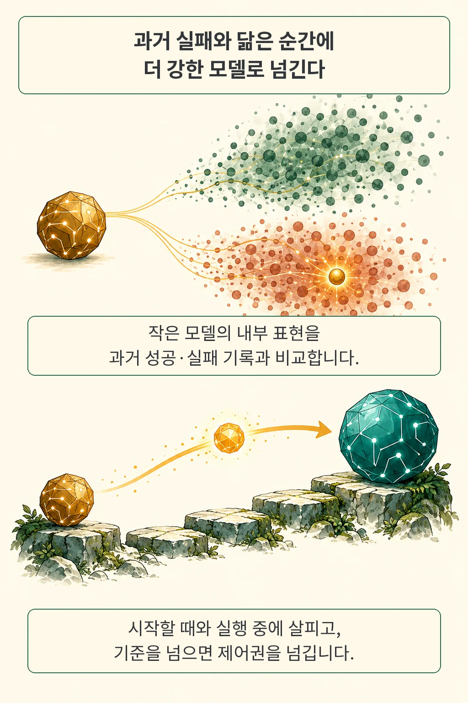

에이전트가 작업 도중 막히면 더 강한 모델로 제어권을 넘기면 된다고 생각하기 쉽습니다. 그런데 넘겨받은 큰 모델도 똑같은 메뉴를 반복해서 클릭한다면, 단순히 모델을 갈아끼우는 것만으로는 문제가 해결되지 않습니다. **LEASH는 작은 모델이 전환 시점을 고르고, 제어권을 넘긴 뒤에도 관찰자(Shadow)로 남아 큰 모델의 재판단을 요청하는 프레임워크**입니다.

글·해설: 다메카솔

## 핵심 내용

- **언제 넘길까**: 작은 모델의 내부 표현 벡터를 과거 성공·실패 실행 분포와 비교해, 작업 시작 시점과 실행 도중에 더 강한 모델이 필요한 순간을 포착합니다.
- **넘긴 뒤에는**: 작은 모델이 관찰자로 전환되어 화면과 실행 이력을 따라가며 불확실성 신호를 계산하고, 위험 신호가 높으면 큰 모델이 아직 실행하지 않은 대기 행동을 취소하고 재판단을 요청합니다.
- **어디까지 확인됐나**: OSWorld(262개 과제, 50행동 예산)에서 Qwen3.5-35B-A3B + Claude Opus 5 조합은 성공률 73.66%·과제당 토큰 환산 비용 0.4117달러를 기록해, 항상 Opus 5만 쓰는 구성(72.90%·0.5094달러)보다 비용을 약 19% 낮췄습니다.

직접 실행을 완수하기에는 역량이 부족한 작은 모델이라도, 지금의 작업 흐름이 과거의 실패 패턴과 닮았는지 감지하는 관찰자로는 유용하게 쓸 수 있다는 발상이 흥미롭습니다. 이 신호를 어떻게 계산하고 어디까지 신뢰할 수 있는지 구체적인 작동 방식을 살펴보겠습니다.

## 실패와 닮은 순간을 어떻게 찾을까

LEASH는 모델이 텍스트로 답하는 자기 확신 점수 대신 **모델 마지막 층의 내부 표현 벡터**를 사용합니다. 먼저 작은 모델로 별도의 참조 과제들을 실행해, 첫 입력(과제 전체 성패 연결)과 각 행동 생성 시점(하위 목표 성패 연결)의 내부 표현을 성공 집단과 실패 집단으로 나누어 모아 둡니다.

실제 작업에서 새로운 내부 표현이 들어오면 마할라노비스 거리(벡터 성분들이 함께 움직이는 공분산까지 반영하는 거리)를 사용해 성공 집단과 실패 집단 중 어느 쪽에 가까운지 비교합니다. 실패 쪽에 상대적으로 가까울수록 높은 점수를 주며, 이 점수는 보정된 실패 확률(퍼센트)이 아니라 **모델 전환 우선순위를 정하는 신호**로 쓰입니다. ([원문 §3.2–3.3](https://arxiv.org/html/2610.22280v1#S3.SS2))

| 관찰 시점 | 살펴보는 것 | 기준을 넘으면 |
| --- | --- | --- |
| 작업 시작 | 요청과 첫 화면을 받은 내부 표현 | 초기에 큰 모델로 전환 |
| 작은 모델 실행 중 | 행동을 생성한 뒤의 내부 표현 | 현재 상태와 최근 이력을 넘김 |

큰 모델이 한 번 이어받으면 남은 행동 예산 안에서 작업 종료까지 제어권을 유지합니다. 이때 업무를 하위 목표로 나누고 진척을 확인하는 **Manager 역할에는 처음부터 강한 모델을 사용**하므로, 작은 모델이 클릭을 맡는 구간에서도 전체 시스템 차원에서는 큰 모델 호출이 함께 일어납니다.

논문이 말하는 ‘학습 없는(training-free)’ 방식은 신경망 가중치를 경사하강법으로 추가 미세조정하지 않는다는 뜻입니다. 참조 실행 데이터를 수집해 평균·공분산 행렬과 임계값을 맞추는 사전 보정 작업은 필요하므로, 도입 비용을 따질 때는 이 초기 데이터 수집과 운영 중 호출 비용을 함께 고려해야 합니다.

## 넘겨받은 큰 모델은 누가 살필까

제어권을 넘긴 작은 모델은 실행자에서 관찰자(Shadow)로 역할을 바꿉니다. 큰 모델이 실제로 수행한 행동을 자신의 이력에 그대로 기록하면서, 현재 화면에서 자신이라면 어떤 행동을 할지 내부적으로 생성해 보고 그때의 내부 표현 벡터를 실패 참조 분포와 비교합니다. 작은 모델이 만든 후보 행동을 실제로 실행하거나 큰 모델에게 따라 하라고 건네지는 않습니다.

부록의 실행 절차에 따르면 전환 직후 첫 단계와 이후 세 단계마다 이 관찰을 수행합니다. 불확실성 점수가 임계값을 넘으면, **큰 모델이 방금 생성했지만 아직 환경에 실행하지 않은 대기 행동을 대화에서 지우고** 현재 접근이 진전되고 있는지 더 높은 추론 노력으로 다시 판단하도록 요청합니다. ([원문 §3.4·부록 A.4](https://arxiv.org/html/2610.22280v1#S3.SS4))

여기서 되돌리는 대상은 아직 실행되기 전의 대기 행동뿐이며, 이미 발송된 이메일을 회수하거나 변경된 외부 파일을 복원하는 기능은 아닙니다. 또한 작은 모델이 직접 실행할 때는 이미 계산된 내부 표현을 그대로 재사용하지만, 초기 확인과 전환 후 Shadow 관찰에는 작은 모델의 추가 추론이 들어가고 재판단 요청 시에는 큰 모델의 연산이 더 소모됩니다(이 호출들은 논문의 총 추론 비용에 모두 합산돼 있습니다).

모델 간에 작업을 넘길 때 맥락을 어떻게 이어 줄지는 [CarryOn의 작업물 중심 기록](/posts/carryon-object-context/)과도 맞닿아 있는 주제인데, LEASH는 무엇을 넘길지에 더해 **넘긴 뒤에도 누가 옆에서 제동을 걸지**를 아키텍처에 포함시켰습니다.

## 성공률과 비용을 함께 읽으면

OSWorld의 262개 평가 과제(과제당 최대 50행동 예산)에서 Qwen3.5-35B-A3B와 Claude Opus 5를 조합한 주요 실험 결과는 아래 표와 같습니다. ([원문 표 1·부록 B.1·B.4](https://arxiv.org/html/2610.22280v1#A2.SS1))

| 구성 | 큰 모델로 넘긴 과제 비율 | 성공률 | 과제당 추론 비용 추정치 |
| --- | ---: | ---: | ---: |
| Qwen3.5 기반 임의 전환 | 64.4% | 61.72% | $0.3768 |
| Qwen3.5 기반 LEASH | 64.1% | 73.66% | $0.4117 |
| 항상 Claude Opus 5 | 100.0% | 72.90% | $0.5094 |

*원문 표 1 요약. 임의 전환의 성공률은 10,000회 무작위 과제 배정의 평균이며, 항상 Opus 5를 쓰는 비교 구성에는 별도 Manager가 없습니다.*

표에서 눈여겨볼 지점은 세 가지입니다.

- **전환 시점 선택의 효과**: 큰 모델로 넘긴 과제 비율이 약 64%로 비슷해도, 무작위 전환(61.72%)과 LEASH(73.66%)는 성공률에서 11.94%p 차이를 보였습니다.
- **단독 대형 모델과의 비교**: 항상 Opus 5만 쓰는 구성(72.90%)과 비슷한 수준의 성공률을 유지하면서 토큰 환산 비용을 과제당 0.5094달러에서 0.4117달러로 낮췄습니다(0.76%p 성공률 차이는 별도 통계 검정 결론이 아닌 해당 설정의 관찰값입니다).
- **비용 산정 범위**: 표의 비용은 작은 모델·Manager·큰 실행 모델·Shadow 감시 호출의 토큰 사용량(캐시 반영)에 OpenRouter 참고 단가를 곱한 추정치이며, 자체 GPU 서버 유지비나 인프라 총운영비(TCO)를 실측한 값은 아닙니다.

## 관찰을 붙인 효과와 해석의 경계

세부 구성별 절제(ablation) 실험과 검증 설계도 함께 살펴볼 필요가 있습니다. ([원문 표 4·한계·부록 B.3](https://arxiv.org/html/2610.22280v1#A2.SS3))

- **Shadow 관찰 유무와 인과 분리 한계**: Qwen3.5 설정에서 Manager와 전환만 썼을 때는 67.94%(0.4050달러), Shadow와 재판단까지 켰을 때는 73.66%(0.4117달러)였습니다. 다만 저자들은 결론의 한계 절에서 현재 평가가 전환 후 개입만의 순수한 인과 효과를 완전히 분리해 입증하지는 못했다고 명시했습니다.
- **초기 전환 추가 시의 예외**: 부록 B.3에서 실행 중 전환만 켠 구성은 성공률이 71.65%였는데, 초기 전환까지 추가하되 Shadow를 끈 구성은 67.94%로 오히려 낮아져 모든 구성 요소를 단순 합산할수록 무조건 좋아지는 것은 아님을 보여 줍니다.
- **참조 분포 분리와 적용 한계**: 같은 과제의 화면 이력이 참조 풀과 평가 풀에 섞이지 않도록 99개 참조 과제에서 과제 단위 묶음(task-grouped) 10분할 교차검증을 사용했습니다. 다만 이 신호는 작은 모델의 실패 위험을 감지하는 장치이므로 두 모델 모두 처음 보는 낯선 앱에서 막히면 개선 폭이 제한되며, 논문의 이론적 최적성 정리 역시 분포 가정 아래 **작업 시작 시점의 전환**만을 다룹니다.

## 다메카솔의 해석: 모델 전환 뒤에도 실행 규칙은 남아야 합니다

이 연구에서 실무적으로 가져올 만한 핵심 원칙은 **모델 라우팅과 실행 중 감시를 한 묶음으로 설계한다는 점**입니다. 어려운 과제를 큰 모델로 넘긴 뒤에는 그 모델의 판단에 전적으로 맡겨 두기 쉬운데, 상대적으로 가벼운 관찰자를 옆에 남겨 두면 루프에 빠졌을 때 제동을 걸 통로가 생깁니다.

물론 불확실성 신호가 명시적인 보안·권한 규칙을 대신할 수는 없습니다. 실패와 닮은 내부 표현 신호는 막힌 경로를 다시 생각하게 만드는 힌트일 뿐이므로, 외부 발송 대상이 허용된 주소인지나 수정할 파일이 작업 범위 안에 있는지는 모델 크기와 무관하게 결정론적 정책으로 검사해야 합니다. 또한 LEASH처럼 실행 전 대기 행동을 고치는 재판단과 달리, 이미 외부 API를 호출한 뒤의 재시도에는 멱등성 키(idempotency key)와 결과 조회 장치가 필수적이며, 최종적으로는 [FDE-Gym이 묻는 고객 성과](/posts/fde-gym-customer-outcomes/)처럼 실제 업무 목표 달성 여부를 별도로 검증해야 합니다.

실제 서비스에서 라우팅 실험을 설계한다면 동일한 업무 집합 위에 **항상 큰 모델 단독, 전환만 적용한 구성, 전환과 관찰을 함께 켠 구성** 세 가지를 나란히 두고, 과제 성공률과 함께 감시·재판단에 쓰인 추가 토큰 비용과 응답 지연 시간을 함께 비교해 보겠습니다.

## 원문과 공개 범위

- [LEASH v1 메타데이터](https://arxiv.org/abs/2610.22280v1), [원문 PDF](https://arxiv.org/pdf/2610.22280v1), [HTML](https://arxiv.org/html/2610.22280v1) — Qingni Wang 등 Simular·위스콘신대학교 매디슨 연구진, 2026년 10월 15일 제출 프리프린트(방법 §3, 결과 표 1·4, 한계, 부록 A.2–A.4·B.1–B.4 대조).
- [Simular 연구팀: Put the Frontier Model on a Leash](https://www.simular.ai/articles/put-the-frontier-model-on-a-leash) — 2026년 10월 16일 공개된 저자 소속 기관 설명 글(논문 수정일로 합산하지 않음).
- 2026년 10월 17일 기준 원문·메타데이터·설명 글에서 LEASH 전용 코드와 데이터의 공개 링크는 확인되지 않았으며(일반 Agent-S 저장소 링크만 존재), OSWorld 모델 실행은 독립 재현하지 않았습니다.

업데이트: 2026-10-17

이 글의 본문과 이미지는 생성형 AI로 제작했습니다. 기획과 편집 기준은 다메카솔이 정했습니다.
