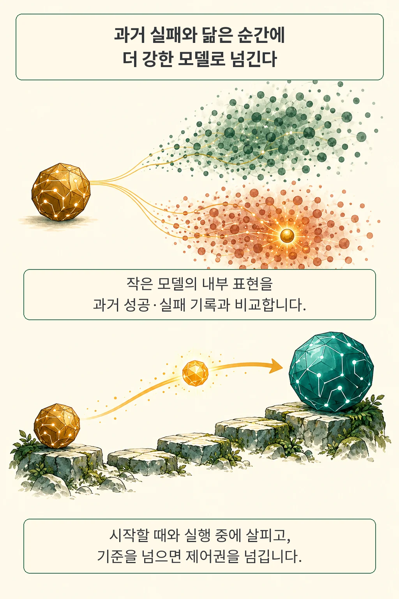

에이전트가 작업 도중 막히면 더 강한 모델로 제어권을 넘기면 된다고 생각하기 쉽습니다. 그런데 넘겨받은 큰 모델마저 똑같은 메뉴를 반복해서 클릭한다면, 단순히 모델을 교체하는 것만으로는 문제가 풀리지 않거든요. **LEASH는 작은 모델이 전환 시점을 고르고, 제어권을 넘긴 뒤에도 관찰자(Shadow)로 남아 큰 모델의 재판단을 요청하는 프레임워크**입니다.

글·해설: 다메카솔

## 핵심 내용

- **언제 넘길까**: 작은 모델의 마지막 층 내부 표현을 과거 성공·실패 분포와 비교해, 작업 시작과 실행 중 강한 모델이 필요한 순간을 포착합니다.
- **넘긴 뒤에는**: 작은 모델이 관찰자로 바뀌어 화면과 이력을 따라가며 위험 신호가 높으면 실행 전 대기 행동을 취소하고 재판단을 요청합니다.
- **실험 결과**: OSWorld(262개 과제, 50행동 예산)에서 Qwen3.5-35B-A3B + Claude Opus 5 조합은 성공률 73.66%, 과제당 비용 0.4117달러를 기록해 항상 Opus 5만 쓰는 구성(72.90%·0.5094달러)보다 비용을 약 19.2% 낮췄습니다.

## 실패와 닮은 순간을 어떻게 찾을까

LEASH는 텍스트 자기 확신 점수 대신 **모델 마지막 층의 내부 표현 벡터**를 사용합니다. 참조 과제에서 첫 입력(전체 성패)과 행동 생성 시점(하위 목표 성패)의 벡터를 성공·실패 집단으로 모아 둔 뒤, 실제 작업에서 마할라노비스 거리로 어느 쪽에 가까운지 비교하죠. 실패 쪽에 가까울수록 높은 점수가 나오는데, 이는 보정된 실패 확률(%)이 아니라 **전환 우선순위를 정하는 상대 신호**입니다.

| 관찰 시점 | 살펴보는 대상 | 임계값을 넘으면 |
| --- | --- | --- |
| 작업 시작 | 요청과 첫 화면의 내부 표현 ([원문 §3.2](https://arxiv.org/html/2610.22280v1#S3.SS2)) | 초기에 큰 모델로 전환 |
| 작은 모델 실행 중 | 행동 생성 뒤의 내부 표현 ([원문 §3.3](https://arxiv.org/html/2610.22280v1#S3.SS3)) | 현재 상태와 최근 이력 전달 |

한 번 큰 모델이 제어권을 받으면 남은 예산 안에서 작업 종료까지 실행을 맡습니다. 다만 하위 목표를 나누고 진척을 살피는 **Manager는 처음부터 강한 모델이 담당**하므로, 작은 모델이 클릭하는 구간에서도 큰 모델 호출이 함께 일어납니다. ‘학습 없는(training-free)’ 방식도 가중치 미세조정을 생략한다는 뜻일 뿐, 참조 데이터로 평균·공분산과 임계값을 맞추는 사전 보정은 거쳐야 합니다.

## 넘겨받은 큰 모델은 누가 살필까

제어권을 넘긴 작은 모델은 실행자에서 관찰자(Shadow)로 바뀝니다. 큰 모델의 실제 행동을 이력에 기록하면서 현재 화면에서 자신이라면 고를 후보 행동을 내부적으로 생성해 실패 분포와 대조하는 셈이죠. 이 후보 행동은 실제로 실행하거나 큰 모델에 전달하지 않으며, 큰 모델의 내부 상태와도 독립적으로 움직입니다.

예를 들어 큰 모델이 데스크톱 설정 창에서 같은 메뉴를 반복해 누르려는 순간을 떠올려 볼까요? 전환 직후 첫 단계와 이후 세 단계마다 관찰하던 작은 모델이 위험 신호를 잡으면, **아직 실행되지 않은 대기 행동을 대화에서 지우고** 더 높은 추론 노력으로 재판단을 요청합니다. ([원문 Shadow 절차](https://arxiv.org/html/2610.22280v1#S3.SS4))

- **개입 한도**: 실행당 최대 여섯 번 발동하며 행동을 바꾼 경우가 두 번 나오면 멈추고, 재검토 뒤 기존 행동을 유지하기도 합니다.
- **되돌림 범위**: 대화 속 실행 전 대기 턴만 지우므로, 이미 보낸 이메일이나 바뀐 외부 파일을 되돌리는 롤백과는 다릅니다.
- **연산 비용**: 작은 모델이 직접 실행할 때는 기존 내부 표현을 재사용하지만, 초기 판별과 Shadow 감시·재판단에는 추가 추론이 붙습니다.

모델 간 인수인계에서 맥락을 잇는 문제는 [CarryOn의 작업물 중심 기록](/posts/carryon-object-context/)과도 맞닿아 있는데, LEASH는 여기에 **전환 뒤 브레이크 장치**까지 더한 편입니다.

## 성공률과 비용을 함께 읽으면

저자들은 화면 관찰 기반 OSWorld 환경에서 평가와 겹치지 않는 99개 참조 과제로 과제 단위 10분할 교차검증을 거쳐 임계값을 맞췄습니다. 이어 262개 평가 과제(최대 50행동 예산)에서 측정한 주요 결과는 아래와 같습니다.

| 구성 | 전환 비율 | 성공률 | 과제당 추정 비용 |
| --- | ---: | ---: | ---: |
| Qwen3.5 기반 임의 전환 | 64.4% | 61.72% | $0.3768 |
| Qwen3.5 기반 LEASH | 64.1% | 73.66% | $0.4117 |
| 항상 Claude Opus 5 | 100.0% | 72.90% | $0.5094 |

> *원문 표 1·부록 B.1·B.4 요약(Qwen3.5-35B-A3B + Claude Opus 5). 임의 전환은 10,000회 무작위 배정 평균이며, 항상 Opus 5 구성에는 별도 Manager가 없습니다.*

- **전환 시점 선택**: 전환 비율은 약 64%로 비슷하지만 LEASH(73.66%)가 임의 전환(61.72%)보다 11.94%p 높았고, 다만 임의 전환 비용($0.3768)이 낮아 동일 비용 비교는 아닙니다.
- **단독 모델 대비**: 항상 Opus 5 구성(72.90%)과 비슷한 성공률을 내면서 비용을 0.5094달러에서 0.4117달러로 약 19.2% 줄였는데, 0.76%p 차이는 관찰값일 뿐 통계 검정 결론과 다릅니다.
- **비용 산정 범위**: 표의 금액은 작은 모델·Manager·강한 실행자·Shadow 호출 토큰(캐시 포함)에 OpenRouter 참고 단가를 곱한 추정치로, 자체 서버 TCO 실측과는 구분됩니다.

## 관찰을 붙인 효과와 해석의 경계

세부 구성별 절제 실험을 보면 모듈을 더할 때 주의할 지점이 보입니다. ([원문 절제 실험과 한계](https://arxiv.org/html/2610.22280v1#A2.SS3))

- **인과 분리 한계**: Manager와 전환만 켠 구성(67.94%·$0.4050)에 Shadow 개입을 더하면 73.66%($0.4117)였으나, 저자들은 전환 후 개입의 순수 인과 효과를 완전히 분리하지 못했다고 밝혔습니다.
- **초기 전환 결합 예외**: 실행 중 전환만 켠 구성이 71.65%인 반면, 초기 전환까지 더하고 Shadow를 끈 구성은 67.94%로 낮아져 모든 기능을 합칠수록 무조건 오르지는 않았습니다.
- **공통 실패와 분포 이동**: 두 모델이 함께 막히는 낯선 앱에서는 개선 폭이 줄어들며, 공분산 공유 가우시안 가정 아래의 최적성 정리도 작업 시작 시점 전환에만 적용됩니다.

전환 이후 관찰 단계에는 작은 모델이 참조 풀에서 본 것과 다른 화면 분포가 들어옵니다. 따라서 실무에서는 전체 묶음을 한 번에 켜기보다 각 단계가 내 업무 데이터에서 실제로 이득을 내는지 따로 확인하는 편이 안전하죠.

## 다메카솔의 해석: 모델 전환 뒤에도 실행 규칙은 남아야 합니다

실무에서 눈여겨볼 원칙은 **모델 라우팅과 실행 중 감시를 한 묶음으로 설계하는 접근**입니다. 어려운 과제를 큰 모델에 넘긴 뒤 결과만 기다리기보다, 가벼운 관찰자를 곁에 두어 제자리걸음을 실행 직전에 끊어 줄 수 있습니다.

물론 불확실성 점수만으로 보안이나 권한 규칙을 대체하기는 어렵습니다. 허용된 발송 주소나 파일 접근 범위는 모델 크기와 무관하게 결정론적 정책으로 먼저 검사하고, 이미 외부 API를 호출한 뒤에는 멱등성 키와 결과 조회를 통해 [FDE-Gym이 묻는 고객 성과](/posts/fde-gym-customer-outcomes/)처럼 실제 목표 달성 여부를 검증해야 합니다.

라우팅 도입을 시험한다면 같은 업무 묶음 위에서 **큰 모델 단독, 전환만 적용, 전환과 관찰 동시 적용** 세 구성을 나란히 비교해 볼 필요가 있습니다. 성공률과 함께 추가 감시 토큰 비용과 응답 지연 시간까지 같이 측정해야 현장에 맞는 기준선을 잡을 수 있습니다.

## 출처

- [LEASH v1 메타데이터](https://arxiv.org/abs/2610.22280v1) · [원문 PDF](https://arxiv.org/pdf/2610.22280v1) · [HTML](https://arxiv.org/html/2610.22280v1) — Qingni Wang 등 Simular·위스콘신대학교 매디슨 연구진, 2026년 10월 15일 제출 프리프린트(방법 §3, 결과 표 1·4, 한계, 부록 A.2–A.4·B.1–B.4 대조).
- [Simular 연구팀: Put the Frontier Model on a Leash](https://www.simular.ai/articles/put-the-frontier-model-on-a-leash) — 2026년 10월 16일 공개된 저자 소속 기관 설명 글.

이 글은 원문과 저자 설명 글을 바탕으로 정리했으며, 2026년 10월 17일 확인 당시 LEASH 전용 코드와 데이터의 공개 링크는 확인되지 않았고(일반 Agent-S 저장소 링크만 존재), OSWorld 실행은 독립 재현하지 않았습니다.

업데이트: 2026-10-17

이 글의 본문과 이미지는 생성형 AI로 제작했습니다. 기획과 편집 기준은 다메카솔이 정했습니다.
