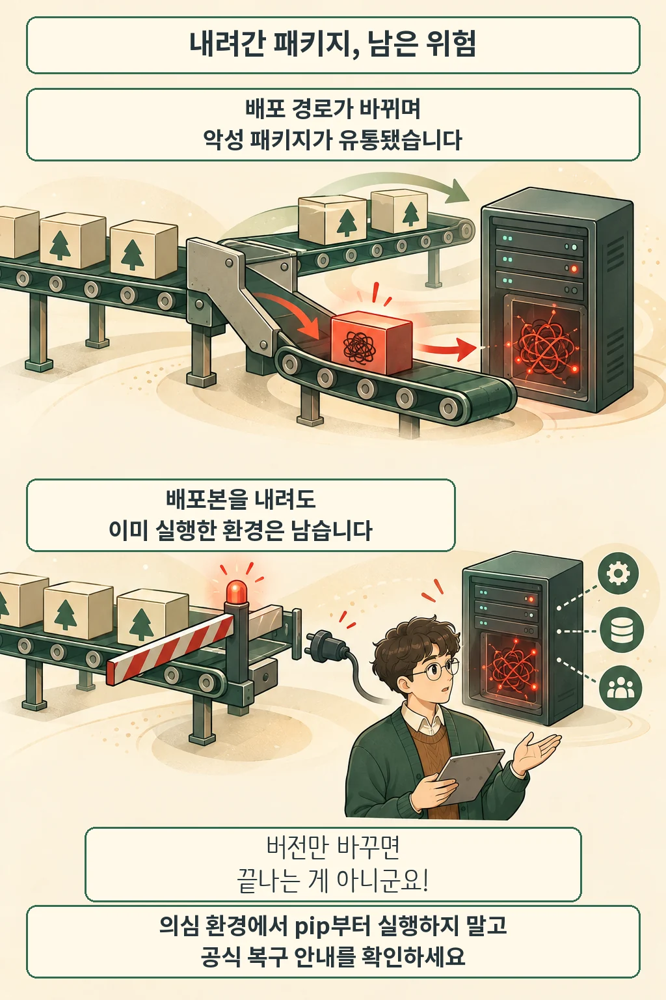

글·해설: 다메카솔

LiteLLM은 2026년 10월 21일 **1.107.0 설치 배포본에 자격정보 탈취·원격 코드 실행용 악성 코드가 포함됐다**고 공지했습니다. 회수는 끝났지만 조사는 진행 중입니다. 이 글은 [공식 공지](https://docs.litellm.ai/blog/security-incident-oct-21-2026)의 **20:30 UTC 갱신본**을 기준으로 합니다.

## AI 게이트웨이에서 일어난 배포 사고

[LiteLLM](https://docs.litellm.ai/docs/)은 여러 언어 모델을 공통 인터페이스로 호출하게 해 주는 도구입니다. 자체 운영하는 게이트웨이는 가상 키와 비용 추적, 관리자 화면도 제공합니다. 앱과 모델 제공자 사이에 놓이는 구성요소이므로, 도입할 때는 기능뿐 아니라 어떤 자격정보와 연결되는지 파악해야 합니다.

이번 공지는 모델의 답변 품질에 관한 소식이 아닙니다. 개발자가 받아 실행한 소프트웨어가 대상입니다. 공식 설명에 따르면 **GitHub의 정상 소스 태그에는 악성 파일이 없었고, 변조된 배포 경로가 다른 저장소에서 배포본을 만들었습니다.**

## 영향 범위는 배포본과 시각으로 확인합니다

아래는 업체가 밝힌 10월 21일 **UTC 기준 유통 시간**입니다. 한국 시각은 9시간을 더하며 날짜가 바뀔 수 있습니다.

| 배포 경로 | 영향 범위와 시간 |
| --- | --- |
| PyPI | `litellm==1.107.0`의 7개 wheel, 11:39:51–13:23 |
| Docker Hub | `v1.107.0`, `latest`, `main-latest`, `main-stable`, 11:46:56–14:20 |
| GHCR | 위 태그들, 11:46:56 유통 시작, 13:51에는 접근 불가 |

업체는 **기업 고객용 비공개 레지스트리는 영향받지 않았다**고 설명합니다. 현재 태그가 정상이어도 과거 실행 이력은 별도로 확인해야 합니다. 이미지별 digest는 공식 공지와 대조하세요.

## 의심 환경에서 pip부터 실행하지 마세요

공식 대응 안내는 **pip도 Python을 시작해 악성 시작 코드를 다시 실행할 수 있다**고 경고합니다. 흔적이 없다는 이유만으로 안전하다고 판단하지 말고, 영향 환경 재구축과 접근 가능했던 자격정보 교체를 포함한 최신 복구 안내를 따르세요. 단순 버전 교체로 복구가 완료됐다고 볼 수 없습니다.

이 경고의 배경은 Python의 시작 과정입니다. [Python 3.12 공식 문서](https://docs.python.org/3.12/library/site.html)는 일반적인 시작 시 `site`가 로드되며, `.pth`의 실행 가능한 줄과 `sitecustomize`가 동작할 수 있다고 설명합니다. 특정 라이브러리를 직접 import하지 않았더라도 시작 코드가 실행될 수 있는 구조입니다. 이는 언어 동작 설명이며, 이 글에서 악성 패키지를 실행해 확인한 결과는 아닙니다.

## 아직 조사 중인 부분과 운영자가 남길 기록

20:30 갱신본은 로그에 남은 GitHub CLI 토큰이 악용됐을 가능성을 설명하지만, **내부 LiteLLM에 처음 접근한 경로는 미확인**입니다. 업체의 조사 설명을 독립적으로 확정된 원인으로 받아들이면 안 됩니다.

다메카솔은 이 사건을 통해 배포 기록을 세 칸으로 나눠 볼 필요가 있다고 생각합니다. **검토한 소스, 받아 온 배포본, 실제 실행한 환경**입니다. 각 칸을 연결하는 커밋·digest·실행 시각이 있어야 조사 질문을 좁힐 수 있습니다. 만화의 컨베이어는 이 구분을 위한 비유이며 실제 배포 시스템 화면은 아닙니다.

AI 도구를 운영할 때 입력과 외부 자료가 만나는 경계도 중요합니다. 별개의 문제인 [도구 출력의 근거 바꿔치기 연구](/posts/tool-output-evidence-substitution/)와 함께 보면, 모델 응답 검증과 소프트웨어 공급 경로 검증을 각각 어디서 해야 하는지 비교할 수 있습니다.

## 출처

- [LiteLLM 사건 공지: 영향 범위와 최신 복구 안내](https://docs.litellm.ai/blog/security-incident-oct-21-2026)
- [Python 3.12 site 문서: 시작 시 실행되는 코드](https://docs.python.org/3.12/library/site.html)
- [LiteLLM 공식 소개: SDK와 게이트웨이](https://docs.litellm.ai/docs/)

이 글의 본문과 이미지는 생성형 AI로 제작했습니다. 기획과 편집 기준은 다메카솔이 정했습니다.
