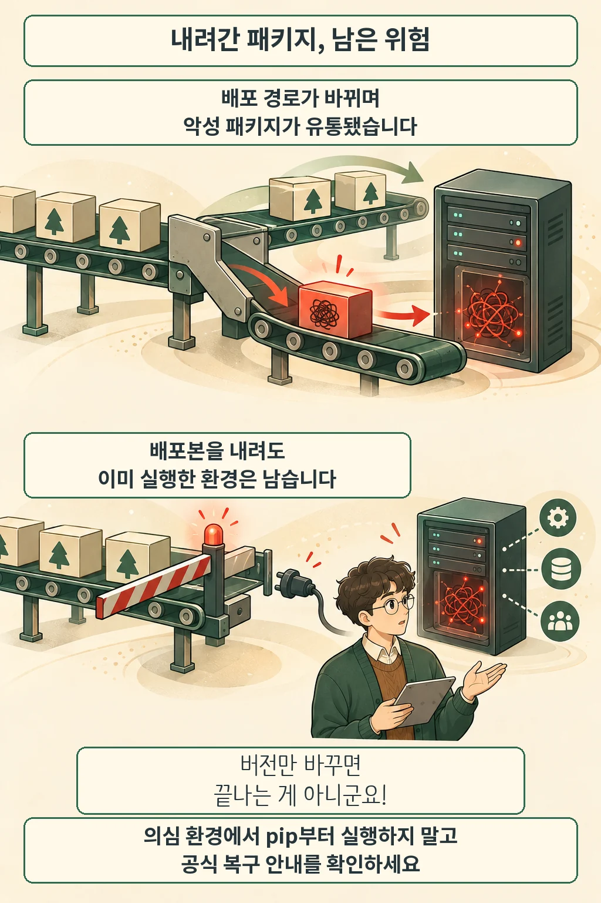

GitHub 공식 태그가 깨끗한데도, 내 서버에 깔린 패키지는 변조됐을 수 있습니다. 소스를 확인한 시점과 실제 배포본을 빌드해 올리는 경로가 다르면 버전 번호만으로 안전을 장담하기 어렵거든요. 게다가 문제 배포본이 저장소에서 내려간 뒤에도 이미 실행된 환경의 위험은 그대로 남습니다.

글·해설: 다메카솔

## 소스 코드가 깨끗해도 배포본은 다릅니다

[LiteLLM](https://docs.litellm.ai/docs/)은 여러 언어 모델을 **공통 인터페이스**로 호출하게 돕는 도구이며, 자체 게이트웨이는 가상 키와 비용 추적, 관리자 화면까지 제공합니다. 앱과 모델 제공자 사이에서 요청을 중계하는 만큼, 도입 단계부터 어떤 자격정보가 연결되는지 함께 파악해야 하죠.

2026년 10월 21일 이 생태계에서 모델 응답 오류가 아니라 설치 소프트웨어 자체를 노린 공급망 침해가 발생했습니다. 개발자가 내려받아 실행하는 배포 파이프라인이 침해되면서 공식 저장소와 다른 파일이 유통된 사건입니다.

[공식 공지](https://docs.litellm.ai/blog/security-incident-oct-21-2026)는 문제의 **1.107.0 설치 배포본**에 자격정보 탈취와 원격 코드 로딩용 악성 코드가 포함됐고 회수는 끝났다고 밝힙니다. GitHub의 **정상 소스 태그**에는 악성 파일이 없었으나, 침해된 배포 경로가 공격자가 제어하는 유사 저장소에서 별도 패키지를 만들어 올렸기 때문이죠.

## 유통이 멈춘 시간과 영향받은 배포본

영향 여부는 소스 저장소가 아니라 실제로 내려받은 레지스트리와 시각으로 확인해야 합니다. 아래는 업체가 밝힌 10월 21일 **UTC 기준 유통 시간**이며, 한국 시각은 여기에 9시간을 더해 계산합니다.

| 배포 경로 | 영향받은 패키지·태그 | 유통 구간 (10월 21일 UTC) | 상태 |
| --- | --- | --- | --- |
| PyPI | `litellm==1.107.0` (7개 wheel) | 11:39:51–13:23 | 회수 완료 |
| Docker Hub | `v1.107.0`, `latest`, `main-latest`, `main-stable` | 11:46:56–14:20 | 4개 태그 영향 |
| GHCR | 위와 동일한 4개 태그 | 11:46:56 시작 | 13:51 접근 불가 |

이 시간대는 저장소에 악성 파일이 올라와 있던 유통 기간을 뜻합니다. 업체는 기업 고객용 **비공개 레지스트리**가 영향받지 않았다고 밝히지만, 공개 저장소에서 배포본을 회수했더라도 이미 실행한 호스트의 위험은 남거든요. 컨테이너를 운영 중이라면 현재 태그가 정상으로 보이더라도 당시 pull한 이미지 digest를 공지와 대조해 두어야 합니다.

## 의심 환경에서 pip 실행이 위험한 이유

공식 대응 안내는 **pip도 Python을 시작해 악성 시작 코드를 다시 실행할 수 있다**고 경고합니다. 눈에 띄는 흔적이 없다고 안전하다고 판단하기 어렵기에, 단순 버전 교체 대신 영향 환경 재구축과 접근 가능했던 자격정보 교체를 포함한 최신 복구 안내를 따라야 합니다.

예를 들어, 저녁 배포 중 `main-latest` 태그로 자체 LiteLLM 게이트웨이를 띄웠다가 뒤늦게 공지를 본 팀을 떠올려 봅시다. 급한 대로 같은 컨테이너에서 `pip install`로 이전 버전을 다시 깔면 해결될 것 같지만, 그 `pip` 실행 자체가 Python을 띄우며 악성 시작 코드를 재실행할 수 있습니다. 게이트웨이에 API 키와 가상 키 권한이 걸려 있었다면, 환경 재구축과 키 교체까지 마쳐야 위험을 닫을 수 있죠.

이런 재실행이 가능한 이유는 Python의 시작 절차 때문입니다. [Python 3.12 `site` 문서](https://docs.python.org/3.12/library/site.html)는 일반 시작 시 `site` 모듈이 로드되며 `.pth`의 실행 가능한 `import` 줄이나 `sitecustomize`가 동작할 수 있다고 설명합니다. **특정 라이브러리를 직접** `import`하지 않았더라도 Python을 실행하는 순간 시작 코드가 돌 수 있는 셈입니다.

## 아직 미확인인 경로와 분리해야 할 배포 기록

사고 원인은 아직 최종 확정 단계가 아닙니다. `20:30 UTC` 갱신 공지는 내부 로그에 노출된 GitHub CLI 토큰 악용 가능성을 짚으면서도, **내부 LiteLLM에 처음 접근한 경로는 미확인**이라고 적고 있습니다. 단일 업체의 중간 조사 발표인 만큼 후속 공지를 함께 지켜볼 필요가 있습니다.

이런 사고에서 조사 범위를 빨리 좁히려면 배포 이력을 **검토한 소스, 받아 온 배포본, 실제 실행한 환경** 세 칸으로 나누어 기록해 두어야 합니다. 각 칸을 커밋·digest·실행 시각으로 이어 두면 어느 환경이 문제 배포본을 받았는지 곧바로 가려낼 수 있거든요.

- **검토한 소스**: 리뷰와 검증을 거친 Git 태그 및 커밋 해시
- **받아 온 배포본**: PyPI wheel 버전이나 컨테이너 레지스트리의 실제 이미지 digest
- **실제 실행한 환경**: 해당 배포본이 기동된 호스트·컨테이너와 시각, 연결된 자격정보 범위

AI 도구를 운영할 때는 외부 입력과 코드가 만나는 경계를 단계별로 나누어 보는 시각이 중요합니다. 별개 주제를 다룬 [도구 출력의 근거 바꿔치기 연구](/posts/tool-output-evidence-substitution/)와 함께 보면 모델 응답 검증과 소프트웨어 공급 경로 검증 지점을 비교하는 데 도움이 됩니다.

## 출처

- [LiteLLM 사건 공지: 영향 범위와 최신 복구 안내](https://docs.litellm.ai/blog/security-incident-oct-21-2026)
- [Python 3.12 site 문서: 시작 시 실행되는 코드](https://docs.python.org/3.12/library/site.html)
- [LiteLLM 공식 소개: SDK와 게이트웨이](https://docs.litellm.ai/docs/)

이 글은 2026년 10월 21일 20:30 UTC 기준 공식 공지와 Python 3.12 문서를 바탕으로 정리했으며, 악성 패키지 실행이나 사고 재현은 수행하지 않았고 만화의 컨베이어 장면은 이해를 돕기 위한 개념 비유입니다.

이 글의 본문과 이미지는 생성형 AI로 제작했습니다. 기획과 편집 기준은 다메카솔이 정했습니다.
