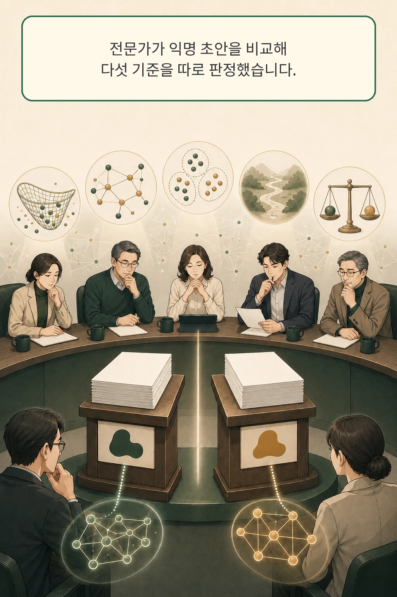

논문을 더 많이 찾고 요약을 길게 쓰면 문헌 리뷰도 자연히 좋아진다고 생각하기 쉽습니다. 그러나 **「LitReview Arena: Evaluating Literature Review Agents with Battle-Style Peer Review Platform」**의 실험 결과는 그 믿음을 흔듭니다. 문헌 리뷰 초안 두 개를 해당 분야 연구자에게 익명으로 보여 주고 다섯 가지 기준을 따로 비교하는 `LitReview Arena`와 고정 벤치마크 `LitReviewBench`로 측정해 보니, 현재 강력한 시스템들은 검색과 인용 범위는 넓혔지만 연구 지형을 조직하고 다음 질문을 제안하는 단계에서는 인간 초안과 큰 차이를 보였습니다.

글·해설: 다메카솔

## 핵심 내용

- 문헌 포괄 범위(coverage)가 넓어도 주장 근거, 분야 구조, 비자명한 연구 제안이 약하면 좋은 연구 출발점이 되기 어렵습니다.
- 논문은 AI 논문 작성 경험이 있는 전문가 105명을 분야에 맞춰 배정하고 두 초안을 익명으로 상대 비교했다고 보고합니다.
- 인간 초안과의 전체 효용(Overall Utility, D5) 결정적 대결(decisive match) 904건에서 비인간 시스템의 승률은 208건(23.0%)에 그쳤습니다.
- 두 AI 심사자(judge)가 서로 높게 일치하더라도 전문가 순위와는 크게 어긋날 수 있었습니다.
- 전문가 사례로 보정한 `LitJudge`는 D5 순위 상관을 0.467에서 0.792로 높였지만, 공개 snapshot만으로 전체 실험을 독립 재현할 수는 없습니다.

## 논문 수와 연구 지형은 다른 문제다

문헌 리뷰에는 검색으로 해결할 수 있는 일과 깊은 학술적 판단이 필요한 일이 함께 들어 있습니다. 관련 논문을 찾고 인용이 실제 주장과 맞는지 확인하는 단계는 비교적 구체적인 규칙으로 나눌 수 있지만, 분야를 어떤 축으로 묶을지, 서로 충돌하는 실험 결과를 어떻게 설명할지, 다음 연구가 풀어야 할 빈틈(gap)이 무엇인지는 훨씬 높은 수준의 합성을 요구합니다.

저자들은 기존 자동 평가가 참조 문헌 겹침(reference overlap), 인용 수(citation count), 주제 포괄성(topical coverage)처럼 안정적으로 셀 수 있는 신호에 치우쳤다고 지적합니다. 이런 지표도 필요하지만, 정작 연구자가 리뷰를 읽고 “이 분야가 어떻게 나뉘며 다음에 무엇을 검증해야 하는가”를 판단할 때 필요한 구조적 품질을 충분히 대변하지 못합니다. 그래서 이 연구는 정답 초안 하나와의 표면적인 문장 유사도를 재는 대신, 같은 주제를 다룬 초안 두 개 가운데 어느 쪽이 연구 출발점으로 더 나은지 전문가가 직접 상대 비교하도록 설계했습니다.

## 분야가 맞는 전문가에게 두 초안을 익명으로 보여 줬다

평가 주제(topic seed)는 OpenAlex에서 추출했습니다. 저자들은 2022~2025년 AI 분야에서 인용 수 50회를 넘긴 서베이 논문(survey-style paper) 3,000편 이상을 모으고 각 논문에서 하나의 주제를 뽑았으며, 공개 저장소 snapshot에는 정규화된 주제 925개가 들어 있습니다.

각 대결(battle)은 서로 다른 시스템이 만든 초안 두 개를 이름 없이 좌우 무작위 순서로 보여 주고, AI 논문 작성 경험이 있는 평가자 105명 중 연구 분야·세부 분야·익숙한 논문이 맞는 전문가에게 배정해 아래 다섯 차원을 각각 `A`, `B`, `Tie`, `Both Bad` 가운데 하나로 판정하게 했습니다.

| 차원 | 묻는 질문 |
| --- | --- |
| Literature Coverage | 중요한 문헌을 충분히 포함했는가 |
| Claim Support | 핵심 주장이 관련 인용으로 뒷받침되는가 |
| Paper Structure | 접근법 사이 관계를 이해할 수 있게 조직했는가 |
| Research Suggestions | 중요하고 비자명한 연구 방향을 제시했는가 |
| Overall Utility | 연구자의 출발점으로 어느 초안이 더 유용한가 |

단일 총점으로 뭉뚱그리기 전에 단순 포괄성(coverage)과 구조적 합성(synthesis)을 분리해 측정했다는 점이 이 벤치마크의 핵심입니다.

## 강한 시스템도 구조와 연구 제안에서 뒤처졌다

평가 결과 인간 초안이 다섯 차원 모두에서 1위를 차지했습니다. 전체 효용(D5)에서 인간 초안과 직접 맞붙은 결정적 대결(decisive match, `Tie`와 `Both Bad` 제외) 904건만 세면 비인간 시스템이 이긴 경우는 208건(23.0%)에 불과했습니다.

특히 격차가 벌어졌고 전체 효용(D5) 순위와 가장 강하게 맞물린 항목은 Paper Structure(순위 상관 0.99)와 Research Suggestions(0.96)였으며, Literature Coverage와의 상관은 0.90이었습니다. 문헌을 넓게 모으는 일보다 분야의 숨은 관계를 드러내고 구체적인 다음 질문을 만드는 일이 전문가의 실질적 효용을 좌우한 것입니다.

추론 시점의 계산량을 늘려도 이 간격은 쉽게 닫히지 않았습니다. 논문 표에서 에이전트형 시스템(agentic system)은 질의당 평균 122.3K 토큰을 사용해 단독 모델(standalone model, 8.1K 토큰)보다 약 15배의 test-time budget을 썼지만, 전반적인 품질을 높였을 뿐 인간 초안과의 효용 격차를 해소하지는 못했습니다. 저자들의 표현대로 많은 AI 초안은 유기적으로 합성된 리뷰라기보다 잘 정리된 참고문헌 목록(efficient bibliography)에 가까웠습니다.

## AI judge의 높은 일치는 전문가 정렬을 보장하지 않았다

전문가 평가는 비용이 많이 들기 때문에, 연구팀은 LLM 심사자(judge)가 이를 대체할 수 있는지 확인하고자 대결 500건을 뽑아 Qwen3-235B가 다섯 차원을 판정하게 했습니다.

결과는 흥미로웠습니다. Literature Coverage에서는 전문가 순위와 어느 정도 맞았지만, 고차원 합성 영역으로 갈수록 어긋나 D5 순위 상관이 0.467에 그쳤습니다. 더 극적인 장면은 리더보드 역전으로, 전문가는 인간 초안을 1위로 두었지만 보정 전(naive) AI judge는 D5에서 인간에게 Elo 310, GPT-5.2에 2490을 부여했습니다.

이를 단순한 전문가 주관성 탓으로 돌리기도 어렵습니다. 전문가 간 일치도(D5 expert-expert agreement)는 0.861로 높았고, Qwen과 DeepSeek judge끼리도 모든 차원에서 0.7 이상 일치했지만 정작 전문가와의 정렬만 낮았기 때문입니다. AI 심사자끼리 비슷한 표면적 유창성이나 형식 선호를 공유하면 안정적으로 같은 방향을 잘못 가리킬 수 있음을 보여 줍니다.

연구팀이 제안한 `LitJudge`는 구조가 비슷한 사례, 주제가 비슷한 사례, 인간 초안에서 가져온 다양성 기반 연구 공백 기준점(diversity-aware research-gap anchor)을 컨텍스트로 제공해 이 간격을 보정합니다. 같은 500건 설정에서 D5 정렬은 0.467에서 0.792로, Research Suggestions 정렬은 0.430에서 0.842로 크게 올랐습니다. 물론 이 결과는 전문가 사례 보정이 유용하다는 증거일 뿐, 모든 분야에서 전문가 심사를 완전히 대체한다는 보증은 아닙니다.

## 공개 재현의 경계와 적용 범위

저자들의 GitHub 저장소(2026년 8월 25일 고정 revision `768d18362ae913f74a0257f240ba50c00dc9eef9`)는 MIT 라이선스의 evaluator 코드, 프로토콜 문서, 전문가 판정 결과(`expert_outcomes.jsonl`, 2,754행)와 주제 목록(`topics.jsonl`, 925행)을 제공합니다. 다만 핵심 초안 쌍을 담는 `battles.jsonl`은 아카이브 안에서 실제 본문이 아니라 164,220,412바이트 크기의 Git LFS 객체를 가리키는 포인터였고, 가명 처리된 `annotator_id`만으로는 논문이 보고한 105명의 실제 참여자 수를 독립 재집계할 수 없었습니다(이번 검토에서는 PDF, TeX, 메타데이터, 고정 저장소 아카이브와 공개 라벨을 교차 확인했으며 전체 battle replay나 API 실행은 수행하지 않았습니다). 또한 논문과 저장소는 ICML 2026 채택을 명시하고 있으나 JavaScript 없이 수집한 공식 목록에서는 독립 확인이 되지 않아 저자 표기로 귀속해 둡니다.

적용 범위의 한계도 분명합니다. 주 벤치마크가 AI 주제를 중심으로 구성되어 있어(부록의 생물학 파일럿이 비슷한 경향을 보였더라도) 생물의학이나 법률처럼 증거 규범과 안전 비용이 다른 분야에는 별도의 사실·인용 감사를 더해야 합니다. 전문가 보정 역시 구조가 비슷한 사례만 반복 참조하면 익숙한 논문 문법을 강화하거나 유행하는 주제에 쏠릴 수 있고, 새 논문이 계속 들어오는 살아 있는 리뷰(living review)에서 과거 문맥과 모순 없이 주장을 갱신하는 장기 과제도 아직 다루지 않습니다.

## 다메카솔의 해석: 검색·근거·구조·제안을 분리한다

문헌 리뷰 에이전트를 실제 연구 워크플로에 도입한다면 단일 종합 점수로 승인하지 않고 다음 네 층의 증거를 분리해 남겨야 합니다.

| 검증 층 | 운영에서 남길 증거 |
| --- | --- |
| 검색 범위 | query, database, cutoff date, 누락 후보 |
| 주장 근거 | claim별 citation과 원문 위치 |
| 연구 구조 | 분류 축과 서로 충돌하는 결과를 묶은 이유 |
| 연구 제안 | 기존 연구로 바로 반박되지 않는 구체적인 gap |

자동 심사자(judge) 역시 고정된 정답처럼 다루지 않고 분야 전문가가 읽은 표본을 정기적으로 넣어 순위를 다시 보정해야 하며, AI judge끼리의 높은 일치도는 참고 신호로만 기록하는 편이 안전합니다. 앞으로 문헌 리뷰 에이전트를 도입할 때는 단순히 더 많은 논문을 가져오는지보다 사람이 분류 축을 수정한 횟수, 근거 없는 연구 제안을 걸러낸 비율, 새 논문이 추가될 때 기존 주장을 안전하게 갱신하는지를 성공 기준으로 삼아야 합니다. 좋은 문헌 리뷰는 검색 결과의 끝이 아니라 연구 판단의 시작점이기 때문입니다.

## 논문 정보

| 항목 | 내용 |
| --- | --- |
| 제목 | LitReview Arena: Evaluating Literature Review Agents with Battle-Style Peer Review Platform |
| 저자 | Ruotong Zhao, Zhiyu Chen, Xurui Liu, Haidong Xue, Dong Liang, Jigao Fu, Yanbiao Wu, Yuanyi Zhen, Fengli Xu, Yong Li |
| 공개 이력 | arXiv v1 2026-07-01 14:54:07 UTC (2026-08-25 cs.AI 신규 목록 등장) |
| 저자 표기 | ICML 2026 accepted |
| 공개 artifact | 고정 GitHub revision의 evaluator code·labels·topics; battle 본문은 Git LFS pointer |

## 자주 묻는 질문

### 논문을 정확히 많이 찾으면 좋은 리뷰 아닌가요?

포괄성(Coverage)은 출발 조건일 뿐입니다. 어떤 연구들이 같은 가정을 공유하고 어디서 충돌하는지 조직하지 못하면 독자는 분야의 지형도를 얻지 못합니다. 이번 전문가 선호도 분석에서도 논문 구조(Paper Structure)와 연구 제안(Research Suggestions)이 전체 효용과 가장 강하게 연결됐습니다.

### LitJudge가 전문가를 대체할 수 있나요?

이 연구는 500건 설정에서 전문가 정렬이 크게 개선됐다고 보고하지만, 주 도메인이 AI이고 지속 갱신(living review)이나 증거 규범이 다른 분야는 범위 밖입니다. `LitJudge`는 전문가를 완전히 대체하기보다 전문가 사례를 효율적으로 재사용하는 보정 장치로 읽는 편이 정확합니다.

## 함께 읽기

- [AI 에이전트는 열린 연구 질문을 끝까지 풀 수 있을까](/posts/ai-open-ended-research-shadow-evaluation/)
- [LLM이 출처를 제시해도 정보 판단이 끝나지 않는 이유](/posts/information-discernment-llm-sources/)

## 출처

- [Ruotong Zhao 외, “LitReview Arena: Evaluating Literature Review Agents with Battle-Style Peer Review Platform,” arXiv:2608.21374](https://arxiv.org/abs/2608.21374)
- [arXiv v1 PDF](https://arxiv.org/pdf/2608.21374)
- [저자 공식 GitHub 저장소, pinned revision 768d1836](https://github.com/VanellopeAsher/LitReview-Arena/tree/768d18362ae913f74a0257f240ba50c00dc9eef9)
- [ICML 2026 공식 사이트](https://icml.cc/Conferences/2026)

이 글의 본문과 이미지는 생성형 AI로 제작했습니다. 기획과 편집 기준은 다메카솔이 정했습니다.

Updated: 2026-08-25
