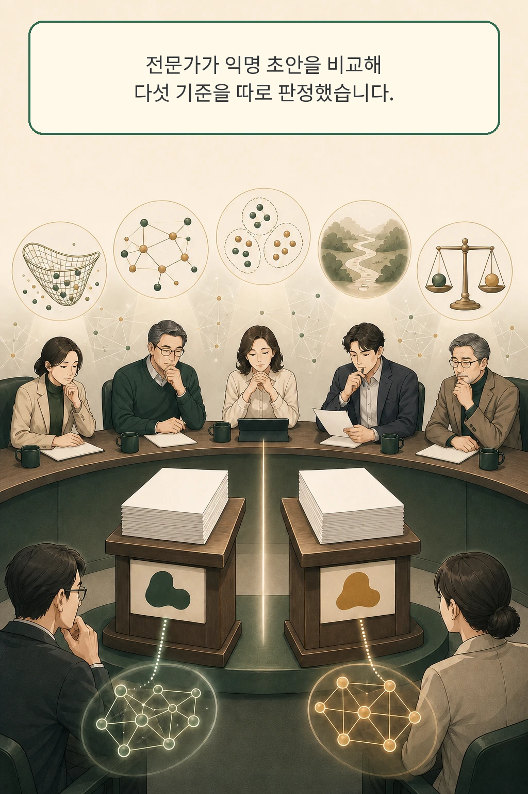

딥리서치나 문헌 리뷰 에이전트를 쓰다 보면 논문을 수십 편씩 찾아 요약해 주니 연구 조사도 금세 끝날 것이라는 기대가 생깁니다. 막상 해당 분야 연구자들에게 인간 초안과 AI 초안을 익명으로 비교하게 해 보니, AI가 쓴 글은 잘 정리된 참고문헌 목록에 머무는 경우가 많았습니다. 검색량과 인용 범위는 넓어졌지만, 분야의 연구 지형을 세우고 다음 질문을 짚어내는 단계에서는 여전히 간격이 남아 있었거든요.

글·해설: 다메카솔

## 핵심 내용

- **수집과 합성의 분리**: 논문을 넓게 모으는 일과 분야 구조를 조직해 비자명한 연구 방향을 제안하는 일은 난이도가 다릅니다.
- **인간 초안과의 격차**: 전체 효용(D5)에서 인간 초안과 직접 맞붙은 결정적 대결 904건 중 비인간 시스템 승리는 208건(23.0%)에 그쳤습니다.
- **AI 심사자의 함정과 보정**: 보정 없는 LLM 심사자는 인간 1위 순위를 뒤집었지만, `LitJudge` 보정을 적용하자 D5 순위 상관이 0.467에서 0.792로 올랐습니다.

## 논문 수와 연구 지형은 다른 문제다

문헌 리뷰에는 검색으로 해결할 수 있는 일과 깊은 학술적 판단이 필요한 일이 함께 들어 있습니다. 관련 논문을 찾고 인용이 주장과 맞는지 대조하는 작업은 규칙화하기 쉽지만, 분야를 어떤 축으로 묶고 상충하는 실험 결과를 어떻게 설명할지는 훨씬 높은 수준의 합성을 요구하죠.

예를 들어 에이전트 메모리 최적화 분야를 AI에게 정리해 달라고 요청하는 상황을 떠올려 봅시다. 시스템이 관련 논문 80편을 찾아 요약하고 인용을 정확히 달더라도, 장기 기억 압축 방식과 검색 기반 방식의 갈림길이나 검증되지 않은 병목을 짚어내지 못하면 참고문헌 목록에 그치고 맙니다. 「LitReview Arena」 연구진은 기존 자동 평가가 참조 문헌 겹침이나 인용 수처럼 세기 쉬운 지표에 치우친 탓에 이런 구조적 품질을 놓쳤다고 봤습니다.

## 분야 전문가의 익명 비교로 다섯 가지를 따로 쟀다

연구팀은 정답 초안 하나와 표면 유사도를 재는 대신, 같은 주제의 두 초안을 나란히 놓고 연구 출발점으로 어느 쪽이 더 나은지 묻는 `LitReview Arena`를 구축했습니다. OpenAlex의 최근 AI 서베이 논문 중 인용 50회를 넘긴 3천 편 이상에서 주제를 뽑았고, AI 논문 작성 경험이 있는 전문가 105명이 세부 분야에 맞는 익명 초안 쌍을 좌우 무작위로 받아 `A`, `B`, `Tie`, `Both Bad`로 판정했습니다.

| 평가 차원 | 묻는 핵심 질문 |
| --- | --- |
| Literature Coverage (D1) | 중요한 문헌을 충분히 포함했는가 |
| Claim Support (D2) | 핵심 주장이 관련 인용으로 뒷받침되는가 |
| Paper Structure (D3) | 접근법 사이 관계를 이해할 수 있게 조직했는가 |
| Research Suggestions (D4) | 중요하고 비자명한 연구 방향을 제시했는가 |
| Overall Utility (D5) | 연구자의 출발점으로 어느 초안이 더 유용한가 |

단일 총점으로 뭉뚱그리지 않고 포괄성과 구조적 합성을 분리해 잰 덕분에 어디서 격차가 벌어지는지 분명히 드러났죠.

## 강한 에이전트도 구조와 연구 제안에서 밀렸다

비교 결과 인간 초안이 다섯 차원 모두에서 1위를 지켰습니다. 에이전트형 시스템이 추론 시점에 단독 모델보다 약 15배 많은 토큰을 투입해 전반적 품질을 끌어올렸는데도, 인간 초안과의 효용 격차는 쉽게 닫히지 않았습니다.

| 비교 항목 | 보고된 수치 | 해석 포인트 |
| --- | --- | --- |
| 인간 vs 비인간 승률 (D5) | 208 / 904건 (23.0%) | `Tie`·`Both Bad` 제외 결정적 대결 기준 |
| D5와의 차원별 순위 상관 | 구조 0.99 · 제안 0.96 · 포괄 0.90 | 수집량보다 구조화와 제안이 효용 좌우 |
| 질의당 평균 토큰 | 에이전트 122.3K vs 단독 8.1K | 약 15배 예산으로도 인간과의 격차 유지 |
| 보정 전 Qwen3-235B (500건) | D5 상관 0.467 (인간 310 vs GPT-5.2 2490) | 유창성 선호로 인간 1위 Elo 순위 역전 |
| 심사자 간 일치도 | AI끼리 0.7 이상 / 전문가끼리 0.861 | AI의 높은 일치가 전문가 정렬을 보장하진 않음 |
| LitJudge 보정 후 (500건) | D5 0.467→0.792 / D4 0.430→0.842 | 유사 사례와 다양성 공백 기준점 활용 효과 |

저자들이 많은 AI 초안을 유기적으로 합성된 리뷰보다 잘 정리된 참고문헌 목록에 가깝다고 해석한 까닭이 여기에 있습니다. 문헌을 넓게 모으는 능력만으로는 분야의 숨은 관계를 드러내고 다음 실험을 제안하는 단계까지 넘어가기 어렵다는 셈이죠.

## AI 심사자의 높은 일치가 전문가 정렬을 뜻하진 않았다

전문가 평가는 비용이 많이 들기 때문에, 연구팀은 500건의 대결 부분집합으로 LLM 심사자가 이를 대신할 수 있는지 시험했습니다. 결과는 의외였는데, Qwen과 DeepSeek 심사자는 모든 차원에서 서로 0.7 이상 일치하면서도 정작 전문가 순위와는 크게 어긋났거든요. AI 심사자들이 표면적 유창성이나 형식 선호를 공유하면 안정적으로 같은 오답을 고를 수 있음을 보여 줍니다.

연구팀이 제안한 `LitJudge`는 구조 유사 사례, 주제 유사 사례, 인간 초안 기반의 다양성 연구 공백 기준점을 함께 컨텍스트로 넣어 이 간격을 보정합니다. 덕분에 D5와 Research Suggestions(D4) 정렬이 크게 높아졌지만, 이를 전문가 심사를 대체하는 도구라기보다 전문가 사례를 재사용하는 보정 장치로 읽는 편이 정확합니다.

## 공개 데이터 경계와 적용 범위

주 벤치마크가 AI 주제 중심이라(부록의 생물학 파일럿이 비슷한 경향을 보였더라도) 생물의학이나 법률처럼 증거 규범과 안전 비용이 다른 분야에서는 별도의 사실·인용 검증이 필요합니다. 전문가 사례 보정 역시 익숙한 문법이나 유행 주제로 쏠릴 위험이 있고, 새 논문이 계속 들어오는 살아 있는 리뷰(living review)의 장기 갱신 과제도 아직 다루지 않았습니다.

공개 저장소에는 MIT 라이선스 평가 코드·프로토콜과 전문가 판정(2,754행), 정규화 주제(925행)가 담겨 있습니다. 다만 실제 초안 쌍을 담은 `battles.jsonl`은 약 164MB의 Git LFS 포인터로만 제공되고 평가자 ID도 가명 처리돼 있어, 공개 아카이브만으로 전체 대결을 재실행하거나 참여자 수를 재집계하기는 어렵습니다.

## 다메카솔의 해석: 검색·근거·구조·제안을 분리한다

문헌 리뷰 에이전트를 연구 워크플로에 도입한다면 단일 종합 점수 대신 아래 네 층의 증거를 분리해 관리하는 편이 안전합니다.

- **검색 범위**: 쿼리, 데이터베이스, 기준일(cutoff date), 누락 후보를 남깁니다.
- **주장 근거**: 주장(claim)별 인용 논문과 원문 확인 위치를 기록합니다.
- **연구 구조**: 분야 분류 축과 상충하는 결과를 묶은 근거를 검토합니다.
- **연구 제안**: 선행 연구로 바로 반박되지 않는 구체적 공백(gap)인지 걸러냅니다.

자동 심사자 역시 고정된 정답 판독기처럼 쓰기보다 전문가가 읽은 표본을 정기적으로 넣어 순위를 재보정하는 편이 좋습니다. 결국 도입 성패는 논문을 몇 편 더 긁어오는지가 아니라 사람이 분류 축을 고친 횟수, 근거 없는 제안을 걸러낸 비율, 새 논문이 들어올 때 기존 주장을 안전하게 갱신하는지로 갈리는 편입니다.

## 함께 읽기

- [AI 에이전트는 열린 연구 질문을 끝까지 풀 수 있을까](/posts/ai-open-ended-research-shadow-evaluation/)
- [LLM이 출처를 제시해도 정보 판단이 끝나지 않는 이유](/posts/information-discernment-llm-sources/)

## 출처

- [Ruotong Zhao 외, “LitReview Arena: Evaluating Literature Review Agents with Battle-Style Peer Review Platform,” arXiv:2608.21374](https://arxiv.org/abs/2608.21374)
- [arXiv v1 PDF](https://arxiv.org/pdf/2608.21374)
- [저자 공식 GitHub 저장소, pinned revision 768d1836](https://github.com/VanellopeAsher/LitReview-Arena/tree/768d18362ae913f74a0257f240ba50c00dc9eef9)
- [ICML 2026 공식 사이트](https://icml.cc/Conferences/2026)

이 글은 논문 원문(arXiv v1, 2026-07-01 제출·2026-08-25 cs.AI 등재)과 저자 공개 저장소 아카이브를 바탕으로 정리했으며, 별도 실행 재현은 수행하지 않았고 그림은 새로 구성했습니다.

이 글의 본문과 이미지는 생성형 AI로 제작했습니다. 기획과 편집 기준은 다메카솔이 정했습니다.
