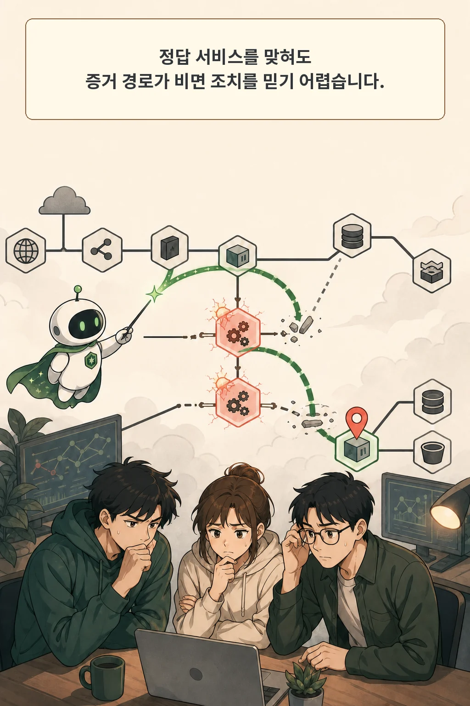
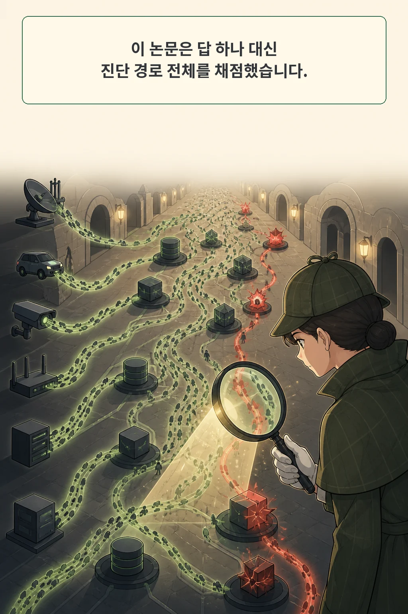
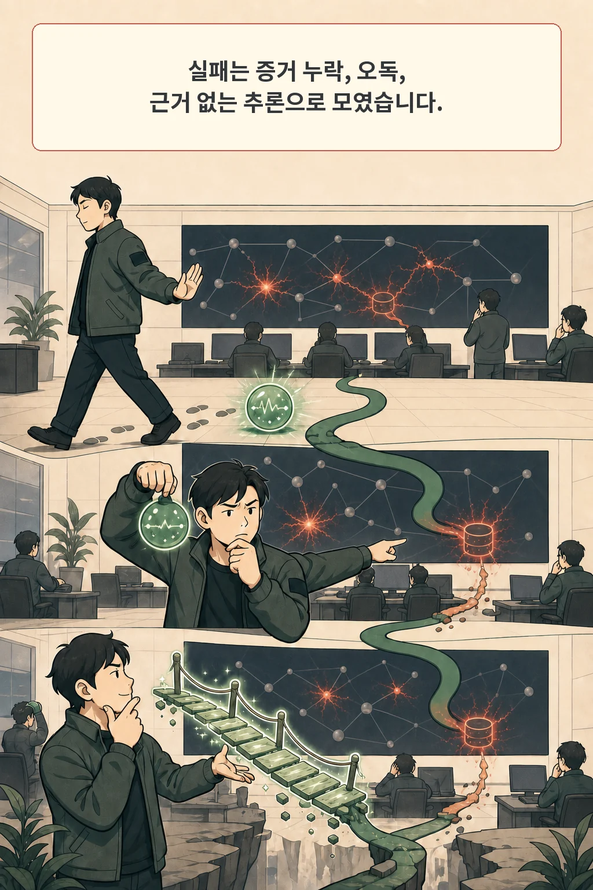
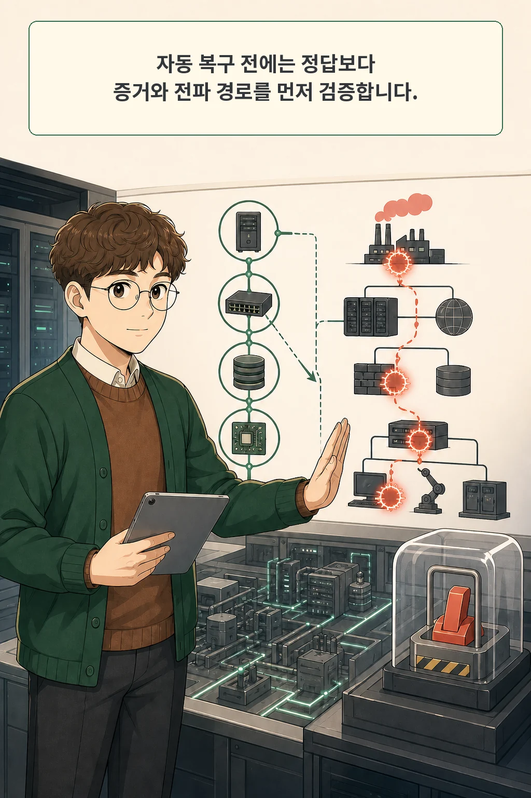

LLM 에이전트가 장애 원인 서비스를 정확히 짚어냈다면 바로 복구를 맡겨도 될까요? 근거 로그와 전파 경로를 설명하지 못하면 그 정답은 우연에 가까워 자동 복구로 이어갈수록 위험해집니다. **「Beyond Fault Localization」**은 3,500개 궤적을 주석된 장애 전파 경로와 대조해 조사 실패를 분류하고, 이중 방어 구조 `DiagGuard`를 제안했습니다.

글·해설: 다메카솔

## 핵심 내용

- 원인 서비스가 맞아도 증거와 전파 경로가 빠진 진단은 복구 근거로 삼기 어렵습니다.
- RCABench 500개 사례의 3,500개 궤적을 대조한 결과 실패는 증거 누락·오독·근거 없는 추론으로 모였습니다.
- `DiagGuard`는 별도 AIOps 2025 조건에서 `Acc@1`을 43.5%에서 52.5%로 높였지만, 자동 복구에는 별도 승인선이 필요합니다.

## 맞힌 서비스와 믿을 수 있는 진단은 다르다

기존 마이크로서비스 근본 원인 분석(RCA) 평가는 대개 원인 서비스를 맞혔는지만 따집니다. 여러 모델을 빠르게 비교하기는 좋지만, 에이전트가 어떤 근거로 결론에 닿았는지는 가려 버리죠.

실제 운영에서는 정답 하나보다 서비스 간 연결 고리가 훨씬 중요하거든요. 예를 들어 저장소 계층의 I/O 지연이 데이터베이스를 거쳐 상품 서비스 오류로 번졌다면, 진단은 각 구간의 텔레메트리(telemetry) 변화로 그 흐름을 입증해야 합니다. 중간 경로를 건너뛴 채 마지막 노드만 맞히면 복구 순서나 대상을 잘못 정할 위험이 커집니다.

## 3,500개 진단 경로를 전파 경로와 대조했다

저자들은 RCABench 표본을 뽑아 서비스 수준 장애 전파 경로를 직접 주석했습니다. 기존 데이터셋에는 원인 라벨만 있어 장애 주입 정보와 로그·지표·트레이스, TrainTicket 호출 그래프를 대조해 경로를 복원한 셈이죠. 이어 여섯 개 프레임워크와 두 백본으로 추론·SQL 질의·반환 결과를 모으고 최종 적중률과 노드·간선 복원력을 함께 쟀습니다.

| 구분 | 평가 설정 및 주요 결과 |
| --- | --- |
| 표본·수집 규모 | RCABench 1,430개 중 단순 무작위 비복원 500개 추출, 7개 구성 × 500 = 3,500개 궤적 |
| 공유 Qwen 백본 | 개방형 프레임워크 3종 `Acc@1` 77.6%~79.6%, 전 구성 평균 `Edge F1` ≤ 0.67 |
| 백본 교체 (`ThinkDepth.ai`) | Qwen → Sonnet 전환 시 `Acc@1` +10.8%p, `Edge F1`은 0.66 → 0.67 정체 |
| 인과 깊이 영향 | Qwen 기반 전 프레임워크에서 전파 깊이 2 → 5 구간 정확도 하락 |

표에서 보듯 모델 성능을 키워도 `Node F1`과 `Edge F1`이 뜻하는 경로 복원력은 자동으로 따라오지 않았습니다. `ThinkDepth.ai`의 백본을 바꿨을 때 최종 정답률은 두 자릿수나 뛰었지만 방향 간선 정확도는 제자리걸음이었거든요.

## 실패는 증거를 다루는 세 방식으로 모였다

성공한 조사는 장애 영향권에 머무르며 조회한 증거에 맞춰 다음 질의를 고쳤고, 인과 사슬이 깊어질수록 질의 의도도 넓혔습니다. 반대로 실패한 궤적은 세 계열로 모였습니다.

| 실패 계열 | 원문 분류 | 진단 과정에서 벌어진 문제 |
| --- | --- | --- |
| 증거 누락 | protocol omission | 정상 기준이나 결정적 서비스·지표·로그를 조회하지 않음 |
| 증거 오독 | semantic misread | 조회한 신호의 의미, 시간 범위, 호출 방향을 반대로 읽음 |
| 근거 없는 추론 | general reasoning | 관측과 무관한 원인을 만들거나 마찰을 피하려 결론을 고정함 |

두 저자가 실패 궤적 154건을 독립 코딩한 결과 144건에서 같은 코드 집합을 부여해 93.5%의 일치도를 보였습니다. 한 궤적에 여러 실패가 겹칠 수 있어 비율은 중복 집계되며, 이상 노드를 찍는 일과 전파 방향을 복원하는 일은 난도가 전혀 다릅니다.

## DiagGuard는 먼저 펼치고 나중에 의심한다

연구진은 이 실패 목록을 바탕으로 진단 코어 바깥에 **Grounder**와 **Verifier**를 두는 `DiagGuard`를 설계했습니다. Grounder는 추론 전에 가용 텔레메트리 범위와 정상 기준을 펼쳐 누락을 줄이고, Verifier는 제안된 원인이 조회 결과와 맞고 다른 설명을 배제했는지 확인합니다.

| 평가 항목 | 실험 조건 및 결과 (`AIOps 2025`, 5회 반복 평균) |
| --- | --- |
| held-out 환경 | e-commerce 400개 incident, 신규 토폴로지, Seed 2.0 Pro 모델 |
| 전체 성능 향상 | `Acc@1` 43.5% → 52.5%, `pass@3` 56.9% → 67.1%, `pass@5` 62.3% → 73.0% |
| 구성요소 기여 | Grounder 단독 `Acc@1` +4.1%p, Verifier 단독 +4.5%p, 결합 +9.0%p |

다만 특성화 분석은 TrainTicket 단일 토폴로지와 고정 표본의 일회 실행에 기대며 유의성 검정이 빠져 있어, 구성 간 차이는 경향성으로 읽어야 합니다. 과정 라벨링에 사람 주석과 LLM 보조 분류가 쓰였고, 공개 예고 저장소 역시 2026년 8월 24일 기준 아직 비공개 상태였습니다.

## 다메카솔의 해석: 자동 복구에는 증거 승인선을 둔다

LLM 기반 RCA를 자동 복구에 연결한다면, 원인 서비스 일치는 첫 관문으로만 두고 세 조건을 모두 통과했을 때만 변경 권한을 여는 편이 좋습니다.

| 승인 조건 | 확인 항목 |
| --- | --- |
| 근거 텔레메트리 | 장애 구간과 정상 구간을 같은 서비스·지표 기준으로 비교했는가 |
| 전파 경로 | 관측된 서비스 노드와 방향 간선이 원인에서 증상까지 이어지는가 |
| 반증 확인 | 만성 잡음이나 더 단순한 대체 원인을 검토해 배제했는가 |

하나라도 비면 사람에게 판단을 넘기고, 보고서에는 미조회 텔레메트리까지 구분해 남겨야 합니다. 모델의 확신보다 재검사 가능한 증거 사슬을 기준으로 삼아야 비로소 자동 복구를 논의할 수 있겠죠.

## 논문 정보

| 항목 | 내용 |
| --- | --- |
| 제목 | Beyond Fault Localization: A Trajectory-Level Study of LLM Agents for Microservice Root Cause Analysis |
| 저자 | Qisheng Lu, Aoyang Fang, Junjielong Xu, Jin'ao Shang, Songhan Zhang, Yifan Yang, Xiaochuan Yan, Pinjia He |
| 공개 이력 | arXiv v1 제출 (2026-08-21 17:13:45 UTC) |
| 공개 아티팩트 | 2026-08-24 확인 시점 공식 저장소 미공개 (향후 공개 예고) |

## 자주 묻는 질문

### 원인 서비스를 맞혔다면 복구 결과도 같은 것 아닌가요?

복구는 대상뿐 아니라 조치 순서와 범위가 중요합니다. 중간 경로가 틀리면 증상 노드를 건드릴 수 있어 경로 증거를 함께 검증해야 합니다.

### DiagGuard가 실제 운영 환경에서도 검증됐나요?

공개 벤치마크의 주입 장애를 다뤄 다른 토폴로지와 모델에서 개선을 보였지만, 장기 운영 환경 검증은 앞으로의 과제입니다.

## 함께 읽기

- [AI 코딩 에이전트의 결과보다 작업 흔적을 먼저 읽어야 하는 이유](/posts/agentic-coding-production-traces/)
- [AI 에이전트는 기억하고도 현재 상태를 놓칠 수 있습니다](/posts/statemem-agent-memory-state-tracking/)

## 출처

- [Qisheng Lu 외, “Beyond Fault Localization: A Trajectory-Level Study of LLM Agents for Microservice Root Cause Analysis,” arXiv:2608.21310](https://arxiv.org/abs/2608.21310)
- [arXiv v1 PDF](https://arxiv.org/pdf/2608.21310)

이 글은 arXiv 논문 원문과 메타데이터를 바탕으로 해설했으며, 실험을 독립 재현하거나 논문 그림을 복제하지 않았습니다.

이 글의 본문과 이미지는 생성형 AI로 제작했습니다. 기획과 편집 기준은 다메카솔이 정했습니다.

Updated: 2026-08-24
