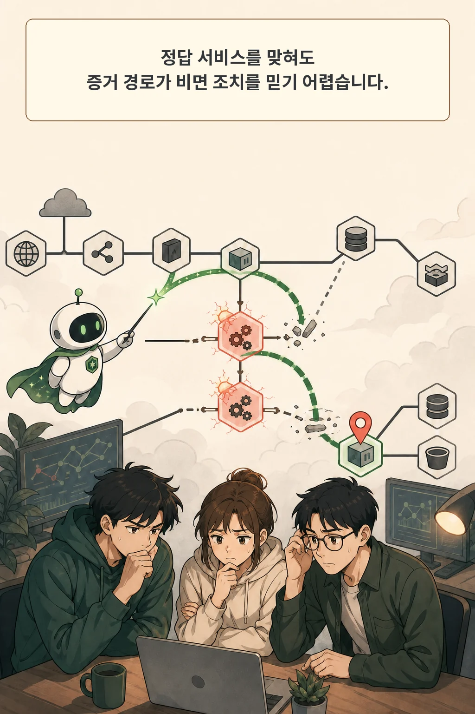
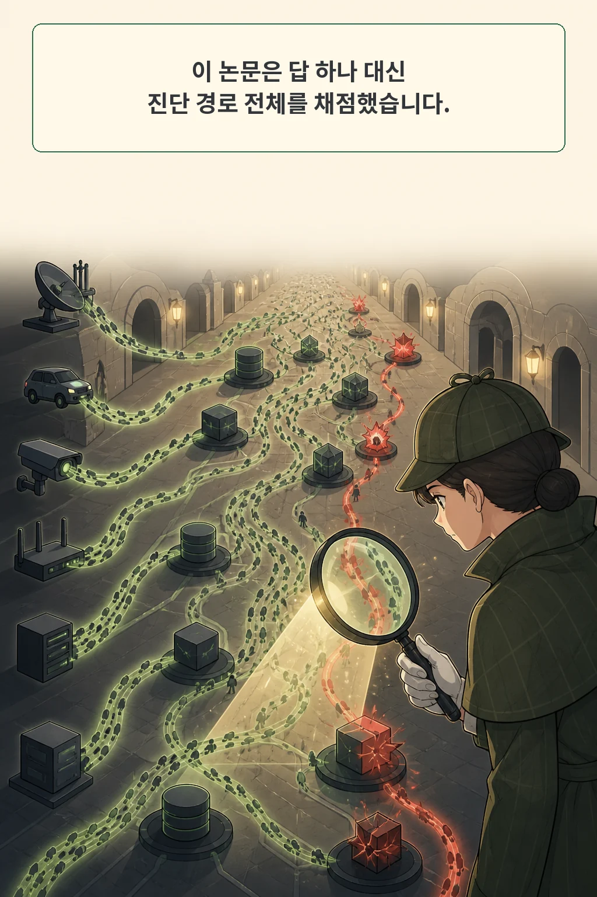
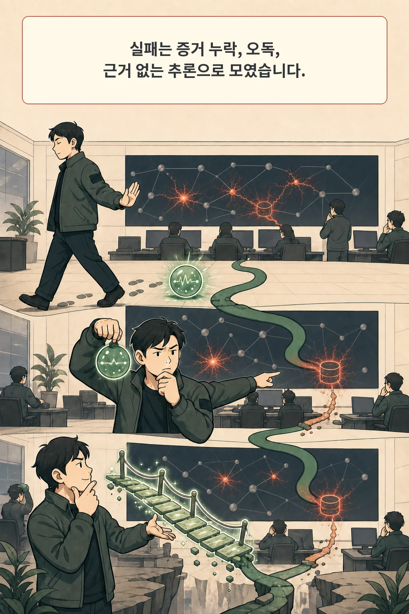
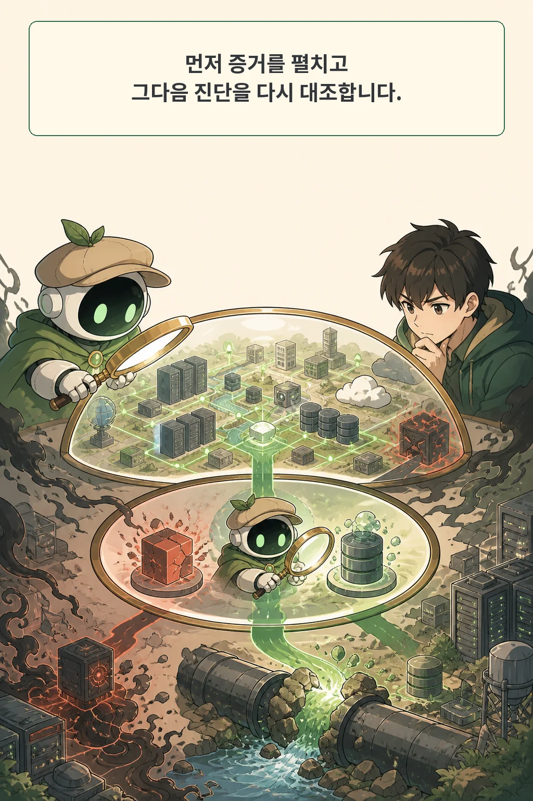
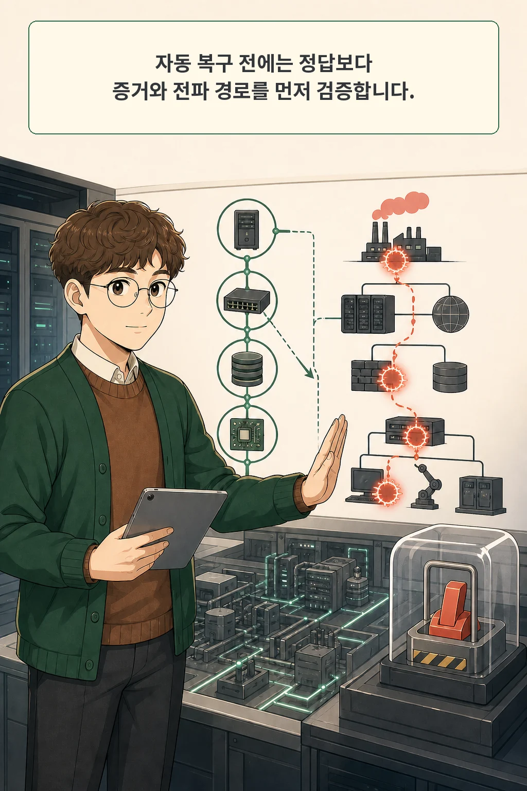

장애 원인을 맞힌 진단이라고 해서 실제 운영에 바로 쓸 수 있는 것은 아닙니다. 어떤 로그와 지표를 확인했고 장애가 어느 서비스를 거쳐 번졌는지 설명하지 못한다면, 그 정답은 우연과 구분하기 어렵고 자동 복구까지 연결할수록 위험이 커집니다. **「Beyond Fault Localization: A Trajectory-Level Study of LLM Agents for Microservice Root Cause Analysis」**는 최종 서비스 이름 대신 진단 과정 전체를 들여다보며, 3,500개 에이전트 궤적(trajectory)을 주석된 장애 전파 경로와 비교해 반복되는 실패를 이중 방어 구조인 `DiagGuard`로 풀어냈습니다.

글·해설: 다메카솔

## 핵심 내용

- 근본 원인(root-cause) 서비스가 맞아도 증거와 전파 경로가 빠진 진단은 조치 근거로 삼기 어렵습니다.
- 저자들은 RCABench 500개 사례에서 일곱 가지 구성의 3,500개 에이전트 궤적을 수집해 주석된 전파 경로와 대조했습니다.
- 실패는 결정적 증거 누락, 증거 오독, 증거와 무관한 추론의 세 계열로 정리됐습니다.
- 별도 AIOps 2025 조건에서 `DiagGuard`는 Acc@1을 43.5%에서 52.5%로 높였습니다.
- 특성화는 단일 토폴로지와 일회 실행에 기대므로 실제 자동 복구에는 별도의 승인 조건이 필요합니다.

## 맞힌 서비스와 믿을 수 있는 진단은 다르다

기존 마이크로서비스 근본 원인 분석(RCA) 평가는 대개 원인 서비스를 맞혔는지(Acc@1이나 Top-k 정확도)만 봅니다. 여러 방법을 한눈에 비교하기는 좋지만, 에이전트가 어떤 근거를 거쳐 그 답에 도착했는지는 가려 버립니다.

실제 운영자는 답 하나보다 훨씬 구체적인 연결 고리를 필요로 합니다. 예를 들어 저장소 계층의 I/O 이상이 데이터베이스를 거쳐 상품 서비스 지연으로 번졌다면, 진단은 그 연결을 텔레메트리(telemetry)로 뒷받침해야 합니다. 중간 서비스와 방향 간선을 건너뛴 채 마지막 노드만 맞혔다면 복구 대상이나 순서를 잘못 정할 수 있습니다. 이 논문이 **정답률 뒤에 숨은 조사 과정을 비교 가능한 근거로 만들 수 있는가**를 묻고, 근본 원인 라벨(root-cause label)과 서비스 수준 장애 전파 경로(service-level fault-propagation path)를 분리해 평가한 이유입니다.

## 3,500개 진단 경로를 전파 경로와 대조했다

저자들은 공개 RCABench의 1,430개 사례에서 단순 무작위 비복원 추출로 500개를 골랐습니다. 각 사례에는 원인 서비스 라벨만 있고 서비스 수준 전파 경로는 없어서, 장애 주입 정보와 전후 로그·지표·트레이스, TrainTicket 호출 그래프를 바탕으로 사람이 직접 전파 경로를 주석했습니다. 그다음 여섯 개의 에이전트 프레임워크를 같은 Qwen 백본으로 비교하고 `ThinkDepth.ai` 한 구성은 Sonnet으로 다시 돌려, 사례당 7개씩 총 3,500개 궤적(에이전트의 생각, SQL 질의, 반환된 텔레메트리, 최종 답 포함)을 수집했습니다.

평가는 최종 근본 원인을 맞혔는지 보는 `Acc@1`과 주석 경로의 서비스 노드·방향 간선을 얼마나 되찾았는지 보는 `Node F1`·`Edge F1`의 두 층으로 진행됐습니다. 공유 Qwen 백본에서 개방형 조사 프레임워크 세 개의 Acc@1은 77.6%~79.6%에 달했지만, 모든 구성의 평균 Edge F1은 0.67을 넘지 못했습니다. `ThinkDepth.ai`의 백본을 Sonnet으로 바꾸자 Acc@1은 10.8%p 높아졌으나 Edge F1은 0.66에서 0.67로 제자리걸음이었습니다. 더 강한 모델이 전파 경로까지 자동으로 복원해 주지는 않았다는 뜻입니다.

## 실패는 증거를 다루는 세 방식으로 모였다

성공한 조사에는 뚜렷한 방향이 있었습니다. 장애가 영향을 준 서비스와 텔레메트리 범위에 머물렀고, 실제로 조회한 증거에 맞춰 다음 질의를 바꿨으며, 인과 사슬이 깊어질수록 질의 의도도 넓어졌습니다. 반대로 실패한 조사는 다음 세 계열로 모였습니다.

| 실패 계열 | 진단에서 벌어진 일 |
| --- | --- |
| 증거 누락 | 비교 기준이나 결정적 service·metric·log를 조회하지 않음 |
| 증거 오독 | 가져온 신호의 의미, 시간 범위, 호출 방향을 잘못 읽음 |
| 근거 없는 추론 | 관측과 연결되지 않은 원인 상태를 만들거나 마찰을 피하려고 결론을 고정함 |

두 저자가 154개 실패 궤적을 독립 코딩했을 때 144개에서 같은 코드 집합을 부여해 93.5%의 일치도를 기록했습니다(세부 실패 코드는 한 궤적에 중복으로 나타날 수 있어 비율 합계가 100%가 되지는 않습니다). 또한 인과 사슬의 깊이가 깊어질수록 난도도 크게 뛰었는데, Qwen을 쓴 모든 프레임워크는 깊이가 2에서 5로 길어질수록 정확도가 떨어졌습니다. 이상 노드를 찾는 일과 노드 사이의 전파 방향을 복원하는 일은 난도가 전혀 달랐습니다.

## DiagGuard는 먼저 펼치고 나중에 의심한다

저자들은 이 실패 목록을 방어 요구사항으로 바꿔 기존 진단 코어 바깥에 **Grounder**와 **Verifier**를 두는 `DiagGuard`를 설계했습니다. Grounder는 답을 찾기 전에 이용 가능한 텔레메트리의 범위와 정상 구간 기준을 펼쳐 보지 못한 증거를 줄이고, Verifier는 에이전트가 고른 원인이 조회한 증거와 맞는지, 다른 설명을 배제했는지 다시 확인해 오독이나 억지 결론을 걸러냅니다.

전이 성능을 확인하기 위해 특성화와 다른 조건(AIOps 2025 e-commerce 벤치마크 400개 incident, 다른 서비스 토폴로지, 다른 벤더의 Seed 2.0 Pro 모델, 5회 반복 실행)에서 시험한 결과는 다음과 같았습니다.

- **전체 성능 향상**: held-out 조건에서 Acc@1은 43.5%에서 52.5%로, pass@3은 56.9%에서 67.1%로, pass@5는 62.3%에서 73.0%로 높아졌습니다.
- **구성요소별 기여(ablation)**: Grounder만 두면 Acc@1이 +4.1%p, Verifier만 두면 +4.5%p 올랐고, 둘을 함께 쓰면 +9.0%p 높아졌습니다(5회 실행 평균 기준).

다만 이번 특성화 분석은 RCABench의 TrainTicket 단일 토폴로지와 고정된 500개 표본, 1회 실행 결과(유의성 검정 미포함)에 기반하며, 과정 라벨링에 사람 주석과 LLM 보조 분류가 들어간다는 한계가 있습니다. 또한 저자들이 주석 경로와 코드북, 프롬프트 공개를 예고했으나 2026년 8월 24일 확인 시점에는 접근 가능한 공식 저장소가 없어, 이번 검토에서는 13쪽 PDF와 TeX 원문 묶음(35개 파일)으로 방법과 표를 교차 확인했습니다.

## 다메카솔의 해석: 자동 복구에는 증거 승인선을 둔다

LLM 기반 RCA를 실제 자동 복구와 연결한다면 **정답 서비스 일치**는 첫 조건으로만 두고, 다음 세 가지 조건이 모두 충족되기 전에는 시스템 변경 권한을 넘기지 않아야 합니다.

| 승인 조건 | 확인할 것 |
| --- | --- |
| 근거 telemetry | incident window와 정상 구간을 같은 entity·metric으로 비교했는가 |
| 전파 경로 | 관측된 서비스 노드와 방향 간선이 원인에서 증상까지 이어지는가 |
| 반증 확인 | 만성 잡음이나 더 단순한 대체 원인을 검토했는가 |

세 조건 가운데 하나라도 비면 사람에게 넘기고, 진단 보고서에는 조회하지 않은 텔레메트리까지 구분해 남겨야 합니다. 모델의 자연어 확신보다 재검사 가능한 증거 사슬(evidence chain)을 승인 근거로 삼아야 하며, “얼마나 자주 맞혔나”를 넘어 “무엇을 보고 어떤 경로를 따라 무엇을 배제했나”까지 재생할 수 있어야 자동 복구 권한을 논의할 수 있습니다.

## 논문 정보

| 항목 | 내용 |
| --- | --- |
| 제목 | Beyond Fault Localization: A Trajectory-Level Study of LLM Agents for Microservice Root Cause Analysis |
| 저자 | Qisheng Lu, Aoyang Fang, Junjielong Xu, Jin'ao Shang, Songhan Zhang, Yifan Yang, Xiaochuan Yan, Pinjia He |
| 공개 이력 | arXiv v1 제출 2026-08-21 17:13:45 UTC |
| 이 글의 분류 | 마이크로서비스 RCA agent trajectory empirical study |
| 공개 artifact | 수집 시점에 접근 가능한 저자 저장소 없음 (향후 공개 예고) |

## 자주 묻는 질문

### 원인 서비스를 맞혔다면 복구 결과도 같은 것 아닌가요?

복구는 대상뿐 아니라 조치 순서와 범위를 함께 요구합니다. 중간 전파 경로가 틀리면 증상 서비스를 원인으로 오인하거나 정상인 의존성을 먼저 건드릴 수 있으므로, 최종 정확도(endpoint accuracy)와 경로 증거(path evidence)를 함께 봐야 합니다.

### DiagGuard가 실제 production incident에서도 검증됐나요?

이 연구는 공개 벤치마크의 주입 장애를 사용했습니다. held-out 모델·데이터셋·토폴로지에서 이득을 보였지만, 장기 운영 환경의 불완전한 텔레메트리와 새로운 장애 유형을 다루는 프로덕션 검증은 앞으로의 과제입니다.

## 함께 읽기

- [AI 코딩 에이전트의 결과보다 작업 흔적을 먼저 읽어야 하는 이유](/posts/agentic-coding-production-traces/)
- [AI 에이전트는 기억하고도 현재 상태를 놓칠 수 있습니다](/posts/statemem-agent-memory-state-tracking/)

## 출처

- [Qisheng Lu 외, “Beyond Fault Localization: A Trajectory-Level Study of LLM Agents for Microservice Root Cause Analysis,” arXiv:2608.21310](https://arxiv.org/abs/2608.21310)
- [arXiv v1 PDF](https://arxiv.org/pdf/2608.21310)

이 글의 본문과 이미지는 생성형 AI로 제작했습니다. 기획과 편집 기준은 다메카솔이 정했습니다.

Updated: 2026-08-24
