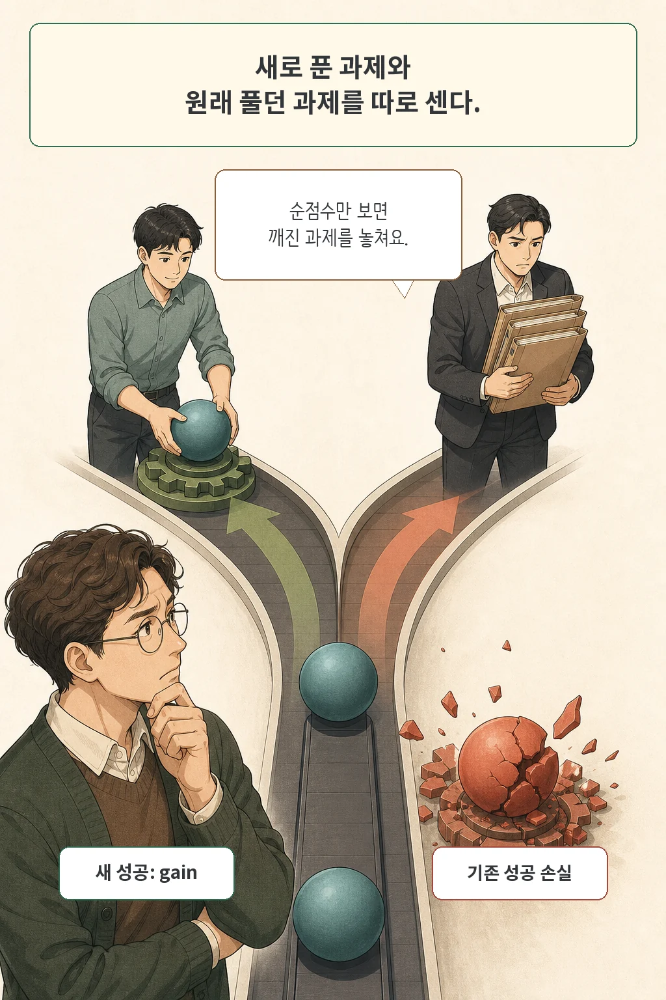
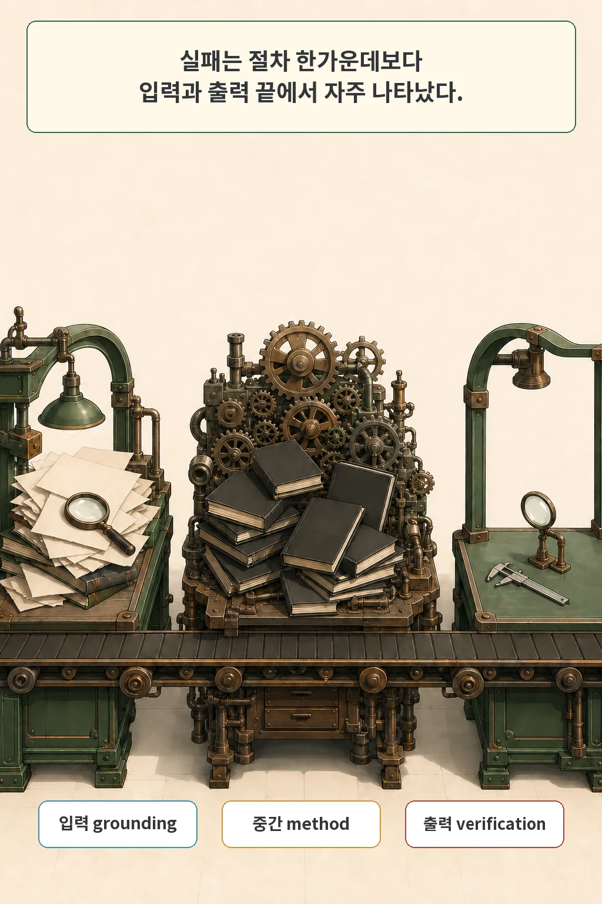
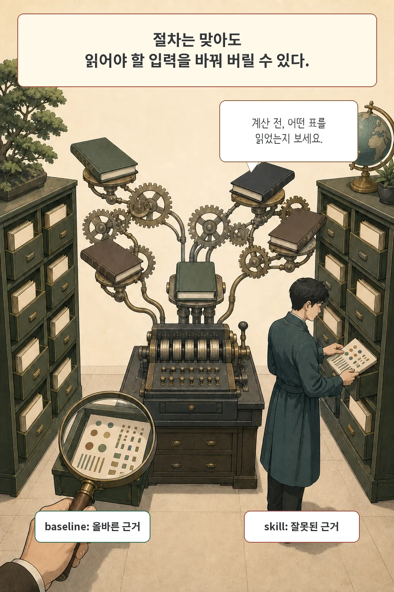
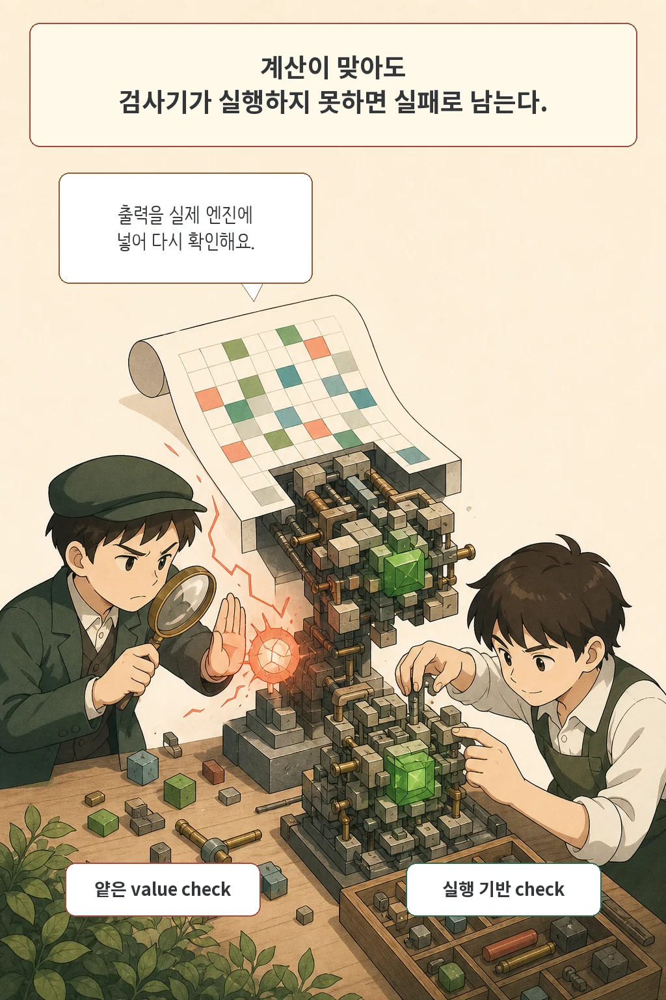
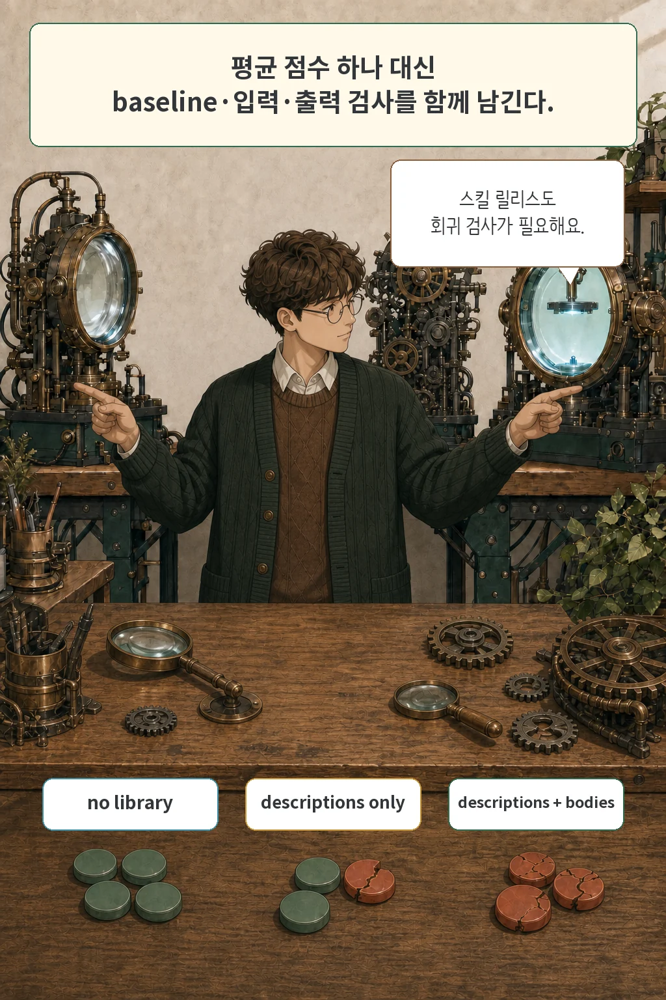

553번 좋아졌지만, 324번은 원래 풀던 문제를 오히려 틀렸습니다. 2026년 7월 24일 공개된 **The Regression Tax: Decomposing Why Skills Help and Hurt LLM Agents**는 LLM 에이전트에 절차형 스킬(skill library)을 넣기 전과 후를 동일한 과제로 짝지어 비교한 연구입니다. 새로 푼 과제(gain)와 원래 풀던 과제를 깨뜨린 경우(regression)를 따로 세어 보니, 스킬 도입으로 발생한 퇴행이 총이득(gross gain)의 **59%**를 깎아먹고 있었습니다.

글·해설: 다메카솔

## 핵심 내용

- **평균 성공률 뒤에 숨은 퇴행 세금(Regression Tax)**: 2개 오피스 자동화 벤치마크(OfficeQA-Pro 94개 + SpreadsheetBench 392개 = 총 486개 과제)와 3개 모델-하네스 스택, 4개 스킬 조건(`486 × 4 × 3 = 5,832` 실행)을 18개 조건 쌍으로 비교한 결과, 새 성공 전이(gain) 553건 대비 퇴행 전이(regression)가 324건 발생해 순이득(net gain)은 229건에 머물렀습니다.
- **세 가지 퇴행·병목 경로**: 스킬 본문을 열지 않았는데도 시스템 프롬프트의 스킬 설명만으로 행동이 바뀌는 **Skill-description osmosis**(SpreadsheetBench 퇴행 243건 중 70건), 일반화된 스킬 절차를 따르다 오히려 올바른 입력 문서·셀 선택을 놓치는 **Grounding displacement**(OfficeQA-Pro 본문 관여 퇴행 81건 중 59건), 그리고 산출물 수식을 얕은 채점기가 재계산하지 못해 오답 처리하거나 검증 도구가 부족한 **Verification 병목**이 확인되었습니다.
- **해석 및 통계적 경계**: 18개 McNemar 검정 중 명목상 유의(`p < .05`)는 5개였고, Bonferroni 보정 후 유의성이 남은 3개 조건은 모두 `Claude Code + Claude Sonnet 4.6`의 SpreadsheetBench에 집중되었습니다.

## 평균 성공률은 무엇을 숨기나

연구진은 같은 과제의 스킬 미적용(`no-skill`) 결과와 스킬 적용(`skill`) 결과를 일대일로 짝지었습니다. 기본 상태에서 실패했다가 스킬을 넣고 성공하면 **이득(gain)**, 반대로 기본 상태에서 성공하던 과제가 스킬을 넣은 뒤 실패하면 **퇴행(regression)**입니다(둘 다 실패하면 `residual failure`, 둘 다 성공하면 `retained success`).

평균 성공률 차이만 보면 이득에서 퇴행을 뺀 순증가(net gain)만 보입니다. 하지만 똑같이 `+5`가 올랐더라도, 새 성공 15개와 퇴행 10개를 만든 스킬 라이브러리와 새 성공 7개와 퇴행 2개를 만든 라이브러리는 운영 안정성이 전혀 다릅니다.

논문이 3개 스택(`OpenCode + MiniMax-M2.7`, `Codex + GPT-5.4-mini`, `Claude Code + Claude Sonnet 4.6`)과 3개 스킬 라이브러리의 18개 조건 비교에서 집계한 과제 전이(transition) 합계는 **이득 553건, 퇴행 324건(순이득 229건)**으로, 퇴행이 총이득의 59%를 상쇄했습니다.

## 입력, 절차, 검증의 세 단계와 세 가지 실패 메커니즘

저자들은 에이전트 작업 과정을 **입력 근거 확보(Grounding) → 절차 수행(Method) → 산출물 검증(Verification)**의 세 단계로 나누고, 스킬이 개입할 때 나타나는 세 가지 현상을 추적했습니다.

| 현상 및 단계 | 주요 관찰 수치 | 작동 방식과 시사점 |
| --- | --- | --- |
| **1. Skill-description osmosis** (열지 않은 스킬 설명의 삼투) | SpreadsheetBench 퇴행 243건 중 **70건** (단, 호출 없는 이득도 다수 존재) | 스킬 본문(body)을 호출하지 않았는데도 시스템 프롬프트에 상주한 스킬 이름·요약 설명만으로 에이전트의 행동 경로가 바뀜 (단순 호출 on/off 실험으로는 포착 불가) |
| **2. Grounding displacement** (절차에 밀려난 입력 독해) | OfficeQA-Pro 본문 관여 퇴행 81건 중 **59건** | 스킬 본문의 일반적인 절차(Method)를 따르느라 정작 질문이 요구한 정확한 문서·연도·셀 위치(Grounding)를 놓침 (예: 1934년·1946년 수치를 제대로 골라 `142`를 내던 에이전트가 스킬 적용 후 엉뚱한 표를 읽어 `542` 반환) |
| **3. Verification 병목과 채점기 한계** (산출물 실행 검증) | 수식 포함 실패 663건 재계산 시 **226건이 실제 정답** (396건 오답, 41건 계산 불가) | 에이전트가 산출물을 실제 엔진으로 검증할 도구가 부족하거나, 반대로 벤치마크의 얕은 값 비교 채점기(value-only grader)가 유효한 엑셀 수식을 재계산하지 못해 실패로 오판함 |

특히 두 번째인 **Grounding displacement**는 실무에 시사하는 바가 큽니다. 기존 스킬 문서는 주로 중간 계산이나 편집 절차(Method)를 길게 설명하는 데 집중하지만, 실제 실패 궤적을 짝지어 보면 절차 자체보다 **처음에 어느 문서와 셀을 집어 들었는가(Grounding)**와 **마지막에 결과를 실행해 확인했는가(Verification)**에서 퇴행이 집중되었습니다.

세 번째인 **Verification** 분석 역시 에이전트 자체의 검증 도구와 평가 채점기 양쪽 모두에 경종을 울립니다. SpreadsheetBench에서 실패로 분류된 수식 포함 답안 663건을 완전한 스프레드시트 엔진으로 다시 계산해 보니 226건은 이미 올바른 수식이었습니다.

## 통계적 유의성과 공개 자료의 한계

이 연구의 수치를 일반화할 때는 논문이 직접 밝힌 다섯 가지 방법론적 한계를 함께 봐야 합니다.

1. **통계적 유의성의 편중**: 18개 조건 쌍에 대한 McNemar 검정 중 명목상 `p < .05`를 만족한 것은 5개였고, 다중 비교(Bonferroni) 보정을 거친 뒤 유의성이 남은 3개 조건은 모두 `Claude Code + Claude Sonnet 4.6`의 SpreadsheetBench 실험이었습니다.
2. **단일 실행과 스택 결합**: 오피스 자동화 벤치마크 2종에 국한되어 있으며, 각 조건을 시드(seed) 반복 없이 1회씩만 실행해 실행 간 분산을 측정하지 못했습니다. 또한 모델과 하네스가 한 스택으로 묶여 있어 두 요인의 효과를 단독으로 분리할 수 없습니다.
3. **인과 통제와 코딩 한계**: 라이브러리마다 토큰 길이와 문구가 달라 동일 토큰 조건이 아니며, 실패 메커니즘 라벨은 저자 1인이 코딩해 코더 간 합의도(inter-coder agreement)가 보고되지 않았습니다.
4. **재현 저장소 범위**: 논문에 연결된 공식 저장소(`sentient-agi/meta-skill-creator`, Apache-2.0, 2026년 7월 28일 기준 commit `02cb1db9...`)에는 스킬 생성기 구현체가 공개돼 있으나, 5,832개 실행의 원시 궤적(raw trajectory)과 전체 분석 코드는 포함되어 있지 않습니다.

## 다메카솔의 해석: 스킬 배포 전 3단계 분리 평가

에이전트에 새로운 프롬프트 스킬이나 절차 문서를 추가할 때는 평균 점수 하나만 보고 배포하지 않도록 세 갈래 대조 실험을 기본 관문으로 둘 만합니다.

1. **스킬 미적용 (`No library`)**: 기존에 잘 풀던 과제 목록을 회귀 테스트 기준선으로 고정합니다.
2. **요약 설명만 탑재 (`Descriptions only`)**: 본문 호출 없이 시스템 프롬프트에 스킬 목록만 들어갔을 때 생기는 삼투 효과(osmosis)를 먼저 분리해 측정합니다.
3. **설명 + 본문 호출 (`Descriptions + bodies`)**: 실제 스킬 본문을 읽었을 때 새로 얻은 이득(gain)과 기존 성공을 깨뜨린 퇴행(regression)을 따로 집계합니다.

만약 퇴행이 발생했다면 중간 절차 설명을 더 길게 늘리기 전에, 스킬이 에이전트의 **초기 입력 문서·셀 선택(Grounding)**을 흐트러뜨리지 않았는지와 **최종 산출물을 실제 엔진으로 실행해 보는 검증 단계(Verification)**가 빠지지 않았는지부터 점검해야 합니다.

## 논문 정보

| 항목 | 내용 |
| --- | --- |
| 제목 | The Regression Tax: Decomposing Why Skills Help and Hurt LLM Agents |
| 저자 | Darshan Tank, Baran Nama |
| 소속 | Sentient Labs |
| arXiv v1 제출 | 2026-07-24 17:50:03 UTC |
| 분야 | cs.AI |
| 평가 규모 | 486개 과제 × 4개 조건 × 3개 스택 = 5,832회 실행 |
| 공식 연결 저장소 | `sentient-agi/meta-skill-creator` (Apache-2.0) |

## 출처

- [논문 초록과 메타데이터, arXiv:2607.22520](https://arxiv.org/abs/2607.22520)
- [논문 원문 PDF](https://arxiv.org/pdf/2607.22520)
- [arXiv HTML 원문](https://arxiv.org/html/2607.22520)
- [저자 공식 meta-skill-creator 저장소](https://github.com/sentient-agi/meta-skill-creator)

이 글의 본문과 이미지는 생성형 AI로 제작했습니다. 기획과 편집 기준은 다메카솔이 정했습니다.
