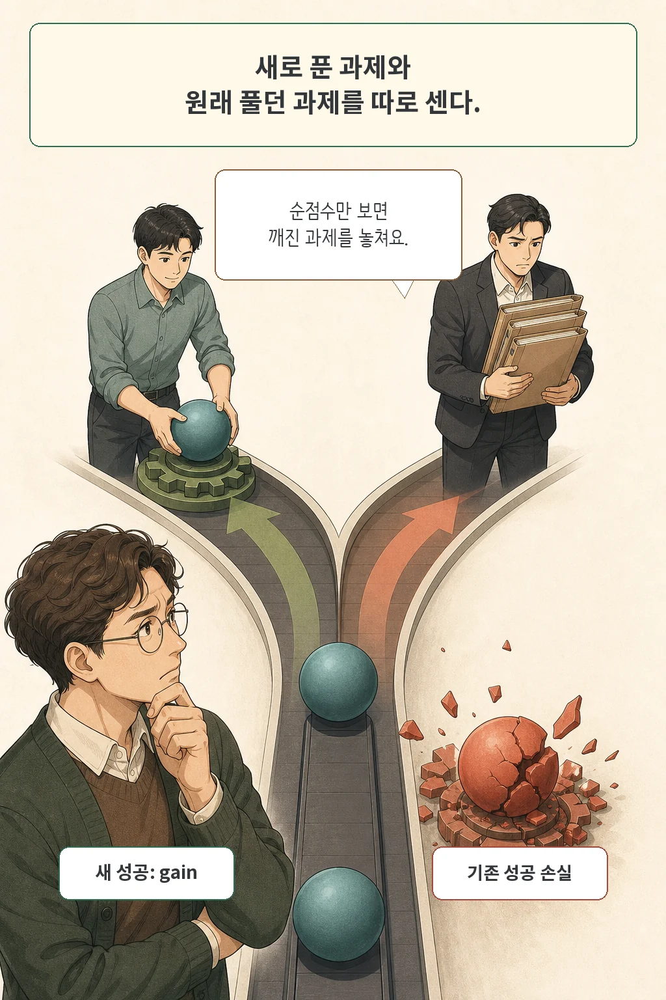
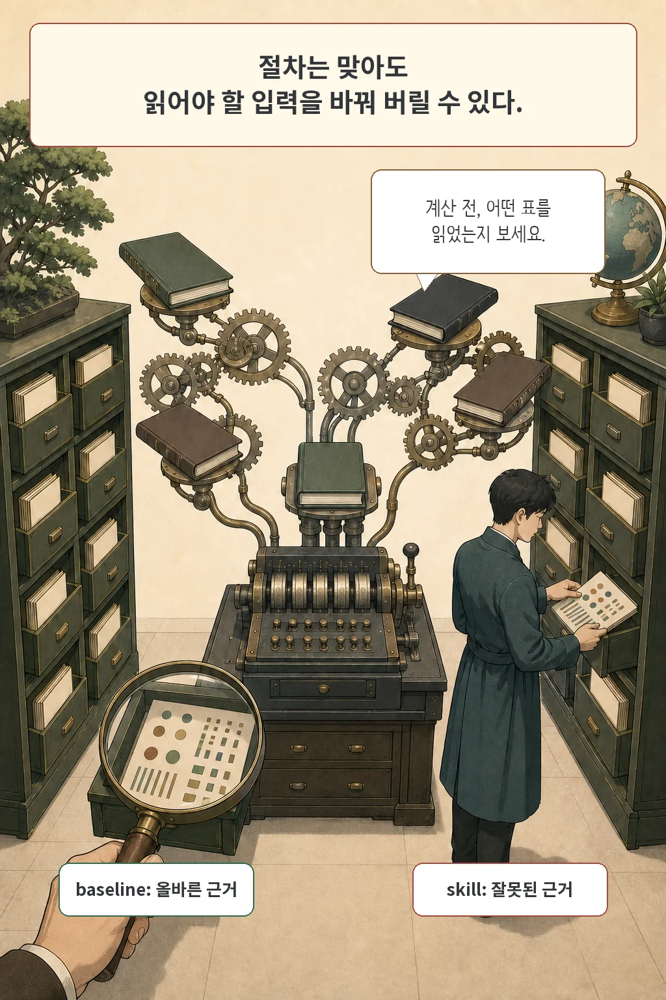
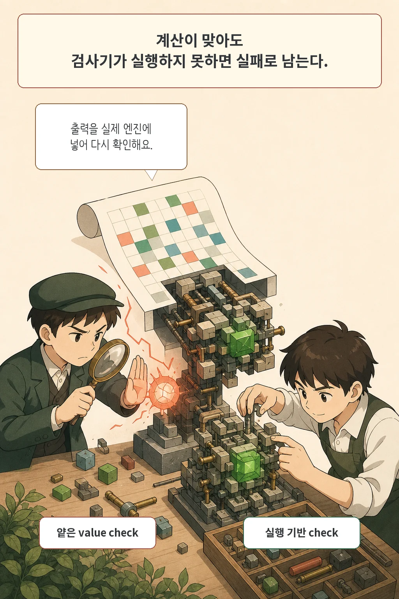

에이전트에 절차형 스킬을 붙이면 새 과제는 곧잘 풀기 시작하지만, 정작 예전에는 거뜬히 통과하던 작업이 갑자기 깨지는 일이 생깁니다. 최근 발표된 **「The Regression Tax」** 연구는 스킬 적용 전후를 같은 과제로 짝지어 비교해 보니, 새로 얻은 성공 553건의 59%에 해당하는 324건이 기존 성공의 퇴행으로 상쇄됐다고 보고합니다. 평균 합격률 한 줄 뒤에서 조용히 쌓이는 이 '퇴행 세금'이 왜 생기는지 살펴볼까요?

글·해설: 다메카솔

## 핵심 내용

- **순이득에 가려진 퇴행 세금**: 486개 과제·5,832회 실행(18쌍 비교)에서 이득 553건 대비 퇴행 324건이 나와 순이득은 229건에 머물렀습니다.
- **세 가지 실패 경로**: 본문 미호출 설명 삼투(**osmosis**), 일반 절차에 밀린 입력 손실(**grounding displacement**), 검증·채점 한계(**verification**)입니다.
- **유의성과 범위**: Bonferroni 보정 후 유의한 조건은 18개 중 3개로, 모두 `Claude Code + Claude Sonnet 4.6`의 SpreadsheetBench에 집중됐습니다.

## 평균 성공률은 무엇을 숨기나

연구진은 같은 과제의 스킬 미적용(`no-skill`)과 적용(`skill`) 결과를 일대일로 짝지었습니다. 기본 상태에서 틀리다 스킬로 맞히면 **이득(gain)**이고, 원래 맞던 과제가 깨지면 **퇴행(regression)**으로 봅니다. 둘 다 실패하면 `residual failure`, 둘 다 성공하면 `retained success`로 구분하죠.

예를 들어 평균 통과율이 똑같이 오른 두 라이브러리를 떠올려 봅시다. 한쪽이 새 성공 15건을 얻고 기존 작업 10건을 깨뜨렸다면, 새 성공 7건에 퇴행을 2건으로 막은 쪽과는 운영 안정성이 크게 다르거든요.

- **벤치마크(486개)**: OfficeQA-Pro 94개, SpreadsheetBench 392개
- **스택(3종)**: `OpenCode + MiniMax-M2.7`, `Codex + GPT-5.4-mini`, `Claude Code + Claude Sonnet 4.6` (모델·하네스 분리 불가)
- **조건(4종, 5,832실행)**: `no-skill` 기준선과 `anthropic`·`openai`·저자 라이브러리 비교(18쌍)

## 입력·절차·검증의 세 단계와 세 가지 실패 경로

저자들은 작업 흐름을 **입력 확보(Grounding) → 절차 수행(Method) → 산출물 검증(Verification)**으로 나누어 살폈습니다. 스킬 문서는 주로 중간 절차에 집중하지만, 퇴행은 앞단의 입력 선택과 뒷단의 확인 단계에서 두드러졌습니다.

| 메커니즘 | 핵심 수치 | 작동 방식 |
| --- | --- | --- |
| **1. Skill-description osmosis** | SpreadsheetBench 퇴행 243건 중 **70건** | 본문을 열지 않아도 시스템 프롬프트의 이름·설명이 경로를 바꿈 |
| **2. Grounding displacement** | OfficeQA-Pro 본문 관여 퇴행 81건 중 **59건** | 일반 절차에 밀려 질문이 지정한 표·연도·셀을 놓침 |
| **3. Verification 병목** | 수식 포함 실패 663건 재계산 시 **226건 정답** (오답 396, 불가 41) | 검증 도구 부재와 얕은 값 비교 채점기의 수식 미계산이 겹침 |

먼저 **Skill-description osmosis**는 스킬 본문을 불러오지 않은 상태에서도 일어납니다. 시스템 프롬프트에 남은 이름과 요약만으로 에이전트 경로가 바뀌는 셈이죠. 다만 참여도가 낮은 두 스택에서는 호출 없는 이득이 퇴행보다 많아, 설명 자체가 도움과 방해를 함께 만들었습니다.

두 번째 **Grounding displacement**는 절차 지침이 입력 독해를 밀어내는 현상입니다. 가령 OfficeQA-Pro에서 기본 에이전트는 1934년·1946년 수치를 골라 `142`를 냈지만, 스킬 적용 후에는 엉뚱한 표를 읽어 `542`를 반환했습니다. 잔여 실패 역시 OfficeQA-Pro는 잘못된 입력 지정에, SpreadsheetBench는 출력 검증에 주로 놓여 있었습니다.

세 번째 **Verification 병목**은 확인 도구와 채점 방식을 함께 돌아보게 합니다. SpreadsheetBench에서 오답 처리된 수식 포함 답안 663건을 완전한 엔진으로 재계산하자 226건이 이미 정답이었거든요. 얕은 값 비교 채점기가 수식을 계산하지 못한 데다, 에이전트 역시 산출물을 실제 엔진으로 검증할 도구가 부족했습니다.

## 통계적 유의성과 해석 한계

이 결과를 모든 에이전트에 그대로 일반화하기는 어렵습니다. 논문도 설계와 공개 자료의 한계를 분명히 짚어 두었습니다.

1. **유의성 편중**: 18개 McNemar 검정 중 명목상 `p < .05`는 5개였고, Bonferroni 보정 후 남은 3개는 모두 `Claude Code + Claude Sonnet 4.6`의 SpreadsheetBench 조건이었습니다.
2. **단일 실행·스택 결합**: 오피스 벤치마크 2종을 시드 없이 1회만 돌려 분산을 재지 못했고, 모델과 하네스 효과도 분리하기 어렵습니다.
3. **비통제 길이·단일 코더**: 라이브러리 길이를 맞추지 않았고, 메커니즘 라벨은 저자 1인이 코딩해 코더 간 일치도가 빠져 있습니다.
4. **공개 저장소 범위**: `sentient-agi/meta-skill-creator`(Apache-2.0)는 스킬 생성기 코드만 공개하며, 5,832회 실행의 원시 궤적과 분석 코드는 논문·arXiv 번들에 포함되지 않았습니다.

## 다메카솔의 해석: 배포 전 3단계 분리 평가

스킬을 배포할 때는 평균 점수 하나만 보지 말고 아래 세 조건을 분리해 점검할 필요가 있습니다.

1. **스킬 미적용 (`No library`)**: 기존 성공 과제를 회귀 기준선으로 고정합니다.
2. **요약 설명만 탑재 (`Descriptions only`)**: 본문 호출 전 프롬프트 설명만으로 생기는 삼투(osmosis) 영향을 먼저 살핍니다.
3. **설명 + 본문 (`Descriptions + bodies`)**: 본문 적용 후 얻은 이득(gain)과 깨진 과제(regression)를 나란히 집계합니다.

퇴행이 나타나면 절차를 더 길게 쓰기 전에, 스킬이 **초기 문서·셀 선택(Grounding)**을 흐트러뜨리지 않았는지와 **실행 검증(Verification)** 단계가 빠지지 않았는지부터 점검해야 합니다.

## 논문 정보

| 항목 | 내용 |
| --- | --- |
| 제목 | The Regression Tax: Decomposing Why Skills Help and Hurt LLM Agents |
| 저자 · 소속 | Darshan Tank, Baran Nama (Sentient Labs) |
| arXiv v1 제출 | 2026-07-24 17:50:03 UTC (`cs.AI`) |
| 평가 규모 | 486개 과제 × 4개 조건 × 3개 스택 = 5,832회 실행 |
| 공식 연결 저장소 | `sentient-agi/meta-skill-creator` (Apache-2.0) |

## 출처

- [논문 초록과 메타데이터, arXiv:2607.22520](https://arxiv.org/abs/2607.22520)
- [논문 원문 PDF](https://arxiv.org/pdf/2607.22520)
- [arXiv HTML 원문](https://arxiv.org/html/2607.22520)
- [저자 공식 meta-skill-creator 저장소](https://github.com/sentient-agi/meta-skill-creator)

이 글은 논문 원문과 공개 저장소를 바탕으로 해설하며, 실험을 독립 재현하지 않았고 논문 그림은 새로 구성했습니다.

이 글의 본문과 이미지는 생성형 AI로 제작했습니다. 기획과 편집 기준은 다메카솔이 정했습니다.
