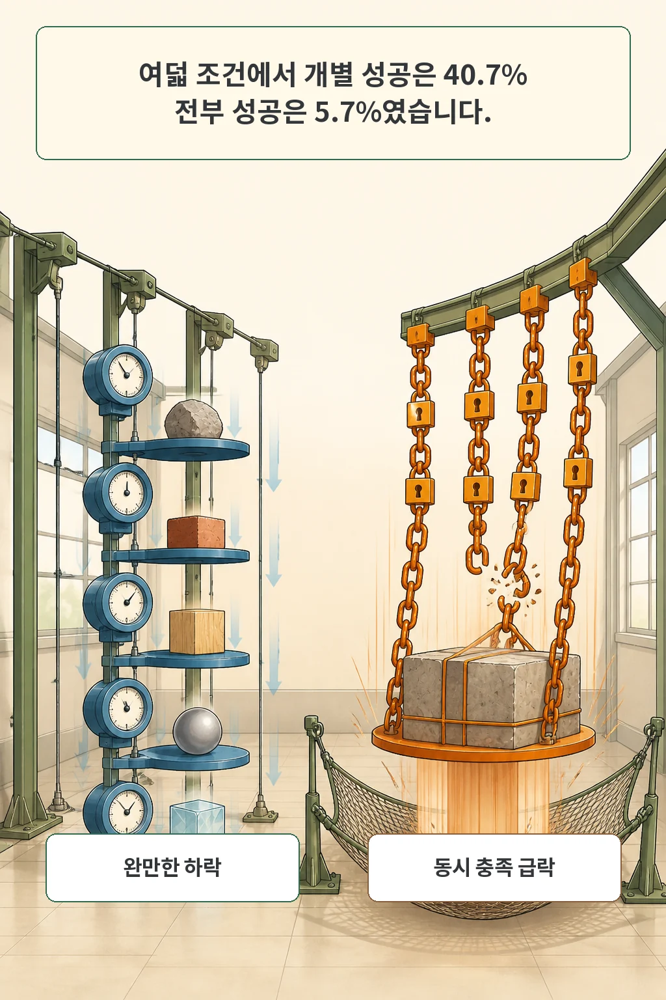

한 응답에 요구하는 조건이 8개가 되자 개별 조건은 평균 40.7% 통과했지만, 여덟 조건을 모두 만족한 응답은 5.7%에 불과했습니다. 조건 하나씩 떼어 보면 완만한 하락인데 전부를 동시에 요구하는 순간 결과가 가파르게 무너진 것입니다. **「Large Language Models Can Follow Instructions, But Not Many at Once」**는 LLM 심사자 대신 결정적 규칙 검사기를 쓰는 `Constraint Saturation Evaluation (CSE)`으로 제약 수를 1개에서 12개까지 늘려 가며 이 곱셈형 붕괴 현상을 측정했습니다.

글·해설: 다메카솔

## 핵심 내용

- 개별 제약의 평균 통과율(`marginal CSR`)과 모든 제약의 동시 통과율(`strict CSR`)은 전혀 다른 궤적을 그립니다.
- 작은 실패율도 제약마다 누적되면 전체 성공률은 곱으로 급락해 `k=8`에서 평균 통과율 40.7% 대비 동시 통과율은 5.7%로 떨어졌습니다.
- 문단 수·문장 길이·관계 순서처럼 생성 내내 추적해야 하는 구조 제약이 단순 어휘 제약보다 기준 능력을 약 2배 더 빨리 잃었습니다.
- 생성 전 계획(planning scaffold)은 붕괴 임계점을 옮기지 못했고, 사후 자기수정과 best-of-5 재시도도 한두 조건의 여유만 만들었습니다.
- 실무에서는 중요한 요구를 단일 프롬프트에 몰아넣지 말고 단계로 나누어 각 경계에서 결정적으로 검증해야 합니다.

## 하나씩 통과해도 전부 통과하는 것은 아닙니다

논문이 구분한 두 지표부터 짚어야 합니다. `marginal CSR`은 개별 제약의 평균 통과율이고, `strict CSR`은 한 응답에 걸린 모든 제약을 동시에 통과한 비율입니다. 제약이 하나일 때는 두 값이 같지만 제약 수가 늘어나면 간격이 급격히 벌어집니다.

논문은 이 현상을 특정 제약끼리 유난히 충돌해서 생기는 문제라기보다(평균 쌍별 실패 상관은 약 0.067), 각 제약의 작은 실패 확률이 곱으로 누적되는 구조로 설명합니다. 실제 프로덕션에서 JSON 형식, 길이, 금지어, 안전 경계, 근거 표기 가운데 하나라도 어기면 실패로 처리해야 하는 작업이라면 개별 평균 점수는 성공을 보장하지 못합니다.

## CSE는 제약 수를 늘리고 규칙으로 판정했습니다

`CSE`는 절차적으로 제약 조합을 생성하되 서로 양립할 수 없는 조합은 호환성 검사기(compatibility checker)에서 걸러내고, 만족 가능한 조합만 모델에 제시한 뒤 제약마다 작성된 결정적 함수로 통과 여부를 판정합니다. 초록과 방법 절 기준 8개 처리 차원, 36개 제약 유형, 4,527개 프로브(probe), 15개 모델을 대상으로 제약 수 `k`를 1에서 12까지 늘리며 총 369,753건의 제약 검사를 수행했습니다(문자 금지·필수 단어 같은 국소 제약부터 문단 수·문장 길이·관계 순서·자기 단어 수 보고처럼 생성 전체를 추적해야 하는 전역 제약까지 포함합니다).

결정적 검사는 판정기의 흔들림을 없애 주지만, 문맥 일관성(coherence)이나 정보성, 어조, 사실 정확성처럼 의미 판단이 필요한 조건은 평가 대상에서 빠지고 모든 요구를 동시에 만족하는 논리곱(conjunction)만 측정한다는 범위 한계도 함께 가집니다.

## 완만한 하락이 전체 응답에서는 절벽이 됩니다

실험에서 드러난 곱셈형 붕괴와 완화 시도의 결과는 다음과 같습니다.

- **개별 통과율 vs. 동시 통과율**: 전체 집계에서 개별 제약 통과율은 $72.0\% \times 0.922^{(k-1)}$에 가깝게 완만히 감소했지만(held-out MAE 0.2%p), 동시 통과율(`strict CSR`)은 급락해 `k=8`에서 개별 40.7% 대비 동시 5.7%를 기록했습니다. 가장 강한 모델도 7개 제약에서 프로브 수준 성공률이 50% 아래로 내려갔고, 15개 모델 중 12개는 3개 이하에서 그 임계점을 지났습니다.
- **구조 제약의 빠른 붕괴**: 문단 수·문장 길이·관계 구조처럼 생성 내내 상태를 유지해야 하는 구조 제약은 어휘 제약보다 제약 하나가 추가될 때 기준 능력을 약 2배 더 잃었습니다(저자는 이를 이해 부족이 아니라 끝까지 유지하지 못하는 `comprehension-maintenance gap`으로 해석합니다).
- **계획·자기수정·재시도의 한계**: 세 모델에서 시험한 생성 전 계획(planning scaffold)은 출력 예산 부족 효과를 분리해도 반감기를 일관되게 늘리지 못했습니다. 사후 자기수정과 best-of-5 재시도는 임계점을 한두 제약 늦췄으나, 같은 프로브가 여러 추출(draw)에서도 비슷한 방식으로 반복 실패하는 경향 때문에 독립 재표본화 기대치보다 이득이 작았습니다.

결과를 읽을 때는 원문 프리프린트(arXiv v1)의 편집 불일치와 공개 경계도 유의해야 합니다. 초록·방법은 36개 제약과 369,753개 검사를 적지만 한계 절은 30개 제약을, 결과 표는 314,108개 satisfiable check를 사용하며, 초록의 코드 공개 문구와 달리 부록 A는 출판 시 공개 예정이라고 적어 2026년 8월 14일 기준 공식 코드·데이터 URL은 확인되지 않았습니다. 또한 빈 코드 블록이나 문장 복사처럼 결정적 검사기의 형식 조건만 우회 통과한 사례도 보고되어, 기계적 사양 통과와 실질적 유용성은 구분해 읽어야 합니다.

## 다메카솔의 해석

이 논문이 주는 실무적 교훈은 **단일 프롬프트를 더 정교하게 길게 쓰는 것보다 작업을 단계로 나누고 각 경계를 검사하는 편이 낫다**는 것입니다. 한 번의 호출에 출력 형식, 분량, 안전, 근거 표기, 도구 사용, 어조 제약을 겹겹이 얹으면 개별 제약 준수율이 높아 보여도 전체 동시 통과율은 급격히 무너집니다.

따라서 중요한 요구는 생성 단계와 검증 단계로 분리하고, 단계당 제약 수를 줄인 뒤 JSON 스키마·허용값·출처 존재·테스트 결과처럼 코드로 확인할 수 있는 조건을 즉시 검사해 실패 시 다음 단계로 넘기지 않는 fail-closed 파이프라인을 구성해야 합니다.

## 논문 정보

| 항목 | 내용 |
| --- | --- |
| 제목 | Large Language Models Can Follow Instructions, But Not Many at Once: Phase Transitions in Compositional Constraint Satisfaction |
| 저자 | Mariya I. Vasileva |
| arXiv v1 제출 | 2026-08-12 10:57:06 UTC (2026-08-14 cs.AI 신규 목록 등장) |
| 분야 | cs.AI, cs.CL |
| 상태 | arXiv preprint, ARR May 2026 review 표기; 채택 페이지 미확인 |

## 출처

- [논문 초록과 메타데이터 — arXiv:2608.12426](https://arxiv.org/abs/2608.12426)
- [논문 원문 PDF](https://arxiv.org/pdf/2608.12426)
- [공식 arXiv TeX source bundle](https://export.arxiv.org/e-print/2608.12426)
- [관련 글: AI 에이전트의 판단 근거는 왜 로그만으로 부족할까](/posts/workflow-as-knowledge/)

이 글의 본문과 이미지는 생성형 AI로 제작했습니다. 기획과 편집 기준은 다메카솔이 정했습니다.

Updated: 2026-08-14
