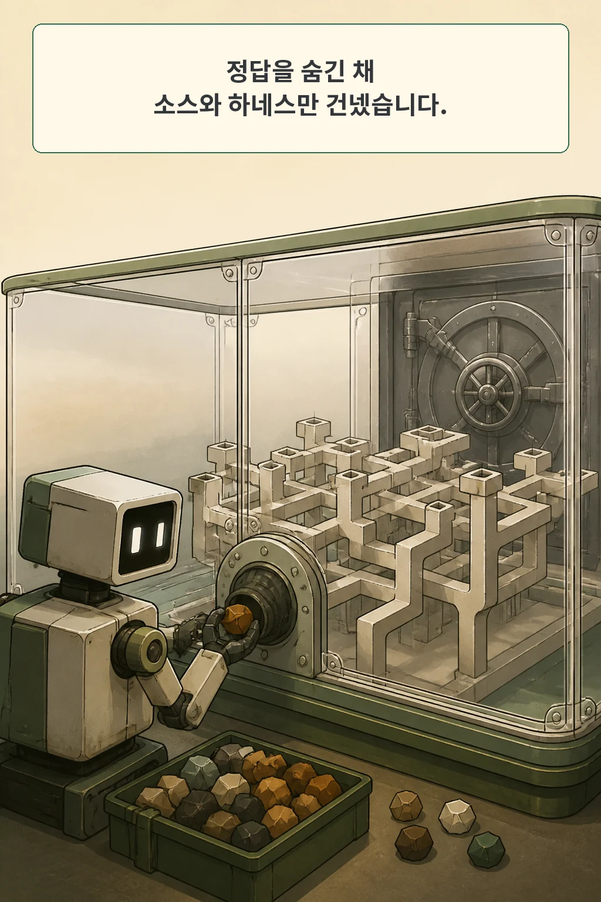
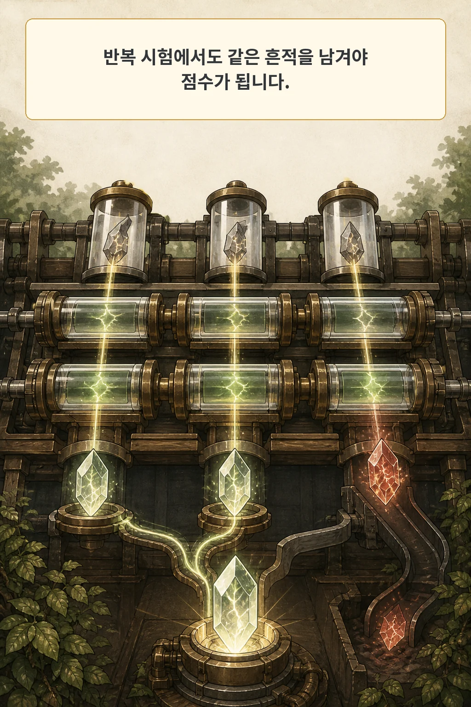
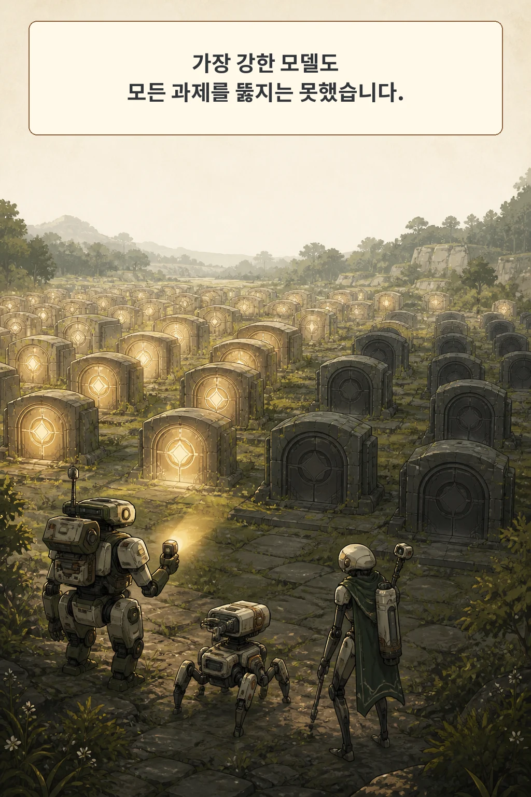

보안 에이전트나 퍼저가 목표 취약점과 다른 위치에서 새로운 크래시를 찾아냈다면, 이 결과를 오답으로 버려야 할까요? 「FuzzingBrain-Bench V1」은 알려진 정답을 모델에게 숨긴 채, 실제 실행에서 재현되는 서로 다른 크래시를 얼마나 넓게 찾는지 측정하는 개방형 평가를 제안합니다.

글·해설: 다메카솔

## 핵심 내용

- **정답 비공개 환경**: 43개 프로젝트의 77개 과제에서 참조 PoC·패치·정답 위치를 모두 가렸습니다.
- **3회 재현 기반 채점**: 하네스에서 세 번 연속 같은 크래시 서명이 나와야 점수로 인정합니다.
- **모델별 탐색 성적**: Claude Opus 4.8이 196/579점(60/77개 과제)으로 1위였으나, 17개 과제에서는 크래시를 내지 못했습니다.
- **서명과 취약점 분리**: 고유 크래시 서명이 곧 고유 근본 취약점은 아니므로, 실무에서는 원인 분석과 승인 관문이 따로 필요합니다.

## 정답 하나만 보면 유효한 실패도 놓칩니다

기존의 취약점 재현형 벤치마크는 모델이 이미 알려진 버그를 다시 찾아냈는지 확인하는 데 적합합니다. 예상한 결함 위치나 참조 PoC(개념증명 입력)와 일치하면 곧바로 성공으로 채점할 수 있거든요.

하지만 미지의 버그를 찾는 탐색에서는 이 기준이 오히려 발목을 잡습니다. 가령 오픈소스 파서를 점검하던 에이전트가 기존 리포트의 힙 오버플로 대신 다른 위치의 널 포인터 역참조 크래시를 찾아냈다고 해 봅시다. 정해진 정답 하나만 맞혀야 하는 평가라면 이 유용한 발견마저 오답 처리될 수 있는 셈이죠. FuzzingBrain-Bench는 정답 복원 대신 과제 안에서 **재현 가능한 서로 다른 크래시 서명**을 세어 점수로 환산합니다.

## 정답 대신 소스와 하네스만 남긴 환경

각 과제의 Docker 이미지에는 취약한 리비전의 소스 코드, 퍼징 하네스, sanitizer 설정, 계측된(instrumented) 하네스 바이너리만 담겨 있습니다. 참조 PoC, 버그 리포트, 패치, Git 히스토리는 모델에게 제공되지 않죠.

| 구성 항목 | 세부 내용 |
| --- | --- |
| **코퍼스 규모** | 43개 오픈소스 프로젝트, 77개 과제 (C 36 · C++ 32 · Java/JVM 9) |
| **결함 분류 (14종)** | 메모리 안전성 45개, 서비스 거부(DoS) 및 기타 32개 |
| **MCP 도구** | `setup`, `exec`, `run_poc_on_harness` (`exec`는 별도 네트워크 격리) |
| **실행 제한** | 과제당 최대 100턴, 1,800초 |

모델은 이 세 도구만으로 소스를 읽고 명령을 실행하며 후보 입력을 시험합니다. 특히 `exec`가 별도 네트워크 네임스페이스에서 실행되므로 외부 이슈 트래커나 수정 커밋을 검색해 힌트를 얻는 경로는 원천 차단되어 있습니다.

## 세 번 같은 흔적을 남겨야 점수가 됩니다

후보 입력은 하네스에서 연속으로 세 번 실행되어 모두 크래시하고 똑같은 서명을 남겨야 유효 후보가 됩니다. 일부만 실패하거나 위치가 흔들리는 불안정한(flaky) 입력은 제외되거든요. 서명은 정규화한 결함 분류(fault class)와 관련 함수 최대 세 개로 만들고, 같은 과제 안에서 중복 서명은 한 번만 집계합니다.

여기서 경계를 분명히 둘 필요가 있습니다. 예를 들어 하나의 근본 결함도 서로 다른 호출 경로를 타면 상위 함수 이름이 달라져 여러 서명으로 기록될 수 있기 때문입니다. 따라서 고유 크래시 서명은 관찰된 실패 현상을 나누는 기준일 뿐, 독립된 근본 취약점(root-cause vulnerability) 개수를 확정하는 단위로 보기는 어렵습니다.

## 가장 앞선 모델도 17개 과제는 풀지 못했습니다

저자들은 Claude Haiku·Sonnet·Opus 세 모델을 전체 과제에 투입해 성능과 탐색 행동을 비교했습니다.

| 평가 모델 | 종합 점수 (579점 만점) | 1개 이상 크래시 과제 (77개) | 사용 턴 중앙값 (최대 100턴) |
| --- | ---: | ---: | ---: |
| **Claude Opus 4.8** | **196 / 579** | **60 / 77** | 51턴 |
| **Claude Sonnet 4.6** | **156 / 579** | **50 / 77** | 100턴 |
| **Claude Haiku 4.5** | **58 / 579** | **35 / 77** | 100턴 |

확인된 취약점이 있는데도 세 모델 모두 크래시를 못 낸 과제가 13개였고, Opus 역시 17개 과제에서는 크래시 입력을 만들지 못했습니다. 과제 점수는 `min(서로 다른 크래시 수, 3) × 난이도 D`로 합산하는데요. Opus는 턴 제한의 절반 수준에서 스스로 탐색을 멈추는 경향 때문에, 낮은 난이도 일부 구간에서는 끝까지 턴을 쓴 Sonnet보다 약한 성적을 냈습니다. 추론 능력만큼이나 **조기 종료 여부**가 성적에 영향을 준 셈이죠.

V1 단계의 구조적 제약도 함께 살펴볼 만합니다. 난이도 `D`(1~5)가 평가 대상인 세 Anthropic 모델 패널의 성공률로 정해진 고정값이라 다른 모델군으로 결과를 그대로 일반화할 때는 주의가 필요합니다. 표본이 비교적 작아 sanitizer가 잘 잡는 메모리 결함에 치우친 점, 공개 MIT 저장소에 채점기와 인덱스는 있으나 참조 PoC와 정답 키는 비공개로 남은 점도 한계입니다.

## 다메카솔의 해석: 크래시와 취약점 확정 사이에 관문을 둡니다

실무 취약점 분류(triage) 파이프라인에 AI 에이전트를 연결할 때는 아래 네 단계를 분리해 운영하는 편이 안전합니다.

1. **크래시 증거 확보**: 입력 해시, sanitizer 출력, 실행 환경과 3회 연속 재현 기록을 남깁니다.
2. **서명 중복 제거**: 결함 분류, 호출 경로, 정규화 규칙 버전을 기준으로 묶어 줍니다.
3. **근본 원인 분석**: 관련 소스 코드와 호출 경로를 대조해 동일 결함 여부를 판별합니다.
4. **최종 승인·우선순위**: 보안 담당자가 실제 취약점 여부와 영향 범위, 패치 순위를 확정합니다.

서명 방식은 앞의 두 단계를 자동화하는 데 아주 유용하지만, 서명 수를 곧바로 ‘취약점 수’나 ‘패치 우선순위’로 올리면 증거보다 결론이 앞서기 쉽습니다. [도구 명세로 에이전트 행동을 제한하는 방법](/posts/tool-specifications-agent-safety/)이 실행 전 경계를 다뤘다면, [프로덕션 코딩 에이전트의 작업 흔적](/posts/agentic-coding-production-traces/)처럼 실행 뒤 남긴 재현 기록까지 구조화해야 운영에서도 안전하게 재판단할 수 있습니다.

## 자주 묻는 질문

### 점수가 높으면 더 많은 실제 취약점을 찾았다는 뜻인가요?

점수는 3회 재현된 서로 다른 크래시 서명 수와 난이도 계수를 반영합니다. 같은 근본 결함도 호출 경로에 따라 여러 서명을 남길 수 있어, 점수를 고유 취약점 개수와 일대일로 대응시키기는 어렵습니다.

### 정답을 숨기면 채점 정확도가 떨어지지 않나요?

사전 정답 대신 ‘3회 연속 재현’, ‘sanitizer 검출’, ‘정규화된 함수 경로’라는 실행 신호를 기준으로 삼습니다. 뜻밖의 버그 발견을 넓게 포착하는 대신, 근본 원인 확정은 후속 분석에 맡기는 실용적 절충입니다.

## 함께 읽기

- [도구 명세로 AI 에이전트를 안전하게 쓰는 방법](/posts/tool-specifications-agent-safety/)
- [production 코딩 에이전트의 실제 작업 흔적](/posts/agentic-coding-production-traces/)

## 출처

- [FuzzingBrain 연구진, “FuzzingBrain-Bench V1: Evaluating Open-Ended Bug Discovery by LLMs,” arXiv:2608.25158 (2026-08-25 21:09:20 UTC v1 제출; 2026-08-27 cs.AI 목록 공개)](https://arxiv.org/abs/2608.25158)
- [arXiv v1 PDF](https://arxiv.org/pdf/2608.25158)
- [FuzzingBrain-Bench 공식 저장소, pinned commit 76ac1fce](https://github.com/fuzzingbrain/FuzzingBrain-Bench/tree/76ac1fce7094400c1dce017a8c1432d48969881c)

이 글은 논문 원문과 공개 저장소 메타데이터를 바탕으로 해설했으며, 231개 모델 실행은 독립 재현하지 않았습니다.

이 글의 본문과 이미지는 생성형 AI로 제작했습니다. 기획과 편집 기준은 다메카솔이 정했습니다.
