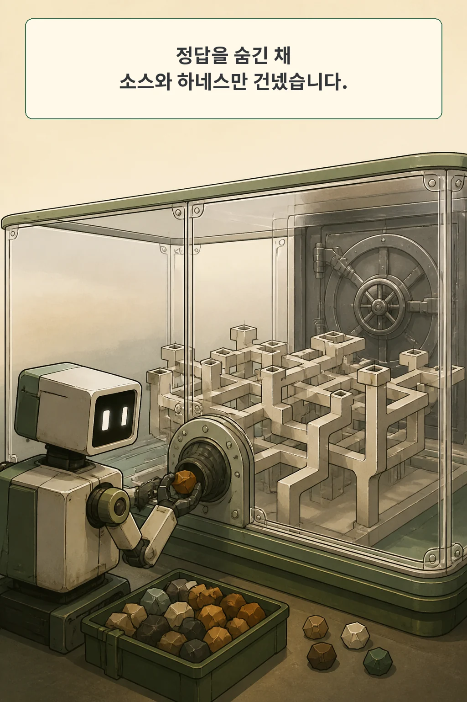
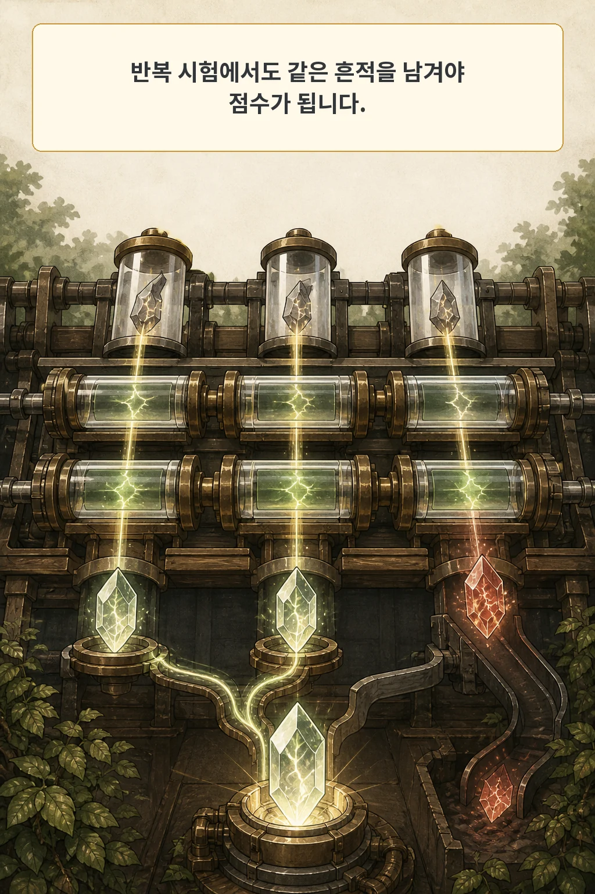
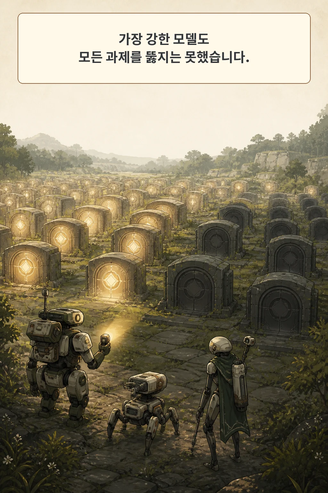

퍼저나 보안 에이전트가 사전에 알려진 취약점과 다른 위치에서 새로운 크래시를 터뜨렸다면, 그 결과를 오답으로 버려야 할까요? **「FuzzingBrain-Bench V1: Evaluating Open-Ended Bug Discovery by LLMs」**는 알려진 정답을 모델에게 숨긴 채 실제로 재현되는 서로 다른 크래시를 찾게 하는 개방형 평가를 제안합니다(2026년 8월 25일 21:09:20 UTC 제출된 arXiv v1 기준이며, 8월 27일 cs.AI 공식 일일 신규 목록에서 최근 7일 확장 없이 선정했습니다).

글·해설: 다메카솔

## 핵심 내용

- **봉인된 개방형 과제**: 43개 오픈소스 프로젝트의 77개 과제(C 36개, C++ 32개, Java/JVM 9개)에서 정답 위치·패치·참조 PoC를 모델에게 전혀 보여 주지 않았습니다.
- **3회 재현 기반 채점**: 후보 입력은 하네스에서 세 번 실행해 모두 크래시하고 동일한 서명(정규화된 fault class + 관련 함수 최대 3개)을 남겨야만 점수 후보가 됩니다.
- **모델별 탐색 결과**: 세 가지 Claude 모델 중 **Opus 4.8**이 **196/579점**(60/77개 과제에서 1개 이상 크래시 발생)으로 가장 높았으나, 17개 과제에서는 크래시를 내지 못했습니다.
- **서명과 근본 취약점의 구분**: 서로 다른 크래시 서명이 곧 서로 다른 근본 취약점(root-cause vulnerability)을 뜻하지는 않으며, 이번 검토에서는 공개 인덱스와 점수 산식을 직접 검산했습니다(231개 모델 실행 자체는 재현하지 않았습니다).

## 정답 하나만 보면 새 실패를 버릴 수 있다

기존의 취약점 재현형 벤치마크는 모델이 이미 알려진 버그를 다시 찾아냈는지 묻기에 적합합니다. 예상한 결함 위치나 참조 PoC(개념증명 입력)와 일치하면 성공으로 처리할 수 있어 채점도 명쾌합니다.

하지만 미지의 버그를 찾는 개방형 탐색에서는 이 기준이 오히려 족쇄가 됩니다. 모델이 같은 프로그램 안에서 전혀 다른 유효한 크래시를 찾아냈더라도, 사전에 정해 둔 정답 하나와 다르다는 이유로 실패처럼 처리될 수 있기 때문인데요. FuzzingBrain-Bench는 특정 목표 취약점 하나를 맞히게 하는 대신, 에이전트가 실행 중 찾아낸 재현 가능한 크래시를 모아 같은 과제 안에서 **서로 다른 크래시 서명**을 세어 점수로 환산합니다. 정답 복원 능력보다 넓은 버그 발견 능력을 측정하려는 설계입니다.

## 봉인된 과제에는 소스와 하네스만 있다

FuzzingBrain-Bench V1은 43개 오픈소스 프로젝트에서 **77개 과제**(C 36개, C++ 32개, Java/JVM 9개)를 구축했습니다. 각 과제는 취약한 리비전의 소스 코드와 퍼징 하네스, sanitizer 설정, 계측된(instrumented) 하네스 바이너리를 Docker 이미지 안에 담아 제공합니다.

모델에게는 참조 PoC나 버그 리포트, 수정 패치, Git 히스토리, 정답 위치가 전혀 주어지지 않습니다. 오직 `setup`, `exec`, `run_poc_on_harness` 세 가지 도구만으로 소스를 읽고 명령을 실행하며 후보 입력을 시험해야 하는데, 특히 `exec`는 격리된 별도 네트워크 네임스페이스에서 돌아가므로 외부 이슈 트래커나 수정 커밋을 검색할 수도 없습니다. 저자들은 이 환경에 Claude Haiku 4.5, Sonnet 4.6, Opus 4.8 세 모델을 투입해 과제당 최대 100턴, 1,800초 제한으로 실험을 진행했습니다.

## 세 번 같은 흔적을 남겨야 센다

에이전트가 제출한 후보 입력은 하네스에서 연속으로 **세 번** 실행됩니다. 세 번의 실행이 모두 크래시를 일으키고 똑같은 서명을 남겨야만 유효한 점수 후보로 인정받으며, 한 번만 실패하거나 실행할 때마다 크래시 위치가 달라지는 불안정한(flaky) 입력은 제외됩니다.

크래시 서명은 정규화한 결함 분류(fault class)와 스택의 관련 함수 이름 최대 세 개를 조합해 만듭니다. 같은 과제 실행 안에서 이미 등장한 서명은 한 번만 집계해, 동일한 크래시를 반복 제출해 점수를 부풀리는 현상을 막았습니다.

다만 여기에는 반드시 짚어야 할 경계가 있습니다. **하나의 근본 결함이라도 서로 다른 함수 호출 경로를 타고 들어가면 서로 다른 상위 함수 이름을 남길 수 있다**는 점입니다. 따라서 고유한 크래시 서명(distinct crash signature)은 관찰된 실패 현상을 나누는 단위일 뿐, 독립된 근본 취약점(root-cause vulnerability) 개수를 확정하는 단위는 아닙니다.

## 가장 강한 모델도 17개 과제에서는 크래시를 못 냈다

저자들이 보고한 세 모델의 성적표와 행동 특성은 다음과 같습니다.

| 평가 모델 | 종합 점수 (만점 579점) | 1개 이상 크래시를 낸 과제 수 (전체 77개) | 과제당 사용 턴 중앙값 (최대 100턴) |
| --- | ---: | ---: | ---: |
| **Claude Opus 4.8** | **196 / 579** | **60 / 77** | 51턴 |
| **Claude Sonnet 4.6** | **156 / 579** | **50 / 77** | 100턴 |
| **Claude Haiku 4.5** | **58 / 579** | **35 / 77** | 100턴 |

확인된 취약점이 존재하는 과제들인데도 **13개 과제**에서는 세 모델 모두 단 하나의 크래시 입력도 만들지 못했고, 가장 점수가 높은 Opus 4.8 역시 **17개 과제**에서 크래시를 내지 못했습니다.

점수 산식과 행동 패턴에서도 눈여겨볼 대목이 있습니다.

- **난이도 가중 점수 산식**: 각 과제 점수는 `min(서로 다른 크래시 수, 3) × 난이도 D`로 계산해 합산하며(만점 579점), 난이도 `D`(1~5)는 평가 대상인 세 Anthropic 모델 패널의 성공률로 정한 고정값입니다. 평가 대상과 난이도 산정 기준이 같은 모델 계열에 묶여 있다는 점은 다른 모델군으로 결과를 확장할 때 유의해야 할 제약입니다.
- **조기 종료 정책의 영향**: Sonnet 4.6과 Haiku 4.5의 사용 턴 중앙값이 제한치인 100턴이었던 것과 달리 Opus 4.8은 **51턴**에 머물렀습니다. 저자들은 Opus가 스스로 탐색을 일찍 멈추는 경향 때문에 일부 낮은 난이도 구간에서 오히려 Sonnet보다 약한 결과를 냈다고 분석했는데, 모델의 추론 능력뿐 아니라 **언제 멈추느냐는 종료 정책**도 벤치마크 성적에 직접 영향을 준 셈입니다.

## 공개 index는 확인했지만 모델 실행은 재현하지 않았다

이번 검토에서는 공식 저장소 고정 커밋(`76ac1fce7094400c1dce017a8c1432d48969881c`)의 아카이브를 보존하고 공개 인덱스와 난이도 표를 직접 검산했습니다. 고유 과제 별칭(alias) 77개, 대소문자 정규화 기준 프로젝트 43개, 언어별 분포(C 36개·C++ 32개·JVM 9개), 난이도 계수 합과 과제당 크래시 상한(3개)으로 계산한 최대 점수 579점이 모두 논문과 정확히 일치함을 확인했습니다.

다만 77개 Docker 이미지를 내려받아 세 모델의 231개 실행을 재생하지는 않았으며, 각 크래시 서명이 실제로 별개의 근본 취약점인지 대조할 참조 PoC와 정답 키(answer key)도 공개 저장소에는 포함되지 않았습니다. 또한 과제 수가 77개로 비교적 작고 sanitizer가 잘 잡아내는 결함에 표본이 치우쳐 있다는 점(메모리 안전성 결함 45개, 서비스 거부 및 기타 결함 32개)도 V1의 한계로 남아 있습니다.

## 다메카솔의 해석: 크래시와 취약점 확정 사이에 관문을 둔다

만약 AI 보안 에이전트를 실무 취약점 분류(triage) 파이프라인에 연결한다면, 그 결과를 다음 네 단계로 분리해 다뤄야 합니다.

| 단계 | 남길 증거와 판단 기준 |
| --- | --- |
| **1. 크래시 증거 확보** | 입력 해시, sanitizer 출력, 실행 환경과 3회 연속 재현 결과 |
| **2. 서명 중복 제거** | 결함 분류(fault class), 함수 호출 경로, 정규화 규칙 버전 |
| **3. 근본 원인 분석** | 관련 소스 코드, 호출 경로 대조, 동일 근본 결함으로 묶은 근거 |
| **4. 최종 승인 및 우선순위** | 보안 담당자가 확정한 실제 취약점 여부, 영향 범위, 패치 우선순위 |

FuzzingBrain-Bench의 크래시 서명 방식은 앞의 1·2단계를 자동화하는 데 무척 유용하지만, 서명 개수를 곧바로 ‘발견한 취약점 수’나 ‘패치 우선순위’로 승격하면 증거보다 결론이 앞서게 됩니다. 재현 가능한 크래시는 조사할 가치가 충분한 강력한 신호일 뿐, 실제 취약점 확정은 코드와 영향 범위를 읽는 별도의 판단 영역입니다.

앞서 다룬 [도구 명세로 에이전트 행동을 제한하는 방법](/posts/tool-specifications-agent-safety/)이 실행 전의 안전 경계를 짚었다면, 이번 벤치마크는 실행 뒤 쏟아지는 실패 증거를 어떻게 채점하고 걸러낼지 보여 줍니다. [프로덕션 코딩 에이전트의 작업 흔적을 다룬 글](/posts/agentic-coding-production-traces/)처럼 최종 점수 하나보다 어떤 도구 호출과 재현 기록이 그 숫자를 만들었는지 남겨 두어야 실제 운영에서도 안전하게 재판단할 수 있습니다.

## 논문 정보

| 항목 | 내용 |
| --- | --- |
| 제목 | FuzzingBrain-Bench V1: Evaluating Open-Ended Bug Discovery by LLMs |
| 공개 이력 | arXiv v1 2026-08-25 21:09:20 UTC; 2026-08-27 cs.AI 신규 목록 등장 |
| 과제 | 43개 오픈소스 프로젝트, 77개 과제 |
| 평가 모델 | Claude Haiku 4.5, Sonnet 4.6, Opus 4.8 |
| 공개 artifact | MIT 공식 코드, 공개 challenge index, grader와 고정 난이도 표 |

## 자주 묻는 질문

### 점수가 높으면 더 많은 실제 취약점을 찾았다는 뜻인가요?

점수는 3회 연속 재현된 서로 다른 크래시 서명 수와 난이도 계수를 반영한 값입니다. 동일한 근본 결함이 호출 경로에 따라 여러 서명을 남길 수 있으므로, 점수나 서명 수가 실제 고유 취약점 개수와 일대일로 일치한다고 볼 수는 없습니다.

### 정답을 숨기면 채점 정확도가 떨어지지 않나요?

사전 정답과의 일치 대신 ‘3회 연속 재현’, ‘sanitizer 결함 검출’, ‘정규화된 함수 경로’라는 객관적 실행 신호를 사용합니다. 예상 밖의 새로운 버그 발견을 포착하는 대신, 근본 원인 확정은 후속 분석 단계로 남기는 실용적 절충입니다.

## 함께 읽기

- [도구 명세로 AI 에이전트를 안전하게 쓰는 방법](/posts/tool-specifications-agent-safety/)
- [production 코딩 에이전트의 실제 작업 흔적](/posts/agentic-coding-production-traces/)

## 출처

- [FuzzingBrain 연구진, “FuzzingBrain-Bench V1: Evaluating Open-Ended Bug Discovery by LLMs,” arXiv:2608.25158](https://arxiv.org/abs/2608.25158)
- [arXiv v1 PDF](https://arxiv.org/pdf/2608.25158)
- [FuzzingBrain-Bench 공식 저장소, pinned commit 76ac1fce](https://github.com/fuzzingbrain/FuzzingBrain-Bench/tree/76ac1fce7094400c1dce017a8c1432d48969881c)

이 글의 본문과 이미지는 생성형 AI로 제작했습니다. 기획과 편집 기준은 다메카솔이 정했습니다.

Updated: 2026-08-27
