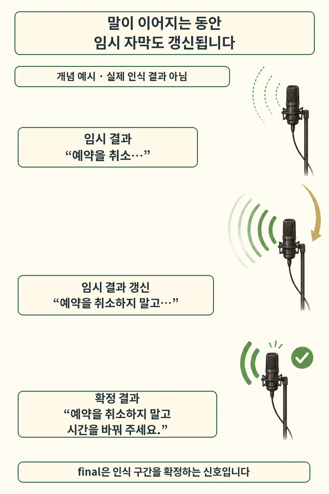
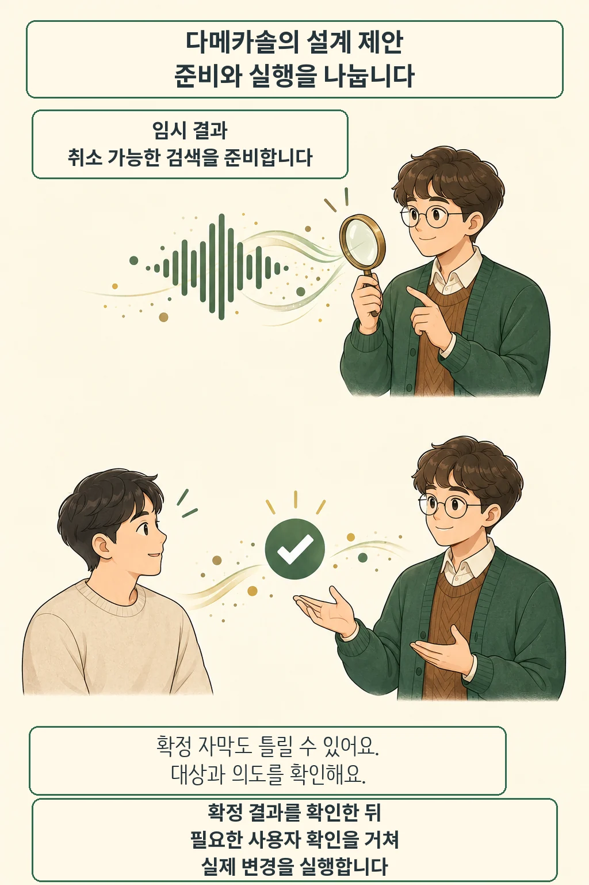

“예약을 취소…”까지만 들은 음성 에이전트가 성급하게 취소 API를 호출해 버리면, 바로 뒤에 이어진 “…하지 말고 시간만 바꿔 주세요”라는 말을 수습하기가 꽤 까다로워집니다. 실시간 음성 서비스에서는 말하는 도중에 계속 바뀌는 임시 자막과 발화가 끝난 뒤 확정된 구간을 분리해서 다루는 설계가 필수적이거든요. Microsoft가 2026년 10월 1일 발표한 **MAI-Transcribe-2-Streaming**은 오디오가 들어오는 동안 중간 결과를 먼저 보내고 발화 구간이 끝나면 확정 결과를 전달하는 실시간 음성 인식 모델입니다. ([Microsoft 공식 발표](https://techcommunity.microsoft.com/blog/azure-ai-foundry-blog/build-expressive-voice-experiences-with-new-mai-models-in-microsoft-foundry/4524637))

글·해설: 다메카솔

## 말이 이어지면 자막도 바뀝니다

Vercel AI Gateway의 모델 문서를 보면, 이 모델은 WebSocket 연결로 오디오 스트림을 연속 전송하면서 발화 도중 점진적으로 전사 결과를 돌려줍니다. 이때 `Partials`는 뒤이어 들어오는 문맥에 따라 앞선 텍스트가 계속 덮어써지는 중간 결과이고, `final`은 한 발화 구간이 끝났을 때 확정되는 결과입니다. ([제공 방식과 모델 문서](https://vercel.com/ai-gateway/models/mai-transcribe-2-streaming))

실무에서 흔히 겪는 함정은 중간에 도착하는 `Partials` 문자열을 모두 확정 문장처럼 대화 기록에 이어 붙이는 경우입니다. 이렇게 처리하면 수정되기 전의 조각 문장까지 대화 이력에 중복으로 남아 후속 응답 흐름이 쉽게 꼬이죠. 따라서 화면에는 임시 자막을 빠르게 갱신해 보여 주더라도, 내부 상태에서는 덮어쓰기 전용 임시 버퍼와 확정된 `final` 이력을 명확히 갈라 저장하는 편이 좋습니다.

## 함께 발표된 모델과 기능 경계

이번 발표에는 음성을 텍스트로 바꾸는 모델과 텍스트를 음성으로 읽는 모델이 함께 이름을 올렸습니다. Microsoft Foundry의 Azure Speech 및 직접 API 경로로 제공되며, Vercel AI Gateway에서도 스트리밍 모델 접근 경로를 안내하고 있습니다.

| 모델 | 발표에서 설명한 역할 | 10월 1일 발표 기준 가격 |
| --- | --- | --- |
| MAI-Transcribe-2-Streaming | 들어오는 음성을 실시간 텍스트로 변환 (60개 언어·자동 언어 감지) | 음성 1시간당 $0.54 (2026년 말까지 도입 가격) |
| MAI-Voice-2.1 | 텍스트를 표현력 있는 음성으로 생성 | 100만 문자당 $22 |
| MAI-Voice-2.1-Flash | 응답 속도와 처리량을 중시한 음성 생성 | 100만 문자당 $15 |

도입을 검토할 때 눈여겨볼 대목은 **스트리밍 모델과 비스트리밍 모델의 기능 경계**입니다. 발표문에서 소개된 화자 분리(diarization)와 단어별 타임스탬프는 비스트리밍 모델인 **MAI-Transcribe-2**의 기능으로 안내돼 있거든요. 스트리밍 모델에는 60개 언어와 자동 언어 감지가 안내돼 있는 만큼, 화자 분리 같은 기능이 꼭 필요한 워크플로라면 도입 전 지원 범위와 계정별 리전·할당량 조건을 별도로 확인해야 합니다.

## 다메카솔의 해석: 준비는 앞당기고 실행은 확인 뒤로

실시간 음성 에이전트를 설계한다면 **임시 결과(`Partials`)로 시작할 수 있는 읽기 전용 준비 작업**과 **확정 결과(`final`) 뒤에만 허용할 상태 변경 작업**을 나누는 접근이 유효합니다. 예를 들어 사용자가 말을 이어 가는 동안에는 취소 가능한 후보를 조회하거나 화면 데이터를 프리페치하는 수준만 먼저 돌려 두고, 문장 끝에서 부정 표현이 붙어 의도가 바뀌면 진행 중이던 비동기 요청을 폐기하는 방식입니다. 이때 이전 요청의 뒤늦은 응답이 새 화면을 덮어쓰지 않도록 발화 구간 ID나 요청 버전을 함께 대조하면 한결 안전해지죠.

반면 예약 취소나 결제, 메시지 발송처럼 외부 상태를 되돌리기 어렵게 바꾸는 작업은 `final` 구간이 확정된 뒤에 배치해야 합니다. 게다가 `final`은 어디까지나 ‘한 번의 발화 구간이 끝났다’는 경계 신호일 뿐 전사 정확도나 사용자의 최종 승인까지 보장하는 지표와는 성격이 다릅니다. [Copilot Memory의 현재 브랜치 확인](/posts/github-agentic-autofix-copilot-memory/)처럼 실제 변경 직전에는 대상과 실행 의도를 사용자에게 한 번 더 확인받는 절차를 두는 편이 낫습니다.

테스트 시나리오를 꾸릴 때도 첫 자막이 뜨는 응답 속도만 재기보다, **말 끝에서 의도를 뒤집는 문장(“취소… 하지 마세요”)이나 발화 중간에 대상을 바꾸는 문장**을 함께 넣어 보는 편을 권합니다. 그래야 앞서 출발한 사전 조회 작업이 깔끔하게 취소되고 상태가 어긋나지 않는지까지 검증할 수 있거든요.

## 출처

- [Microsoft Foundry: 새 MAI 음성 모델 발표](https://techcommunity.microsoft.com/blog/azure-ai-foundry-blog/build-expressive-voice-experiences-with-new-mai-models-in-microsoft-foundry/4524637) — 2026-10-01. 출시 내용·사양·발표 가격의 1차 출처.
- [Vercel AI Gateway: MAI-Transcribe-2-Streaming](https://vercel.com/ai-gateway/models/mai-transcribe-2-streaming) — 2026-10-02 확인. WebSocket 스트리밍, 임시(`Partials`)/확정(`final`) 결과 구분 및 제공 경로 안내.

공식 발표와 제공업체 문서를 대조해 정리했으며, 한국어 잡음 환경에서의 인식 정확도나 실제 종단간 지연 시간은 직접 측정하지 않았습니다. 이 글의 본문과 이미지는 생성형 AI로 제작했습니다. 기획과 편집 기준은 다메카솔이 정했습니다.
