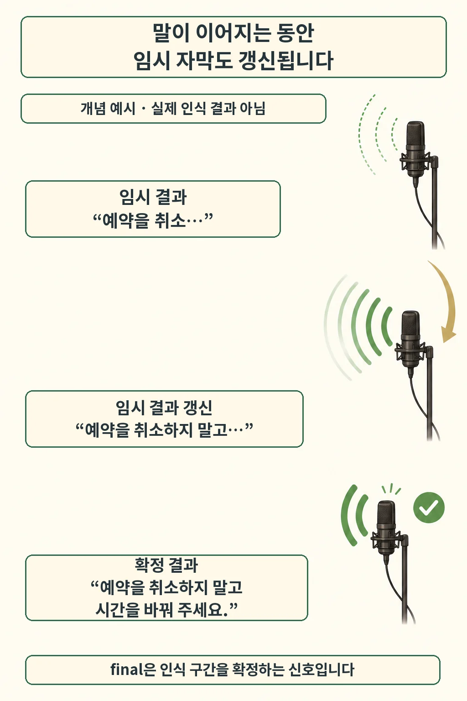
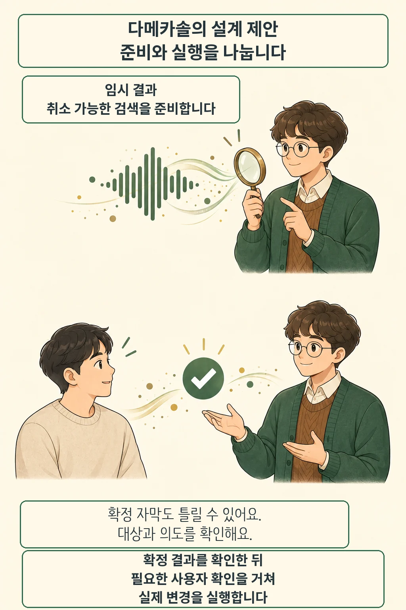

글·해설: 다메카솔

발행·확인: 2026-10-02

“예약을 취소…”까지만 들은 음성 에이전트가 성급하게 예약 취소 API를 호출해 버리면, 바로 뒤에 이어진 “…하지 말고 시간만 바꿔 주세요”라는 말을 수습하기 어려워집니다. 실시간 자막을 빠르게 받아 처리하는 서비스에서는 **말하는 도중에 계속 바뀌는 임시 문장과 발화가 끝난 뒤 확정된 구간을 분리하는 설계**가 필수적입니다. Microsoft가 2026년 10월 1일 발표한 **MAI-Transcribe-2-Streaming**은 음성이 들어오는 동안 중간 결과를 보내고 발화 구간이 끝나면 확정 결과를 전달하는 실시간 음성 인식 모델입니다. ([Microsoft 공식 발표](https://techcommunity.microsoft.com/blog/azure-ai-foundry-blog/build-expressive-voice-experiences-with-new-mai-models-in-microsoft-foundry/4524637))

## 말이 이어지면 자막도 바뀝니다

Vercel AI Gateway의 모델 문서에 따르면, 이 모델은 WebSocket 연결로 오디오 스트림을 연속 전송하면서 말하는 도중 점진적으로 전사 결과를 돌려줍니다. 이때 `Partials`는 발화가 이어짐에 따라 앞선 텍스트가 계속 덮어써지는 중간 결과이고, `final`은 한 발화 구간이 끝났을 때 확정되는 결과입니다. ([제공 방식과 모델 문서](https://vercel.com/ai-gateway/models/mai-transcribe-2-streaming))

만약 애플리케이션이 중간에 도착하는 `Partials` 문자열을 모두 확정된 문장처럼 뒤에 이어 붙이기만 하면 수정되기 전의 조각들까지 대화 기록에 중복으로 남게 됩니다. 따라서 화면에는 임시 자막을 빠르게 갱신해 보여 주더라도, 내부 상태에서는 진행 중인 임시 버퍼와 확정된 `final` 이력을 명확히 나누어 저장해야 합니다.

## 함께 발표된 모델과 기능 경계

이번 발표에는 음성을 텍스트로 바꾸는 모델과 텍스트를 음성으로 읽는 모델이 함께 포함됐으며, Microsoft Foundry의 Azure Speech 및 직접 API 경로(그리고 Vercel AI Gateway)를 통해 제공됩니다.

| 모델 | 발표에서 설명한 역할 | 10월 1일 발표 기준 가격 |
| --- | --- | --- |
| MAI-Transcribe-2-Streaming | 들어오는 음성을 실시간 텍스트로 변환 (60개 언어·자동 언어 감지) | 음성 1시간당 $0.54 (2026년 말까지 도입 가격) |
| MAI-Voice-2.1 | 텍스트를 표현력 있는 음성으로 생성 | 100만 문자당 $22 |
| MAI-Voice-2.1-Flash | 응답 속도와 처리량을 중시한 음성 생성 | 100만 문자당 $15 |

검토할 때 주의할 점은 **스트리밍 모델과 비스트리밍 모델의 기능 범위 구분**입니다. 발표문에서 소개된 화자 분리(diarization)와 단어별 타임스탬프 기능은 비스트리밍 모델인 **MAI-Transcribe-2**의 기능으로 안내돼 있으므로, 실시간 스트리밍 모델을 도입할 때는 해당 기능 지원 여부와 계정별 리전·할당량 조건을 별도로 확인해야 합니다.

## 다메카솔의 해석: 준비는 앞당기고 실행은 확인 뒤로

실시간 음성 에이전트를 설계한다면 **임시 결과(`Partials`)로 시작할 수 있는 읽기 전용 준비 작업**과 **확정 결과(`final`) 뒤에만 수행할 상태 변경 작업**을 나누겠습니다. 예를 들어 사용자가 말을 이어 가는 동안에는 취소 가능한 후보 검색이나 화면 프리페치만 먼저 돌려 두고, 말미에 부정 표현이 붙어 의도가 바뀌면 앞서 준비하던 비동기 요청을 버리는 방식입니다(이때 이전 요청의 늦은 응답이 새 화면을 덮어쓰지 않도록 발화 구간 ID나 요청 버전을 함께 검증해야 합니다).

반면 예약 취소나 결제, 메시지 발송처럼 외부 상태를 바꾸는 작업은 `final` 구간이 확정된 뒤에 두어야 안전합니다. 또한 `final`은 어디까지나 ‘음성 인식 구간이 끝났다’는 신호일 뿐 ‘사용자가 실행을 최종 승인했다’는 뜻은 아니므로, [Copilot Memory의 현재 브랜치 확인](/posts/github-agentic-autofix-copilot-memory/)처럼 중요한 변경 직전에는 대상과 의도를 다시 확인하는 단계가 필요합니다.

도입 테스트를 준비한다면 첫 자막이 뜨는 지연 시간뿐 아니라, **말 끝에서 의도를 뒤집는 문장(“취소… 하지 마세요”)이나 중간에 대상을 바꾸는 문장**을 넣었을 때 앞서 시작된 사전 작업이 깔끔하게 취소되는지 함께 점검해 보기를 권합니다.

## 출처

- [Microsoft Foundry: 새 MAI 음성 모델 발표](https://techcommunity.microsoft.com/blog/azure-ai-foundry-blog/build-expressive-voice-experiences-with-new-mai-models-in-microsoft-foundry/4524637) — 2026-10-01. 출시 내용·사양·발표 가격의 1차 출처.
- [Vercel AI Gateway: MAI-Transcribe-2-Streaming](https://vercel.com/ai-gateway/models/mai-transcribe-2-streaming) — 2026-10-02 확인. WebSocket 스트리밍, 임시(`Partials`)/확정(`final`) 결과 구분 및 제공 경로 안내.

공식 발표와 제공업체 문서를 대조해 정리했으며, 한국어 잡음 환경에서의 인식 정확도나 실제 종단간 지연 시간은 직접 측정하지 않았습니다. 이 글의 본문과 이미지는 생성형 AI로 제작했습니다. 기획과 편집 기준은 다메카솔이 정했습니다.
