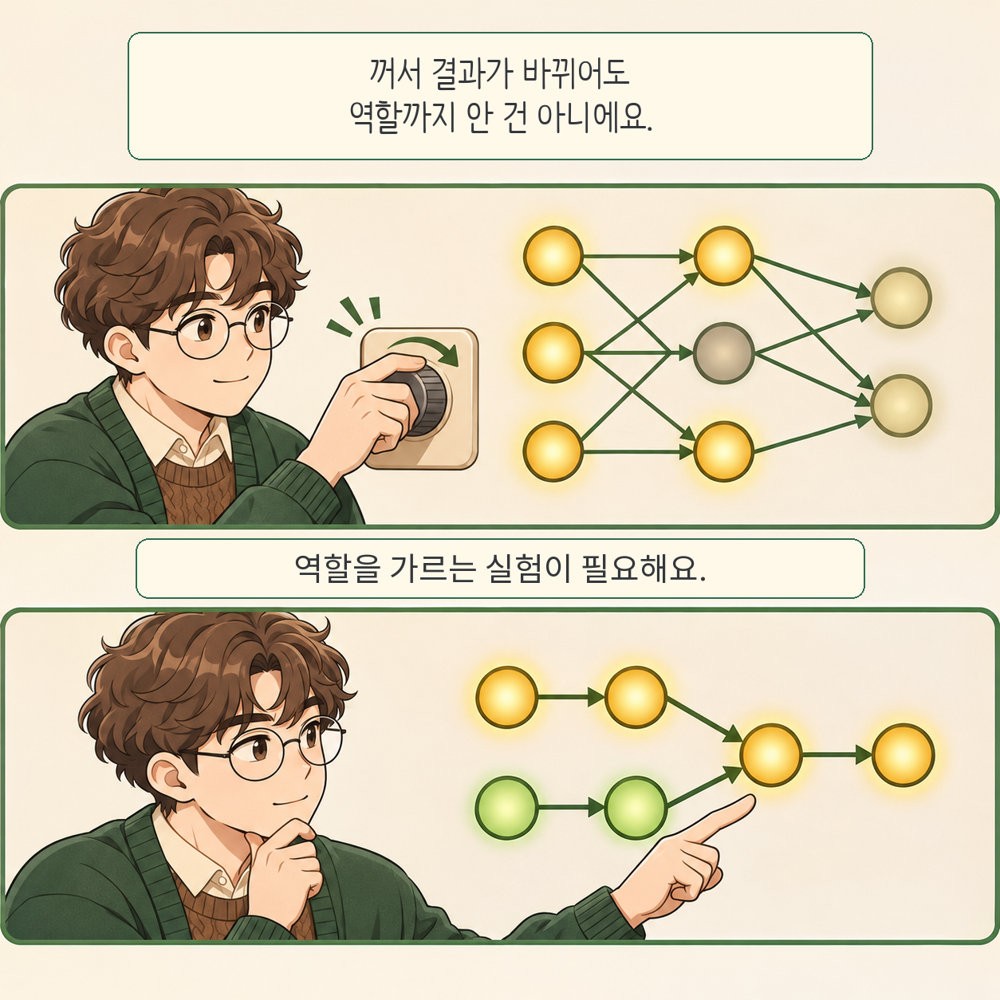

언어 모델이나 비전 모델 내부에서 특정 개념에 반응하는 뉴런이나 피처를 찾아내면, 흔히 작동 원리까지 파악했다고 생각하기 쉽습니다. 하지만 내부에서 신호가 보인다는 사실과 모델이 그 신호를 실제 계산에 쓴다는 이야기는 전혀 별개거든요. 최근 공개된 논증형 논문 「Mechanistic Interpretability Needs a Logic of Inference」(2026-11-10)는 신경과학의 시행착오를 바탕으로, 해석가능성 관찰이 언제 진정한 기제 설명이 되는지 짚어 봅니다.

글·해설: 다메카솔

## 관찰한 정보와 실제 쓰이는 계산은 다릅니다

기계적 해석가능성(MI)은 신경망의 내부 표현과 계산 과정을 찾아내 모델 행동을 설명하려는 분야입니다. 연구자들은 문제에 따라 개별 뉴런, 희소 오토인코더(SAE) 피처, 어텐션 헤드 회로, 집단 활동의 기하 구조, 동역학 궤적처럼 서로 다른 설명 단위를 분석 대상으로 고르죠.

예를 들어 언어 모델의 은닉층에 프로브를 붙여 특정 문법 속성을 높은 정확도로 읽어냈다고 가정해 봅시다. 이 결과는 정보가 *표현되어 있다*는 뜻일 뿐, 하류 계산 단계가 그 정보를 실제로 읽어 쓰는지까지는 보여 주지 못합니다. 논문은 훈련 과제에 불필요한 언어 속성까지 모델에 부호화되거나 프로브 정확도가 행동 중요도와 어긋나는 사례를 들며, 내부에서 정보를 읽어낼 수 있다는 사실만으로 모델이 그 정보를 사용한다고 결론 내리기 어렵다고 지적합니다.

분석 단위 자체도 고정된 전제가 아니라 검증할 가설로 다루어야 합니다. 전전두엽 연구에서는 개별 자극에 선택적인 뉴런을 빼도 집단 활동에서 과제 변수가 해독되었고, 인공신경망에서도 유닛 선택성이 과제 성능과 엇갈리는 경우가 보고되었거든요. 게다가 SAE 피처 기저는 유일한 분해가 아니므로, 국소 단위를 찾았다면 인접 수준과 교차 점검할 필요가 있습니다.

## 개입해서 결과가 바뀌어도 계산 역할은 남습니다

단순 관찰의 한계를 넘으려면 구성요소를 끄거나(ablation) 활성화를 맞바꾸는(patching) 인과 개입 실험이 필요합니다. 그런데 특정 요소를 껐을 때 출력이 흔들렸다고 해서 그 요소가 맡은 계산까지 곧바로 밝혀지지는 않습니다. 개입 뒤 나타나는 변화는 겨냥한 요소의 기능뿐 아니라 나머지 네트워크의 반응과 보상까지 함께 섞인 결과이기 때문이죠.

가령 어텐션 헤드를 제거하면 후속 구성요소가 빈자리를 부분적으로 메우는 자가 복구(self-repair)가 입력에 따라 다르게 나타납니다. 신경과학의 금화조(zebra finch) 노래 회로에서도 특정 영역을 급속 억제하면 노래가 곧바로 끊기지만 영구 손상 뒤에는 회복되는데, 이는 급성 개입이 하위 회로 전체를 흔들기 때문입니다. 이처럼 구성요소를 바꾸어 출력에 영향을 줬다는 관찰만으로는 그 요소의 계산 역할을 특정하기 어렵습니다.

## 다섯 원칙으로 엮은 반복 추론 절차

저자들은 관찰과 개입을 곧바로 기제 주장으로 건너뛰지 않도록 측정 조건 전제(`P0`)와 다섯 원칙(`P1`~`P5`)을 제안합니다. 한 번 훑고 끝내는 체크리스트가 아니라, 실험 결과에 따라 설명 단위를 다시 점검하는 순환 논리입니다.

| 단계 | 핵심 원칙 | 확인해야 할 질문과 근거 요건 |
| --- | --- | --- |
| **P0** | 측정 의존성 점검 | 살리엔시나 패칭 손상 방식, 평가 지표가 관찰 결과 자체를 바꾸지 않는지 살핍니다. |
| **P1** | 설명 단위의 가설화 | 뉴런·SAE 피처·회로·집단 구조 중 고른 단위가 충분한지 인접 수준과 대조합니다. |
| **P2** | 표현과 계산 사용 분리 | 상류에서 해독된 정보를 선택적으로 바꿀 때 하류 계산과 출력이 예상대로 변하는지 봅니다. |
| **P3** | 인과적 영향과 역할 구분 | 개입 효과가 언제 어디서 나타나고 무엇은 남는지 경쟁 설명을 가를 예측을 세웁니다. |
| **P4** | 역할 간 의존 관계 규명 | 개별 역할이 독립 중복인지 상호 결합인지 경로별 교차 개입으로 구조를 확인합니다. |
| **P5** | 불변성 탐색과 재검토 | 시드·과제·규모를 바꿔도 유지되는 설명을 찾아 처음 잡은 분석 단위를 다시 수정합니다. |

이 중 `P3`와 `P4`의 설계 방식은 논문 속 생쥐 운동 계획 연구가 잘 보여 줍니다. 지연 반응 과제를 수행하는 생쥐의 전외측 운동 피질(ALM)에서는 양쪽 반구 모두에서 움직임을 준비하는 신호가 관찰됩니다. 연구진은 한쪽만 일시 억제하면 활동이 빠르게 회복되지만 양쪽을 동시에 억제하면 회복되지 않는 차이를 비교해, 양측이 선택적으로 결합된 부분 중복 구조임을 가려냈죠. 저자들은 이처럼 경쟁 설명을 구분할 예측과 개입을 설계하고 구성요소 사이의 의존 관계를 확인해야 한다고 제안합니다.

역할과 의존 관계를 찾은 뒤에도 조건을 바꿨을 때 유지되는 불변성을 따져 보아야 합니다. 실제로 훈련과 규모가 바뀌어도 회로 알고리즘이나 SAE 부분공간(subspace)이 개별 피처보다 안정적으로 유지되는 사례가 보고되었고, 살리엔시와 패칭 역시 측정 조건(`P0`)에 따라 결과가 달라지거든요. 결국 해석가능성 추론은 분석 단위와 측정 조건을 확인하고 다른 조건에서도 유지되는 설명을 찾아 분석 단위를 재검토하는 반복 과정입니다.

## 모델에서 찾은 기제와 외부 세계 검증

논문은 해석가능성이 기여하는 과학적 발견을 모델 내부 기제 이해와 외부 과학 분야 탐색의 두 갈래로 나눕니다. 특히 과학 데이터를 학습한 모델을 분석할 때는 모델이 실제 자연 현상과 다른 계산 지름길을 활용할 수 있다는 점을 경계해야 합니다. 모델에서 찾은 기제는 외부 세계에 대한 가설을 세우는 출발점일 뿐이며, 독립적인 행동 실험이나 새 데이터셋 같은 분야별 검증을 대체하기 어렵습니다.

이번 논문은 새 벤치마크 수치나 구현 코드를 제시하기보다 기존 연구의 추론 공백을 정리한 위치 논문입니다. 실무나 연구에 옮길 때는 특정 기법 하나에 기대기보다 질문에 맞춰 측정 조건과 대안 가설을 가르는 실험 설계가 뒤따라야 합니다.

## 다메카솔의 해석

해석가능성 보고서나 모델 진단 도구의 결과를 읽을 때는 화려한 시각화 하나를 '원리 규명'으로 받아들이지 않는 편이 좋습니다. 팀 내에서 보고서를 검토할 때 다음 세 항목을 나누어 적으면 주장의 근거 범위를 확인하기 쉬워집니다.

- **관찰한 사실**: 어느 단위(뉴런, SAE 피처, 회로, 집단 표현)에서 어떤 측정 조건으로 신호를 읽었는지 적습니다.
- **개입으로 바뀐 결과**: 절제나 패칭 때 하류 상태와 출력이 어떻게 변했고 보상 경로는 살폈는지 구분합니다.
- **아직 남은 대안 설명**: 같은 결과를 설명할 수 있는 경쟁 가설과 추가 도메인 검증 필요 항목을 남깁니다.

이처럼 해석가능성 보고서를 읽을 때 관찰과 개입 결과, 남은 대안 설명을 구분해 적어두면 과장을 줄이는 데 도움이 됩니다. 인과 추론의 시선을 다루는 점에서 [에이전트 검토 효과를 평가하는 연구](/posts/agent-review-causal-effect/)와도 문제의식이 맞닿아 있는데요. 그 연구가 작업 흐름 속 개입 시점의 정책 효과를 다뤘다면, 이번 논문은 모델 내부의 계산 역할을 입증하는 논리를 짚는다는 점이 다릅니다.

## 출처

- Zhimin Hu 외, [Mechanistic Interpretability Needs a Logic of Inference (arXiv:2611.14483v1)](https://arxiv.org/abs/2611.14483v1), 2026-11-10 공개. 검토일 2026-11-13.
- [논문 전체 HTML](https://arxiv.org/html/2611.14483v1)

이 글은 논문 원문을 바탕으로 정리했으며 별도 실험 재현은 수행하지 않았고, 만화는 원문 그림을 복제하지 않고 개념 설명을 위해 새로 구성했습니다.

이 글의 본문과 이미지는 생성형 AI로 제작했습니다. 기획과 편집 기준은 다메카솔이 정했습니다.
