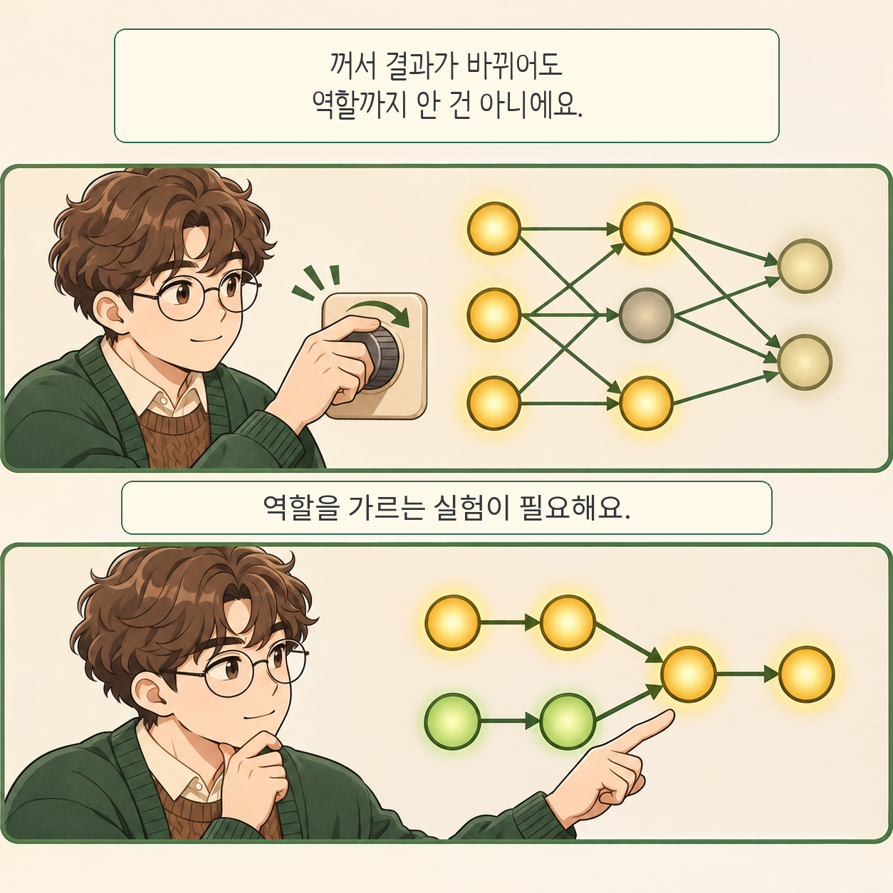

글·해설: 다메카솔

기계적 해석가능성은 신경망 내부의 계산을 설명하려는 연구입니다. 하지만 특정 정보가 보인다는 사실과 그 정보가 실제 출력에 쓰인다는 주장은 다릅니다. 2026년 11월 10일 공개된 *Mechanistic Interpretability Needs a Logic of Inference*는 이 간격을 다루는 논증형 논문입니다. 

## 영향을 주는 것과 역할을 아는 것

내부 표현에서 정보를 추출했어도 모델이 그것을 사용했다고 단정할 수는 없습니다. 구성요소를 꺼서 출력이 바뀌어도 어떤 계산을 담당했는지는 남습니다. 다른 부분이 개입에 반응하거나 보상할 수 있기 때문입니다. 

## 저자들이 제안하는 확인 과정

측정 방법이 무엇을 보여 주는지 먼저 확인합니다. 이어 설명할 단위를 고르고, 발견한 정보의 실제 사용 여부, 구성요소의 역할, 역할 사이의 의존 관계를 구분합니다. 경쟁하는 설명이 서로 다른 결과를 예측하도록 실험을 설계하는 것이 핵심입니다. 조건을 바꿔도 유지되는 설명을 찾으며 처음 고른 분석 단위도 다시 검토합니다. 고정된 체크리스트보다는 반복하는 추론 과정입니다. 

## 모델 밖에서는 별도의 증거가 필요합니다

이 논문은 새 성능 기록을 보고하는 실험 논문이 아닙니다. 해석 결과에서 무엇을 결론 낼 수 있는지 정리한 제안입니다. 모델의 기제를 알아냈더라도 현실 세계가 같은 방식으로 작동한다는 보장은 없습니다. 외부 분야의 실험과 관측이 필요합니다. 

다메카솔의 해석: 연구를 읽을 때 ‘관찰한 것·개입으로 바뀐 것·아직 남은 설명’을 나누어 적으면 주장의 범위를 점검하기 좋겠습니다. [에이전트 검토 효과를 평가하는 연구](/posts/agent-review-causal-effect/)도 인과를 다루지만, 여기서 설명하려는 대상은 모델 내부 계산입니다. 

## 출처

- [Hu 외, 논문 원문과 제출 이력](https://arxiv.org/abs/2611.14483v1)
- [논문 전체 HTML](https://arxiv.org/html/2611.14483v1)

자료 확인: 2026-11-13. 만화의 회로는 개념 설명을 위한 재구성이며 논문의 그림이나 실제 실험 결과가 아닙니다.

이 글의 본문과 이미지는 생성형 AI로 제작했습니다. 기획과 편집 기준은 다메카솔이 정했습니다.
