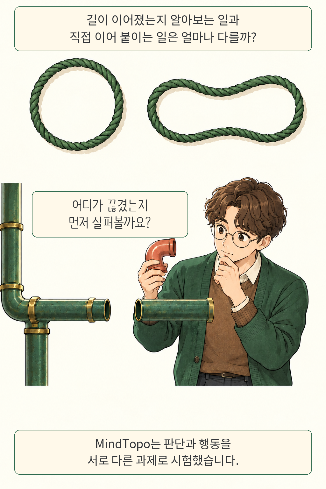

**MindTopo에서 평가한 멀티모달 모델들은 그림 속 관계를 답하는 과제보다 직접 행동해서 목표를 만드는 과제에서 훨씬 낮은 평균 점수를 받았습니다.** 눈으로 연결된 길을 알아보는 능력이 행동 계획으로 자연스럽게 이어질 것이라는 기대를 점검한 결과인데요. 연구팀은 미로·파이프·구슬·매듭처럼 구조가 눈에 보이는 문제로 두 능력을 나누어 살폈습니다. 에이전트를 개발할 때도 답변의 그럴듯함과 실제 실행의 성공을 구분해 볼 만한 연구입니다.

글·해설: 다메카솔

## 핵심 내용

- **벤치마크 규모**: MindTopo v1은 연속성·분리·순서·둘러쌈·매듭의 5가지 위상 성질에 관한 13종 과제, 11,030개 사례를 담고 있습니다.
- **정적 추론 vs 행동 계획**: 정적 추론에서는 그림 속 관계를 답하고, 행동 계획에서는 시뮬레이터 환경이 정한 목표 조건을 제한 횟수 안에 만족해야 성공으로 인정받습니다.
- **비교 시 유의점**: 두 과제군은 같은 위상 성질로 묶었지만 장면은 각 생성기로 따로 만들었으므로, 점수 차이에는 과제 구성과 난도 차이도 함께 작용합니다.
- **기준 버전과 확인 범위**: 성능 수치는 2026년 9월 10일 제출된 논문 v1(모델 14개 평가)에 고정했으며, 공식 소개 페이지에 남아 있는 다른 수치(사례 11,016개, 모델 11개, 최고 점수 54.1%)와 구분했습니다. 공식 코드와 데이터의 공개 상태를 직접 확인했고, 아래 모델 점수는 저자 보고치입니다.

## 휘어도 이어진 고리, 돌려야 이어지는 파이프

둥근 고리를 옆으로 길게 늘려도 끊어진 곳이 생기지는 않듯, 모양이 달라져도 연결 자체는 유지됩니다. 논문이 다루는 위상적 관계는 이처럼 길이나 각도보다 **무엇과 무엇이 이어지고 어떤 경계가 안과 밖을 나누는지**에 초점을 둡니다(자르거나 이어 붙이거나 한 부분을 다른 부분에 통과시키지 않는 변형이라는 조건이 붙습니다).

연구팀은 이 관점을 다음 다섯 가지 성질로 나눴습니다([v1 2.1~2.2절](https://arxiv.org/html/2609.11900v1#S2)).

- **연속성**: 길이 끊김 없이 이어지는지 묻습니다.
- **분리**: 부분들을 서로 나눌 수 있는지 확인합니다.
- **순서**: 줄을 따라 대상이 어떤 순서로 놓였는지 봅니다.
- **둘러쌈**: 경계 안팎과 구멍의 관계를 살핍니다.
- **매듭**: 꼬임과 고리의 연결을 다룹니다.

물론 이 다섯 가지가 모든 공간 지각 능력을 대표하는 목록은 아니며, 만화 속 고리와 파이프 작업대 역시 질문을 쉽게 보여 주기 위해 새로 그린 설명용 예시입니다(파이프 두께와 색은 이해를 돕는 장치이며 실제 평가 화면을 복제한 그림이 아닙니다).

## 답을 고르는 시험에서 행동을 실행하는 시험으로

길이 이어졌다는 판단을 실제 연결 작업으로 옮기면 무엇을 어떻게 채점해야 할까요? 미로 추론 과제에서는 주어진 점에서 도달 가능한 점을 골라 답하지만, Pipe 계획 과제에서는 파이프 조각을 90도씩 돌려 모든 활성 파이프가 시작점에 연결되도록 만들어야 합니다. 단 하나의 빈틈만 남아도 실패로 처리됩니다.

채점 방식도 엄격하게 나뉩니다. 정적 질문의 숫자·선택형 답은 정답과 정확히 일치해야 하고, 순서 없는 목록은 집합 단위로 비교합니다. 반면 본문 계획 평가에서는 모델이 관측 화면을 받아 행동을 고르면 시뮬레이터가 상태를 갱신하며, 정해진 행동 횟수 안에 과제별 목표 조건에 도달해야만 한 회차의 성공으로 집계합니다. 모델이 자연어로 “완료했다”고 말하는 것과는 판정 근거가 전혀 다릅니다.

다만 두 과제군은 동일한 장면을 번갈아 보여 준 실험이 아닙니다. 저자들은 같은 위상 성질을 중심으로 과제를 묶되 각 생성기로 장면을 따로 만들었습니다. 따라서 추론과 계획의 평균 점수 차이는 이 벤치마크 구성에서 드러난 결과로 읽어야 하며, 행동 자체·상태 표현·난도·필요한 행동 길이 가운데 무엇이 얼마만큼 원인인지 분리하려면 추가 대조 실험이 필요합니다. 이러한 관점은 파일 전달과 후속 작업 의존성을 시험한 [JarvisGUI의 기기 간 작업 완료 평가](/posts/jarvisgui-cross-device-state/)와도 맞닿아 있습니다.

## 평균 점수와 파이프의 빈틈을 함께 읽기

논문 v1이 비교한 멀티모달 모델 14개 가운데 가장 높은 점수를 기록한 GPT-5.6-Sol조차 Pipe 과제의 성공률은 **50.50%**에 머물렀습니다. 모든 조각을 연결하는 과제에서 절반 가까운 시도가 목표에 도달하지 못한 셈입니다(실제 배관 작업이나 물리적 로봇 성공률로 그대로 확장해 읽기에는 실험 조건이 다릅니다).

| 논문 v1의 평가 대상 | 정적 추론 과제평균 (8종) | 행동 계획 과제평균 (5종) | Pipe 성공률 |
| --- | ---: | ---: | ---: |
| GPT-5.6-Sol | 66.83% | 52.75% | 50.50% |
| GPT-5.5 | 53.77% | 24.33% | 2.17% |
| Gemini-3.1-Pro | 52.24% | 19.23% | 5.50% |

출처는 [논문 v1 Table 1과 3.2절](https://arxiv.org/html/2609.11900v1#S3.S2)입니다. 표의 평균은 정적 추론 8종, 행동 계획 5종의 **과제별 점수를 같은 비중으로 평균**한 값이어서, 전체 사례를 한데 모은 단순 정답률과는 구분해야 합니다(계획 과제의 사례 수는 종류마다 600개이며, 본문 평가의 디코딩 온도는 0입니다). 세부 실험 결과에서 눈여겨볼 지점은 다음과 같습니다.

- **전체 평균과 인간 관측 기준**: GPT-5.6-Sol의 13종 전체 과제평균은 61.42%였고, 인간 관측 평균은 97.87%였습니다. 전문 평가자 5명이 전체 11,030개 중 11,008개를 나누어 평가(사례당 완료된 평가 1건)한 결과이므로, 모든 사람이 전 문항을 풀었다거나 인간 전체의 일반 능력을 측정했다고 해석하면 표본 범위를 벗어납니다.
- **미세조정·강화학습 후에도 남는 격차**: Qwen3-VL-2B-Instruct에 지도 미세조정(SFT)과 강화학습(RL)을 순서대로 적용하자 선택된 추론 5종 평균은 14.24%에서 51.53%로 크게 올랐지만, 계획 4종은 0.20%에서 6.33%로 오르는 데 그쳤습니다. 이때 계획 평가는 초기 관측에서 전체 행동열을 한 번에 예측해 실행하는 방식을 썼으므로, 단계마다 관측을 주고받는 앞선 본문 계획 평가 표와 수치를 직접 이어 비교할 때는 주의가 필요합니다.
- **과제 범위와 영상 생성 관찰**: Untangle 과제는 화면에 투영된 줄의 교차를 없애는 문제로 3차원 매듭의 위상 종류를 보존하는 문제와 구별되며, 전체 장면은 실제 사진이 아니라 절차적으로 생성된 이미지입니다. 저자들이 함께 살핀 생성 영상 실험(선택된 영상 모델과 제한된 검수 표본)에서도 그럴듯해 보이는 마지막 장면과 유효한 상태 전이를 구분해야 하는 문제가 관찰됐습니다.

## 공식 페이지와 원문이 다를 때의 기준

2026년 9월 11일 확인 시점에 공식 소개 페이지에는 사례 11,016개, 모델 11개, 최고 점수 54.1%가 표시돼 있어 v1 PDF(11,030개, 14개, 61.42%)와 차이가 있었습니다. 이 글은 **논문 v1의 연구 결과와 소개 페이지의 표시 상태를 분리**해 기록했으며, 숫자가 달라진 원인은 공개 자료만으로 단정하지 않았습니다.

코드와 데이터의 공개 여부도 링크를 직접 따라가 확인했습니다. 소개 페이지에는 공개 예정 표시가 남아 있었지만, PDF가 안내하는 [GitHub 저장소](https://github.com/mll-lab-nu/MindTopo/tree/96ac4d15a706c43b31fb60ada7902c604cb857c1)와 [Hugging Face 데이터](https://huggingface.co/datasets/MLL-Lab/MindTopo/tree/312ae92494ff1f17d7b1eb340ea77ccadb9a3cba)는 이미 공개 상태였습니다. 저장소는 정적 질문, 상호작용 계획, 이미지 생성 결합, 저장된 영상 평가의 실행 경로를 제공하며, 실행 로그는 배포에서 제외한다고 README에 명시하고 있습니다. 이번 검토에서는 버전이 고정된 원문·코드·데이터 메타데이터를 대조해 Pipe 완료 조건을 확인했고, 모델 API 호출과 전체 벤치마크 재실행은 수행하지 않았습니다.

## 다메카솔의 해석: 완료 조건을 환경 쪽에 두겠습니다

에이전트 평가 체계를 직접 설계한다면 설명의 정답률과 실행 성공률을 별도 지표로 관리하는 편이 좋습니다. 답변이 그럴듯해도 도구에 전달한 행동이 유효한지, 목표 상태에 실제로 도달했는지는 별도의 증거가 필요하기 때문입니다. Pipe 과제라면 연결 여부를 그래프 탐색으로 확인하고, 파일 작업이라면 목적지 경로의 파일 내용과 필수 속성을 직접 검사하는 식입니다.

이때 완료 판정 기준은 모델이 임의로 고칠 수 없는 환경 쪽에 두는 것이 타당합니다. 모델의 자체 완료 보고를 그대로 승인 근거로 삼으면, 잘못 이해한 목표와 그 목표를 달성했다는 주장이 함께 통과해 버릴 수 있습니다. 이는 [ExecCritic의 테스트 작성·수정 역할 분리](/posts/execcritic-independent-tests/)와도 맞닿는 설계 원칙입니다(물론 판정 근거를 명확히 할 뿐 관측 오류 자체를 자동으로 해결해 주지는 않습니다).

대신 과제마다 목표 판정기를 만들어야 하고, 모호한 요구사항을 검사 가능한 조건으로 다듬으며 판정기 자체의 회귀 테스트를 유지하는 비용이 뒤따릅니다. 이는 공개 연구에서 도출한 엔지니어링 판단이며, 앞으로 상태 정보를 정확한 구조 데이터로 제공하고 행동 길이까지 맞췄을 때 추론과 계획 사이의 격차가 얼마나 줄어드는지 확인해 보면 더 잘 보는 모델이 필요한지, 아니면 더 나은 계획 구조가 필요한지 한층 분명해질 것입니다.

## 출처

- Ge 외, [MindTopo: Can Foundation Models Reason in Topological Space? v1](https://arxiv.org/abs/2609.11900v1), 2026-09-10 제출. 프리프린트.
- [논문 PDF](https://arxiv.org/pdf/2609.11900v1), 2절의 과제 설계, Table 1·2, 3.2~3.5절의 결과, 5절의 한계, 부록 B의 평가 조건.
- [공식 프로젝트 페이지](https://mind-topo.github.io/), 2026-09-11 확인. 수치와 공개 예정 표시가 PDF 및 직접 링크 상태와 다름.
- [공식 코드 96ac4d15](https://github.com/mll-lab-nu/MindTopo/tree/96ac4d15a706c43b31fb60ada7902c604cb857c1), [공식 데이터 312ae924](https://huggingface.co/datasets/MLL-Lab/MindTopo/tree/312ae92494ff1f17d7b1eb340ea77ccadb9a3cba), 2026-09-11 확인.

Updated: 2026-09-11

이 글의 본문과 이미지는 생성형 AI로 제작했습니다. 기획과 편집 기준은 다메카솔이 정했습니다.
