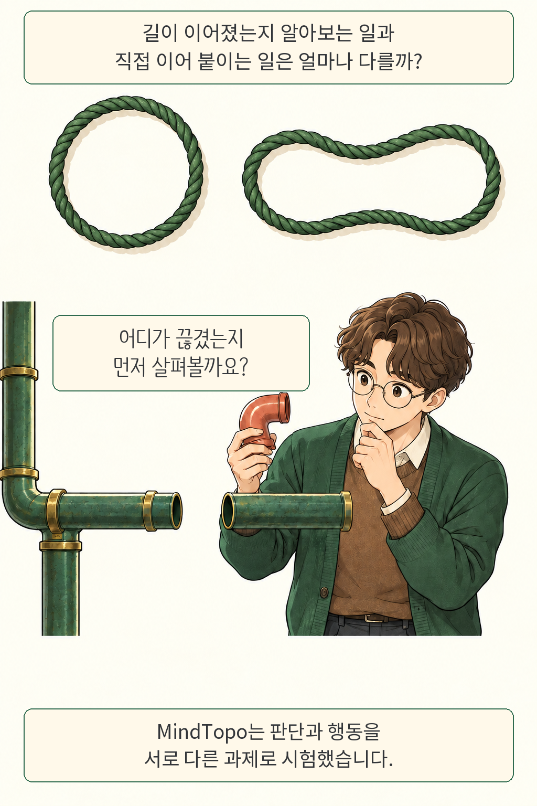

그림 속 미로나 회로를 보고 길을 잘 맞히는 AI라면, 실제 작업 환경에서도 부품을 돌려 연결을 완성할 수 있을까요? **MindTopo** 연구팀이 멀티모달 모델 14개를 시험해 보니, 그림을 보고 답을 고르는 정적 추론보다 직접 행동해 목표를 만드는 계획 과제에서 평균 점수가 크게 낮았습니다. 에이전트를 개발할 때 '말로 맞히는 능력'과 '실행으로 끝내는 능력'을 왜 따로 재야 하는지 보여 주는 연구입니다.

글·해설: 다메카솔

## 핵심 내용

- **벤치마크 구성**: 2026년 9월 10일 제출된 MindTopo v1은 5가지 위상 성질에 관한 13종 과제, 11,030개 사례를 담았습니다.
- **추론 vs 계획**: 정적 추론(8종)은 그림 속 관계를 답으로 맞히고, 행동 계획(5종, 각 600개)은 시뮬레이터 목표 조건을 제한 횟수 안에 채워야 성공합니다.
- **비교 조건과 공개 범위**: 두 과제군은 장면을 별도 생성해 난도·과제 차이도 작용하며, 본문 수치는 논문 v1(모델 14개)에 고정했습니다.

## 휘어도 이어진 고리, 돌려야 이어지는 파이프

둥근 고리를 옆으로 길게 늘려도 끊어진 곳이 생기지는 않듯, 모양이 달라져도 연결 자체는 유지됩니다. 논문이 다루는 위상적 관계는 길이나 각도보다 **무엇이 이어지고 어떤 경계가 안과 밖을 나누는지**에 초점을 둡니다. 자르거나 이어 붙이거나 다른 부분에 통과시키지 않는 변형 조건 아래 구조를 살피는 셈이죠.

연구팀은 이를 다섯 가지 위상 성질로 나눴습니다([v1 2.1~2.2절](https://arxiv.org/html/2609.11900v1#S2)).

- **연속성**: 길이 끊김 없이 이어지는지 확인합니다.
- **분리**: 부분들을 경계로 나눌 수 있는지 살핍니다.
- **순서**: 줄을 따라 대상이 어떤 차례로 놓였는지 봅니다.
- **둘러쌈**: 경계 안팎과 구멍의 관계를 판별합니다.
- **매듭**: 꼬임과 고리의 연결 상태를 파악합니다.

이 다섯 가지가 모든 공간 지각을 포괄하지는 않으며, 전체 장면도 실제 사진이 아니라 절차적으로 생성한 합성 이미지입니다.

## 답을 고르는 시험에서 행동을 실행하는 시험으로

눈으로 길을 맞히는 일과 직접 상태를 바꿔 목표를 완성하는 일은 어떻게 다를까요? 예를 들어 미로 추론에서는 도달 가능한 점을 골라 답하지만, Pipe 계획에서는 조각을 90도씩 돌려 모든 활성 파이프를 시작점에 연결해야 하며 빈틈이 하나라도 남으면 실패합니다.

정적 추론과 행동 계획은 채점 방식부터 뚜렷하게 갈립니다. 정적 질문은 숫자·선택형 답이 정확히 일치하거나 순서 없는 목록이 집합 단위로 맞아야 하거든요. 반면 본문 계획 평가는 모델이 관측 화면을 보고 행동을 고르면 시뮬레이터가 상태를 갱신하며, 제한 횟수 안에 목표 조건에 도달해야만 성공으로 집계됩니다. 자연어로 "완료했다"고 말하는 것과는 판정 근거가 다릅니다.

다만 두 과제군은 같은 장면을 번갈아 시험한 전후 실험과 구조가 다릅니다. 각 생성기로 장면을 따로 만들었기 때문에 점수 차이는 행동 능력뿐 아니라 상태 표현, 난도, 필요한 행동 길이가 함께 작용한 결과로 보아야 하며, 원인 분리는 추가 대조 실험이 필요합니다. 이는 [JarvisGUI의 기기 간 작업 완료 평가](/posts/jarvisgui-cross-device-state/)가 다룬 후속 작업 의존성과도 맞닿아 있습니다.

## 평균 점수와 파이프의 빈틈을 함께 읽기

논문 v1이 비교한 모델 14개 중 가장 높은 점수를 받은 GPT-5.6-Sol조차 Pipe 과제 성공률은 **50.50%**에 머물렀습니다. 절반 가까운 시도가 모든 조각을 연결하지 못한 셈이죠. 물론 시뮬레이터 점수가 실제 배관 작업이나 물리 로봇 성공률로 곧장 이어지지는 않습니다.

| 논문 v1 평가 대상 | 정적 추론 평균 (8종) | 행동 계획 평균 (5종) | Pipe 성공률 |
| --- | ---: | ---: | ---: |
| GPT-5.6-Sol | 66.83% | 52.75% | 50.50% |
| GPT-5.5 | 53.77% | 24.33% | 2.17% |
| Gemini-3.1-Pro | 52.24% | 19.23% | 5.50% |
| 인간 관측 기준 | - | - | 100.00% |

출처는 [논문 v1 Table 1과 3.2절](https://arxiv.org/html/2609.11900v1#S3.S2)이며, 본문 평가는 디코딩 온도 0을 썼습니다. 표의 평균은 과제별 점수를 같은 비중으로 단순 평균한 값이라 전체 사례를 합친 정답률과 구분해야 합니다. 세부 결과에서 짚을 맥락은 세 가지입니다.

- **전체 평균과 인간 관측 표본**: GPT-5.6-Sol의 13종 전체 평균은 61.42%, 인간 관측 평균은 97.87%였습니다. 전문 평가자 5명이 11,030개 중 11,008개를 나누어 평가(사례당 1건)한 결과이므로, 인간 전체의 일반 능력으로 확장해 읽기는 어렵습니다.
- **SFT+RL 후에도 남는 격차**: Qwen3-VL-2B-Instruct에 SFT와 RL을 순차 적용하자 선택된 추론 5종 평균은 14.24%에서 51.53%로 뛰었지만, 계획 4종은 0.20%에서 6.33%에 그쳤습니다. 이 계획 평가는 초기 관측에서 전체 행동열을 한 번에 예측해, 위 본문 표와 직접 비교할 때 주의가 필요합니다.
- **과제 범위와 영상 생성 관찰**: Untangle은 화면에 투영된 줄 교차를 푸는 과제로 3차원 매듭의 위상 보존과 구별됩니다. 저자들이 함께 점검한 생성 영상 실험에서도 그럴듯해 보이는 마지막 장면과 유효한 상태 전이를 구분해야 하는 한계가 나타났습니다.

## 공식 페이지와 원문이 다를 때의 기준

2026년 9월 11일 확인 당시 공식 프로젝트 페이지와 논문 v1 PDF 사이에는 일부 수치가 다르게 표시돼 있었습니다.

| 비교 항목 | 공식 프로젝트 페이지 | 논문 v1 PDF (본문 기준) |
| --- | --- | --- |
| 전체 사례 수 | 11,016개 | 11,030개 |
| 평가 모델 수 | 11개 | 14개 |
| 최고 전체 평균 | 54.1% | 61.42% |
| 코드·데이터 상태 | 공개 예정 표시 | 직접 링크 통해 공개 확인 |

이 글은 논문 v1을 기준으로 삼아 두 기록을 분리했으며, 차이의 원인은 공개 자료만으로 단정하기 어렵습니다. 또한 PDF가 연결하는 [GitHub 저장소](https://github.com/mll-lab-nu/MindTopo/tree/96ac4d15a706c43b31fb60ada7902c604cb857c1)와 [Hugging Face 데이터](https://huggingface.co/datasets/MLL-Lab/MindTopo/tree/312ae92494ff1f17d7b1eb340ea77ccadb9a3cba)는 이미 공개 상태였고, 저장소 README에는 실행 로그를 배포에서 제외한다는 점이 적혀 있었습니다.

## 다메카솔의 해석: 완료 조건을 환경 쪽에 두겠습니다

에이전트 평가를 설계한다면 설명의 정답률과 실행 성공률을 따로 관리하는 편이 좋습니다. 답변이 그럴듯해도 행동이 유효했고 목표 상태에 닿았는지는 별도 검증이 필요하거든요. 가령 Pipe 과제라면 그래프 탐색으로 연결을 확인하고, 파일 작업이라면 대상 경로의 파일 내용과 속성을 직접 검사하는 식입니다.

완료 판정 기준도 모델이 바꿀 수 없는 환경 쪽에 두어야 안전합니다. 모델의 자체 완료 보고를 그대로 믿으면 잘못 이해한 목표와 달성 주장이 함께 통과할 수 있고, 이는 [ExecCritic의 테스트 작성·수정 역할 분리](/posts/execcritic-independent-tests/)와도 맞닿는 원칙이죠. 물론 환경 판정기를 두어도 관측 오류 자체가 사라지지는 않으며, 판정기 구현과 회귀 테스트 유지 비용이 따릅니다. 앞으로 구조 데이터와 행동 길이까지 맞춘 대조 실험이 이어진다면, 보는 힘과 계획하는 힘 중 어디가 병목인지 더 선명해질 것입니다.

## 출처

- Ge 외, [MindTopo: Can Foundation Models Reason in Topological Space? v1](https://arxiv.org/abs/2609.11900v1), 2026-09-10 제출. 프리프린트.
- [논문 PDF](https://arxiv.org/pdf/2609.11900v1), 2절의 과제 설계, Table 1·2, 3.2~3.5절의 결과, 5절의 한계, 부록 B의 평가 조건.
- [공식 프로젝트 페이지](https://mind-topo.github.io/), 2026-09-11 확인. 수치와 공개 예정 표시가 PDF 및 직접 링크 상태와 다름.
- [공식 코드 96ac4d15](https://github.com/mll-lab-nu/MindTopo/tree/96ac4d15a706c43b31fb60ada7902c604cb857c1), [공식 데이터 312ae924](https://huggingface.co/datasets/MLL-Lab/MindTopo/tree/312ae92494ff1f17d7b1eb340ea77ccadb9a3cba), 2026-09-11 확인.

Updated: 2026-09-11

이 글은 논문 원문과 공개 저장소를 바탕으로 해설했으며, 별도 벤치마크 재실행은 포함하지 않았고 만화 그림은 이해를 돕기 위해 새로 구성했습니다.

이 글의 본문과 이미지는 생성형 AI로 제작했습니다. 기획과 편집 기준은 다메카솔이 정했습니다.
