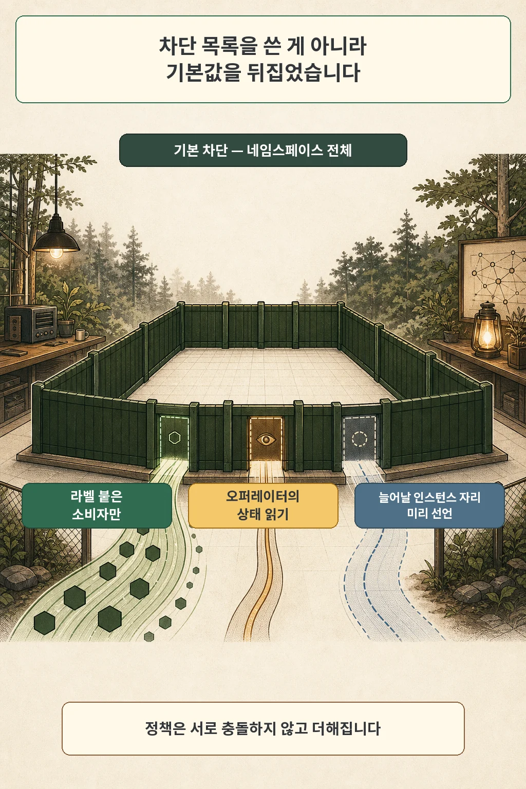
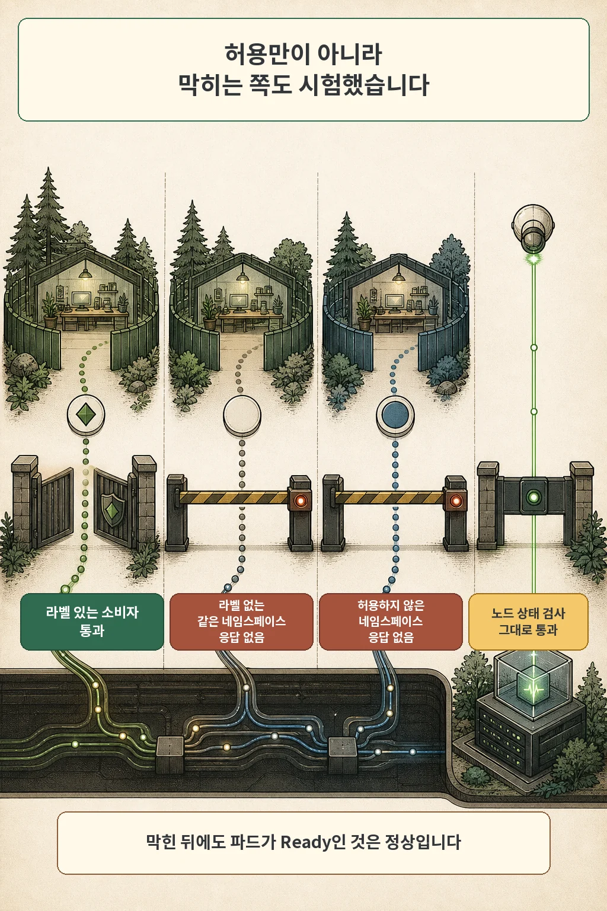

글·해설: 다메카솔

정책을 커밋하고 Argo CD에서 초록색 `Synced`를 확인하면 보통 작업이 끝났다고 생각하기 쉽습니다. 2026년 7월 13일 오후에 저도 같은 화면을 봤지만, 그 초록색이 알려 주는 것은 선언이 클러스터 API에 저장됐다는 사실 하나뿐입니다. 실제로 트래픽이 막히고 있는지는 별도로 두드려 봐야 알 수 있습니다.

> 이 글은 2026년 7월 12~13일에 진행한 홈랩 파일럿의 작업 로그와 GitOps 커밋(`7bdf6f74`)을 대조해 정리한 검증 기록입니다. 실제 네임스페이스·라벨·프로젝트 이름은 일반화한 예시로 치환했습니다.

## 핵심 내용

- **기본 차단과 명시 허용 4장 구성**: 데이터베이스 네임스페이스 전체 인입(Ingress)을 기본 차단하고, 소비 앱→DB 포트(5432), 오퍼레이터→인스턴스 상태 조회, 향후 복제 확장을 대비한 인스턴스 간 통신까지 총 4장의 NetworkPolicy로 경계를 선언했습니다.
- **YAML 들여쓰기(AND vs OR)와 집행 컨트롤러 확인**: `from` 배열 항목 안에 `namespaceSelector`와 `podSelector`를 함께 묶어 교집합(AND) 조건을 강제하고, `systemctl cat k3s`로 `--disable-network-policy`가 꺼져 있지 않은지 확인했습니다.
- **양성·음성(Negative) 시험과 다계층 거부 검증**: 허용 라벨이 있는 파드의 접속 성공(양성)뿐 아니라 라벨 없는 파드와 외부 네임스페이스 파드의 timeout 차단(음성), kubelet/API 서버 경유 상태 검사 정상 유지(60초 후 파드 1/1 Ready), 그리고 PostgreSQL `CONNECT` 권한 회수 및 Vault ServiceAccount 바인딩 거부까지 교차 검증했습니다.

## 네 장으로 선언한 경계

그날 커밋한 NetworkPolicy는 넉 장이었습니다. 한 장은 데이터베이스 네임스페이스 전체의 인입(Ingress)을 기본 차단했고, 나머지 세 장은 통과시킬 경로를 하나씩 열었습니다. 소비 앱에서 데이터베이스 포트로 가는 길, 오퍼레이터가 인스턴스 상태를 읽으러 오는 길, 그리고 향후 인스턴스가 늘어났을 때 필요한 인스턴스 간 복제 경로입니다.

기본 차단 정책은 다음과 같이 작성했습니다.

```yaml
spec:
  podSelector: {}      # 네임스페이스 안 모든 파드를 선택
  policyTypes:
    - Ingress          # egress는 이번 범위 밖
```

Kubernetes의 NetworkPolicy는 차단 목록을 위에서 아래로 평가하는 방화벽 규칙과 다르게 동작합니다. 한 파드에 여러 정책이 걸리면 각 정책이 허용하는 연결의 **합집합**이 최종 결과가 되며 평가 순서는 영향을 주지 않습니다. 파드는 원래 인입에 대해 격리돼 있지 않다가 자신을 선택하는 정책이 하나라도 생기는 순간 격리되므로, 기본 차단 정책은 규칙을 쌓는 것이 아니라 ‘전체 허용’이라는 기본값을 ‘전체 격리’로 뒤집는 역할을 합니다.



오퍼레이터 상태 조회 경로와 인스턴스 간 통신 경로를 미리 열어 둔 데에도 이유가 있습니다. 오퍼레이터 경로를 막으면 데이터베이스 자체는 멀쩡한데도 상태를 읽지 못해 Cluster 리소스만 `unhealthy`로 빠지고, 인스턴스 간 경로를 빼먹으면 단일 인스턴스일 때는 조용히 넘어가다가 복제본을 늘리는 순간 복제 스트림이 막히기 때문입니다.

## 한 항목에 묶으면 「그리고」, 나누면 「또는」

허용 조건을 두 개 쓸 때 둘 다 만족해야 할지(AND), 하나만 만족해도 될지(OR)는 YAML에서 하이픈(`-`) 하나에 갈립니다. 소비 앱 허용 정책은 다음과 같이 작성했습니다.

```yaml
ingress:
  - from:
      - namespaceSelector:          # 이 네임스페이스에 속하고
          matchLabels:
            kubernetes.io/metadata.name: app-ns
        podSelector:                # 동시에 이 라벨을 가진 파드만
          matchLabels:
            needs-db: "true"
    ports:
      - protocol: TCP
        port: 5432
```

두 셀렉터가 같은 `from` 배열 항목 안에 묶여 있으므로 조건은 **교집합(AND)**입니다. 지정한 `app-ns` 네임스페이스에 속하면서 동시에 `needs-db: "true"` 라벨을 단 파드만 통과합니다. 만약 `podSelector` 앞에 하이픈(`-`)을 붙여 별도 배열 항목으로 나누면 조건이 **합집합(OR)**으로 바뀌어, `app-ns`의 모든 파드와 DB 네임스페이스 내 해당 라벨 파드가 각각 열립니다.


들여쓰기 두 칸과 하이픈 하나가 보안 경계의 뜻을 바꾸지만, 잘못 쓴 쪽도 YAML 문법과 API 스키마 검증은 아무 경고 없이 통과합니다.

## 그 정책을 집행하는 쪽은 누구입니까

선언이 클러스터에 저장되고 Argo CD가 `Synced`를 띄웠더라도, API 서버에 저장된 문서 자체가 패킷을 막지는 못합니다. 노드에서 실제로 통행 규칙을 집행하는 네트워크 정책 컨트롤러가 동작하고 있어야 합니다.

Kubernetes 공식 문서가 명시하듯, 구현 컨트롤러 없이 NetworkPolicy 리소스만 만들면 API는 성공을 반환하고 트래픽은 아무 제약 없이 그대로 흐릅니다.


이 홈랩은 k3s 기본 구성이며, 패킷 전달을 맡는 기본 CNI와 별개로 k3s가 내장 배포하는 네트워크 정책 컨트롤러가 정책을 집행합니다. K3s 서버 플래그 `--disable-network-policy`(기본 네트워크 정책 컨트롤러 비활성화)가 설정돼 있지 않은지 확인할 때는 프로세스 목록 문자열 검색 대신 정본인 systemd 유닛의 `ExecStart`를 확인했습니다.

```bash
systemctl cat k3s | grep -- --disable-network-policy
```

출력이 비어 있으면 내장 컨트롤러가 비활성화되지 않았다는 뜻입니다. 하지만 여기까지는 ‘집행기가 켜져 있다’는 확인일 뿐, ‘방금 넣은 정책이 실제로 패킷을 막고 있다’는 증거는 아닙니다.

## 두 방향에서 막힌 것을 확인했습니다

통과되는 경로만 시험하면 정책이 아예 동작하지 않을 때와 결과를 구분할 수 없습니다. 그래서 양성 시험 1종, 음성(차단) 시험 2종, 상태 검사 유지 확인까지 총 네 가지를 시험했습니다.

```bash
# 음성 1: 같은 네임스페이스(app-ns), 허용 라벨 없음
kubectl -n app-ns run probe-nolabel --rm -it --restart=Never \
  --image=<psql 이미지> -- psql -h <db-service> -p 5432 -c 'SELECT 1'

# 음성 2: 정책에 없는 외부 네임스페이스(other-ns)
kubectl -n other-ns run probe-outside --rm -it --restart=Never \
  --image=<psql 이미지> -- psql -h <db-service> -p 5432 -c 'SELECT 1'
```

| 시험 구분 | 출발지 조건 | 기대 결과 | 실측 결과 |
| --- | --- | --- | --- |
| **양성 시험** | `app-ns` + `needs-db: "true"` 라벨 파드 | `SELECT 1` 응답 성공 | **성공** |
| **음성 시험 1** | `app-ns` 내 라벨 없는 파드 (`probe-nolabel`) | 연결 차단 | **timeout으로 차단됨** |
| **음성 시험 2** | 허용되지 않은 `other-ns` 파드 (`probe-outside`) | 연결 차단 | **timeout으로 차단됨** |
| **상태 검사 확인** | 정책 정착 60초 후 kubelet 프로브 및 `kubectl exec` | Cluster healthy, 파드 1/1 Ready | **정상 유지 (1/1 Ready)** |



여기서 두 가지는 운영 중에 기억해 둘 만합니다. 첫째, 차단 동작은 즉각적인 `connection refused`가 아니라 패킷 드롭에 의한 **timeout**으로 나타납니다. 둘째, 인입을 전부 막았는데도 파드 상태 검사가 통과하는 이유는 kubelet 프로브가 호스트 노드에서 출발하고 `kubectl exec`은 API 서버를 경유해 기본 인입 차단에 걸리지 않기 때문입니다.

## 권한은 네 판이고, 판마다 거부를 봤습니다

데이터베이스 앞에는 네트워크 외에도 총 네 겹의 제어판이 서 있었습니다. 각 계층은 서로 다른 대상을 통제하며, 앞 단계를 통과했다고 다음 단계가 열리지 않습니다.

1. **네트워크 도달성 (NetworkPolicy)**: 허용된 네임스페이스와 라벨 조합 외에는 TCP 5432 연결 자체가 timeout으로 막히는 것을 확인했습니다.
2. **데이터베이스 권한 (PostgreSQL GRANT)**: PostgreSQL은 데이터베이스 생성 시 기본적으로 `PUBLIC`에 `CONNECT` 권한을 부여합니다. 이 기본 권한을 회수하고 앱 전용 role에만 부여한 뒤, 권한 없는 임시 role로 TCP 접속을 시도해 접속 시작 시점에 `CONNECT` 권한 부재로 거절되는 것을 확인하고 임시 role을 삭제했습니다.
3. **시크릿 신원 검증 (Vault Kubernetes Auth)**: 정책에 바인딩된 ServiceAccount 토큰으로는 정상 발급을 확인(양성)하고, 바인딩되지 않은 다른 ServiceAccount의 유효한 토큰으로는 인가되지 않은 계정으로 거부되는 것(음성)을 확인했습니다.
4. **클러스터 API 권한 (Kubernetes RBAC)**: 신원 검증 위임이 동작한다는 양성 증거는 확인했으나, 권한 없는 주체가 거절되는 독립된 음성 시험 기록은 당시 로그에 남겨 두지 못해 미검증 공백으로 남겼습니다.

결국 네임스페이스는 그 자체로 완벽한 보안 장벽이 아니라 정책이 걸리는 논리적 범위일 뿐입니다. 경계는 라벨과 정책으로 직접 선언해야 생기고, 선언한 뒤에는 거부되는 쪽을 직접 두드려 봐야 확인됩니다.

## 자주 묻는 질문

- **정책을 적용했는데 아무것도 막히지 않습니다**: 정책 문법보다 CNI와 네트워크 정책 컨트롤러 활성 여부를 먼저 확인해야 합니다. 집행 컨트롤러가 없으면 리소스만 생성되고 트래픽은 그대로 흐릅니다.
- **허용 정책을 한 장 추가했더니 오히려 기존 연결이 막혔습니다**: 파드는 자신을 선택하는 정책이 하나라도 생기는 순간 격리 모드로 전환되어 ‘명시적으로 허용된 트래픽만’ 받게 됩니다. 오퍼레이터나 복제 경로 등 필요한 통신을 함께 열어 두어야 합니다.
- **인입 차단을 걸었는데도 파드가 계속 Ready입니다**: kubelet의 상태 검사는 노드에서 출발하고 `kubectl exec`은 API 서버를 거치므로 일반 파드 간 인입 차단에 막히지 않는 것이 정상입니다.

## 검증 범위와 남은 과제

이번 파일럿에서는 오퍼레이터와 DB 인스턴스의 DNS 해석 및 API 서버 통신을 건드리지 않기 위해 송신(Egress) 차단은 범위에서 제외했고, 아직 수집 소비자가 없는 메트릭 인입 경로도 열어 두지 않았습니다(향후 관측 스택 이전 시 추가 예정). 또한 이번 검증은 `k3s v1.36`(노드 2대: server 1 + agent 1), 기본 CNI 및 내장 네트워크 정책 컨트롤러, CloudNativePG 1.30, Argo CD 3.4 환경에서의 실측이므로, CNI를 교체하거나 클러스터 구성을 바꿀 때마다 이 음성 시험을 다시 실행할 계획입니다.

다음 편에서는 백업 2차 사본을 만들다 공유 게이트웨이를 OOM으로 몰아넣은 사건과, 전송이 끝난 뒤 사본이 정말 같은지 객체 단위로 대조한 절차를 다룹니다.

## 함께 읽을 개념 글

- [Kubernetes NetworkPolicy 간헐적 connection refused: DNAT 뒤 목적지를 확인한 기록](/posts/k8s-networkpolicy-dnat-evaluation/)
- [CoreDNS를 두 대 띄우고도 재구축이 위험했던 이유](/posts/dns-bootstrap-loop/)

## 출처

- 개인 인프라 파일럿 작업 로그: 권한 재설계와 CONNECT 부정 시험, 신원 흐름 양성·음성 검증, NetworkPolicy 4종과 검증 3종, 2026-07-12~13
- 개인 GitOps 저장소 기록: 데이터베이스 네임스페이스 기본 차단과 명시 허용 4종, 2026-07-13, commit `7bdf6f74`
- [Kubernetes: Network Policies](https://kubernetes.io/docs/concepts/services-networking/network-policies/)
- [K3s: server CLI reference](https://docs.k3s.io/cli/server)
- [K3s: Basic Network Options](https://docs.k3s.io/networking/basic-network-options)
- [PostgreSQL: Privileges](https://www.postgresql.org/docs/current/ddl-priv.html)
- [HashiCorp Vault: Kubernetes auth method](https://developer.hashicorp.com/vault/docs/auth/kubernetes)

이 글의 본문과 이미지는 생성형 AI로 제작했습니다. 기획과 편집 기준은 다메카솔이 정했습니다. 만화 이미지는 텍스트 없는 원화에 결정적 레터링을 합성해 만들었습니다. 공식 로고·UI·문서 도표 등 외부 이미지 자산은 사용하지 않았습니다.
