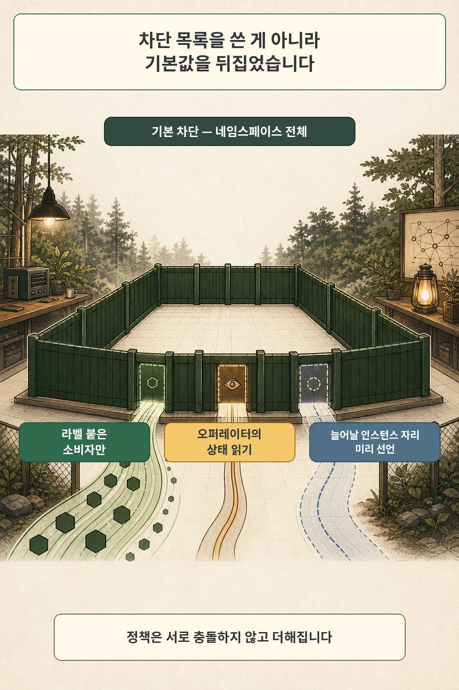
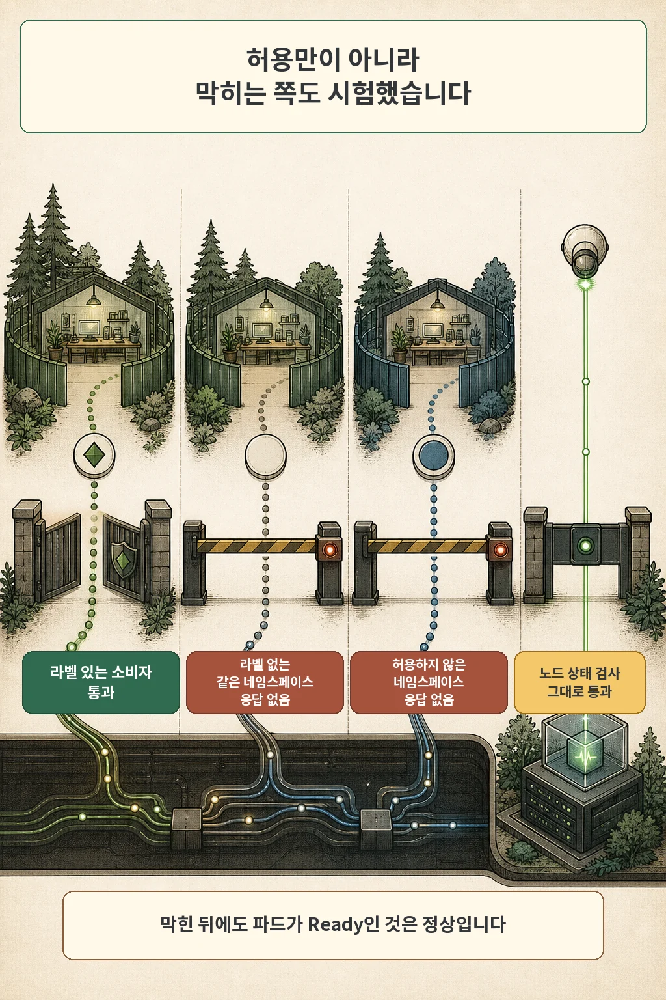

Argo CD에서 `NetworkPolicy` 커밋이 초록색 `Synced`로 뜨면 방화벽 설정도 끝났다고 여기기 쉽습니다. 하지만 그 배지는 선언 문서가 API 서버에 저장됐다는 신호일 뿐, 실제 패킷이 막히는지는 별도로 확인해야 하거든요. 2026년 7월 13일 오후 홈랩 데이터베이스에 격리 정책을 적용하며 통과 시험과 차단(음성) 시험을 함께 진행한 과정을 정리했습니다.

글·해설: 다메카솔

## 핵심 내용

- **기본 차단과 명시 허용 4장**: DB 네임스페이스 전체 인입을 기본 차단하고, 소비 앱(5432), 오퍼레이터 상태 조회(8000), 인스턴스 간 복제·상태 통신(5432·8000)까지 4장의 정책으로 경계를 나눴습니다.
- **AND 선택자와 집행기 점검**: `from` 한 항목에 네임스페이스·파드 선택자를 묶어 교집합(AND)을 걸고, `systemctl cat k3s`로 내장 컨트롤러 활성 상태를 확인했습니다.
- **양성·음성 및 다계층 검증**: 허용 파드 질의 성공, 미허용 파드 2종의 `timeout` 차단, 60초 후 파드 `1/1 Ready` 유지와 PostgreSQL `CONNECT`·Vault 토큰 거부까지 확인했습니다.

## 네 장으로 선언한 경계

커밋한 `NetworkPolicy`는 총 네 장입니다. 한 장으로 DB 네임스페이스 인입(Ingress)을 기본 차단하고, 나머지 세 장으로 필요한 통로만 여는 구조죠. 먼저 모든 파드를 격리 상태로 돌리는 기본 차단 정책은 아래처럼 작성했습니다.

```yaml
spec:
  podSelector: {}      # 네임스페이스 안 모든 파드를 선택
  policyTypes:
    - Ingress          # egress는 이번 범위 밖
```

`NetworkPolicy`는 위에서 아래로 내려오는 방화벽 목록과 다르게 동작합니다. 한 파드에 여러 정책이 겹치면 평가 순서와 무관하게 허용 연결의 **합집합**이 최종 규칙이 되죠. 원래 파드는 모든 인입을 받다가 자신을 선택하는 `Ingress` 정책이 하나라도 걸리는 순간 격리되므로, 기본 차단은 규칙을 쌓는 대신 기본값을 '전체 격리'로 뒤집는 장치입니다.



가령 소비 앱(TCP `5432`)만 열고 오퍼레이터 상태 조회(포트 `8000`)나 인스턴스 간 통신(`5432`·`8000`)을 빼먹으면 문제가 생깁니다. 오퍼레이터가 막히면 DB가 멀쩡해도 `Cluster` 리소스가 `unhealthy`로 빠지고, 인스턴스 간 경로가 빠지면 복제본을 늘리는 순간 복제 트래픽이 멈추거든요.

## 한 항목에 묶으면 「그리고」, 나누면 「또는」

허용 조건을 둘 이상 쓸 때 교집합(AND)과 합집합(OR)은 YAML 하이픈(`-`) 위치에 달렸습니다. 소비 앱 허용 정책은 아래처럼 구성했습니다.

```yaml
ingress:
  - from:
      - namespaceSelector:          # 이 네임스페이스에 속하고
          matchLabels:
            kubernetes.io/metadata.name: app-ns
        podSelector:                # 동시에 이 라벨을 가진 파드만
          matchLabels:
            needs-db: "true"
    ports:
      - protocol: TCP
        port: 5432
```

두 선택자를 같은 `from` 항목에 묶었으므로 조건은 **교집합(AND)**으로 적용됩니다. `app-ns` 네임스페이스에 속하면서 동시에 `needs-db: "true"` 라벨이 붙은 파드만 `5432` 포트로 들어올 수 있죠. 반대로 `podSelector` 앞에 하이픈(`-`)을 붙여 별도 항목으로 나누면 **합집합(OR)**이 되어, `app-ns`의 모든 파드와 DB 네임스페이스 내 해당 라벨 파드가 각각 열립니다.


들여쓰기 두 칸과 하이픈 하나로 보안 경계의 뜻이 정반대로 바뀌지만, 잘못 쓴 쪽도 YAML 문법과 API 스키마 검증은 경고 없이 통과합니다. 선언만으로는 의도한 격리를 보장하기 어려운 이유입니다.

## 그 정책을 집행하는 쪽은 누구인가요

API 서버에 저장된 YAML 문서만으로는 패킷이 막히지 않으며, 노드에서 규칙을 집행하는 네트워크 정책 컨트롤러가 동작하고 있어야 합니다. Kubernetes 공식 문서 역시 구현 컨트롤러 없이 `NetworkPolicy`만 만들면 API는 성공해도 트래픽이 그대로 흐른다고 설명합니다.


이 홈랩은 k3s 기본 구성이라 기본 CNI와 별개로 k3s 내장 네트워크 정책 컨트롤러가 정책을 집행합니다. 다른 CNI와 충돌을 피하려 쓰는 `--disable-network-policy` 플래그가 꺼져 있는지 볼 때는 프로세스 목록 문자열 검색 대신 정본인 systemd 유닛의 `ExecStart`를 조회했습니다.

```bash
systemctl cat k3s | grep -- --disable-network-policy
```

출력이 비어 있으면 내장 컨트롤러가 활성 상태라는 뜻입니다. 하지만 여기까지는 집행기가 켜져 있다는 확인일 뿐, 실제 패킷 차단 여부는 연결 시험으로 확인해야 하거든요.

## 허용과 차단을 양방향으로 시험했습니다

통과되는 경로만 시험하면 정책이 전혀 작동하지 않는 상태와 구분하기 어렵습니다. 그래서 허용 파드 1종과 미허용 파드 2종, 상태 검사 유지까지 네 가지를 묶어 확인했습니다.

```bash
# 음성 1: 같은 네임스페이스(app-ns), 허용 라벨 없음
kubectl -n app-ns run probe-nolabel --rm -it --restart=Never \
  --image=<psql 이미지> -- psql -h <db-service> -p 5432 -c 'SELECT 1'

# 음성 2: 정책에 없는 외부 네임스페이스(other-ns)
kubectl -n other-ns run probe-outside --rm -it --restart=Never \
  --image=<psql 이미지> -- psql -h <db-service> -p 5432 -c 'SELECT 1'
```

| 시험 구분 | 출발지 조건 | 기대 결과 | 실측 결과 |
| --- | --- | --- | --- |
| **양성 시험** | `app-ns` + `needs-db: "true"` 라벨 파드 | `SELECT 1` 성공 | **성공** |
| **음성 시험 1** | `app-ns` 내 라벨 없는 파드 (`probe-nolabel`) | 연결 차단 | **timeout 차단** |
| **음성 시험 2** | 허용되지 않은 `other-ns` 파드 (`probe-outside`) | 연결 차단 | **timeout 차단** |
| **상태 검사** | 정책 정착 60초 후 kubelet 프로브·`kubectl exec` | Cluster healthy, 1/1 Ready | **정상 유지 (1/1 Ready)** |



실측에서 두 가지는 운영 중 기억해 둘 필요가 있습니다. 차단 시 즉각적인 `connection refused` 대신 패킷 드롭에 따른 **timeout**으로 나타나고, `kubelet` 프로브는 노드 발이며 `kubectl exec`은 API 서버 경유라 기본 인입 차단을 걸어도 파드 `1/1 Ready` 상태는 유지되거든요.

## 권한은 네 판이고, 판마다 거부를 봤습니다

데이터베이스 앞에는 네트워크 외에도 인증·권한 계층이 셋 더 서 있었습니다. 앞 단계를 통과하더라도 다음 계층마다 별도 인가 심사를 통과해야 하는 구조입니다.

| 권한 계층 | 설정 및 검증 내용 | 양성·음성 확인 결과 |
| --- | --- | --- |
| **네트워크 (NetworkPolicy)** | 허용 네임스페이스·라벨 외 TCP 5432 차단 | 허용 통과 / 미허용 2종 `timeout` 차단 |
| **DB 권한 (PostgreSQL)** | `PUBLIC` `CONNECT`·`TEMPORARY` 회수, 앱 role 부여 | 미인가 임시 role `CONNECT` 거부 후 삭제 |
| **시크릿 신원 (Vault Auth)** | ServiceAccount 바인딩 기반 토큰 발급 | 바인딩 SA 성공 / 미바인딩 토큰 거부 |
| **API 권한 (K8s RBAC)** | 신원 검증 위임 동작 확인 | 위임 양성만 확인 (독립 음성 기록 없음) |

네임스페이스는 그 자체로 방화벽이 아니라 정책이 걸리는 논리적 범위일 뿐입니다. 경계는 라벨과 정책으로 선언해야 생기고, 선언 뒤에는 거부될 경로까지 두드려 봐야 검증이 끝나는 셈이죠.

## 검증 범위와 다음 편

- **이번 파일럿 범위**: 오퍼레이터와 DB의 DNS 해석·API 서버 통신을 유지하려 송신(Egress) 차단은 뺐고, 수집 소비자가 없는 메트릭 인입 경로는 관측 스택 이전 시점에 추가하기로 남겼습니다.
- **실측 환경과 재시험**: `k3s v1.36`(server 1·agent 1), 기본 CNI·내장 컨트롤러, CloudNativePG 1.30, Argo CD 3.4 기준 실측이므로 CNI나 구성을 바꾸면 같은 음성 시험을 다시 돌려야 합니다.

다음 편에서는 백업 2차 사본을 만들다 공유 게이트웨이를 OOM으로 몰아넣은 사건과, 전송 뒤 사본이 같은지 객체 단위로 대조한 절차를 다룹니다.

## 함께 읽을 개념 글

- [Kubernetes NetworkPolicy 간헐적 connection refused: DNAT 뒤 목적지를 확인한 기록](/posts/k8s-networkpolicy-dnat-evaluation/)
- [CoreDNS를 두 대 띄우고도 재구축이 위험했던 이유](/posts/dns-bootstrap-loop/)

## 출처

- 개인 인프라 파일럿 작업 로그: 권한 재설계와 CONNECT 부정 시험, 신원 흐름 양성·음성 검증, NetworkPolicy 4종과 검증 3종 (2026-07-12~13)
- 개인 GitOps 저장소 기록: 데이터베이스 네임스페이스 기본 차단과 명시 허용 4종 (2026-07-13)
- [Kubernetes: Network Policies](https://kubernetes.io/docs/concepts/services-networking/network-policies/)
- [K3s: server CLI reference](https://docs.k3s.io/cli/server)
- [K3s: Basic Network Options](https://docs.k3s.io/networking/basic-network-options)
- [PostgreSQL: Privileges](https://www.postgresql.org/docs/current/ddl-priv.html)
- [HashiCorp Vault: Kubernetes auth method](https://developer.hashicorp.com/vault/docs/auth/kubernetes)

이 글의 본문과 이미지는 생성형 AI로 제작했습니다. 기획과 편집 기준은 다메카솔이 정했습니다. 실제 네임스페이스·라벨 이름은 일반화했으며, 차단 여부는 패킷 덤프 대신 timeout 관찰로 확인했습니다.
