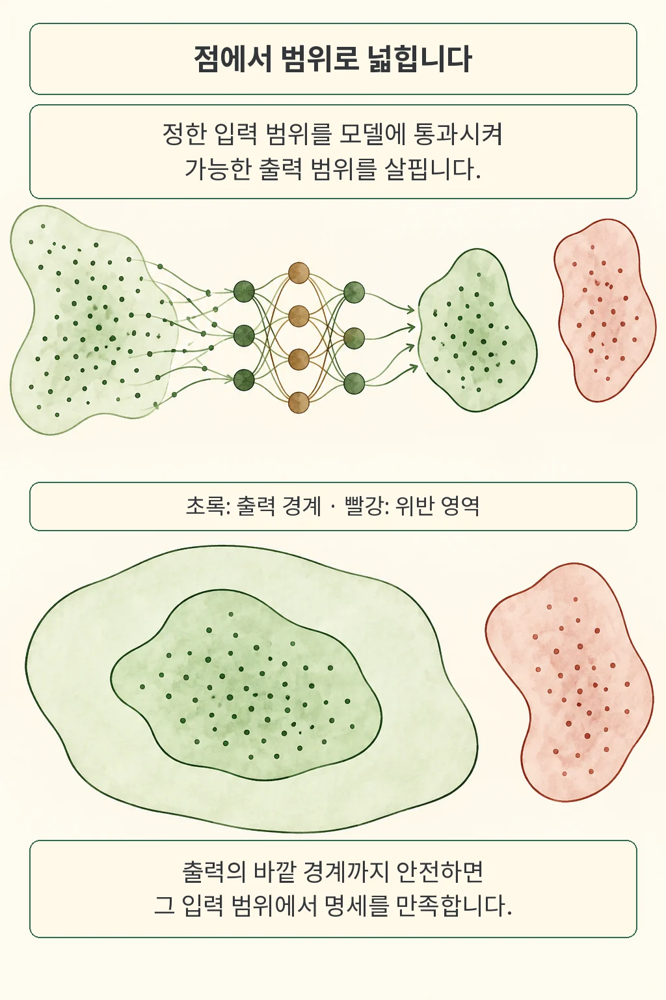
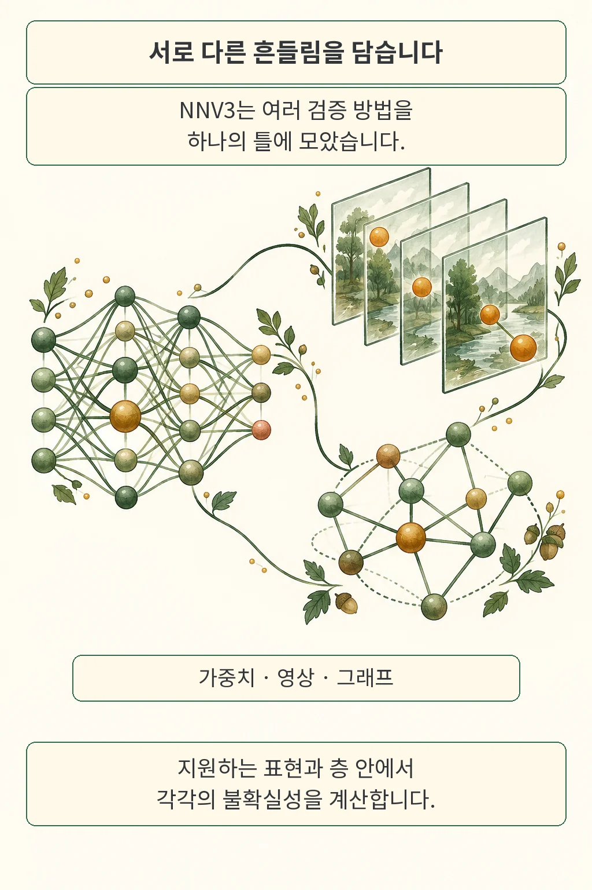

모델을 가볍게 줄여 배포하려는데 준비해 둔 테스트 데이터셋 점수는 잘 나옵니다. 그래도 가중치가 반올림으로 조금 달라지거나 연속 영상 입력이 미세하게 흔들릴 때까지 같은 판단을 유지할지는 점 몇 개를 찍어 보는 테스트만으로는 확신하기 어렵습니다. **NNV3는 지정한 입력·가중치 변화 범위 안에서 모델 출력이 어디까지 달라질 수 있는지 집합으로 계산하고, 그 범위가 안전 명세를 만족하는지 확인하는 신경망 검증 도구**입니다.

*글·해설: 다메카솔*

확인·작성: 2026년 9월 27일

## 핵심 내용

- **세 가지 Star-set 검증 표현의 통합**: MATLAB 기반 신경망 검증기 NNV3는 선행 연구에서 개별 개발된 가중치 구간 교란(**ModelStar**), 연속 영상·3차원 체적 입력(**VolumeStar**), 그래프 신경망(**GraphStar**) 검증을 공통 추상화와 API로 통합했습니다.
- **과대근사와 미확정(unknown) 상태의 분리**: 도달 가능한 출력 집합을 넓게 감싸는 과대근사(over-approximation) 특성상, 4프레임 MNIST 영상 분류기(ZoomIn-4f) 실험에서는 표본 10개 중 7개가 검증 통과, 3개가 미확정(unknown)으로 남아 위반 검출과 결론 유보를 구분해야 함을 보여 줍니다.
- **확률적 검증 모드의 분포 조건**: 대규모 모델(TinyYOLO 등)을 위해 샘플링과 conformal inference를 결합한 확률적 검증 모드를 지원하며, 이때의 UNSAT 판정은 지정된 샘플링 분포와 보정 표본에 대한 확률적 보장(coverage·confidence 각 0.999)으로 읽어야 합니다.

이번에 읽은 논문은 Anne M. Tumlin 등 11명의 **NNV3: Expanding Neural Network Verification to New Architectures and Domains**(2026년 9월 24일 공개 arXiv v1)입니다.

## 테스트한 점 사이까지 살펴보는 방법

일반적인 테스트가 개별 입력 점에서 모델의 출력을 확인한다면, 집합 기반 검증은 허용할 입력 변화 범위를 먼저 정하고 그 안에서 나올 수 있는 출력들을 하나의 **도달 가능 집합(reachable set)**으로 계산합니다. 비선형 연산 등으로 정확한 출력 집합을 구하기 어려울 때는 실제 가능한 출력을 모두 포함하는 더 넓은 경계로 감싸는 **과대근사(over-approximation)**를 사용합니다.

이렇게 넓게 잡은 경계조차 명세 위반 영역(위험 영역)과 겹치지 않는다면, 설정한 입력 범위 안의 어떤 실제 입력도 위험 출력을 내지 않는다고 보장할 수 있습니다. 따라서 검증 결과표를 읽을 때도 단순히 ‘통과(verified)’ 배지만 볼 것이 아니라, 입력과 가중치에 어느 정도의 변화 폭을 허용했는지부터 함께 확인해야 합니다.

## NNV3가 하나의 틀에 모은 것

저자들은 선행 연구들에서 각각 제안됐던 집합 표현과 분석 기법을 공통 Star-set 추상화, 명세 인터페이스, 개발자 API로 하나로 묶었습니다(개별 알고리즘을 처음 발명했다기보다 하나의 검증 프레임워크로 통합한 것이 이번 논문의 핵심 기여입니다).

| 집합 표현 | 주로 다루는 불확실성 | 결과를 읽을 때 확인할 조건 및 현재 한계 |
| --- | --- | --- |
| **ModelStar** | 모델 가중치(매개변수)의 구간 변화 | 완전연결층·2D 합성곱층 지원. 단일 교란층+단일점 입력은 정확 표현, 다층 교란은 과대근사 사용(가중치 반올림 오차는 다루나 추론 중 정수·고정소수점 이산 연산 효과는 지원 범위 밖) |
| **VolumeStar** | 연속 영상 프레임과 3차원 체적 입력 | 프레임 수·해상도가 커질수록 메모리와 계산 시간 증가 |
| **GraphStar** | 그래프 구조 모델의 노드·간선 특성 | 지원하는 메시지 전달 연산과 검증 명세 범위 확인 필요 |

## 원문 실험이 보여 준 범위와 확률적 보장

4프레임 MNIST 영상 분류기인 ZoomIn-4f에서 입력 교란 크기별로 표본 10개(표본당 제한 시간 30분, MATLAB 2025b Docker · 24코어 i9-285K · 64GB RAM · RTX 5090 32GB 환경)를 검증한 원문 표 2 결과는 아래와 같습니다.

| 입력 교란 크기 | 검증 통과 (Verified) | 미확정 (Unknown) | 평균 소요 시간 |
| --- | ---: | ---: | ---: |
| 1/255 | 7 / 10 | 3 / 10 | 35.54초 |
| 2/255 | 7 / 10 | 3 / 10 | 37.88초 |
| 3/255 | 7 / 10 | 3 / 10 | 36.49초 |

여기서 나머지 3건이 **미확정(unknown)**으로 남은 이유는 실제로 안전 명세를 어기는 반례가 발견돼서가 아니라, 과대근사로 넓어진 출력 경계가 위반 영역과 겹쳐 검증기가 확실한 결론을 내리지 못했기 때문입니다.

한편 결정론적 집합 계산이 버거운 큰 네트워크를 위해 NNV3는 샘플링과 conformal inference를 결합한 **확률적 검증 모드**도 함께 제공합니다. 원문 TinyYOLO 실험에서는 VNN-COMP 2023 명세 72개 중 무작위 3개를 골라 명세당 보정 표본 9,230개와 coverage·confidence 각 `0.999`를 적용했고, 명세당 111.26~131.86초에 조건부 UNSAT(위반 없음)을 보고했습니다. 이는 모든 최악의 입력을 100% 감싼 결정론적 보장이 아니라, **보정 표본 추출 과정에 대해 최소 99.9% 신뢰도로 같은 샘플링 분포에서 새로 뽑은 입력의 출력이 계산된 집합 안에 들어갈 확률이 최소 99.9%**라는 분포 조건부 보장입니다.

## 다메카솔의 해석: 결과 옆에 조건을 남깁니다

신경망 검증 결과를 배포 파이프라인에 연결한다면 **검증한 모델 가중치 버전, 허용한 입력·가중치 교란 범위, 안전 명세, 그리고 결정론적/확률적 검증 모드 구분**을 한 묶음의 메타데이터로 남겨야 합니다. 또한 `unknown` 판정을 단순 실패(반례 발견)나 성공에 합치지 않고 별도 상태로 보존해야, 더 정밀한 분할 검증을 돌릴지 입력 범위를 조정할지 판단할 수 있습니다.

코드를 검증할 독립 테스트 생성을 다룬 [ExecCritic 논문 읽기](/posts/execcritic-independent-tests/)와 나란히 놓고 보면, 유한한 테스트 케이스 통과와 연속된 입력 집합의 경계 검증이 각각 어떤 위험을 줄여 주는지 선명하게 대비됩니다.

## 출처

- [NNV3 논문 및 제출 이력, arXiv v1](https://arxiv.org/abs/2609.30050v1) 및 [원문 PDF (5절, 표 2·3)](https://arxiv.org/pdf/2609.30050v1)
- [공식 ModelStar 설명과 지원 범위](https://verivital.github.io/nnv/theory/weight-perturbation.html) · [공식 확률적 검증 이론과 전제](https://verivital.github.io/nnv/theory/probabilistic.html)
- [NNV 공식 코드: 검토한 커밋 (`376568b4`)](https://github.com/verivital/nnv/tree/376568b449535a779f751dd2def774a0ed94ead8) — 원문과 공식 문서, 저장소 파일 구성을 대조했으며 MATLAB 벤치마크 재실행은 수행하지 않았습니다.

이 글의 본문과 이미지는 생성형 AI로 제작했습니다. 기획과 편집 기준은 다메카솔이 정했습니다.
