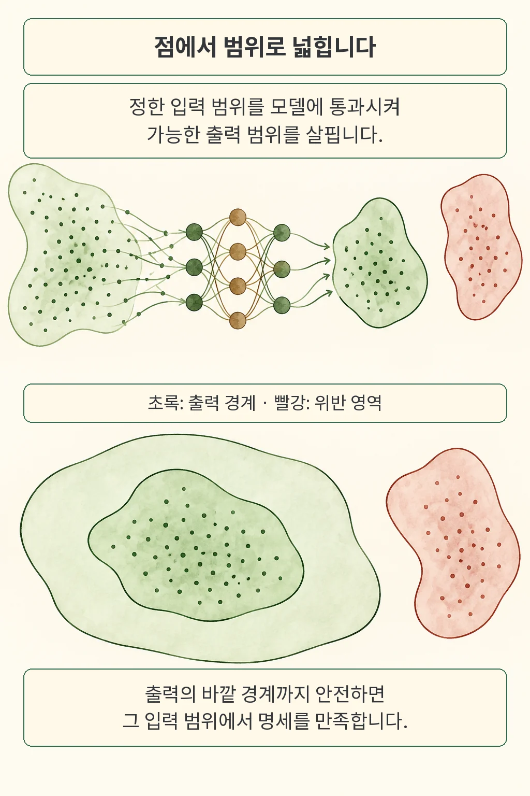
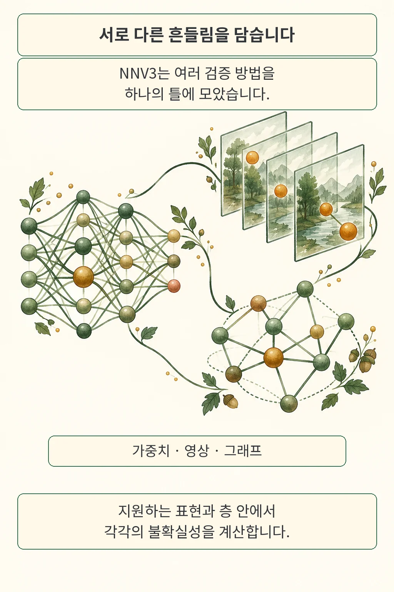

모델을 가볍게 줄여 배포할 때 테스트 데이터셋 점수가 잘 나오더라도, 가중치가 반올림으로 조금 달라지거나 연속 영상 입력이 미세하게 흔들릴 때까지 같은 판단을 유지할지는 점 몇 개를 찍어 보는 테스트만으로 확신하기 어렵습니다. **NNV3**는 지정한 입력·가중치 변화 범위 안에서 모델 출력이 어디까지 달라질 수 있는지 집합으로 계산하고, 그 범위가 안전 명세를 만족하는지 확인하는 MATLAB 기반 신경망 검증 도구거든요. 테스트 통과 여부를 넘어 '어느 범위까지 안전한가'를 따져 보고 싶을 때 유용한 기준을 제시합니다.

글·해설: 다메카솔

## 핵심 내용

- **세 가지 Star-set 검증 표현의 통합**: 선행 연구에서 개별 개발된 가중치 구간 교란(**ModelStar**), 연속 영상·3차원 체적 입력(**VolumeStar**), 그래프 신경망(**GraphStar**) 검증을 공통 추상화와 API로 통합했습니다.
- **과대근사와 미확정(`unknown`) 상태의 분리**: 도달 가능한 출력 집합을 넓게 감싸는 과대근사 특성상, 4프레임 MNIST 영상 분류 실험에서는 교란 수준별 표본 10개 중 7개가 검증 통과, 3개가 미확정으로 남아 위반 검출과 결론 유보를 구분해야 함을 보여 줍니다.
- **확률적 검증 모드의 분포 조건**: TinyYOLO 같은 대규모 모델에는 샘플링과 conformal inference를 결합한 확률적 검증 모드를 지원하며, 이때의 UNSAT 판정은 지정된 샘플링 분포와 보정 표본에 대한 확률적 보장으로 읽어야 합니다.

이번에 살펴본 연구는 Anne M. Tumlin 등 11명이 공개한 「NNV3: Expanding Neural Network Verification to New Architectures and Domains」 프리프린트입니다.

## 테스트한 점 사이까지 살펴보는 방법

일반적인 테스트가 개별 입력 점에서 모델의 출력만 확인한다면, 집합 기반 도달 가능성 분석은 허용할 입력 변화 범위를 먼저 정한 뒤 그 안에서 나올 수 있는 출력을 하나의 **도달 가능 집합(reachable set)**으로 계산합니다. 신경망 내부의 비선형 연산 때문에 정확한 출력 집합을 구하기 어려울 때는 실제 가능한 출력을 모두 감싸는 더 넓은 경계를 잡는 **과대근사(over-approximation)**를 사용하죠.

이렇게 넓게 잡은 경계조차 명세 위반 영역(위험 영역)과 겹치지 않는다면, 설정한 입력 범위 안의 어떤 입력도 위험 출력을 내지 않는다고 보장할 수 있습니다. 예를 들어 카메라 센서 노이즈로 영상 픽셀이 조금씩 흔들리거나 양자화로 가중치가 미세하게 바뀌는 상황을 떠올려 볼까요. 테스트셋 100장을 통과했더라도 그 사이의 미세한 변형에 오분류가 숨어 있을 수 있는데, 집합 검증은 바로 그 빈틈을 경계 단위로 확인합니다. 따라서 검증 결과표를 읽을 때도 단순히 통과 배지만 볼 것이 아니라 입력과 가중치에 어느 정도 변화 폭을 허용했는지부터 함께 확인해야 합니다.

## NNV3가 하나의 틀에 모은 것

저자들은 선행 연구들에서 각각 제안됐던 집합 표현과 분석 기법을 공통 Star-set 추상화, 명세 인터페이스, 개발자 API로 하나로 묶었습니다. 개별 검증 알고리즘을 새로 발명했다기보다 서로 다른 입력·모델 형태를 하나의 검증 프레임워크에서 다루도록 통합한 것이 이번 논문의 핵심 기여입니다.

| 집합 표현 | 주로 다루는 불확실성 | 결과를 읽을 때 확인할 조건 및 현재 한계 |
| --- | --- | --- |
| **ModelStar** | 모델 가중치의 구간 변화 | 완전연결층·2D 합성곱층 지원. 단일 교란층+단일점 입력은 정확 표현, 다층 교란은 건전한 과대근사 사용(추론 중 정수·고정소수점 이산 연산 효과는 지원 범위 밖) |
| **VolumeStar** | 연속 영상·3차원 체적 입력 | 입력 크기·프레임 수가 커질수록 집합 표현 메모리와 계산 시간 증가 |
| **GraphStar** | 그래프 모델의 노드·간선 특성 | 지원하는 메시지 전달 연산과 검증 명세 범위 확인 필요 |

여기서 눈여겨볼 대목은 **ModelStar**의 지원 경계입니다. 단일 교란층에 단일점 입력이 들어갈 때는 출력 집합을 정확히 계산하지만, 여러 층의 가중치가 동시에 흔들리면 건전한 과대근사로 전환되거든요. 또한 가중치 반올림 오차는 구간으로 다뤄도 실제 기기 추론에서 생기는 정수·고정소수점 이산 연산 효과까지는 다루지 못하므로 실행 환경의 수치 오차는 별도로 점검해야 합니다.

## 원문 실험이 보여 준 `unknown`과 확률적 보장

**VolumeStar**의 동작을 보여 주기 위해, 저자들은 4프레임 MNIST 영상 분류기(ZoomIn-4f)를 대상으로 입력 교란 크기별 검증 실험을 수행했습니다.

- **실험 환경과 조건**: MATLAB 2025b Docker(24코어 i9-285K, 64GB RAM, RTX 5090 32GB)에서 교란 수준마다 표본 10개, 표본당 제한 시간 30분으로 검증했습니다.

| 입력 교란 크기 | 검증 통과 (Verified) | 미확정 (Unknown) | 평균 소요 시간 |
| --- | ---: | ---: | ---: |
| 1/255 | 7 / 10 | 3 / 10 | 35.54초 |
| 2/255 | 7 / 10 | 3 / 10 | 37.88초 |
| 3/255 | 7 / 10 | 3 / 10 | 36.49초 |

매번 3건씩 남은 **미확정(`unknown`)** 판정은 안전 명세를 어긴 반례가 발견됐다는 뜻이 아닙니다. 과대근사로 넓어진 출력 경계가 위험 영역과 겹치면서 검증기가 안전과 위반 중 어느 쪽도 확정하지 못했다는 신호죠. 저자들 역시 이번 평가는 통합 기능의 실행 가능성을 보여 주는 시연 목적이며 포괄적 확장성 연구는 아니라고 밝힙니다.

결정론적 집합 계산이 버거운 큰 신경망에는 샘플링과 conformal inference를 결합한 **확률적 검증 모드**를 제공합니다.

- **TinyYOLO 실험 설정**: VNN-COMP 2023 명세 72개 중 무작위 3개를 골라 명세당 보정 표본 9,230개와 coverage·confidence 각 `0.999`를 적용했습니다.
- **관측된 결과**: GPU 환경에서 명세당 111.26~131.86초에 세 명세 모두 조건부 UNSAT(위반 없음)을 보고했습니다.

이 수치는 가능한 최악의 입력을 빠짐없이 감싼 결정론적 보장과 성격이 다릅니다. 보정 표본 추출 과정에 대한 최소 99.9% 신뢰도와, 같은 샘플링 분포에서 새로 뽑은 입력의 출력이 계산된 집합에 들어갈 확률이 최소 99.9%라는 **분포 조건부 보장**이거든요. 즉 탐지기 정확도를 뜻하는 수치가 아니므로 운영 환경의 입력 분포가 달라지면 전제부터 다시 맞춰야 합니다.

## 다메카솔의 해석: 결과 옆에 조건을 남깁니다

신경망 검증 결과를 배포 파이프라인에 연결할 때는 최종 판정값만 저장하면 추적이 어렵습니다. 검증한 모델 가중치 버전, 허용한 입력·가중치 교란 범위, 안전 명세, 그리고 결정론적·확률적 모드 구분을 메타데이터로 함께 남겨 두어야 하거든요.

또한 `unknown` 판정은 실패(반례 발견)나 통과에 합치지 않고 별도 상태로 보존해야 입력 영역 분할이나 허용 범위 조정을 판단할 수 있습니다. 코드를 검증할 독립 테스트 생성을 다룬 [ExecCritic 논문 읽기](/posts/execcritic-independent-tests/)와 나란히 놓고 보면, 유한한 테스트 통과와 연속된 입력 집합 경계 검증이 줄여 주는 위험이 선명하게 대비됩니다.

## 출처

- [NNV3 논문 및 제출 이력, arXiv v1 (2026년 9월 24일 공개)](https://arxiv.org/abs/2609.30050v1) 및 [원문 PDF (5절, 표 2·3)](https://arxiv.org/pdf/2609.30050v1)
- [공식 ModelStar 설명과 지원 범위](https://verivital.github.io/nnv/theory/weight-perturbation.html) · [공식 확률적 검증 이론과 전제](https://verivital.github.io/nnv/theory/probabilistic.html)
- [NNV 공식 코드 저장소 (`376568b4` 커밋)](https://github.com/verivital/nnv/tree/376568b449535a779f751dd2def774a0ed94ead8)

이 글은 논문 원문과 공식 문서, 공개 저장소 구성을 대조해 정리했으며, MATLAB 벤치마크는 별도로 재실행하지 않았습니다.
이 글의 본문과 이미지는 생성형 AI로 제작했습니다. 기획과 편집 기준은 다메카솔이 정했습니다.
