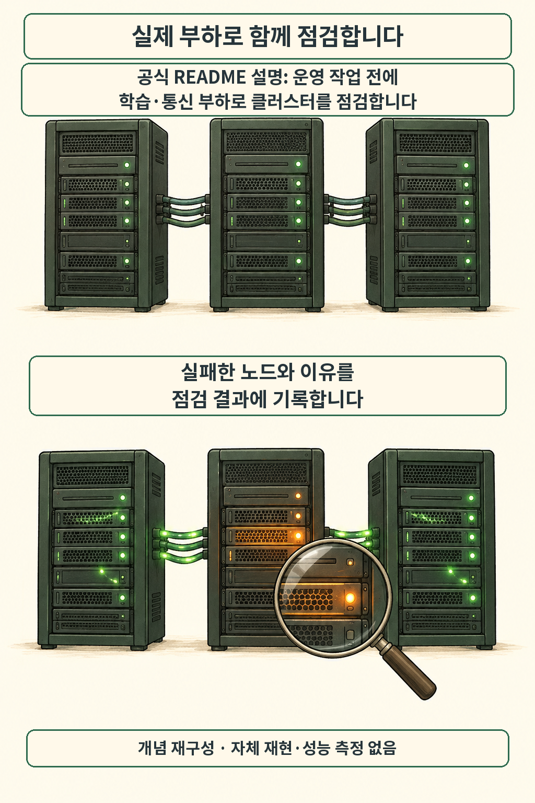

글·해설: 다메카솔

발행·확인: 2026-10-13

여러 GPU 서버에 분산 학습 작업을 올렸는데, 노드들이 동시에 통신 부하를 주고받을 때만 간헐적으로 장애가 나면 원인 노드를 좁히기가 무척 까다롭습니다.

NVIDIA는 10월 12일 DSX 참조 설계의 오픈소스 구성요소 확대를 발표하며 **학습 투입 전에 클러스터 상태를 점검하는 NVCRE(NVIDIA Cluster Readiness Engine)**를 공개했습니다. 인프라 운영자 관점에서 특히 눈여겨볼 대목은 **점검 결과를 얻은 ‘다음 단계’의 책임 경계**입니다. [NVIDIA OCP 발표](https://blogs.nvidia.com/blog/ocp-global-summit-vera-rubin-scale-ai-factories/)

## 학습·통신 부하를 걸고 실패 이유를 남깁니다

단순히 서버 전원이 켜지고 개별 장치가 인식됐다고 해서 대규모 분산 학습이 곧바로 잘 돌아가지는 않습니다. NVCRE는 실제 운영 작업을 투입하기 전에 여러 노드에 걸쳐 **학습·통신 부하를 직접 실행해 보는 Kubernetes 컨트롤러**입니다.

공식 README에 따르면 네트워크 연결 구조(토폴로지)를 고려해 노드 그룹을 묶은 뒤 성능과 장애 여부를 점검하고, 기준에 못 미치거나 실패한 노드가 있으면 그 이유를 결과로 남깁니다. [NVCRE 공식 README](https://github.com/NVIDIA/cluster-readiness-engine/blob/f286978054773060137f4619ff1e425120a7ecb6/README.md)

이번 DSX 발표에는 네트워크 설정, 클러스터 검증, 랙 관리, 베어메탈 구축용 오픈소스 구성요소가 함께 묶여 있습니다. 앞서 다룬 [Vera Rubin 양산 발표](/posts/nvidia-vera-rubin-full-production/)가 차세대 하드웨어 공급 일정에 관한 소식이었다면, NVCRE는 **도입한 장비에 실제 워크로드를 태우기 직전의 검증 단계**를 맡는 도구입니다. [DSX 구성요소 발표](https://blogs.nvidia.com/blog/ocp-global-summit-vera-rubin-scale-ai-factories/#dsx)

## 보고를 받았다고 노드가 격리되지는 않습니다

그렇다면 점검에서 불합격 판정을 받은 노드는 자동으로 스케줄링에서 빠질까요?

공식 README는 **NVCRE가 노드를 직접 변경하지 않으며, 실제 격리 조치는 상위 운영 플랫폼에 맡긴다**고 분명히 선을 긋습니다. 새 파드 배치를 막는 `cordon`이나 스케줄링 조건에 제약을 거는 `taint` 추가 역시 NVCRE의 동작 범위에서 제외되어 있습니다. [노드 변경 범위](https://github.com/NVIDIA/cluster-readiness-engine/blob/f286978054773060137f4619ff1e425120a7ecb6/README.md#how-it-works)

| 구분 | 공식 문서에 명시된 범위 |
| --- | --- |
| 부하 점검 | 운영 작업 투입 전 실제 학습·통신 부하 실행 |
| 결과 기록 | 실패한 노드와 구체적인 실패 이유 보고 |
| 노드 격리 | 직접 수행하지 않음(운영 플랫폼이 처리) |
| 관찰 시점 | 점검 부하가 실행되는 동안에 한정(상시 감시·스케줄러 아님) |

또한 클러스터 상시 감시나 운영 학습 작업 스케줄링도 이 도구의 목표(Non-goals)가 아닙니다. 점검 부하가 도는 동안만 상태를 관찰하므로, 한 번 통과했다는 결과를 영구적인 정상 상태로 믿어버리면 이후 운영 중에 생긴 하드웨어·네트워크 장애를 놓칠 수 있습니다. 점검 결과에 **대상 노드 묶음과 실행 시점**을 반드시 함께 기록해야 하는 이유입니다. [범위와 비목표](https://github.com/NVIDIA/cluster-readiness-engine/blob/f286978054773060137f4619ff1e425120a7ecb6/README.md#scope-and-non-goals)

## 도입 검토는 설치 조건과 운영 절차에서 시작합니다

클러스터에 NVCRE를 설치하려면 먼저 **NVIDIA GPU Operator**가 구성되어 있어야 하며, 기본 메트릭 설정을 쓰려면 **Prometheus Operator CRD**도 필요합니다(이번 글은 공식 발표와 10월 12일 커밋 `f286978` 기준의 README를 확인해 작성했으며, 실제 GPU 클러스터에서 도구를 실행하거나 장애 검출률을 측정한 결과는 포함하지 않았습니다). [사전 조건](https://github.com/NVIDIA/cluster-readiness-engine/blob/f286978054773060137f4619ff1e425120a7ecb6/README.md#quickstart)

## 다메카솔의 해석: 탐지와 격리 사이에 운영 판단을 넣기

저는 NVCRE가 **문제 탐지와 노드 격리 사이를 일부러 분리해 두었다**는 점에 주목합니다.

실무에서 진단 도구의 실패 보고를 곧바로 자동 격리(`cordon`/`taint`)에 직결하면 예상치 못한 부작용이 생기기 쉽습니다. 예를 들어 일시적인 통신 지연이나 비교적 가벼운 경고로 노드 여러 대가 한꺼번에 빠져버리면, 정작 클러스터의 남은 가용 용량이 줄어들어 예약된 대규모 학습 작업 전체가 멈출 수도 있거든요.

반대로 보고서만 쌓아 두고 아무런 후속 연결을 하지 않으면, 이미 문제가 확인된 노드에 다음 학습 작업이 그대로 배치되어 비싼 GPU 시간을 날리게 됩니다.

제가 이 도구를 도입한다면 작은 검증 환경에서 다음 세 가지를 한 묶음의 운영 절차로 먼저 맞춰 보겠습니다.

- **격리 기준 분류**: 어떤 실패 사유일 때 즉시 노드를 빼고, 어떤 경우엔 재점검을 먼저 돌릴지
- **용량 영향 확인**: 문제 노드를 격리했을 때 대기 중인 학습 큐를 감당할 여유 노드가 있는지
- **재투입 게이트**: 수리나 재부팅을 마친 노드를 어떤 점검 통과 기록으로 다시 스케줄링 풀에 넣을지

오픈소스 진단 도구로 클러스터의 약점을 찾아낸 다음, **그 신호를 누가 어떤 기준으로 실제 클러스터 제어에 연결할 것인가?** 도입 검토에서 가장 먼저 답해야 할 운영 질문입니다.

## 출처

- [NVIDIA — 2026년 10월 12일 OCP 및 DSX 발표](https://blogs.nvidia.com/blog/ocp-global-summit-vera-rubin-scale-ai-factories/)
- [NVIDIA — NVCRE 공식 README, f286978 커밋](https://github.com/NVIDIA/cluster-readiness-engine/blob/f286978054773060137f4619ff1e425120a7ecb6/README.md)

이 글의 본문과 이미지는 생성형 AI로 제작했습니다. 기획과 편집 기준은 다메카솔이 정했습니다.
