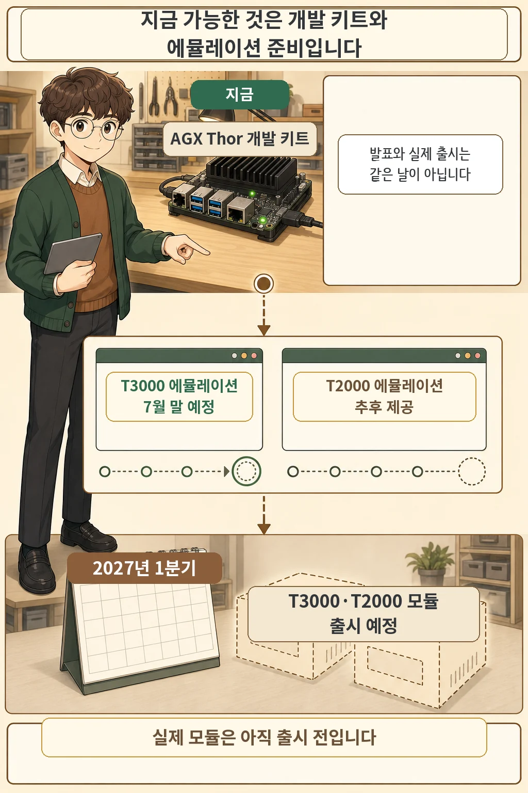
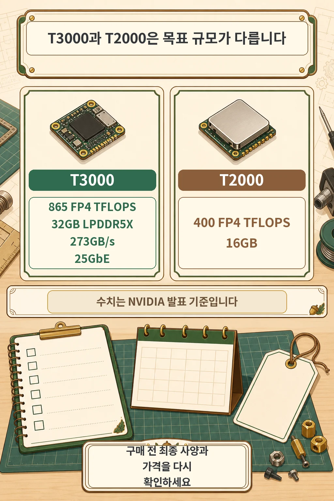

새 Jetson 모듈 발표를 보고 당장 보드를 주문해 로봇에 얹을 수 있을지부터 궁금해졌다면 출시 시점부터 확인하셔야 합니다. NVIDIA가 새로 공개한 **Jetson Thor T3000·T2000**은 즉시 구매하는 신제품이 아니라, 에뮬레이션 경로를 거쳐 **2027년 1분기**에 실물이 나오는 로드맵 발표거든요. 지금 현업 팀이 실제로 손에 쥐고 개발을 시작할 수 있는 선택지는 기존 **Jetson AGX Thor 개발 키트**와 곧 이어질 **JetPack 에뮬레이션**입니다.

글·해설: 다메카솔

## 지금 가능한 것과 2027년에 나오는 것

이번 발표에서 먼저 구분해야 할 대목은 2026년 7월 15일 발표일과 실제 하드웨어 수급 시점의 간극입니다. NVIDIA는 기존 최상위 라인업보다 메모리와 전력 구간을 낮춘 두 모듈을 공개하면서, 실물 출시 전까지 소프트웨어를 먼저 맞춰 볼 수 있는 단계별 일정을 제시했습니다.

- **현재 기준**: 판매 중인 **Jetson AGX Thor 개발 키트**로 같은 Thor 아키텍처와 소프트웨어 스택 기반 개발을 바로 시작할 수 있습니다.
- **2026년 7월 말 예정**: **JetPack 7.2.1** 업데이트를 통해 AGX Thor 키트에서 **T3000 에뮬레이션 모드**를 제공할 계획입니다.
- **향후 릴리스 예고**: 보급형인 **T2000 에뮬레이션 모드**는 후속 JetPack 릴리스로 지원할 예정입니다.
- **2027년 1분기 예정**: 양산용 **T3000·T2000 실제 모듈**이 정식 출시될 계획입니다.

발표일과 실제 공급 시점 사이에는 반년 이상의 간격이 놓여 있고, 에뮬레이션이나 양산 일정도 개발 상황에 따라 바뀔 수 있습니다. 예를 들어 차기 이동 로봇이나 휴머노이드 시제품을 지금 설계 중인 팀을 떠올려 봅시다. 양산용 보드가 나올 때까지 기다리기보다, 우선 AGX Thor 개발 키트에서 센서 입력과 멀티모달 추론 파이프라인을 먼저 띄워 보는 편이 현실적이죠. 그런 다음 T3000 에뮬레이션이 공개되면 목표 모듈의 메모리 상한에 맞춰 모델 크기와 지연 시간을 미리 조율할 수 있습니다.

## T3000과 T2000 발표 사양 비교

두 모듈은 블랙웰 기반 Thor 아키텍처를 공유하지만, 겨냥하는 로봇 워크로드와 체급이 분명하게 나뉩니다. 아래 표는 NVIDIA가 출시 전 공식 발표한 사양을 항목별로 정리한 내용입니다.

| 항목 | Jetson T3000 | Jetson T2000 |
| :--- | :--- | :--- |
| **AI 연산 성능** | 865 FP4 TFLOPS | 400 FP4 TFLOPS |
| **통합 메모리** | 32GB LPDDR5X | 16GB |
| **메모리 대역폭** | 273GB/s | 발표문에 별도 수치 없음 |
| **CPU 구성** | 8코어 Arm CPU | 발표문에 별도 수치 없음 |
| **네트워크** | 25GbE | 발표문에 별도 수치 없음 |
| **주요 타깃** | 휴머노이드·고성능 로봇·멀티모달 엣지 AI | 비전 AI 에이전트·이동 로봇·산업용 매니퓰레이터 |

표에서 두드러지는 차이는 메모리 용량과 고속 인터페이스 구성입니다. 상급 모델은 넉넉한 통합 메모리와 초고속 이더넷을 갖춰 다중 센서 데이터를 동시에 처리하는 멀티모달 로봇에 어울립니다. 반면 보급형 모델은 연산량과 메모리를 절반 규모로 줄여 전력과 단가 제약이 큰 이동 로봇이나 비전 에이전트에 알맞은 편이죠.

NVIDIA는 T3000이 기존 상위 모델인 T5000 대비 약 절반 크기와 전력으로 멀티모달 추론에서 비슷한 성능을 낸다고 설명했습니다. 다만 공개 발표문에 세부 테스트 모델이나 배치 크기 같은 비교 조건이 실리지는 않았으므로, 실무에서는 참고치로 두고 실제 환경에서 다시 검증해야 합니다.

## 다메카솔의 해석: 메모리 선택지와 소프트웨어 튜닝

이번 발표에서 스펙 숫자만큼이나 주목할 변화는 개발자가 고를 수 있는 메모리 구간이 넓어졌다는 점입니다. 그동안 128GB급 대형 개발 키트 중심이던 Thor 계열 아래로 32GB와 16GB 선택지가 내려오면서, 로봇 크기와 배터리 예산에 맞춰 과잉 투자를 줄일 수 있게 됐거든요.

소프트웨어 측면에서는 NVIDIA가 2026년 6월 오픈소스로 공개한 **Jetson Agent Skills**도 함께 챙겨 볼 만합니다. Orin과 Thor를 지원하는 이 도구 모음은 Codex 같은 에이전트 런타임과 연동해 디바이스 진단, 메모리 감사, 추론 메모리 튜닝, BSP 맞춤화를 돕습니다. 물론 최적화만으로 작은 모듈이 충분한지는 실제 센서 입력과 목표 지연 시간을 넣어 직접 계측한 뒤에 판단해야 합니다.

지금 Thor 기반 프로젝트를 시작한다면 다음 세 단계로 움직여 보시길 권합니다.

1. **기준선 측정**: 현재 판매 중인 AGX Thor 개발 키트에서 모델과 센서 파이프라인의 연산·메모리 점유율을 먼저 계측합니다.
2. **에뮬레이션 확인**: JetPack 7.2.1 릴리스 노트에서 T3000 에뮬레이션 제공 여부를 확인하고 자원 제약 테스트로 전환합니다.
3. **출시 전 최종 검증**: 2027년 1분기 출시 시점에 가까워지면 확정 사양, 단가, 공급 일정을 다시 점검한 뒤 구매를 결정합니다.

## 함께 읽을 AI 하드웨어/로보틱스 글

- [로봇 장기 작업 기억을 가중치로 압축하는 RoboTTT](/posts/robottt-long-context-policies/)
- [NVIDIA Rubin 차세대 AI 팩토리 아키텍처](/posts/nvidia-vera-rubin-full-production/)

## 출처

- [NVIDIA 공식 발표: NVIDIA Introduces New Jetson Thor Computers to Advance Mainstream Robotics and Edge AI](https://blogs.nvidia.com/blog/jetson-thor-robotics-edge-ai-agent/)
- [NVIDIA Jetson Thor 공식 제품 페이지](https://www.nvidia.com/en-us/autonomous-machines/embedded-systems/jetson-thor/)
- [NVIDIA Developer Forums: Jetson Agent Skills](https://forums.developer.nvidia.com/t/jetson-agent-skills-ai-assisted-workflows-for-device-bsp-customization/374150)

NVIDIA의 공식 발표와 개발자 문서를 바탕으로 정리했으며, 별도의 하드웨어 실측이나 벤치마크 재현은 포함하지 않았습니다.

이 글의 본문과 이미지는 생성형 AI로 제작했습니다. 기획과 편집 기준은 다메카솔이 정했습니다.
