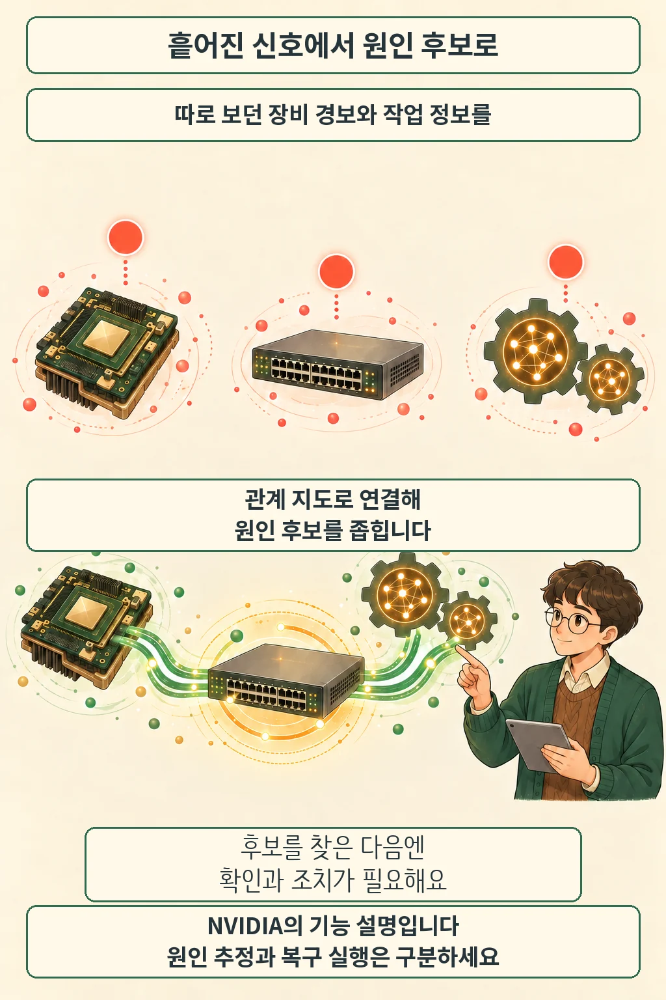

글·해설: 다메카솔

NVIDIA는 2026년 10월 22일 **AI 인프라의 장비 정보와 실행 중인 작업 정보를 함께 분석하는 AIOps 플랫폼 Minerva**를 발표했습니다. 핵심은 경보를 더 모으는 데서 그치지 않고, 어느 부품의 이상이 어떤 AI 작업에 영향을 주는지 연결하는 것입니다. [공식 발표](https://blogs.nvidia.com/blog/minerva-platform-infrastructure/)를 바탕으로 기능과 도입 상태를 살펴봅니다.

## 장비와 작업을 한 지도에 놓습니다

AI 학습이 느려졌을 때 GPU 지표만으로 이유를 알기는 어렵습니다. NVIDIA는 Minerva가 GPU·네트워크·저장장치·스케줄러·작업의 관측 데이터를 연결하고, **장비와 작업의 관계를 계속 갱신하는 지식 그래프**를 만든다고 설명합니다. 지식 그래프는 여기서 “무엇이 무엇과 연결되어 있는가”를 표현하는 관계 지도에 가깝습니다.

이를테면 학습 지연과 네트워크 이상 경보가 함께 보일 때, 같은 작업이 쓰는 연결인지 따라가며 원인 후보를 좁히는 식입니다. 이 예는 기능을 이해하기 위한 설명이며 실제 장애를 재현한 결과는 아닙니다.

NVIDIA가 내세우는 또 다른 기능은 연관된 경보를 하나의 사건으로 묶는 것입니다. 개별 증상을 모두 따로 조사하는 대신, 장비의 연결 관계와 정상 동작에서 벗어난 패턴을 함께 보겠다는 접근입니다. **가능성이 높은 원인을 제시한다는 설명을 원인 확정으로 읽어서는 안 됩니다.**

## 원인 후보와 복구 실행은 다른 단계입니다

공식 발표는 운영자가 AI 도우미와 대화하며 상태를 조사하고 복구 권고를 받을 수 있다고 설명합니다. 사람이 직접 수정할 수도 있고, 인프라 API나 외부 시스템에 연결해 자동화할 수도 있습니다. 권고를 받는 기능과 실제 장비에 변경을 실행하는 연결은 구분해야 합니다.

다메카솔이 이 발표에서 주목하는 부분은 **경보의 개수보다 연결의 맥락**입니다. 위 예에서 필요한 질문은 “경보가 얼마나 많이 떴나”보다 “이 작업이 어떤 장비를 함께 쓰나”입니다. 자동 복구를 검토한다면 어떤 변경까지 맡길지, 변경 뒤 작업 상태를 어떻게 확인할지도 함께 정해야 합니다. 이는 제품의 모든 설정을 확인한 사용 안내가 아니라 발표를 바탕으로 한 운영 관점의 해석입니다.

## 현재 사용과 도입 계획을 나눠 봅니다

발표에서 IREN은 사용 중인 파트너로 소개됩니다. IBM·Lambda·Tesla 등은 도입 계획으로 언급됩니다. 이 목록을 모두 운영 완료 사례로 묶으면 현재 상태를 과장하게 됩니다.

[공식 제품 페이지](https://www.nvidia.com/en-us/networking/products/software/minerva/)는 온프레미스와 SaaS 방식, 수집기만 활용하는 구성부터 통합 AIOps 구성까지 안내합니다. Grafana 연동과 외부 에이전트를 위한 MCP 서버도 설명합니다. 기존 모니터링 전체를 반드시 교체해야 한다는 뜻으로 읽을 필요는 없습니다.

다만 이 발표와 제품 페이지만으로 **독자 환경의 지원 범위·계약 조건·가격이나 즉시 도입 가능 여부**를 확정할 수는 없습니다. 제품 페이지는 Collector를 시작으로 일부 기능을 DSX OS에서 오픈소스로 제공할 계획이라고 설명합니다. Minerva 전체가 이미 무료 오픈소스로 공개됐다는 의미는 아닙니다.

NVIDIA는 장애 중단 감소와 복구 단축을 기대 효과로 제시하지만, 이 글에서는 이를 독립적으로 측정하지 않았습니다. 도입 효과를 판단하려면 같은 작업과 장비 조건에서 조사 시간·중단 시간·유효 처리량을 비교해야 합니다. 만화는 이 연결 방식을 설명한 창작 장면이며 실제 제품 화면이 아닙니다.

## 출처

- [NVIDIA 공식 발표: Minerva의 기능과 파트너별 도입 상태](https://blogs.nvidia.com/blog/minerva-platform-infrastructure/) — 2026-10-22 발표, 21:08 UTC 갱신본 확인
- [NVIDIA Minerva 제품 안내: 배포 방식과 연동 범위](https://www.nvidia.com/en-us/networking/products/software/minerva/) — 2026-10-23 확인

이 글의 본문과 이미지는 생성형 AI로 제작했습니다. 기획과 편집 기준은 다메카솔이 정했습니다.
