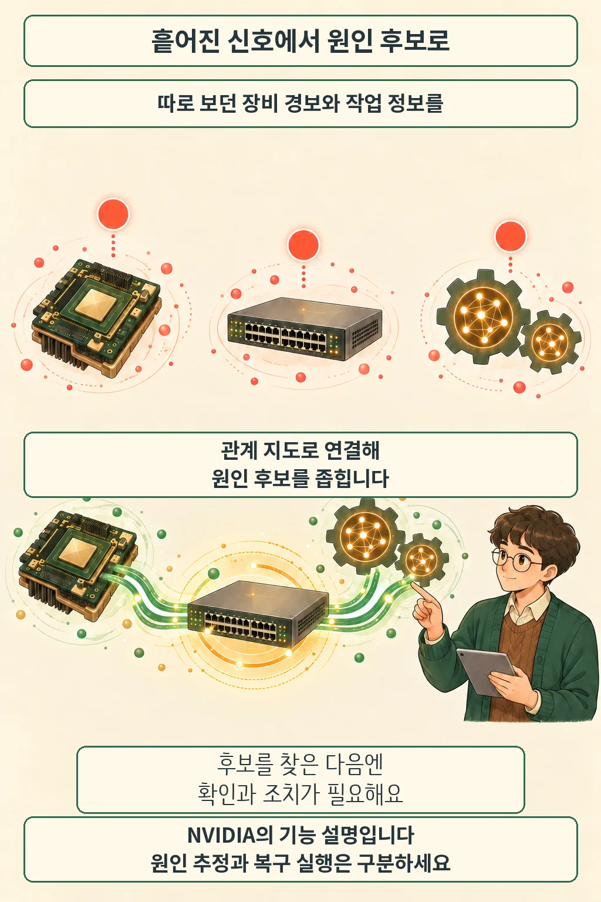

대규모 GPU 클러스터에서 학습 속도가 갑자기 떨어졌는데 경보만 수백 개씩 쏟아진다면 어디부터 확인해야 할까요? GPU, 네트워크, 스토리지, 스케줄러 신호가 팀과 도구마다 따로 움직이기 때문입니다. NVIDIA가 2026년 10월 22일 발표한 **AIOps 플랫폼 Minerva**는 이렇게 흩어진 장비 관측 데이터와 실행 중인 AI 작업 정보를 하나의 맥락으로 묶어 보려는 도구입니다.

글·해설: 다메카솔

## 장비와 작업을 한 지도에 묶는 동적 지식 그래프

기존 데이터센터 모니터링에서는 네트워크·컴퓨팅·ML 팀이 각자 다른 화면을 보는 경우가 많습니다. NVIDIA는 Minerva가 GPU, SuperNIC, DPU, 스위치, 케이블, 저장장치와 NCCL·Slurm 같은 스케줄러·AI 작업의 관측 데이터를 함께 수집한다고 설명합니다. 이 신호로 장비 토폴로지와 실행 중인 작업의 연결을 실시간 매핑하는 **동적 지식 그래프(dynamic knowledge graph)**를 만든다는 구상입니다.

예를 들어 분산 학습의 스텝 시간이 느려지며 스위치 재전송 경보와 NVMe 지연 신호가 겹쳐 떴다고 가정해 봅시다. 관계 지도가 있으면 해당 학습 작업이 거치는 스위치와 SuperNIC 경로를 따라 조사 대상을 좁힐 수 있거든요. 여기에 전용 머신러닝 모델이 시간당 수십억 건의 데이터를 분석해 연관된 증상을 하나의 사건(incident)으로 묶고 **가능성이 높은 원인 후보**를 추려 줍니다. 다만 어디까지나 연관성을 바탕으로 좁힌 후보이므로, 실제 원인을 확정하려면 운영자가 해당 장비 지표를 교차 확인해야 합니다.

## 대화형 조사와 복구 실행의 경계

원인 후보를 찾은 뒤에는 **내장 AI 도우미 Sherlock**이나 외부 에이전트(MCP)를 통해 대화형으로 상태를 조사하고 복구 권고를 받을 수 있습니다. 이때 사람이 추천안을 검토해 **직접 수동으로 수정**할지, **인프라 API나 Ansible 같은 외부 시스템에 연결해 자동화**할지는 별도로 선택하는 구조죠. 실무에서 권고를 받아 보는 기능과 실제 장비 설정을 바꾸는 실행 권한은 분명히 분리해 두는 편이 안전합니다.

## 배포 구성과 파트너 현황에서 확인할 점

도입을 검토할 때는 기능만큼 배포 형태와 파트너별 진행 상태도 짚어 보아야 합니다. NVIDIA [공식 발표](https://blogs.nvidia.com/blog/minerva-platform-infrastructure/)와 [제품 페이지](https://www.nvidia.com/en-us/networking/products/software/minerva/)가 안내하는 온프레미스·SaaS 배포 방식과 수집기·인사이트·Turnkey 도입 구성, Grafana 연동, MCP 서버 지원 범위는 아래 표에서 한눈에 볼 수 있습니다.

| 구분 | 공식 안내 내용 | 실무 확인 포인트 |
| --- | --- | --- |
| **배포·확장** | 온프레미스·NVIDIA 클라우드 SaaS, 수십만 GPU 규모 확장 지원 | 데이터 주권 요건에 맞춰 선택 가능 |
| **도입 구성** | DIY(수집기만) · AIOps+DIY(수집+분석) · Turnkey(통합 플랫폼) | 기존 관측 도구를 유지하며 단계적 결합 가능 |
| **연동·수집** | Grafana, Slack·Teams·PagerDuty·ServiceNow, Ansible·API, MCP 서버 | OpenTelemetry·DCGM·gNMI·Slurm·syslog·JSON 수집 |
| **오픈소스** | Collector를 시작으로 주요 기능을 DSX OS에서 공개 예정 | 향후 모듈별 공개 계획이며 전체 무료 공개와 구분 |
| **파트너 현황** | 사용 중: IREN / 도입 계획: IBM·Lambda·Tesla·Bitdeer AI·Aolani·Jio·Quake AI | 실사용과 계획을 구분(Dell·Lenovo·Supermicro 제공 예정) |

표에서 보듯 현재 사용이 확인된 파트너 **IREN**과 향후 도입 계획으로 언급된 **IBM·Lambda·Tesla** 등은 구분해 읽어야 합니다. 제품 문서는 **Minerva Collector를 시작으로 주요 기능을 DSX OS에서 오픈소스로 제공할 계획**이라고 설명하는데, 플랫폼 전체가 이미 무료 오픈소스로 풀렸다는 뜻과는 거리가 있습니다. 또한 중단 간격 연장(MTBI)이나 복구 단축(MTTR)은 NVIDIA가 제시한 기대 효과이며, 구체적인 가격·계약 조건과 독자 환경의 지원 범위는 공개 문서만으로 확정하기 어려워 별도 확인이 필요합니다.

## 다메카솔의 해석: 경보 수보다 작업 연결을 먼저 보자

결국 이번 발표의 핵심은 경보 개수가 아니라 **장비와 작업의 연결 맥락**입니다. Minerva나 유사한 AIOps 도입을 검토한다면 아래 세 가지를 먼저 점검해 볼 만합니다.

- **작업 의존성 추적**: 경보 수보다 느려진 AI 작업이 어떤 GPU·네트워크·스토리지 경로에 걸쳐 있는지부터 확인합니다.
- **권고와 실행 분리**: AI 도우미의 원인 후보 제안과 인프라 API 자동 변경 권한을 나누고, 변경 후 작업 검증 절차를 정합니다.
- **동일 조건 대조**: 도입 효과는 같은 작업과 장비 구성에서 조사 시간, 중단 시간, 유효 처리량(goodput)을 나란히 비교해 판단합니다.

관측성 플랫폼이 줄여 주는 것은 단서를 모으는 탐색 시간이고, 실제 운영 안정성은 그 뒤의 검증과 권한 통제 기준에 달려 있습니다.

## 출처

- [NVIDIA 공식 발표: Minerva의 기능과 파트너별 도입 상태](https://blogs.nvidia.com/blog/minerva-platform-infrastructure/) — 2026-10-22 15:00:02 UTC 발표, 21:08:44 UTC 갱신본 확인
- [NVIDIA Minerva 제품 안내: 배포 방식과 연동 범위](https://www.nvidia.com/en-us/networking/products/software/minerva/) — 2026-10-23 확인

이 글은 NVIDIA 공식 발표와 제품 문서를 바탕으로 정리했으며 별도의 로컬 설치나 성능 측정은 포함하지 않았고, 만화 그림은 이해를 돕기 위해 새로 구성했습니다.
이 글의 본문과 이미지는 생성형 AI로 제작했습니다. 기획과 편집 기준은 다메카솔이 정했습니다.
