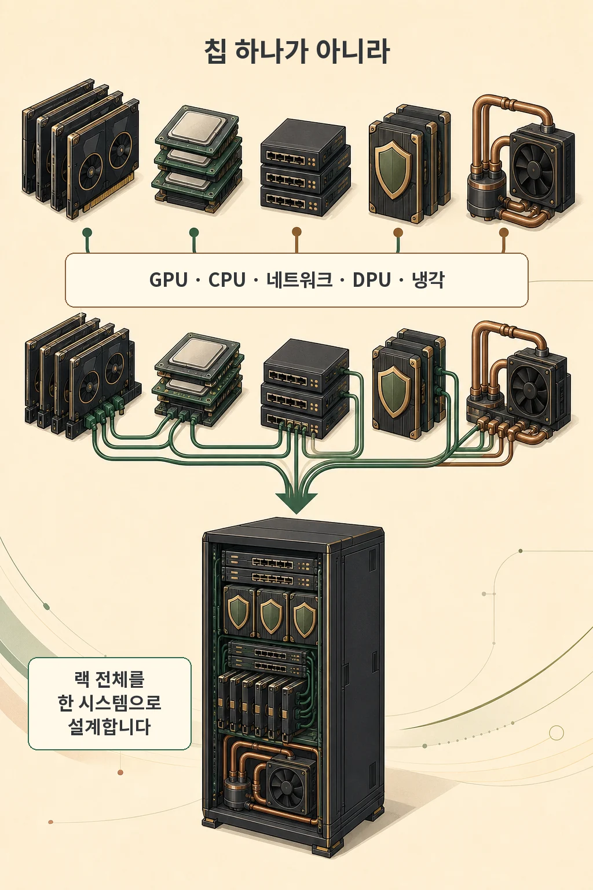
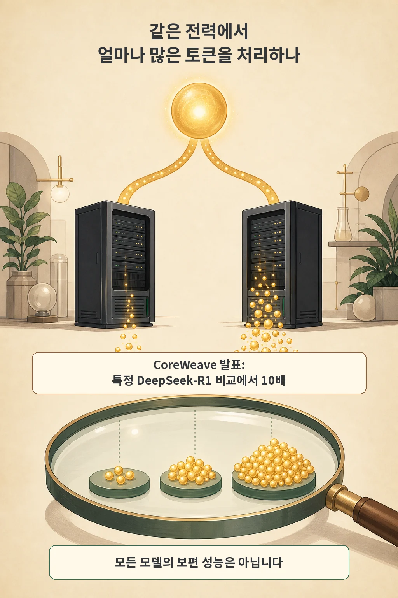

데이터센터를 증설할 때 가장 먼저 부딪히는 벽은 GPU 가격이 아니라 변전소에서 끌어올 수 있는 전력 한도인 경우가 많습니다. NVIDIA가 2026년 7월 21일 전 세계 양산 확대를 발표한 **Vera Rubin NVL72**도 단일 칩 속도 대신 랙 전체의 전력 효율을 앞세웠거든요. 이번 글에서는 랙 단위 공동 설계의 구조와 '전력당 토큰(Tokens per Watt)' 수치를 실무에서 어떻게 검증해야 하는지 짚어 봅니다.

글·해설: 다메카솔

## 칩 하나가 아니라 랙 전체를 하나의 시스템으로 묶었습니다

대규모 모델 학습과 추론에서는 GPU 사이의 집단 통신이 끊임없이 발생하므로 네트워크와 메모리 이동이 전체 처리량과 가동률을 좌우합니다. 개별 칩의 연산 속도가 빨라도 데이터 전송과 냉각이 뒤처지면 랙 전체의 효율이 떨어지거든요. 그래서 NVIDIA는 일곱 종류의 칩과 다섯 종류의 랙 트레이를 처음부터 하나의 시스템으로 공동 설계했습니다. Vera Rubin NVL72 한 랙을 구성하는 핵심 요소와 역할은 아래 표처럼 나뉩니다.

| 구성 요소 | 수량 / 형태 | 시스템 내 역할 |
| --- | --- | --- |
| Rubin GPU | 72개 | 대규모 모델 학습·추론 연산 |
| Vera CPU | 36개 | 에이전트 도구 호출과 작업 흐름 조정 |
| NVLink 6 스위치 | 랙 내부 연결 | GPU 간 집단 통신 지연 최소화 |
| ConnectX-9 SuperNIC · BlueField-4 DPU | 외부 네트워크·오프로드 | 클러스터 외부 연결 및 데이터 경로 처리 |
| 공동 설계 랙 트레이 | 5종 트레이 | 전력·냉각을 포함한 랙 단위 통합 가동 |

이처럼 계산, 네트워크, 냉각, 소프트웨어를 한 몸처럼 묶어야 랙 단위의 실효 성능이 나옵니다. AI 인프라를 평가하는 기본 단위가 GPU 한 장에서 랙 전체로 커진 셈이죠.

## 전력당 토큰, 같은 전기 예산에서 뽑아내는 산출량

전력당 토큰은 일정한 전력 예산 안에서 시스템이 단위 시간에 얼마나 많은 토큰을 처리하는지 보는 효율 지표입니다. 예를 들어 데이터센터 전력 공급이 10MW로 묶여 있다면, 같은 1메가와트(MW)당 토큰 산출량을 높여야 전력망 증설 없이도 더 많은 추론 요청을 감당할 수 있습니다.

첫 실측 사례로 CoreWeave는 가동 중인 Vera Rubin NVL72에서 DeepSeek-R1 벤치마크를 측정한 결과, Grace Blackwell NVL72 대비 메가와트당 초당 토큰이 **10배**였다고 발표했습니다. 다만 이는 특정 모델과 구성에서 나온 파트너의 초기 결과인 만큼, 비교 모델·수치 정밀도·입출력 길이·지연시간 목표·배치 크기·소프트웨어 스택과 실제 전력 경계에 따라 수치는 달라집니다.

한편 NVIDIA는 Spectrum-6 기반 Spectrum-X Ethernet이 10만 개 이상의 GPU 배치에서 최대 95%의 네트워크 효율을 유지한다고 주장합니다. 벤더가 제시한 조건부 수치이긴 하지만, 네트워크가 토큰 처리량을 결정하는 핵심 계산 경로가 됐다는 점은 분명해 보입니다.

## 양산 확대 소식과 클라우드 도입 시 확인 기준

NVIDIA가 밝힌 양산 확대(`ramping into full production`)는 플랫폼 공급이 본궤도에 올랐다는 뜻이지, 모든 지역과 고객에게 같은 날 동일한 인스턴스가 일반 제공(GA)된다는 의미와는 거리가 있습니다. 현재 CoreWeave가 먼저 랙을 가동해 측정값을 공개했고 Google Cloud, Microsoft Azure, Oracle Cloud Infrastructure(OCI)에서도 랙이 가동 중이지만, 파트너별 제공 지역과 시점, 가격은 각 서비스의 별도 공지를 확인해야 합니다.

## 다메카솔의 해석: '10배'를 내 워크로드 기준으로 검증하는 법

벤더의 최고 배율보다 중요한 것은 우리 서비스와 동일한 측정 경계를 맞추는 일입니다. 가령 대량 배치 처리량이 10배 늘어난 구성이라도, 실시간 채팅처럼 첫 토큰 지연에 민감한 서비스에서는 배치를 키우기 어려워 체감 효율이 낮아질 수 있거든요.

실무에서 랙 스케일 인프라를 검토할 때는 아래 기준을 같은 경계 위에서 확인하는 편이 좋습니다.

- **워크로드와 품질**: 내가 쓰는 모델, 입출력 길이, 정밀도에서 기존 수준의 정확도가 유지되는지 검증합니다.
- **처리량과 응답 지연**: 총 토큰 수와 함께 첫 토큰 지연, 토큰 간 지연 목표를 동시에 점검합니다.
- **시스템 전체 전력 경계**: GPU뿐 아니라 CPU, 네트워크, 냉각 전력과 실제 가동률까지 포함해 비용을 따집니다.
- **실제 이용 가능 상태**: 발표 단계와 프리뷰, 원하는 리전의 일반 제공(GA) 여부를 구분합니다.

전력당 토큰은 유용한 효율 지표이지만 품질과 응답성, 총비용을 대신하지는 않습니다. 결국 내 워크로드에서 같은 조건과 경계로 처리량과 전력을 함께 재는 순간부터 비로소 구매 판단의 근거로 쓸 수 있습니다.

## 함께 읽을 AI 인프라 글

- [NVIDIA Jetson Thor 엣지 로보틱스 모듈 분석](/posts/nvidia-jetson-thor-t3000-t2000/)
- [홈랩 쿠버네티스 구축기와 하드웨어 병목 분석](/posts/why-homelab-kubernetes/)

## 출처

- [NVIDIA 공식 블로그 — Vera Rubin Driving Performance Per Watt in Full Production](https://blogs.nvidia.com/blog/vera-rubin/)
- [NVIDIA 제품 문서 — Vera Rubin Platform](https://www.nvidia.com/en-us/data-center/technologies/rubin/)
- [CoreWeave 공식 블로그 — First-Ever Measured Vera Rubin NVL72 Silicon Performance Stats](https://coreweave.com/blog/nvidia-vera-rubin-nvl72-on-coreweave-10x-more-tokens-per-megawatt-than-blackwell)
- [NVIDIA 기술 발표 — Built for Vera Rubin, Spectrum-6 Arrives in Gigascale AI Factories](https://blogs.nvidia.com/blog/nvidia-spectrum-six-arrives-in-gigascale-ai-factories/)

발표 자료와 공식 문서를 바탕으로 정리했으며, 별도 실행 측정은 포함하지 않았습니다.

이 글의 본문과 이미지는 생성형 AI로 제작했습니다. 기획과 편집 기준은 다메카솔이 정했습니다.
