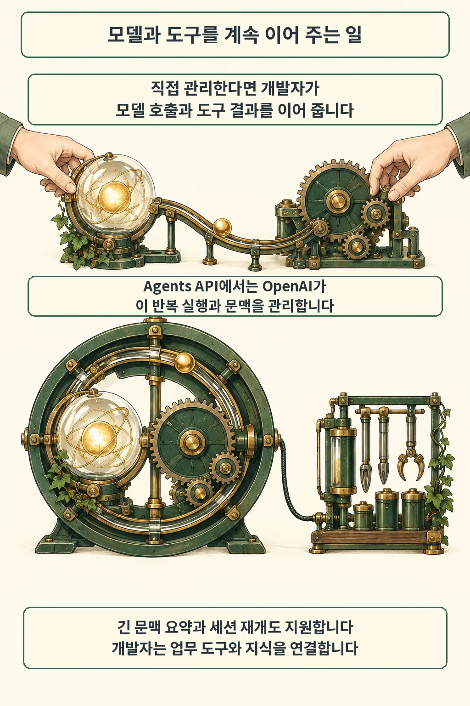
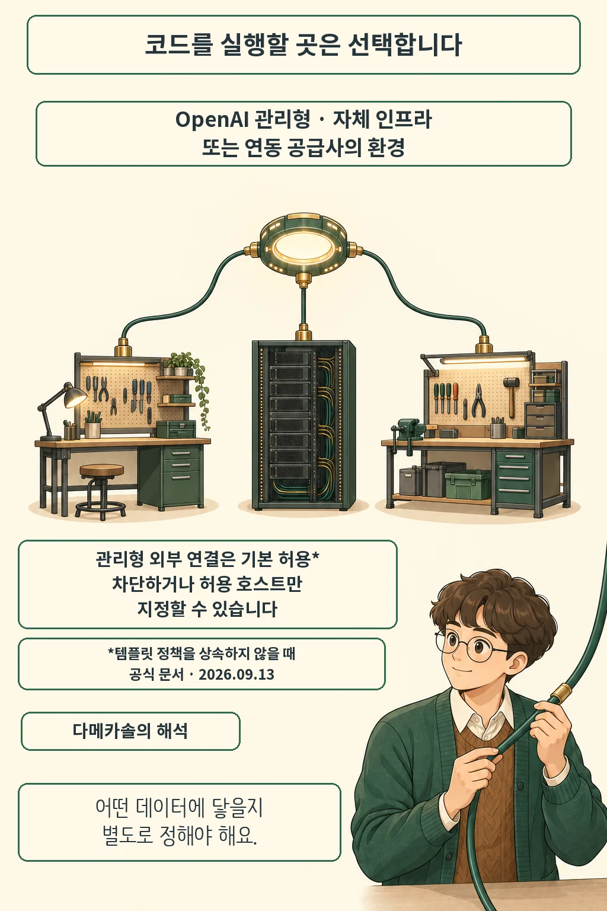

모델을 부르는 코드는 짧아도 작업을 계속 이어 가는 코드는 금세 길어지기 마련입니다. OpenAI가 2026년 9월 10일 이 실행 계층을 관리해 주는 **Agents API 공개 베타**를 발표했습니다. Codex의 실행 구조를 API로 제공하면서 개발자가 에이전트의 작업 환경을 직접 선택하도록 설계한 것이 특징인데요. [공식 발표](https://openai.com/index/introducing-the-agents-api/)와 2026년 9월 13일 확인한 개발자 문서를 기준으로 핵심 구조를 정리했습니다.

글·해설: 다메카솔

Updated: 2026-09-13

## 핵심 내용

- **관리형 실행 계층**: OpenAI가 모델 호출·도구 사용·문맥 관리를 조정하고, 개발자는 업무에 필요한 도구와 지식을 연결합니다.
- **작업 공간 분리**: 실행을 맡기는 선택과 실제 코드·파일이 놓일 환경(OpenAI 관리형 샌드박스, 자체 인프라, 연동 공급사 환경)을 분리해 고를 수 있습니다.
- **네트워크 기본값 주의**: 관리형 샌드박스에서 템플릿 정책을 상속하지 않을 때 외부 연결 기본값은 허용(`enabled`)이므로, 목적에 따라 차단(`disabled`)이나 호스트 제한(`restricted`)을 별도로 설정해야 합니다.

## 반복 실행을 누가 이어 주나요

도구가 돌려준 결과는 곧 다음 판단의 입력이 되며, 이 연결을 끊김 없이 유지하는 일이 하네스의 역할입니다. 위 개념도가 보여 주듯 Agents API에서는 OpenAI가 모델 호출과 도구 사용, 문맥 관리를 조정하고 개발자는 업무에 필요한 도구와 지식을 연결하는 식으로 역할을 나눕니다.

[Agents API 개요](https://developers.openai.com/api/docs/guides/agents-api/overview)를 보면 긴 문맥 요약, 세션 재개, 작업 중 지시 수정, 하위 에이전트에 일을 나누는 기능을 함께 제공합니다. 여러 단계의 작업을 붙잡는 공통 실행 구조를 서비스 형태로 가져오는 셈입니다(공개 베타와 기능 설명은 OpenAI가 밝힌 범위이며, 이번 글에서 성능이나 장애 복구를 직접 시험하지는 않았습니다).

## 작업 공간과 외부 연결은 따로 고릅니다

실행을 맡기더라도 코드와 파일이 놓일 작업 공간은 따로 고를 수 있습니다. 회사는 OpenAI 관리형 샌드박스, 자체 인프라, 연동 공급사의 환경을 모두 사용할 수 있다고 설명하는데요. 실행 루프를 관리받는 선택과 코드를 어디서 돌릴지의 선택을 분리한 구조입니다.

관리형 환경을 쓰더라도 세부 설정은 직접 챙겨야 합니다. [샌드박스 문서](https://developers.openai.com/api/docs/guides/agents-api/environments/openai-hosted)가 안내하는 주요 구성 항목은 다음과 같습니다.

- **사전 준비와 실패 차단**: 파일·패키지·스킬·플러그인을 미리 준비할 수 있으며, 설정 명령이 실패하면 에이전트 시작을 막습니다.
- **템플릿 저장 범위**: 재사용 템플릿에 저장되는 것은 환경 구성(설정)이며, 실행 중인 작업 공간 자체가 그대로 보존되는 방식과는 구별됩니다.
- **외부 네트워크 연결**: 템플릿 정책을 상속하지 않을 때 기본값은 허용인 `enabled`입니다. 필요에 따라 `disabled`로 외부 연결을 차단하거나 `restricted`로 허용할 호스트만 지정할 수 있으므로, 관리형이라는 이름만 보고 네트워크까지 닫혀 있다고 가정하면 실제 접근 범위를 놓치기 쉽습니다.

## 다메카솔의 해석: 맡길 실행과 줄일 접근 범위

이런 서비스를 검토할 때는 하네스 구현 시간을 줄이는 이점과 데이터 접근 설계를 함께 따져 보게 됩니다. 실행 코드를 직접 유지할 부담은 줄어들지만, 어떤 입력을 제공하고 어떤 외부 시스템에 연결할지는 여전히 업무마다 달라지기 때문입니다. 제품이 대신 운영하는 부분과 우리 서비스가 결정할 부분을 분명히 나눠야 도입 효과를 제대로 평가할 수 있습니다.

이해를 돕기 위해 로그 파일만 읽어 원인을 정리하는 가상 과제를 떠올려 보겠습니다. 먼저 분석에 필요한 입력만 제공하고 외부 연결을 닫은(`disabled`) 상태에서도 과제가 끝나는지 확인합니다. 만약 외부 조회가 꼭 필요하다면 그 목적에 맞는 호스트만 연결을 열어 두고, 최종 보고서가 가리키는 근거와 실제 파일을 대조해 볼 수 있습니다. 이때 점검할 핵심은 **답변 품질**과 **접근 범위** 두 가지입니다.

앞서 다룬 [Salesforce AI Harness 발표](/posts/salesforce-enterprise-ai-harness/)에서도 실행을 하나로 묶는 흐름을 살펴봤는데요. 이번 소식의 새로운 지점은 Codex 실행 구조를 공개 베타 API로 제공하면서 작업 환경 선택을 분리했다는 데 있습니다. 처음 도입한다면 작은 읽기 작업부터 시작해, 결과와 접근 기록을 확인하는 속도에 맞춰 에이전트에게 맡길 일을 넓혀 가는 편이 안전합니다.

## 출처

- [OpenAI — Agents API 발표 (2026-09-10)](https://openai.com/index/introducing-the-agents-api/): 공개 베타와 환경 선택.
- [OpenAI 개발자 문서 — Agents API 개요](https://developers.openai.com/api/docs/guides/agents-api/overview): 관리형 실행 기능. 2026-09-13 확인.
- [OpenAI 개발자 문서 — 관리형 샌드박스](https://developers.openai.com/api/docs/guides/agents-api/environments/openai-hosted): 환경 준비와 네트워크 설정. 2026-09-13 확인.

이 글의 본문과 이미지는 생성형 AI로 제작했습니다. 기획과 편집 기준은 다메카솔이 정했습니다.
