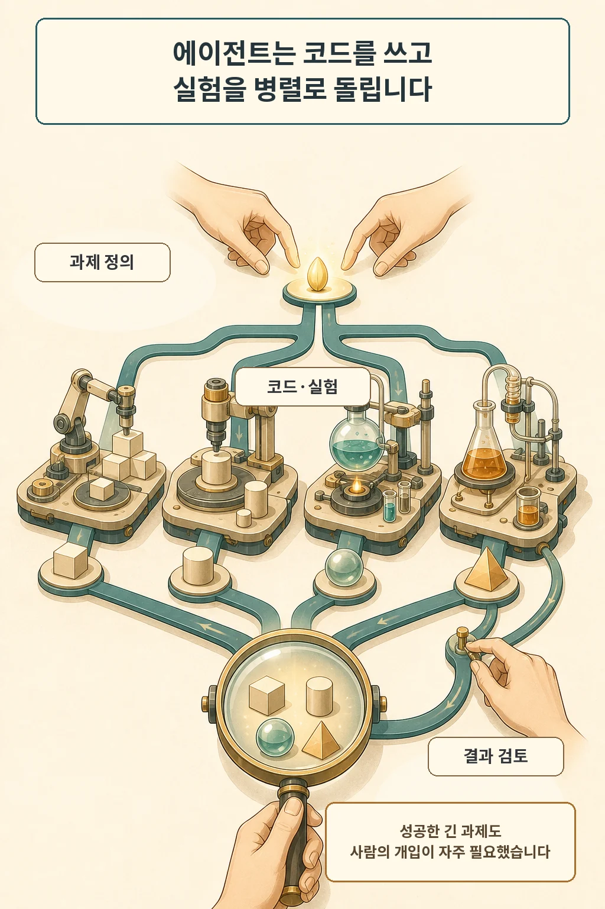

OpenAI는 2026년 9월 6일 사람이 지시한 연구 과제를 수행하는 **'자동화 연구 인턴'** 단계에 도달했다고 밝혔습니다. 하지만 회사가 붙인 이름보다 더 눈여겨봐야 할 것은 실제 위임 범위인데요. 이 시스템은 잘 정의된 과제를 받아 숙련 연구자에게 며칠이 걸릴 작업까지 다루지만, 무엇을 연구하고 어떤 결과를 믿을지는 여전히 사람이 결정합니다. [C001][C002][C004][C012]

## 핵심 내용

- **현재 단계와 미래 목표 구분**: 이번 발표는 일반 사용자용 제품 출시가 아니라 OpenAI 연구 조직 내부 운영에 관한 보고이며, 잘 정의된 과제를 수행하는 현재 단계('연구 인턴')와 2028년 3월을 목표로 한 '자동화 AI 연구자'를 구분합니다. [C001][C002][C003]
- **실행 규모와 해석 한계**: 2026년 8월 중순 기준 연구자 표준 근무일 1일당 에이전트 작업일 3.1일을 썼고 1인당 실험 수도 최고치를 기록했지만, 컴퓨팅 자원 증가 등 복합 요인이 섞여 있어 실행량 증가를 곧바로 연구 진척으로 단정할 수는 없습니다. [C005][C006][C008]
- **사람의 개입과 다음 병목**: 성공한 4~8시간 추정 과제의 절반 이상에 사람의 개입이 있었으며, 실행 속도가 빨라질수록 연구 질문 선택·증거 판정·안전 중단 같은 사람의 판단 지점이 새로운 병목이 됩니다. [C004][C007][C009]

## OpenAI가 말하는 '연구 인턴'은 제한된 역할입니다

이번 공개의 대상은 OpenAI 연구 조직의 내부 운영으로, 상용 제품 출시나 일반 사용자용 기능 발표와는 범위가 다릅니다. 회사는 사람이 방향을 정해 준 잘 정의된 과제를 수행하는 현재 단계를 '연구 인턴'으로 부르고, 더 넓은 범위의 자동화 AI 연구자는 **2028년 3월**을 향한 미래 목표로 구분했습니다. [C001][C002][C003]

따라서 이번 선언을 스스로 연구 주제를 발굴하고 과학적 결론까지 확정하는 자율 연구자의 완성으로 읽으면 발표 범위를 벗어나게 됩니다. OpenAI의 설명에서도 사람은 여전히 연구 우선순위를 정하고, 어떤 아이디어와 실험 결과를 계속 파고들지 판단하며, 시스템을 확대하거나 멈추거나 배포할지 결정하는 주체로 남아 있습니다. [C004]

## 실행 차선은 실제로 넓어졌습니다

내부 실행 지표를 보면 작업 차선이 넓어진 흐름은 뚜렷합니다. OpenAI는 2026년 8월 중순 기준 연구 조직 전체에서 사람의 표준 근무일 1일당 **에이전트 작업일 3.1일**을 썼다고 환산했습니다. 실험자 1인당 실험 수는 2025년 1월 추적을 시작한 이래 8월에 가장 높았고, 연구자들이 에이전트를 여러 세션으로 동시에 운용하는 일도 늘었다고 보고했습니다. [C005][C006]

다만 이 숫자는 실행량이 커진 방향을 보여 줄 뿐, 연구 성과의 인과적 원인은 별도로 따져 봐야 합니다. OpenAI 역시 실험 수 증가가 Codex 채택과 상관관계를 보였지만 같은 기간 사용할 수 있는 컴퓨팅 자원도 크게 늘었다고 덧붙였습니다. 코드 작성량과 실험 횟수는 측정하기 쉬운 반면 실제 연구 진척과의 관계는 해석하기 어렵다는 한계도 함께 밝혔습니다. [C006][C008]

## 긴 과제일수록 사람의 개입이 남았습니다

OpenAI가 결과를 명확히 판정할 수 있었던 내부 세션을 분류해 본 결과, 성공한 **4~8시간 추정 과제의 절반 이상**에는 한 번 이상의 사람 개입이 포함되어 있었습니다. 에이전트가 호흡이 긴 작업을 끝까지 성공시킨 경우에도 중간에 방향을 잡아 주는 사람의 조정이 중요한 변수였던 셈입니다. [C007]

이 수치 역시 표본 범위를 좁혀 읽어야 합니다. 내부 분류기가 결과를 확실히 판정할 수 있는 세션만 그래프에 포함했고, 빠르게 바뀌는 도구 환경 때문에 사용량 집계가 대부분을 포착하지만 전체를 빠짐없이 담지는 못한다고 OpenAI가 설명했기 때문입니다. 결국 이번 공개의 검증 범위는 OpenAI 내부 관측까지입니다. [C008][C011]

## 다음 병목은 실행 뒤의 판단입니다

실행 속도가 올라가면 느린 지점이 사라지는 대신 위치를 옮깁니다. OpenAI는 자동화하기 어려운 과제가 연구자 시간에서 더 큰 비중을 차지하게 되고, 컴퓨팅 자원 역시 다음 제약이 될 수 있다고 봤습니다. 무엇을 연구 질문으로 삼을지 고르는 일, 서로 모순된 실험 결과를 판정하는 일, 안전 위험 앞에서 멈추는 일은 에이전트 사용량 그래프가 대신 답해 주지 못하는 영역입니다. [C004][C008][C009]

이러한 경계는 소프트웨어 운영팀에게도 익숙합니다. 배포 자동화가 빨라질수록 승인 규칙과 회귀 검증, 관측 가능성이 더 중요해지는 것처럼, 연구 조직에서도 단순히 동시에 돌리는 에이전트 수보다 **어떤 작업을 위임했고 어느 지점에서 사람이 개입했으며 실패와 불확실성을 어떻게 기록했는지**가 최종 품질을 좌우합니다. [C007][C009][C010]

## 다메카솔의 해석

이번 공개의 핵심은 '연구자가 사라졌다'는 선언이 아니라 **연구자의 병목이 이동했다**는 관찰에 있습니다. 코드를 작성하고 실험을 돌리는 실행 차선이 넓어진 만큼, 이제는 과제 선택·증거 판정·안전 통제가 전체 처리량을 결정하는 핵심 게이트로 한층 선명하게 드러납니다. [C004][C009][C010]

실제 개발 조직에서 에이전트 도입 효과를 측정한다면 생성한 코드 줄 수보다 **완료 기준이 분명한 과제의 성공률**부터 먼저 재는 편이 좋습니다. 여기에 사람의 개입 횟수, 재작업률, 운영 사고, 검토자가 에이전트의 결론을 뒤집은 사례까지 함께 기록해야 실제 효과를 알 수 있습니다. OpenAI의 내부 보고는 그러한 측정 설계를 시작할 좋은 참고점을 주지만, 다른 조직에서도 같은 변화가 재현되는지는 여전히 검증이 필요한 열린 질문입니다. [C008][C010][C011]

에이전트가 그럴듯한 답을 만드는 것과 약한 증거 앞에서 연구 경로를 수정하는 능력의 차이는 [AI 에이전트는 개방형 연구를 얼마나 평가할 수 있나](/posts/ai-open-ended-research-shadow-evaluation/)에서 이어서 살펴볼 수 있습니다.

## 출처

- [OpenAI, Research acceleration: The view inside OpenAI Research (2026-09-06)](https://openai.com/index/research-acceleration-view-inside-openai/)

글·해설: 다메카솔

이 글의 본문과 이미지는 생성형 AI로 제작했습니다. 기획과 편집 기준은 다메카솔이 정했습니다.
