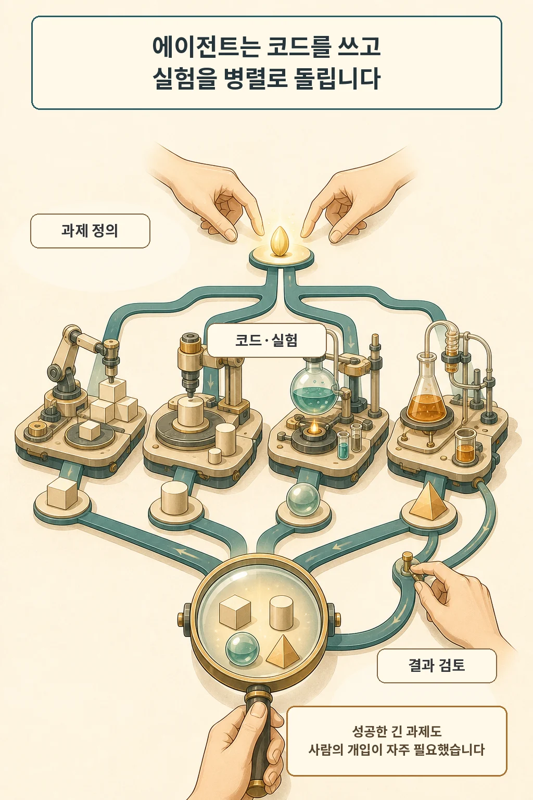

AI 코딩 에이전트가 코드 작성과 실험 실행을 동시에 처리하면, 연구 조직의 일하는 방식은 어디까지 달라질까요? OpenAI는 2026년 9월 6일 사람이 지시한 과제를 수행하는 **'자동화 연구 인턴'** 단계에 도달했다고 밝혔습니다. 하지만 이름만 보고 완전 자율 연구를 떠올리기 전에, 실제로 무엇을 위임했고 어떤 판단을 사람에게 남겼는지 먼저 짚어볼 필요가 있습니다.

글·해설: 다메카솔

## '연구 인턴'과 '자동화 연구자'의 경계

이번 공개는 일반 사용자용 제품 출시가 아니라 OpenAI 연구 조직의 내부 운영을 다룬 보고입니다. 회사는 사람이 방향을 정해 준 잘 정의된 과제를 받아, 숙련 연구자에게 며칠이 걸릴 작업까지 처리하는 현재 단계를 '연구 인턴'으로 불렀습니다. 더 넓은 범위의 '자동화 AI 연구자'는 **2028년 3월**을 향한 미래 목표로 따로 구분해 두었죠.

그래서 현재 단계를 자율 연구자의 완성으로 읽기에는 범위가 뚜렷하게 나뉩니다. OpenAI의 설명에서도 여전히 연구 우선순위를 정하고, 어떤 아이디어와 실험 결과를 계속 파고들지 고르며, 시스템을 확대하거나 멈추고 배포할지 결정하는 주체는 사람으로 남아 있습니다.

## 숫자로 본 실행량 증가와 해석의 여지

내부 지표를 살펴보면 에이전트가 맡은 실행 차선이 넓어진 흐름은 분명하게 나타납니다. 연구자들이 여러 세션을 동시에 돌리는 일이 늘면서, 작업량과 실험 횟수 모두 가파르게 올라갔습니다.

| 구분 | 관측 기준 | 공개 수치·내용 | 함께 볼 한계 |
| --- | --- | --- | --- |
| 에이전트 사용량 | 2026년 8월 중순 | 연구자 표준 8시간 근무일당 에이전트 작업일 3.1일 | 도구 변화가 빨라 일부 사용량 누락 가능 |
| 1인당 실험 수 | 2025년 1월 추적 이후 | 2026년 8월 최고치(다중 세션 운용 증가) | Codex 채택과 함께 컴퓨팅 자원도 크게 증가 |
| 긴 과제 사람 개입 | 2026년 1~7월 내부 분류 | 성공한 4~8시간 추정 과제의 절반 이상에 개입 포함 | 결과를 명확히 판정한 세션만 표본으로 집계 |

다만 실행량이 늘었다는 사실을 곧바로 연구 성과의 인과적 증거로 보기는 어렵습니다. OpenAI 역시 실험 횟수 증가가 Codex 채택과 맞물려 있지만 같은 기간 사용 가능한 컴퓨팅 자원도 크게 늘었다고 밝혔거든요. 게다가 코드 작성량이나 실험 횟수는 세기 쉬운 반면 실제 연구 진척과의 관계는 해석하기 까다롭고, 단일 조직의 내부 관측이라 다른 연구 조직에서도 같은 패턴이 재현될지는 따로 검증해야 할 과제입니다.

호흡이 긴 과제일수록 사람의 역할이 선명하게 남는다는 점도 중요합니다. 내부 분류상 성공한 긴 과제의 절반 이상에서도 결국 중간에 방향을 잡아 주는 사람의 조정이 개입한 셈이죠.

## 속도가 오를수록 판단 병목이 선명해집니다

실행 속도가 빨라지면 병목이 사라지기보다 다음 지점으로 옮겨 갑니다. OpenAI는 자동화하기 어려운 과제가 연구자 시간에서 차지하는 비중이 커지고, 컴퓨팅 자원 역시 다음 제약으로 떠오를 수 있다고 내다봤습니다. 결국 무엇을 연구 질문으로 삼고, 모순된 실험 결과 가운데 무엇을 믿으며, 안전 위험 앞에서 언제 멈출지는 사용량 그래프가 대신 해결해 줄 수 없는 사람의 몫입니다.

예를 들어 실무 개발 조직이 코딩 에이전트를 도입해 효과를 점검한다고 가정해 봅시다. 생성한 코드 줄 수나 에이전트 호출 횟수만 세면 겉으로는 속도가 크게 오른 것처럼 보이기 쉽거든요. 대신 아래 지표를 함께 추적해야 실제 병목이 어디서 풀리고 어디서 막히는지 정확히 가늠할 수 있습니다.

- **완료 기준이 분명한 과제의 성공률**: 모호한 요청을 빼고 범위가 명확히 닫힌 작업이 실제로 통과하는 비율을 먼저 봅니다.
- **사람의 개입 횟수와 재작업률**: 에이전트가 긴 작업 도중 방향을 잃어 사람이 다시 잡아 준 빈도를 기록합니다.
- **검토자가 결론을 뒤집은 사례**: 에이전트가 그럴듯하게 내놓은 분석이나 패치를 사람이 반려한 경우를 모아 취약 지점을 찾습니다.
- **운영 사고와 안전 중단 이력**: 배포와 실험이 빨라질수록 승인 규칙과 회귀 검증, 중단 기준이 최종 품질을 결정합니다.

이번 발표의 핵심은 연구자가 사라졌다는 선언보다 **연구 조직의 병목이 실행에서 판단으로 이동했다**는 관찰에 가깝습니다. 에이전트가 그럴듯한 답을 내놓는 것과 약한 증거 앞에서 연구 경로를 수정하는 능력의 차이는 [AI 에이전트는 개방형 연구를 얼마나 평가할 수 있나](/posts/ai-open-ended-research-shadow-evaluation/)에서도 이어서 살펴볼 수 있습니다.

## 출처

- [OpenAI, Research acceleration: The view inside OpenAI Research (2026-09-06)](https://openai.com/index/research-acceleration-view-inside-openai/)

이 글은 OpenAI의 공식 발표 자료를 바탕으로 정리했으며, 별도 실행 측정은 포함하지 않았습니다.

이 글의 본문과 이미지는 생성형 AI로 제작했습니다. 기획과 편집 기준은 다메카솔이 정했습니다.
