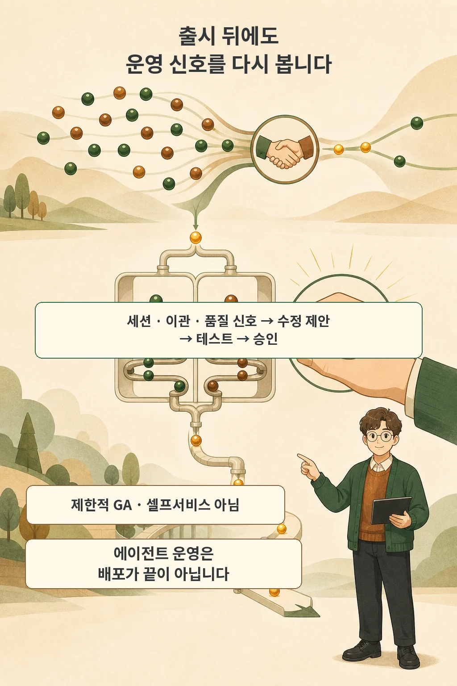

기업 현장에서 AI 에이전트 파일럿이 실전 배포까지 가지 못하는 주된 이유는 모델 지능보다 통제 기준의 부재입니다. 고객 데이터를 어디까지 열고, 예외 상황에서 언제 사람이 개입할지 기준이 없으면 운영 자체가 부담스러워지거든요. OpenAI가 2026년 7월 22일 공개한 `OpenAI Presence`는 더 강한 단일 모델 대신 권한·승인·이관·평가·변경 관리를 묶은 운영 통제 루프를 전면에 내세운 제품입니다.

글·해설: 다메카솔

## 업무 하나에서 시작하는 최소 권한 격리

사내 모든 도구에 접근하는 만능 에이전트는 운영 위험이 지나치게 큽니다. Presence는 청구 문제 해결이나 직원 IT 요청처럼 특정 업무를 먼저 정하고, 그 업무에 필요한 지식과 시스템 접근만 부여하며 배포를 시작합니다.

예를 들어 청구 문의 에이전트라면 고객 확인과 청구 내역 조회, 환불 규정 확인까지만 권한을 받고 인사나 타 부서 시스템에서는 격리되죠. 이렇게 범위를 좁혀 두면 사고 반경을 줄일 뿐 아니라, 정책 준수 여부를 평가할 기준도 분명해집니다. 현재 지원 채널은 실시간 음성과 채팅이며 고객 지원, 아웃바운드 영업, 고위험 내부 업무를 주요 예시로 듭니다.

## 행동하기 전에 승인과 사람 이관을 정합니다

기업은 에이전트가 실행할 수 있는 행동과 승인이 필요한 시점, 사람이 넘겨받아야 할 시점을 정책으로 정합니다. Presence는 표준 운영 절차(SOP)와 가드레일, 승인된 행동, 시뮬레이션 및 평가 도구를 이 운영 경계에 묶어 관리합니다.

가령 단순 안내는 정책에 따라 바로 답하더라도, 고위험 작업이나 규정 외 예외는 관리자 승인을 거치거나 상담원에게 맥락을 넘기도록 정하는 셈이죠. 출시 전에는 일반 요청과 예외 시나리오를 함께 시뮬레이션해 결과 적절성, 정책 준수, 도구 사용, 적절한 사람 이관 여부를 점검합니다.

## 출시 후 개선 루프와 현재 제공 범위

정책과 문의 패턴은 배포 뒤에도 계속 바뀝니다. Presence는 실제 세션과 사람 이관, 품질 신호에서 빈틈을 찾고 Codex가 수정안을 제안하면, 팀이 기존 운영 버전과 비교 테스트를 거친 뒤 통제된 배포를 승인하는 흐름을 따릅니다.

OpenAI는 자사 영어 전화 지원에서 사람 도움 없이 문의의 75%를 해결했고, Codex 기반 개선 루프로 10일간 사람 이관을 15%포인트 줄였다고 밝혔습니다. 다만 이는 자사 채널의 벤더 자체 보고 수치이고 평가 표본이나 독립 검증 결과는 빠져 있어, 다른 기업 환경에 적용하려면 별도 확인이 필요합니다.

| 항목 | OpenAI Presence 공개 내용 | 실무 확인 포인트 |
| --- | --- | --- |
| **채널·예시** | 실시간 음성·채팅, 고객 지원·영업·고위험 내부 업무 | 단일 업무 범위와 채널별 예외 규칙 정의 |
| **통제·평가** | SOP·가드레일·승인·이관, 시뮬레이션 및 Codex 개선안 | 비교 테스트와 사람 승인 절차 유지 |
| **자체 보고 수치** | 영어 전화 75% 무인 해결, 10일간 이관 15%p 감소 | 표본·분모 미공개로 자사 조건별 별도 검증 필요 |
| **제공·도입** | 자격 기업 대상 제한적 일반 제공, 현장 엔지니어·SI 협업 | 셀프서비스 불가, 계정 팀 상담 필요 |

발표문의 `available today`는 자격 요건을 갖춘 기업 대상 제한적 일반 제공(제한적 GA)을 가리킵니다. 현재는 OpenAI 현장 배포 엔지니어와 일부 글로벌 시스템 통합사(SI)가 구축을 이끄는 비셀프서비스 방식이거든요. 기존 음성 API 고객은 계속 API 모델을 쓸 수 있지만, Presence 도입은 계정 팀과의 상담을 거쳐 진행해야 합니다.

## 다메카솔의 해석: 모델보다 운영 경계를 먼저 확인하세요

저라면 데모 화면보다 에이전트가 맡을 업무 범위부터 한 문장으로 고정하겠습니다. 모델 한 번의 성능보다 권한·승인·이관·평가·변경 승인으로 이어지는 통제 루프가 실전 성패를 가르기 때문이죠. 도입이나 자체 구축을 검토할 때는 다음 여섯 가지 운영 기준을 먼저 점검해야 합니다.

- **업무 범위**: 에이전트가 책임질 단일 업무를 한 문장으로 고정했는가
- **최소 접근**: 해당 업무에 꼭 필요한 지식과 시스템 접근만 열었는가
- **행동 통제**: 자동 허용 행동과 사전 승인 대상을 명확히 나눴는가
- **사람 이관**: 예외나 불확실한 상황에서 누가 맥락을 이어받을지 정했는가
- **출시 전 평가**: 정상·예외 시나리오의 정책 준수와 도구·이관 동작을 시험했는가
- **변경 관리**: 수정안을 기존 운영 버전과 비교 테스트한 뒤 사람이 승인하는가

## 함께 읽을 글

- [GitHub Issues AI 에이전트 통제와 승인 가드레일](/posts/github-issues-agent-automation-controls/)
- [SysAdmin 벤치마크: AI 에이전트의 권력 추구 통제](/posts/sysadmin-ai-power-seeking-benchmark/)

## 출처

- [OpenAI 공식 발표 — Introducing OpenAI Presence](https://openai.com/index/introducing-openai-presence/)

OpenAI 공식 발표 자료를 바탕으로 정리했으며, 별도 실행 측정은 포함하지 않았습니다.
이 글의 본문과 이미지는 생성형 AI로 제작했습니다. 기획과 편집 기준은 다메카솔이 정했습니다.
