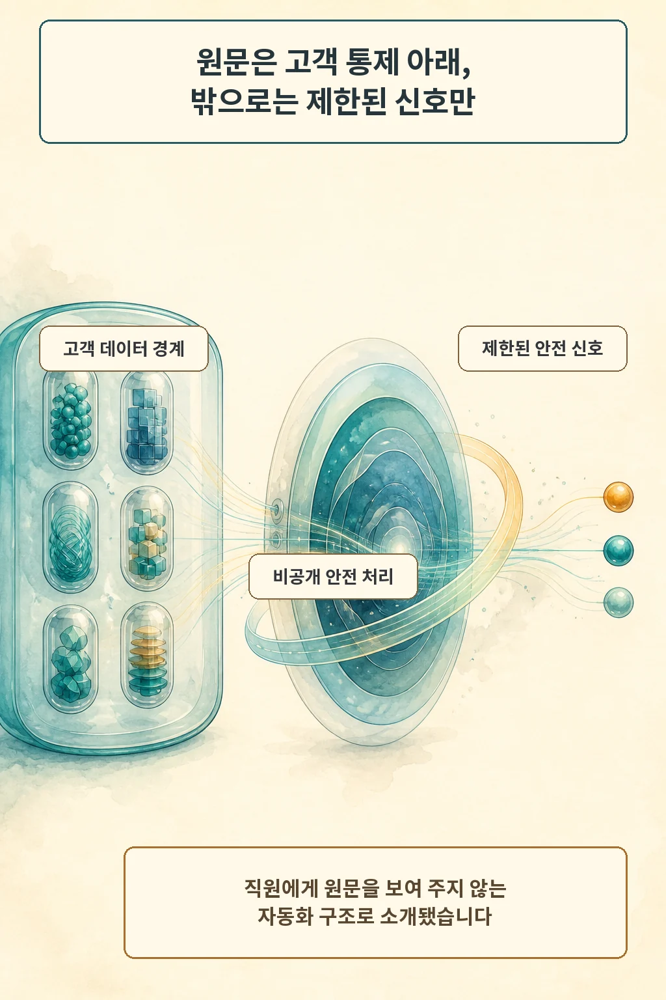
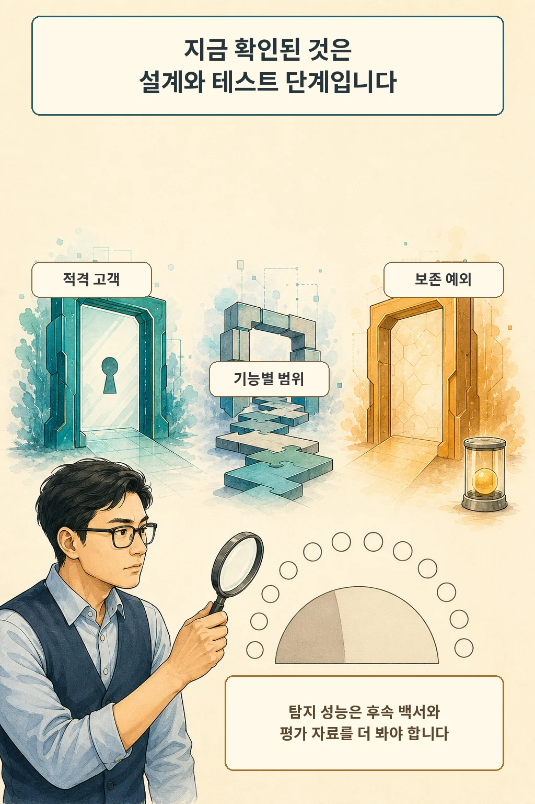

“고객 데이터를 보관하지 않는다”는 약속과 “여러 대화에 걸친 연속적인 위험을 탐지한다”는 안전 요구는 얼핏 정면으로 충돌해 보입니다. OpenAI는 2026년 8월 19일 적격 API 고객을 위한 영구 미보존(Zero Data Retention, ZDR) 확대와 `Private Safety Processing` 프리뷰를 발표하며, 두 요구를 서로 다른 데이터 경계로 나누어 풀겠다고 설명했습니다. [C001][C010]

## 핵심 내용

- **학습 비사용과 보존 제어의 구분**: 일반 API는 기본적으로 데이터를 모델 학습에 쓰지 않되 남용 탐지 로그를 최대 30일 보관할 수 있으며, ZDR은 승인된 적격 요청에서 프롬프트·응답 원문을 처리 즉시 보존 대상에서 제외하는 별도 제어입니다. [C002][C003]
- **원문과 안전 신호 분리**: `Private Safety Processing`은 고객 콘텐츠 원문을 고객 통제 인프라(또는 향후 고객 관리 키 암호화 영역)에 남기고, 제한된 안전 신호만 OpenAI에 반환해 직원의 원문 접근을 차단합니다. [C004][C005][C006]
- **기능별 예외와 출시 일정**: background mode·Code Interpreter·extended prompt caching 등 미지원 기능과 법적 보존 예외(아동 성착취 이미지 신고 등)가 따로 존재하며, 2026년 9월 출시 및 기술 백서 공개가 예고된 초기 테스트 단계입니다. [C007][C008][C009]

## ZDR은 ‘학습 비사용’보다 좁고 구체적인 보존 설정입니다

OpenAI API 고객 데이터는 기본적으로 모델 학습에 사용되지 않지만, 학습 비사용 정책과 데이터 보존 정책은 별개입니다. 일반 API 사용에서는 남용 탐지용 로그가 기본적으로 최대 30일간 보관될 수 있는 반면, ZDR은 승인을 받은 조직의 적격 요청에서 프롬프트와 응답 원문을 처리 직후 보존 대상에서 제외하는 한층 엄격한 보존 경계 제어입니다. [C002][C003]

## 비공개 안전 처리는 원문과 신호를 분리합니다

OpenAI가 예고한 `Private Safety Processing`은 연관된 여러 상호작용에 걸쳐 위험 패턴을 찾는 자동화 시스템입니다. 회사 설명에 따르면 고객 콘텐츠 원문은 고객이 통제하는 인프라에 남고, 자동화 시스템은 제한된 안전 신호만 OpenAI에 반환합니다. 위험 플래그가 발생한 경우에도 OpenAI 직원에게 전달되는 범위에서 프롬프트와 응답 원문은 제외됩니다. [C004][C005][C006]

향후에는 OpenAI 인프라에서 처리하되 고객이 관리하는 키(customer-managed keys)로 콘텐츠를 암호화해 OpenAI 직원의 원문 접근을 막는 선택지도 추가할 계획입니다. 다만 이는 앞으로 도입될 선택지이므로 현재 모든 ZDR 요청에 기본 적용되는 동작과는 범위를 구분해 읽어야 합니다. [C005][C007]

## 기능마다 ZDR 적용 범위가 다릅니다

ZDR은 계정 전체에 일괄 적용되는 라벨이 아니라 요청 경로별로 달라지는 제어입니다. 사전 승인과 자격 요건이 필요할 뿐 아니라, 사용하는 엔드포인트와 기능에 따라 보존 동작이 달라집니다. 실제로 OpenAI 문서에는 background mode, Code Interpreter, extended prompt caching처럼 ZDR이 지원되지 않는 기능이 명시되어 있으며, 잠재적 아동 성착취 이미지의 탐지·신고에 따른 제한적 법적 보존 예외도 존재합니다. 따라서 운영자는 실제 요청 경로별 호환성과 예외 조항을 꼼꼼히 확인해야 합니다. [C008][C009]

## 현재는 초기 테스트와 출시 계획 단계입니다

`Private Safety Processing`은 현재 초기 고객과 함께 테스트 중이며, OpenAI는 2026년 9월부터 기능을 정식 출시하고 기술 백서를 공개할 계획이라고 밝혔습니다. [C007]

이번 발표는 아키텍처의 설계 의도와 데이터 경계를 설명한 수준이므로, 위험 탐지의 오탐·미탐 비율이나 우회 공격에 대한 견고성, 키 관리 실패 시의 영향에 대한 독립 검증은 9월 백서 공개 이후의 과제로 남아 있습니다. 공급사가 직원의 원문 접근을 제한한다는 구조적 설명과 실제 안전 탐지 성능은 별개의 검증 문제입니다. [C007][C011]

## 다메카솔의 해석

이번 프리뷰의 핵심은 원문 고객 콘텐츠, 자동화된 패턴 처리, 운영 조직에 전달되는 제한된 신호를 서로 다른 권한과 저장 경계로 분리하려는 아키텍처 시도에 있습니다. [C010]

비슷한 고규제 환경을 운영하는 팀이라면 도입 전에 세 가지 질문을 따로 시험해야 합니다. 원문이 약속한 경계 안에만 머무는가, 제한된 안전 신호만으로 필요한 보안 대응이 가능한가, 그리고 ZDR 미지원 기능과 법적 예외가 실제 API 호출 경로에서 명확히 분리되는가입니다. 9월 기술 백서가 공개되면 데이터 흐름뿐 아니라 탐지 정확도와 실패 모드까지 확인한 뒤 도입 범위를 결정하는 편이 안전합니다. [C007][C008][C009][C011]

## 출처

- [OpenAI, Offering Zero Data Retention for frontier models (2026-08-19)](https://openai.com/index/offering-zero-data-retention-for-frontier-models/)
- [OpenAI Platform, Data controls in the OpenAI platform (2026-08-20 확인)](https://platform.openai.com/docs/guides/your-data)
- [OpenAI, Business data privacy, security, and compliance (2026-08-20 확인)](https://openai.com/business-data/)

글·해설: 다메카솔

이 글의 본문과 이미지는 생성형 AI로 제작했습니다. 기획과 편집 기준은 다메카솔이 정했습니다.
