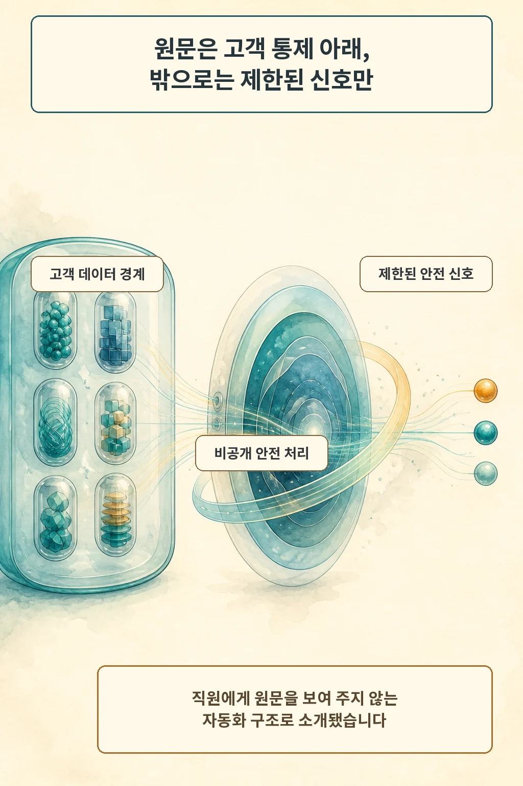
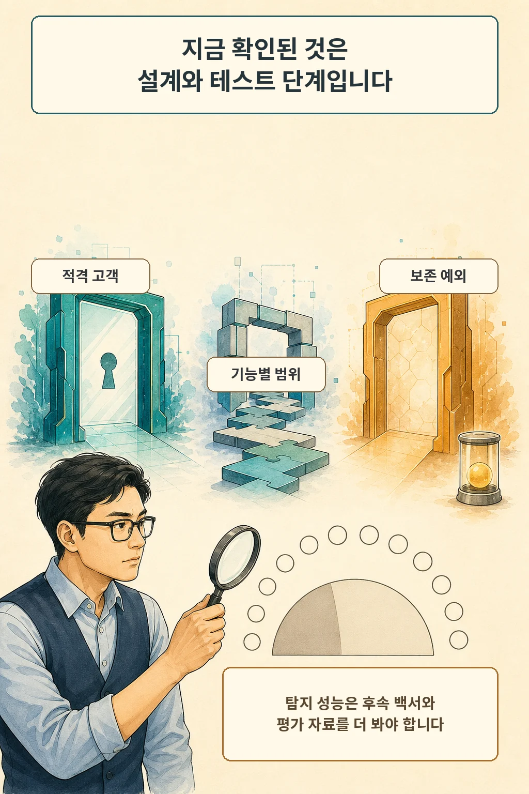

“고객 데이터를 남기지 않겠다”는 약속과 “여러 대화에 걸쳐 이어지는 위험 패턴을 잡아내겠다”는 안전 기준은 얼핏 정면으로 부딪혀 보입니다. OpenAI가 2026년 8월 19일 적격 API 고객을 위한 영구 미보존(Zero Data Retention, ZDR) 확대와 `Private Safety Processing` 프리뷰를 발표한 것도 바로 이 지점을 풀기 위해서죠. 데이터를 어디에 남기고 어떤 신호만 꺼내 쓸지 경계를 다시 긋겠다는 접근입니다.

글·해설: 다메카솔

## ZDR은 ‘학습 비사용’과 다른 보존 경계입니다

API 문서를 볼 때 많은 팀이 ‘모델 학습에 쓰지 않는다’는 문구를 ‘데이터가 아예 남지 않는다’로 받아들이곤 합니다. 하지만 OpenAI 플랫폼 문서에서도 학습 비사용 정책과 데이터 보존 정책은 서로 별개 영역으로 다뤄지거든요. 일반 API 호출은 기본적으로 모델 학습에서 빠지더라도 남용 탐지용 로그가 최대 30일까지 보관될 수 있는 반면, ZDR은 사전 승인을 받은 조직의 적격 요청에서 프롬프트와 응답 원문을 처리 직후 보존 대상에서 제외하는 더 좁은 설정입니다.

가령 환자의 진료 기록이나 사내 법무 문서를 다루는 AI 도구를 API로 구축한다고 생각해 볼까요? 단발성 요청마다 원문이 지워져야 규제 요건을 맞출 수 있지만, 서비스 악용 여부를 살피는 팀 입장에서는 여러 차례 나뉜 우회 시도를 놓칠까 걱정하게 됩니다. 결국 원문을 직접 열람하지 않고도 연속적인 위험 징후만 판별할 수 있느냐가 핵심 과제로 남는 셈이죠.

## 비공개 안전 처리는 원문과 신호를 분리합니다

OpenAI가 프리뷰로 소개한 `Private Safety Processing`은 연관된 여러 상호작용에서 위험 패턴을 찾는 자동화 시스템입니다. 회사 설명에 따르면 고객 콘텐츠 원문은 고객이 통제하는 인프라 안에 그대로 머무르고, 자동화 시스템은 제한된 안전 신호만 OpenAI 쪽으로 돌려보냅니다. 위험 플래그가 뜨더라도 OpenAI 직원에게 전달되는 데이터에서 프롬프트와 응답 원문은 빠진다고 안내하고 있습니다.

향후에는 OpenAI 인프라에서 처리를 수행하더라도 고객이 직접 관리하는 키(customer-managed keys)로 콘텐츠를 암호화해 직원의 원문 접근을 막는 선택지도 추가할 계획입니다. 다만 이 암호화 옵션은 앞으로 도입될 예정이므로, 지금 당장 모든 ZDR 요청에 기본 적용되는 동작과는 분명히 구분해 두는 편이 좋습니다.

## 기능별 예외와 출시 일정을 함께 짚어야 합니다

ZDR은 계정 전체에 한 번 켜 두면 끝나는 라벨이 아니라 요청 경로와 기능 호환성에 따라 적용 범위가 달라집니다. 사전 승인과 자격 요건을 충족하더라도 사용하는 엔드포인트에 따라 미지원 기능이 섞일 수 있어 운영 전 구분이 필요하죠.

| 구분 | 적용 조건 및 동작 | 실무에서 확인할 경계 |
| --- | --- | --- |
| **일반 API** | 기본 학습 비사용, 남용 탐지 로그 최대 30일 보관 가능 | 로그 보존 기간과 내부 컴플라이언스 대조 |
| **현행 ZDR** | 승인 조직의 적격 요청에서 처리 직후 원문 미보존 | `background mode`·`Code Interpreter`·`extended prompt caching` 미지원 |
| **비공개 안전 처리** | 초기 고객 테스트 중, 2026년 9월 출시·기술 백서 예고 | 원문 대신 제한된 안전 신호만 반환, 아동 성착취 이미지 신고 예외 별도 존재 |

실제로 OpenAI 문서에는 `background mode`, `Code Interpreter`, `extended prompt caching`처럼 ZDR이 지원되지 않는 기능이 명시되어 있습니다. 여기에 잠재적 아동 성착취 이미지의 탐지와 신고를 위한 제한적 법적 보존 예외도 따로 존재하므로, 운영 팀은 호출 경로별 호환성과 예외 조항을 아키텍처 설계 단계에서 먼저 가려내야 합니다.

이번 발표는 아키텍처의 설계 의도와 데이터 경계를 설명한 단계로 이해하는 편이 정확합니다. `Private Safety Processing`은 초기 고객과 테스트 중이며, OpenAI는 2026년 9월부터 기능을 정식 출시하고 기술 백서를 공개할 계획이라고 밝혔습니다. 따라서 오탐·미탐 비율이나 우회 공격에 대한 견고성, 키 관리 실패 시의 영향 같은 실제 안전 탐지 성능은 백서 공개 이후 별도로 따져 보아야 할 영역으로 남아 있습니다.

## 다메카솔의 해석: 경계 분리와 검증 과제는 별개입니다

이번 프리뷰에서 주목할 대목은 원문 고객 콘텐츠, 자동화된 패턴 처리, 운영 조직이 받는 안전 신호를 서로 다른 권한과 저장 경계로 쪼개려는 시도입니다. 고규제 환경에서 OpenAI API 도입을 검토하는 팀이라면 기술 백서가 나오기 전이라도 아래 세 가지 질문을 기준으로 호출 구조를 점검해 두시기 바랍니다.

1. **원문 체류 경계**: 실제 호출 경로에서 프롬프트와 응답 원문이 약속된 고객 통제 경계 안에만 머무르는지 확인합니다.
2. **신호 기반 대응력**: 원문 없이 전달되는 제한된 안전 신호만으로도 사내 보안·감사 대응 절차를 돌릴 수 있는지 검토합니다.
3. **미지원 기능 분리**: `Code Interpreter`나 `background mode` 등 ZDR 예외 기능이 민감 데이터 경로에 섞이지 않도록 라우팅을 분리합니다.

## 출처

- [OpenAI, Offering Zero Data Retention for frontier models (2026-08-19)](https://openai.com/index/offering-zero-data-retention-for-frontier-models/)
- [OpenAI Platform, Data controls in the OpenAI platform (2026-08-20 확인)](https://platform.openai.com/docs/guides/your-data)
- [OpenAI, Business data privacy, security, and compliance (2026-08-20 확인)](https://openai.com/business-data/)

발표 자료와 공식 문서를 바탕으로 정리했으며, 별도 실행 검증은 포함하지 않았습니다.

이 글의 본문과 이미지는 생성형 AI로 제작했습니다. 기획과 편집 기준은 다메카솔이 정했습니다.
