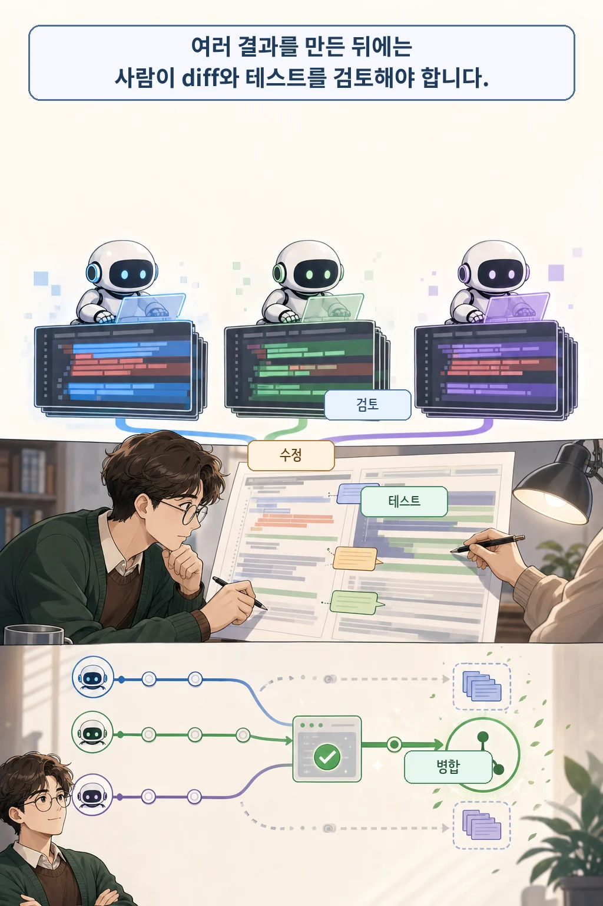

Claude Code나 Codex CLI 같은 코딩 에이전트를 한 프로젝트에서 여러 개 동시에 돌리다 보면, 같은 파일을 덮어쓰거나 브랜치가 꼬여 충돌(Conflict)을 푸느라 시간을 쏟기 쉽죠. 이 문제는 모델의 실력이 부족해서라기보다 여러 에이전트가 한 작업 폴더를 공유하기 때문에 생깁니다. 오픈소스 도구 **Orca**는 새 AI 모델이 아니라, 에이전트별 작업을 독립된 Git Worktree로 나누고 검토 흐름을 묶어 주는 데스크톱 오케스트레이터입니다.

글·해설: 다메카솔

## Orca는 모델이 아니라 작업 공간을 관리하는 도구입니다

AI 코딩 도구를 고를 때 많은 개발자가 모델 성능부터 비교하곤 하는데요. 멀티 에이전트 작업이 매끄럽게 돌아가려면 파운데이션 모델, CLI 에이전트, 그리고 작업 공간을 관리하는 오케스트레이터의 역할을 분리해 보아야 합니다.

| 계층 | 주요 역할 | 대표 예시 |
| :--- | :--- | :--- |
| **1. 파운데이션 모델** | 코드와 언어 패턴을 학습해 다음 토큰을 예측 | Claude Sonnet, GPT-5, DeepSeek |
| **2. CLI 코딩 에이전트** | 모델을 호출해 터미널 셸을 열고 파일 읽기·쓰기와 커밋을 수행 | Codex CLI, Claude Code, OpenCode |
| **3. 워크스페이스 오케스트레이터** | 여러 에이전트에 독립된 작업 폴더를 배정하고 검토·병합을 조율 | **Orca** |

Orca는 세 번째 계층에 놓여 특정 모델이나 에이전트에 사용자를 가두지 않습니다. 이미 구독해 둔 CLI 코딩 에이전트나 사용자 지정(Custom) CLI 실행 파일을 한 화면에 탭으로 띄우고, 작업마다 별도 폴더를 배정해 주는 셈이죠. 모델이 코드를 추론하고 에이전트가 셸과 파일을 다룬다면, 오케스트레이터는 에이전트가 서로의 작업을 건드리지 않도록 흐름을 관리합니다.

## 브랜치 전환 대신 Git Worktree로 작업 공간을 나누는 이유

한 로컬 저장소 폴더에서 `git checkout -b feature-a`처럼 브랜치만 바꾸면, 디스크에 유지되는 작업 트리는 언제나 하나뿐입니다. 에이전트 A가 백엔드를 고치는 사이 에이전트 B가 같은 폴더에서 브랜치를 옮기거나 파일을 수정하면 작업이 뒤엉킬 수밖에 없거든요.

Git에 내장된 **Git Worktree**는 하나의 저장소 이력을 공유하면서도 디스크의 서로 다른 경로에 작업 트리를 여러 개 열어 줍니다. 예를 들어 버그 수정과 인증 리팩토링, 문서 업데이트를 동시에 맡길 때 아래처럼 폴더를 나눌 수 있습니다.

- `~/project/worktrees/fix-bug-123` (에이전트 A — 버그 수정)
- `~/project/worktrees/refactor-auth` (에이전트 B — 인증 모듈 개편)
- `~/project/worktrees/docs-update` (에이전트 C — 문서 업데이트)

Orca는 새 작업이 들어올 때마다 백그라운드에서 worktree를 만들고 그 경로 안에서 에이전트를 실행합니다. 덕분에 한쪽이 테스트를 고치는 동안 다른 에이전트가 문서를 다듬어도 파일 덮어쓰기를 피할 수 있습니다. 다만 모든 worktree가 같은 저장소와 호스트 자원을 함께 쓰는 만큼, 로컬 포트나 데이터베이스처럼 폴더 밖 실행 환경까지 자동으로 분리되지는 않는다는 점은 챙겨야 합니다.

## 파일 격리가 보안 샌드박스를 뜻하지는 않습니다

작업 폴더를 나누면 코드 충돌은 줄어들지만, 여기서 놓치기 쉬운 보안 경계가 있습니다. Git Worktree는 파일과 브랜치 공간만 구분해 줄 뿐, 도커(Docker)나 가상머신(VM)처럼 프로세스 권한을 가두는 샌드박스는 아니거든요.

에이전트가 자기 worktree 폴더에서 돌더라도 터미널 권한이 열려 있다면 호스트 OS의 파일을 지우는 명령(`rm -rf /` 등)이나 환경 변수 파일, SSH 키에 접근할 수 있습니다. Orca 공식 문서에서도 에이전트별 기본 권한 우회 인자를 짚어 주며, 설정에서 자동 실행(`Yolo`)과 수동 승인(`Manual`)을 조절하도록 안내합니다.

그러니 처음 도구를 연결할 때는 권한 우회 실행이 기본값인지 살피고, 수동 승인(`Manual`) 모드로 시작하는 편이 안전합니다. 운영 AWS 자격 증명이나 프로덕션 DB 접속 정보가 있는 머신이라면 격리된 개발 컨테이너 안에서만 에이전트를 구동해야 합니다.

| 구분 | Git Worktree 분리 | 수동 승인(`Manual`) 및 컨테이너 격리 |
| :--- | :--- | :--- |
| **주된 목적** | 작업 폴더·브랜치·파일 수정 충돌 방지 | 위험 명령 차단 및 자격 증명 노출 방지 |
| **보호 범위** | 저장소 내 작업 디렉터리와 브랜치 상태 | 호스트 OS, `.env`, SSH 키, 외부 시스템 접근 |
| **권장 점검** | 이슈 1개당 worktree 1개 배정 여부 확인 | 기본 권한 우회(`Yolo`) 해제 및 민감 환경 분리 |

## 여러 에이전트가 만든 코드, 병합 전 검토 루프가 핵심입니다

에이전트 서너 개가 동시에 코드를 빠르게 뽑아내더라도, 작성 속도가 곧바로 올바른 설계를 보장해 주지는 않습니다. 병렬 작업이 늘수록 오히려 사람이 변경 내역을 읽고 검증하는 과정이 병목이 됩니다.

Orca가 작업 분리와 함께 내세우는 기능이 바로 병합 전 검토 루프입니다. worktree마다 바뀐 코드를 대조하는 **Diff Viewer**를 열고, 수정할 줄에 직접 의견을 달아 에이전트에게 묶어 보내는 **Annotate AI Diff**를 제공하죠. 가령 인증 리팩토링 worktree의 diff에서 예외 처리가 빠진 줄을 발견했다면, 해당 라인에 주석을 달아 재작성을 요청하고 단위 테스트를 거쳐 메인 브랜치로 병합할 수 있습니다.

## 멀티 에이전트를 실무에 들일 때 먼저 맞출 운영 기준

병렬 코딩 환경에서는 개발자가 모든 줄을 직접 작성하기보다 작업 경계를 나누고 변경점을 심사하는 조율자 역할을 맡게 됩니다. 실무에 들일 때는 다음 세 가지 기준을 먼저 정해 두는 편이 좋습니다.

1. **태스크 단위의 명확한 경계 분리**: 하나의 worktree에는 서로 얽히지 않는 독립된 이슈 하나만 맡기는 단일 책임 원칙을 지켜 병합 충돌을 줄입니다.
2. **테스트·린터 통과 후 병합**: 에이전트가 완료를 보고하더라도 CI 파이프라인의 단위 테스트와 린터(Linter) 검증을 통과하기 전에는 `main` 브랜치로 넘기지 않습니다.
3. **최소 권한과 외부 호출 관리**: 권한 우회(`Yolo`) 설정 여부를 점검해 수동 승인을 기본으로 두고, 에이전트 터미널의 쓰기 권한을 필요한 폴더로 좁히며 외부 네트워크 호출과 컨테이너 격리를 함께 챙깁니다.

## 함께 읽을 AI/개발 도구 글

- [LLM 에이전트 스킬 주입과 성능 회귀(Regression Tax) 방어 전략](/posts/llm-agent-skill-regression-tax/)
- [워크플로우를 지식으로 자산화하는 엔지니어링 방법론](/posts/workflow-as-knowledge/)

## 출처

- [Orca Official Documentation — What is Orca?](https://www.onorca.dev/docs)
- [Orca Official GitHub Repository (`stablyai/orca`)](https://github.com/stablyai/orca)
- [Orca Docs — Worktrees](https://www.onorca.dev/docs/model/worktrees)
- [Orca Docs — Supported agents](https://www.onorca.dev/docs/agents/supported) · [Custom CLI agent](https://www.onorca.dev/docs/agents/custom-cli)
- [Orca Docs — Settings reference](https://www.onorca.dev/docs/settings)
- [Orca Docs — Diff viewer](https://www.onorca.dev/docs/review/diff-viewer) · [Annotate AI Diff](https://www.onorca.dev/docs/review/annotate-ai-diff)
- [Git Documentation — git-worktree](https://git-scm.com/docs/git-worktree)

이 글은 Orca와 Git 공식 문서를 바탕으로 정리했으며, 별도의 설치·실행 재현이나 성능 측정은 포함하지 않았고 만화 도해는 개념 설명을 위해 새로 구성했습니다.

이 글의 본문과 이미지는 생성형 AI로 제작했습니다. 기획과 편집 기준은 다메카솔이 정했습니다.
