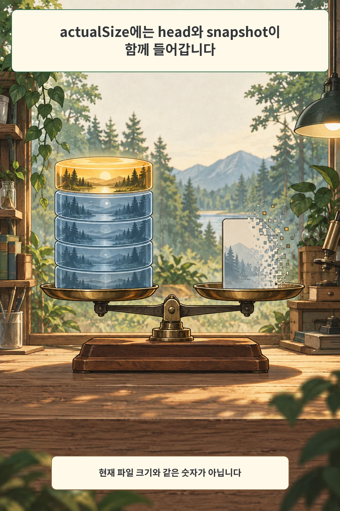
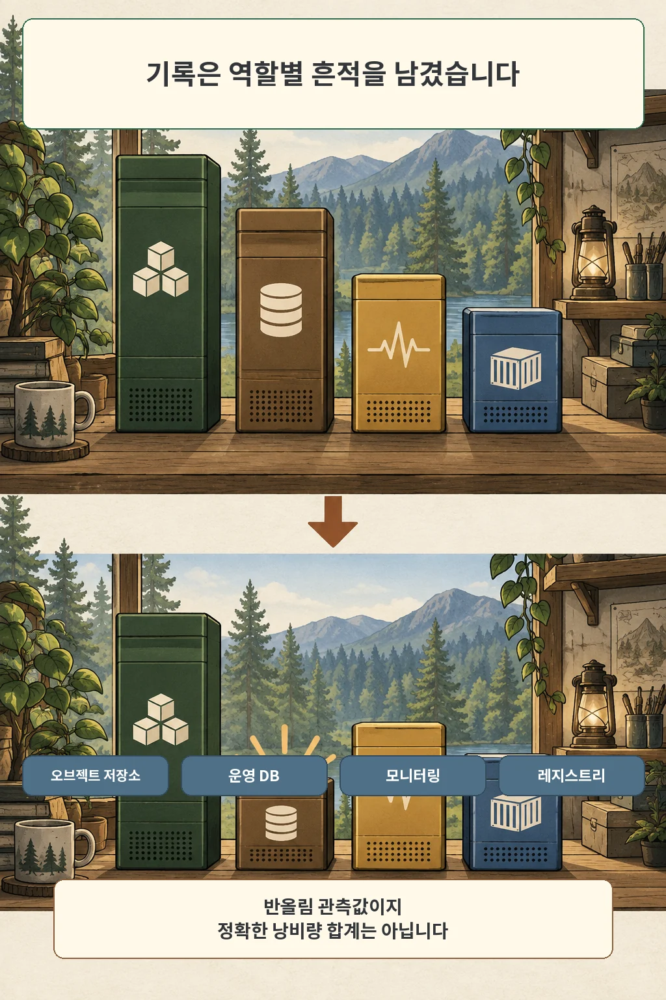

글·해설: 다메카솔

2026년 7월 20일, 볼륨 확장과 replica rebuild를 거친 홈랩에서 제가 직접 만든 적 없는 스냅숏들이 눈에 띄었습니다. 처음에는 단순한 뺄셈 하나로 답을 내고 싶었는데요. 스토리지 화면의 용량에서 노드 디스크 사용량을 빼면 사라진 공간이 바로 나올 것 같았지만, 막상 확인해 보니 Longhorn의 `actualSize`부터 제가 생각하던 의미가 아니었습니다.

> 이 글은 2026년 7월 20일과 24일의 개인 인프라 변경 기록·운영 runbook을 2026년 10월 3일 Longhorn 1.13 공식 문서와 다시 대조해 썼습니다. 변경 기록의 용량은 당시 남긴 반올림 관측값이며 원본 명령 출력은 보존되지 않았습니다. 최초 초안의 72%, 155GB, 289GB 비교는 측정 시각·명령·대상 범위를 확인할 수 없어 제목과 본문 주장, 이미지에서 제외했습니다.

## 핵심 내용

- **`actualSize`의 정확한 의미**: 현재 사용자가 읽는 파일 크기만이 아니라, 각 replica의 **volume head와 스냅숏 레이어들이 디스크에서 차지하는 물리 공간**을 함께 가리킵니다.
- **시스템 스냅숏 누적과 검증**: rebuild·볼륨 확장·백업 과정에서 시스템 스냅숏이 자동 생성될 수 있으며, 작은 운영 DB 볼륨에서 스냅숏 객체를 정리해 약 13GB가 회수되는 것을 먼저 확인했습니다.
- **안전 게이트와 3층 관측**: 스냅숏 병합(purge)은 추가 임시 공간을 쓰므로 사전 안전 게이트를 통과한 뒤 실행해야 하며, 정리 후에는 CR 개수 대신 노드 파일시스템·볼륨 레이어·작업 상태를 같은 시간축에서 확인해야 합니다.

## actualSize는 현재 파일 크기가 아닙니다

Longhorn 1.13 공식 문서는 볼륨의 `actualSize`를 각 replica가 디스크에서 실제로 사용하는 공간으로 정의합니다. 여기에는 현재 쓰기 대상인 **volume head**뿐 아니라 과거 **스냅숏 레이어**도 함께 포함되는데요. 게다가 게스트 파일시스템에서 파일을 지웠다고 해서 블록 계층에 `trim`이 자동으로 전달되는 것도 아니기 때문에, 애플리케이션이 보는 파일 크기와 Longhorn의 `actualSize`, 노드 파일시스템 사용량은 서로 다른 숫자를 가리킬 수 있습니다.

이 구분을 놓치면 `actualSize`를 “지금 사용자가 읽고 쓰는 활성 데이터 크기”로만 오해하기 쉽습니다. 실제로는 다음 질문에 훨씬 가깝습니다.

> 이 replica의 head와 스냅숏 레이어들이 현재 디스크에서 얼마나 많은 물리 공간을 쓰고 있는가?

Longhorn은 리빌드(rebuild), 볼륨 확장(expansion), 백업 과정에서 운영자가 UI에서 직접 만들지 않은 **시스템 스냅숏**을 생성할 수 있습니다. 반대로 스냅숏 객체가 보인다는 사실만으로 그 크기 전체가 즉시 회수 가능한 낭비 공간이라는 뜻도 아닙니다. head와 자식 레이어가 참조하는 블록, 병합 상태, replica별 배치까지 함께 살펴야 실제 회수 가능량을 알 수 있습니다.

## 네 볼륨의 숫자는 단서였지 정답이 아니었습니다

당시 변경 기록에는 주요 볼륨 역할별로 다음과 같은 스냅숏 관측값이 남아 있었습니다.

| 공개용 역할명 | 기록된 snapshot 관측값 |
| --- | ---: |
| 오브젝트 스토리지 | 180.5G |
| 운영 데이터베이스 | 18.9G |
| 모니터링 | 15.1G |
| 컨테이너 레지스트리 | 4.3G |

그렇다고 이 표의 숫자를 단순 합산해 “그만큼이 전부 낭비 공간이었다”고 단정할 수는 없습니다. 당시 원본 명령 출력이 남아 있지 않아 이 값이 replica별 수치인지, 스냅숏 객체별 단순 합계인지, 공유 블록을 어떤 범위로 센 것인지 다시 대조할 수 없기 때문입니다.

기록으로 확실히 말할 수 있는 사실은 두 가지입니다. 변경 기록이 볼륨 확장과 리빌드 이후의 시스템 스냅숏 누적을 원인 후보로 지목했다는 점, 그리고 규모가 작은 운영 DB 볼륨에서 관련 스냅숏 객체를 정리한 직후 **약 13GB**가 실제로 회수됐다는 점입니다. 물론 이 13GB 회수가 나머지 세 볼륨에서도 똑같은 비율로 재현된다는 보증은 아니었기에, 가장 큰 볼륨부터 일괄 삭제하지 않고 작은 대상 하나로 동작과 회수 결과를 먼저 검증했습니다.

## 삭제 명령보다 먼저 닫아야 할 gate가 있습니다

스냅숏 purge는 단순한 메타데이터 객체 삭제가 아닙니다. Longhorn이 스냅숏 레이어를 병합(coalesce)하고 더 이상 필요 없는 데이터를 정리하는 동안 추가 임시 공간이 필요하며, 공식 문서는 상황에 따라 볼륨의 명목 크기(nominal size)만큼 여유가 필요할 수 있다고 경고합니다. 디스크가 거의 찬 상태에서 무계획으로 정리를 시작하면 [다음 편의 DiskPressure 장애](/posts/snapshot-merge-diskpressure/)처럼 정리 작업 자체가 노드 압박을 키울 수 있습니다.

그래서 이 환경의 운영 런북(runbook)은 스냅숏 정리 전에 다음 5가지 사전 게이트를 먼저 확인하도록 바뀌었습니다.

1. **배치 작업 정지 확인**: 전체 네임스페이스에 실행 중인 Job이나 소유자 없는(ownerless) 배치 Pod가 없는지 확인합니다.
2. **볼륨·복제본 건강 확인**: 모든 Longhorn 볼륨이 `attached`·`healthy` 상태이고 replica가 `running`이며 진행 중인 리빌드가 없는지 확인합니다.
3. **백업 무결성 확인**: 외부 백업 사본의 최신 체크섬과 복원 경로를 점검합니다.
4. **보존 대상 기록**: 지우지 않고 보존할 사용자 스냅숏 이름을 미리 기록합니다.
5. **대형 작업 동시 실행 금지**: 정리 중에는 대형 백업·복원·볼륨 이동을 새로 시작하지 않습니다.

주기적인 정리에는 제거 가능한 스냅숏과 시스템 스냅숏을 purge하는 개수(count) 기반 작업인 Longhorn의 `snapshot-cleanup` 태스크를 쓸 수 있습니다(공식 문서에 따르면 이는 일반 스냅숏 보존 개수를 뜻하는 `retain` 값으로 동작을 조절하는 작업이 아니며, 리빌드 뒤 시스템 생성 스냅숏을 자동 정리하는 설정 역시 기능의 존재 여부와 현재 클러스터의 활성화 여부를 분리해 확인해야 합니다).

아울러 `markRemoved` 상태를 읽는 기준도 바로잡았습니다. 당시 기록에는 purge 실행 전 `markRemoved` 상태의 스냅숏들이 관측됐지만, 후속 런북과 공식 문서를 대조해 보면 purge가 끝난 뒤에도 스냅숏 CR(커스텀 리소스)이 일종의 묘비(tombstone)처럼 남을 수 있습니다. 따라서 `markRemoved=true`인 CR이 보인다는 이유만으로 디스크 공간이 아직 회수되지 않았다고 단정하거나 무리하게 purge를 반복해서는 안 됩니다.

## 정리 뒤에는 객체가 아니라 결과를 확인합니다

2026년 7월 24일 후속 작업에서는 NAS 체크섬 검증과 볼륨·리빌드 게이트를 모두 통과한 뒤 정리 절차를 실행했습니다. 기록상 33개 볼륨 모두 건강 상태를 유지했고, 한 노드의 루트 파일시스템 사용률은 **79%에서 67%**로 낮아지며 **약 53GiB**가 회수됐습니다(이 수치 역시 당시 운영 기록의 관측값이며 현재 시점에 동일 명령으로 재현한 측정은 아닙니다).

핵심은 정리 성공 여부를 스냅숏 CR 개수 하나로 판정하지 않았다는 데 있습니다. 작업 로그의 볼륨별 purge 결과, 사용자 스냅숏 보존 여부, 볼륨 건강 상태(robustness), 노드 파일시스템 사용률을 한 세트로 묶어 확인했습니다. 정리 뒤 `markRemoved` 객체가 남아 있더라도 노드 디스크 사용량이 줄고 볼륨이 건강하다면 정상적인 tombstone일 수 있고, 반대로 객체 수는 줄었는데 호스트 사용량이 그대로라면 추가로 지우기 전에 replica의 sparse file 상태와 실제 참조 블록을 먼저 조사해야 합니다.

## 한 숫자 대신 세 층을 같은 시간축에 놓습니다

이 경험을 거친 뒤로는 스토리지 용량 경보를 다음 세 층으로 나누어 같은 시간축 위에 올려놓고 봅니다.

- **노드 파일시스템 층**: 호스트 디스크에 물리적 여유 공간이 얼마나 남았는가?
- **Longhorn 볼륨 층**: volume head와 스냅숏의 `actualSize`가 replica별로 얼마나 커졌는가?
- **작업 이벤트 층**: 리빌드, 볼륨 확장, 백업, 정리(cleanup) 작업이 언제 시작되고 끝났는가?

Longhorn이 제공하는 볼륨·스냅숏 `actualSize` 지표에 노드 사용률과 작업 이벤트를 같은 시간축으로 포개 놓으면 “어느 작업 직후에 어떤 레이어가 불어났는가”를 빠르게 좁힐 수 있습니다. 숫자가 서로 맞지 않는다고 성급히 삭제 명령부터 내리는 대신, `actualSize`가 head와 스냅숏을 함께 세는 지표라는 점부터 짚고 **정리 전 안전 게이트와 정리 후 물리 사용량**을 한 세트로 기록하는 것이 안전한 운영 순서입니다.

## 함께 읽을 글

- [애플리케이션 복제와 스토리지 복제는 무엇이 다른가](/posts/application-storage-replication-layers/): 앞선 6편의 replica 계층 판단을 개념으로 정리합니다.
- [replica 1은 같은 뜻이 아니었습니다: Vault PDB 앞에서 멈춘 drain](/posts/replica-layer-pdb-drain/): 같은 홈랩에서 애플리케이션과 스토리지 replica를 분리한 사건입니다.

## 출처

- 개인 인프라 변경 기록, 2026-07-20·24
- 개인 인프라 Longhorn snapshot 회수 runbook
- [Longhorn 1.13: Volume Size](https://longhorn.io/docs/1.13.0/nodes-and-volumes/volumes/volume-size/)
- [Longhorn 1.13: Scheduling Backups and Snapshots](https://longhorn.io/docs/1.13.0/snapshots-and-backups/scheduling-backups-and-snapshots/)
- [Longhorn 1.13: Create and Manage Snapshots](https://longhorn.io/docs/1.13.0/snapshots-and-backups/setup-a-snapshot/)
- [Longhorn 1.13: Helm Values](https://longhorn.io/docs/1.13.0/references/helm-values/)
- [Longhorn 1.13: Metrics](https://longhorn.io/docs/1.13.0/monitoring/metrics/)

공식 문서는 2026년 10월 3일 다시 확인했습니다. 실제 볼륨 이름, 사설 주소, 호스트명과 네임스페이스는 공개용 역할명으로 바꿨습니다.

이 글의 본문과 이미지는 생성형 AI로 제작했습니다. 기획과 편집 기준은 다메카솔이 정했습니다. 만화 이미지는 텍스트 없는 원화에 결정적 레터링을 합성해 만들었습니다. 공식 로고·UI·문서 도표 등 외부 이미지 자산은 사용하지 않았습니다.
