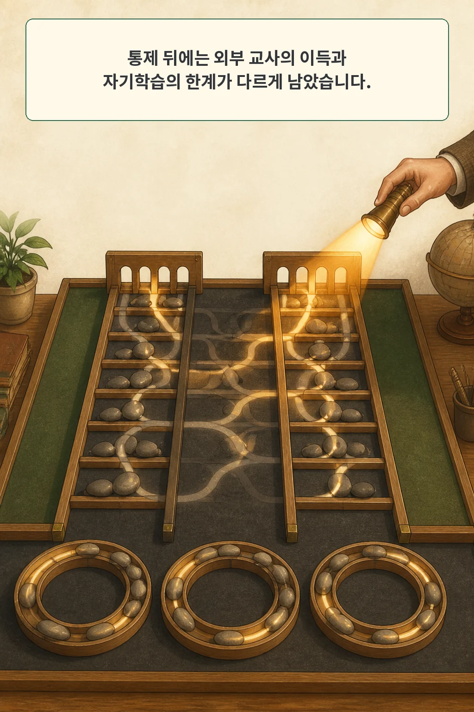

파인튜닝이나 자기학습 뒤 모델이 예전에 틀리던 문제를 맞히기 시작했다면 곧바로 '새 능력 획득'으로 세어도 될까요? 평균 점수보다 정밀해 보이는 문제별 성패 추적도, 잡음이 섞인 두 추정치를 빼는 방식이라 가중치가 변하지 않은 모델에서조차 학습과 손실 착시가 생기거든요. **「Phantom Gains」** 연구는 똑같은 평가 파이프라인을 학습 없는 **동결 대조군(frozen control)**에 통과시켜, 변화가 없을 때도 관측되는 영가설(measured null)부터 재야 한다고 짚습니다.

글·해설: 다메카솔

## 핵심 내용

- **단일 디코드 착시**: 동결 모델을 두 번 평가한 것만으로 6개 학습·9개 손실(CLR 1.5)이 잡혔습니다.
- **영가설 직접 측정**: 임계값을 높여도 영가설이 남아, 통합 기준선 exact test와 FDR 통제로 동결 오탐 0건을 얻었습니다.
- **교사 신호와 자기학습**: 조건을 맞춘 AIME 비교에서 외부 증류만 드문 도달 문제를 시드마다 8~11개 개선했습니다.

## 같은 모델을 두 번 재도 결과는 뒤집힌다

평균 정확도가 전체 성패를 뭉뚱그린다면, 전이 통계는 각 문제를 `틀림→맞음`이나 `맞음→틀림`으로 나눕니다. 어디서 배우고 잊었는지 짚기 좋지만, 생성 샘플·문제 순서·파싱·수식 채점·런타임 상태가 흔들리면 경계에 걸린 문제는 칸을 옮깁니다.

가령 `temperature 0`으로 맞춘 수학 평가 200문제를 두 번 돌려 본다고 해 봅시다. 가중치가 그대로여도 추론 배치 처리(batching)나 런타임 상태가 어긋나면 판정이 뒤집히며, 세밀한 전이 표에서는 이것이 능력의 생성이나 소실로 기록되죠.

- **단일 greedy 원장**: 동결 모델 재평가만으로 6개 학습·9개 손실이 나와 손실 대 학습 비율(CLR)이 1.5로 계산됐습니다.
- **직렬 평가 잔존 잡음**: 같은 200문제를 한 프로세스에서 직렬 평가해도 뒤집힘이 16건에서 4건(2%)으로 남았습니다.

단일 디코드 결과를 모델 상태로 삼기보다, 여러 샘플의 정답률 추정치에 여유폭을 둔 히스테리시스 구간(hysteresis band)으로 경계 흔들림을 거르는 편이 안전합니다.

## 영가설을 0으로 가정하지 않고 직접 잰다

이 감사 방법의 출발점은 '학습이 없으니 변화량도 0'이라 가정하지 않는 데 있습니다. 동결 대조군을 실험군과 같은 문제·체크포인트 수·디코드 예산·프롬프트·파서·실행 경로에 통과시켜 **측정된 영가설(measured null)** 분포를 먼저 구해야 하는 셈이죠.

논문은 `Qwen3-8B`에 `rank-32` LoRA 자기학습을 3라운드 적용하며 동결 대조군도 같은 단계로 평가했습니다. 다중 실험군 연구에서는 각 실험군의 학습 전 체크포인트가 모두 초기 모델의 독립 평가이므로, 이 기준선 반복을 짝지어 추가 비용 없이 동결 분포를 얻을 수 있습니다.

## 한 번의 성공은 새 능력이 아닐 수 있다

기본 모델이 한 번도 못 맞힌 문제를 학습 뒤 한 번 맞히면 '새 능력 확장'으로 세는 기준은 표본이 작을수록 취약합니다. 원래 드물게 맞힐 수 있었지만 앞선 샘플에서 우연히 드러나지 않았던 문제를 새 능력으로 오인하기 쉽습니다. 아래 표처럼 임계값을 높이는 처방도 운 좋은 대조 결과 한 건에 기댄 착시였습니다.

| 판정 방식 | 대조 없는 해석 · 한계 | 동결 대조 결과 | 논문의 보정 해법 |
| --- | --- | --- | --- |
| **단일 greedy 원장** | 동결 모델도 CLR 1.5 손실로 보임 | 직렬화 뒤에도 4/200(2%) 뒤집힘 | 다중 샘플 추정기 + 히스테리시스 |
| **1회 확장 (`m=1`)** | 새 풀이 능력 획득으로 판정 | 동결 대조군도 7/25(0.280) 확장 | 고정 임계값 의존 폐기 |
| **2회 상향 (`m≥2`)** | 영가설이 0이라 안전하다고 믿음 | 110개 비교 합산 영가설 0.058(0.038~0.078) | 다중 반복으로 영가설 분포 측정 |
| **통합 기준선 exact 검정** | 고정 임계값 없이 기준선 대비 상승 검정 | held-out 반복 11건 모두 오탐 0건 | 1,408회 pooled exact test + FDR |

문제마다 원래 정답 확률이 다르고 반복 횟수와 디코드 예산에 따라 임계선을 넘을 확률도 달라집니다. 핵심 질문은 "몇 번 맞혔는가"가 아니라 **이 문제의 기존 성공 분포로 설명하기 어려운 변화인가**로 옮겨가야 합니다.

## 외부 교사의 이득과 자기학습의 한계를 분리했다

잡음을 걸러냈다고 모든 학습 효과가 사라지지는 않습니다. 데이터 흐름·보존량·평가를 맞춘 AIME 사다리(ladder)와 MATH 손실 구간에서 외부 교사 증류(`gpt-oss-120b`)와 세 가지 자기학습 설정을 비교하자 결과가 갈렸습니다.

| 비교 구간 · 지표 | 외부 교사 증류 | 자기학습 (`STaR`·다수결 SFT·정책 경사) | 동결 대조군 · 유의성 |
| --- | --- | --- | --- |
| **AIME 드문 도달 (`≤5/1,408`, 22문제)** | 시드마다 **8~11개** 개선 | 시드마다 **0~2개** 개선 | 대조군 **0건** · $\beta=1.91$ ($p<10^{-8}$) |
| **AIME 완전 미도달 (`0/1,408`, 10문제)** | 시드 합집합 **5개** | 시드 합집합 **2개** | 차이 비유의 ($p=0.35$) |
| **MATH 구간(1,163문제) 손실** | - | `STaR` **106개** · 다수결 SFT **88개** | 대조군 중앙 손실 **8개** |

외부 증류만 드물게 풀리던 문제에서 일관된 전이를 냈고, 전체 이득 규모를 보정한 로지스틱 모형에서도 상호작용이 유의하게 남았습니다. 반면 한 번도 못 맞힌 미도달 구간에서는 차이가 유의하지 않아, 외부 교사 역시 **희미하게 닿아 있던 문제**의 경로를 넓힌 결과로 읽힙니다.

- **짧은 학습 지평**: 단일 백본(`Qwen3-8B`), `rank-32` LoRA, 3라운드(약 270 step) 결과라 장기 강화학습이나 다른 모델 계열에 대해서는 별도 확인이 필요합니다.
- **표본 구성 경계**: 1,163개 MATH 구간은 사전학습 오염 가능성이 높고 전이가 잘 보이도록 고른 집합이라 자연 망각률과 구분해야 합니다(AIME 2026 절반은 컷오프 이후 문제).

## 다메카솔의 해석: 지표마다 no-op 테스트를 둔다

평가 파이프라인을 운영한다면 성능을 보고하기 전에 가중치를 바꾸지 않은 모델을 같은 체크포인트 수·문제 순서·디코드 예산·채점기에 통과시키는 **무변화 대조 시험(no-op test)**부터 붙여야 합니다. 지표가 세분화될수록 측정기의 바닥 잡음도 지표별로 재야 안전하거든요.

- **원장 우선 저장**: 통계를 성급히 확정하지 말고 문제별 정답 수, 토큰 잘림, 시드, 파이프라인 버전을 원장에 먼저 남깁니다.
- **짝 대조군·FDR**: 전이 지표마다 같은 구조의 동결 대조군 구간을 붙이고, 다수 문제를 함께 검정할 때는 위발견율(FDR)로 오탐을 통제합니다.

변하지 않은 대상이 측정기에서 얼마나 흔들리는지 먼저 확인해야, 이후에 잡힌 개선 신호도 자신 있게 설명할 수 있습니다.

## 함께 읽기

- [AI 에이전트는 기억하고도 현재 상태를 놓칠 수 있습니다](/posts/statemem-agent-memory-state-tracking/)

## 출처

- Cheng Xu, Nan Yan, Liming Chen, M-Tahar Kechadi, [「Phantom Gains: Auditing Self-Improvement Against a Measured Null」 (arXiv:2608.20290)](https://arxiv.org/abs/2608.20290), 2026년 8월 20일 v1 공개(8월 21일 cs.AI 목록).
- [arXiv HTML 본문](https://arxiv.org/html/2608.20290) · [원문 PDF](https://arxiv.org/pdf/2608.20290)
- [공식 코드와 평가 기록 (chengxuphd/phantom-gains)](https://github.com/chengxuphd/phantom-gains): 48개 실행·344만 세대·53억 토큰을 19MB 문제별 집계 기록으로 공개(약 15GB 원본 생성 텍스트는 별도 요청).

이 글은 논문 원문과 공식 저장소의 공개 집계 기록을 바탕으로 정리했으며 새 학습 실행은 독립 재현하지 않았고, 만화는 논문 그림을 복제하지 않고 개념을 새로 구성했습니다.
이 글의 본문과 이미지는 생성형 AI로 제작했습니다. 기획과 편집 기준은 다메카솔이 정했습니다.
