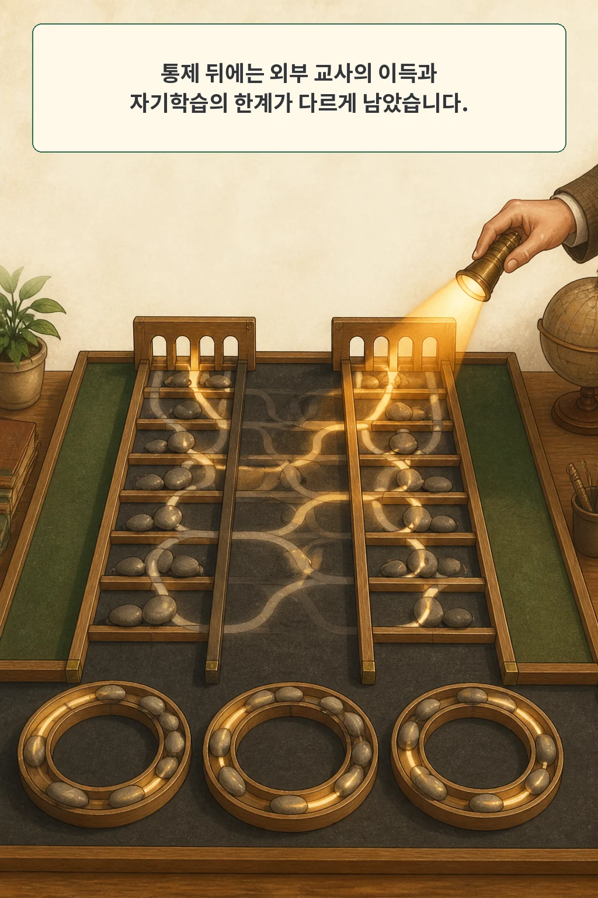

모델이 학습 전에는 틀렸고 학습 뒤에는 맞힌 문제가 있다면 이를 곧바로 **새로 배운 능력**으로 세어도 될까요? 반대로 맞히던 문제를 틀리면 **망각**이라고 불러도 될까요? 문제별 변화는 평균 정확도보다 훨씬 정밀해 보이지만, 두 번의 평가가 각각 흔들린다면 그 차이는 측정 잡음까지 함께 확대합니다. 심지어 전혀 학습하지 않은 똑같은 모델을 다시 평가해도 학습과 손실처럼 보이는 전이가 나타납니다. **「Phantom Gains: Auditing Self-Improvement Against a Measured Null」**은 이 함정을 학습하지 않은 동결 대조군(frozen control)으로 감사하며, 자기학습 실험과 동일한 문제·체크포인트·평가 파이프라인을 대조군에도 적용해 “변화가 없을 때도 관측되는 변화량”을 직접 측정했습니다.

글·해설: 다메카솔

## 핵심 내용

- 문제별 학습·손실 판정은 잡음이 섞인 두 추정치의 차이라 단일 평가에 취약합니다.
- 동결 모델의 두 평가만 비교해도 6개 학습과 9개 손실이 나타났고, 학습 대비 손실 비율(CLR)은 1.5가 됐습니다.
- 성공 임계값을 강화해도 110개 동결 비교에서 측정된 영가설(measured null)은 0이 아니라 0.058이었습니다.
- 문제별 pooled baseline, exact test, 위발견율(FDR) 통제를 적용하자 held-out 동결 반복에서는 잘못된 탐지가 0건이었습니다.
- 조건을 맞춘 비교에서 외부 교사 증류(distillation)의 이득은 남았지만, 세 가지 자기학습 설정의 전이는 훨씬 제한적이었습니다.

## 같은 모델을 두 번 재도 결과는 뒤집힌다

평균 정확도가 여러 문제의 성패를 한데 묶는다면, 전이 수준 통계는 각 문제를 `틀림→맞음`, `맞음→틀림`, `변화 없음`으로 세세하게 분류합니다. 어디서 배웠고 어디서 잊었는지 짚어낼 수 있어 매력적이지만, 각 칸은 잡음이 섞인 두 추정치(noisy estimate)의 차이입니다. 생성 샘플이나 문제 순서, 수식 동치 채점, 출력 파싱, 런타임 상태가 조금만 달라져도 경계에 있던 문제는 칸을 옮기며, 세밀한 단위로 내려갈수록 판정 하나의 흔들림이 곧 “능력의 생성”이나 “소실”이라는 서사로 둔갑합니다.

실제로 논문의 단일 greedy decode 원장에서 아무것도 학습하지 않은 동결 모델이 6개 문제를 새로 맞히고 9개를 잃어, 변화 대 손실 비율(change-to-loss ratio)이 1.5로 계산됐습니다. 숫자만 보면 손실이 학습보다 많다는 결론까지 내릴 수 있지만 실제 원인은 모델 변화가 아니라 측정 파이프라인의 흔들림이었습니다. 같은 200개 문제를 한 프로세스에서 직렬 평가하면 판정 뒤집힘이 16건에서 4건으로 줄어들었으나 여전히 2%가 남았습니다.

## 영가설을 0으로 놓지 않고 직접 잰다

저자들의 핵심 제안은 “학습이 없으면 전이도 0”이라고 가정하지 말고, 학습하지 않은 대조군을 실험군과 똑같은 문제·체크포인트 수·디코드 수·프롬프트·파서·실행 경로에 통과시켜 전이 통계의 분포인 **측정된 영가설(measured null)**을 먼저 재는 것입니다.

논문은 Qwen3-8B에 rank-32 LoRA 자기학습을 세 라운드 적용하면서 동결 대조군도 동일한 단계 수와 평가 파이프라인을 통과시켰습니다. 확장 판정의 성공 임계값을 두 번으로 올린 보정에서도 110개 동결 비교의 합산 영가설(pooled null)은 0이 아니라 0.058(95% 구간 0.038~0.078)이었습니다. 이에 저자들은 문제별로 1,408회의 pooled baseline을 만들고 exact test를 수행한 뒤 다중검정 위발견율(FDR)을 통제하는 대안 통계를 도입했고, 11개 held-out 동결 반복에 적용했을 때 잘못된 탐지를 0건으로 줄였습니다.

## 한 번의 성공은 새 능력이 아닐 수 있다

기본 모델이 한 번도 맞히지 못한 문제를 학습 모델이 한 번 맞혔을 때 이를 **확장**으로 세는 통계($m=1$)는 표본이 적을 때 특히 취약합니다. 실제로 이 기준을 적용하자 학습하지 않은 동결 대조군에서도 25개 중 7개(0.280)의 확장이 관측됐습니다. 드물게 맞힐 가능성이 원래 있었지만 앞선 소수 샘플에서 우연히 관측되지 않았던 문제를 새 능력으로 오인한 것입니다.

단순히 성공 임계값을 높이는 것만으로도 부족합니다. 문제마다 기본 성공률이 다르고 반복 횟수와 디코드 예산에 따라 임계선을 넘을 확률도 달라지기 때문에, 핵심 질문은 “이번에 맞혔는가”가 아니라 **이 문제의 기존 성공 분포로 설명하기 어려운 변화인가**가 되어야 합니다.

## 외부 교사의 이득과 자기학습의 한계를 분리했다

측정 잡음을 보정했다고 해서 모든 학습 효과가 사라지는 것은 아닙니다. 데이터 흐름과 보존량, 평가를 맞춘 AIME 사다리 실험에서 외부 교사 답을 쓰는 증류(distillation)와 세 가지 자기학습 설정을 비교한 결과는 뚜렷하게 갈렸습니다.

- **드물게 맞히던 문제(22개)에서의 전이**: 증류는 시드(seed)마다 8~11개 문제를 개선한 반면, 세 가지 자기학습 설정은 0~2개에 그쳤습니다. 전체 이득 규모 차이를 보정한 로지스틱 모델에서도 증류 상호작용은 $\beta = 1.91$ ($p < 10^{-8}$, 공개 기록 재계산 시 $\beta = 1.905, p = 9.867 \times 10^{-9}$)로 유의하게 남았습니다.
- **완전 미도달 문제(10개)의 경계**: 기본 모델이 1,408회 추출에서 단 한 번도 맞히지 못한 10개 문제만 떼어 보면 차이는 유의하지 않았습니다. 즉 외부 교사가 무에서 유를 만들었다기보다 **드물게 도달하던 문제에서 외부 신호의 전이가 훨씬 분명했다**고 읽는 편이 정확합니다.
- **대조군과 비교한 손실(forgetting)**: 전이가 잘 보이도록 구성한 1,163개 MATH 문제 구간에서 STaR와 다수결(majority-vote) SFT는 각각 106개와 88개 문제를 손상시켰고, 동결 대조군의 중앙 손실 수는 8개였습니다. 실제 손실이 존재하지만 대조군 없이는 효과 크기를 과장하게 됩니다.

이 실험은 단일 백본 계열(Qwen3-8B)과 rank-32 LoRA, 3라운드(약 270 optimizer step)의 짧은 지평, 그리고 사전학습에 포함됐을 가능성이 높은 MATH 구간을 다룬 결과입니다. 공식 저장소(고정 커밋 `ccb887872e3c684fa2fb532bbd44064a7da07821`)는 48개 실행·344만 세대·53억 토큰의 결과를 약 19MB 집계 기록으로 공개하며(약 15GB 원본 생성 텍스트는 별도 요청), 이번 검토에서는 이 공개 집계 기록으로 원장 비교, 부트스트랩 구간, measured null, exact test, 민감도 분석과 표·그림 9개를 모두 일치하게 재계산했습니다(공식 테스트 45개 중 37개 통과, 수식 동치 판정 8개는 Windows 환경의 자식 프로세스 핸들 복제 제약으로 제외).

## 다메카솔의 해석: 성능 통계마다 no-op 테스트를 둔다

제품 평가 파이프라인에 이 원리를 적용한다면, 각 성능 통계마다 모델 가중치를 바꾸지 않은 채 동일한 체크포인트 수·문제 순서·디코드 예산·파서·채점기·실행 환경을 통과시키는 **무변화 대조 시험(no-op test)**을 붙여 측정기의 바닥 잡음(noise floor)부터 확인해야 합니다.

| 항목 | 확인할 질문 |
| --- | --- |
| 평균 변화 | 전체 성능이 실제로 얼마나 움직였나? |
| 전이 통계 | 어떤 문제에서 gain과 loss가 생겼나? |
| measured null | 같은 파이프라인의 무변화 모델에서도 그만큼 움직이나? |

문제별 판정에는 신뢰구간이나 부트스트랩 구간을 붙이고 여러 문제를 동시에 검사할 때는 FDR 같은 다중검정 통제를 적용하며, 파이프라인 버전·시드·문제 순서·샘플 수·디코드 설정을 원장에 남겨야 합니다. 자기 개선을 믿지 말자는 뜻이 아니라, 개선을 주장하기 전에 그 측정기가 변하지 않은 대상에도 개선을 만들어 내는지 먼저 시험하자는 것입니다.

## 논문 정보

| 항목 | 내용 |
| --- | --- |
| 제목 | Phantom Gains: Auditing Self-Improvement Against a Measured Null |
| 저자 | Cheng Xu, Nan Yan, Liming Chen, M-Tahar Kechadi |
| 공개 이력 | arXiv v1 제출 2026-08-20 17:30:14 UTC (2026-08-21 cs.AI 신규 목록 등장) |
| 이 글의 분류 | 경험적 모델 평가·자기학습 감사 연구 |
| 공식 코드 | chengxuphd/phantom-gains, 검증 커밋 ccb8878 |

## 자주 묻는 질문

### temperature 0이면 이런 잡음이 없어지나요?

줄어들 수는 있지만 0이라고 가정할 수 없습니다. 문제 순서, 런타임 상태, 파서, 수식 동치 채점, 서빙 환경이 판정을 바꿀 수 있으며, 이 논문에서도 직렬 평가 뒤 뒤집힘이 줄었지만 완전히 사라지지는 않았습니다.

### 평균 정확도도 믿으면 안 되나요?

평균은 문제별 전이보다 흔들림에 덜 민감하지만 불확실성 추정은 여전히 필요합니다. 특히 “새 능력”이나 “망각”처럼 문제별 상태 변화로 해석할 때 동결 대조군 비교가 더욱 중요합니다.

### frozen control은 한 번만 실행하면 되나요?

한 번의 대조 실행도 경고 신호를 주지만 영가설 분포를 추정하려면 반복이 필요합니다. 이때 실험군과 대조군의 문제, 체크포인트 수, 디코드 예산, 실행 경로를 똑같이 맞춰야 합니다.

## 함께 읽기

- [AI 에이전트는 기억하고도 현재 상태를 놓칠 수 있습니다](/posts/statemem-agent-memory-state-tracking/)

## 출처

- [Chengxu Yang 외, “Phantom Gains: Auditing Self-Improvement Against a Measured Null,” arXiv:2608.20290](https://arxiv.org/abs/2608.20290)
- [arXiv HTML 본문](https://arxiv.org/html/2608.20290)
- [공식 코드와 평가 기록](https://github.com/chengxuphd/phantom-gains)

이 글의 본문과 이미지는 생성형 AI로 제작했습니다. 기획과 편집 기준은 다메카솔이 정했습니다.

Updated: 2026-08-22
