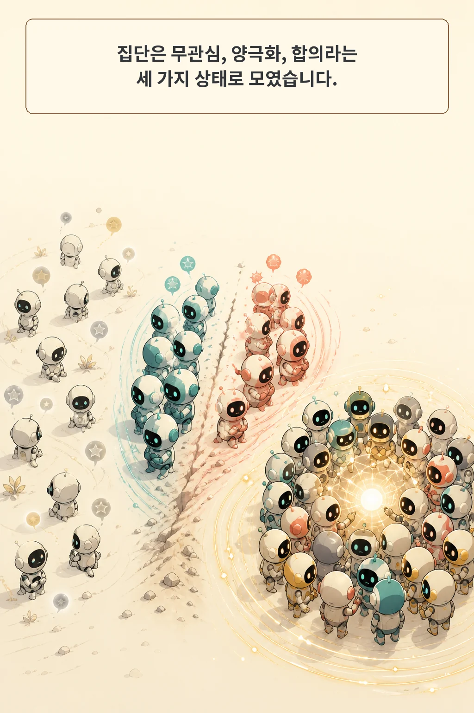
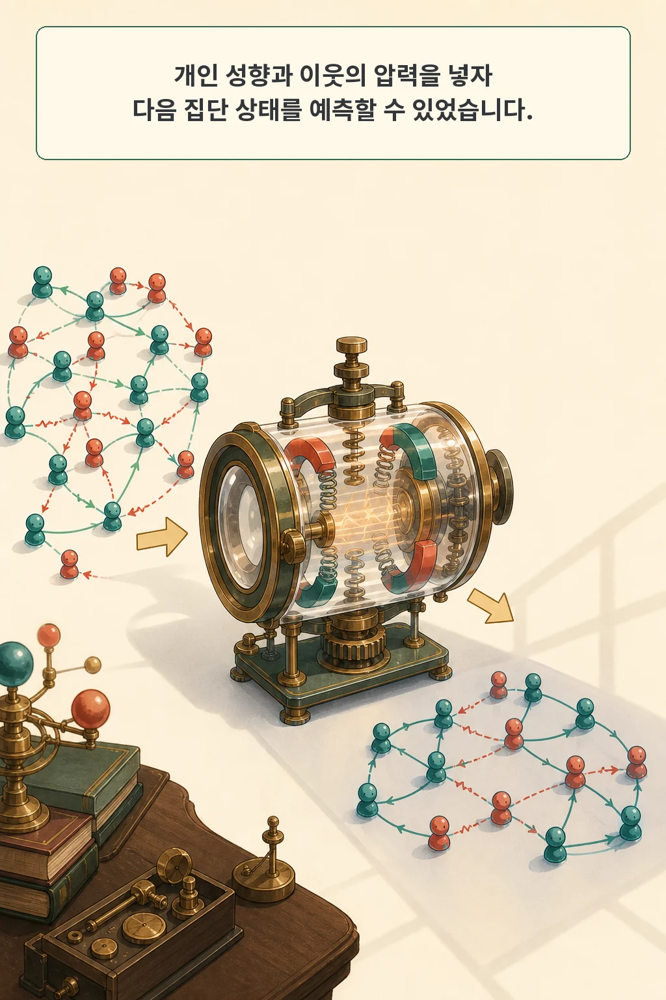

여러 AI 에이전트를 네트워크로 연결하면 흩어진 답이 하나로 모이기도 하지만, 똑같은 연결 구조가 공유된 편향까지 함께 증폭할 수 있습니다. 핵심은 에이전트 수가 아니라 개별 에이전트의 기본 성향과 이웃의 압력이 반복 상호작용에서 어떻게 결합되는지입니다. **「Physics of Agents: Statistical Mechanics Predicts Collective Behavior of AI Agents」**는 1만 개가 넘는 LLM 에이전트 집단을 시뮬레이션해 복잡한 자연어 대화를 무관심·양극화·합의라는 세 가지 집단 상태로 정리하고, 통계역학에서 가져온 작은 확률 모델로 다음 의견 변화를 예측했습니다.

글·해설: 다메카솔

## 핵심 내용

- 32개 에이전트가 하나의 이진 문항을 두고 고정된 대칭 네트워크에서 8라운드 동안 메시지를 교환했습니다.
- 집단은 약한 의견이 흩어진 무관심, 강한 두 진영으로 갈린 양극화, 한쪽으로 모인 합의 상태를 보였습니다.
- 객관적 수학 문항(6,400개 집단 궤적)에서는 네 모델 모두 상호작용 뒤 집단 정답률이 높아졌습니다.
- 주관적 정치 문항에서는 네 모델 중 세 모델이 오른쪽 방향으로 이동했습니다(실제 인간 사회가 아니라 특정 페르소나를 부여한 LLM 시뮬레이션 결과).
- 세 결합계수만 쓴 Ising 계열 갱신 규칙으로 보지 않은 문항의 한 단계 의견 변화를 75~86%의 균형 정확도(balanced accuracy)로 예측했습니다.

## 32개 에이전트가 같은 질문을 반복해서 논의했다

주 실험의 한 집단에는 에이전트 32개가 들어갑니다. 에이전트들은 하나의 이진 문항에 먼저 답한 뒤, 고정된 대칭 네트워크에서 이웃의 최신 메시지만 보고 다시 의견을 내는 단순 Markov 갱신을 8라운드 반복했습니다. 실험 모델로는 GPT-4o-mini, Gemma-3n-E4B-it, Qwen3.5-9B, Llama-3.1-8B-Instruct 네 종을 사용했으며, 객관 영역에는 MATH에서 가져온 수학 문항과 서로 다른 수학 전문성을, 주관 영역에는 정치 성향 문항과 서로 다른 페르소나를 부여했습니다(하나의 질문과 고정 연결망, 이진 의견이라는 통제된 조건에서 LLM 집단의 의견 변화만 떼어 본 실험입니다).

## 복잡한 대화가 세 가지 집단 상태로 정리됐다

핵심 관찰 분석에는 9,600개 시뮬레이션 집단(미관측 그래프 일반화와 비동기 갱신 실험을 포함하면 총 1만 개 이상)이 쓰였습니다. 각 에이전트의 의견에는 방향과 강도가 있어서 약한 의견들이 흩어져 있으면 **무관심**, 강한 의견이 양쪽 진영으로 갈리면 **양극화**, 강한 의견이 한쪽으로 모이면 **합의**가 됩니다. 출발점에서는 약한 의견이 많았지만 메시지를 주고받을수록 확신이 커지며 집단이 더 정렬된 질서 상태로 이동했습니다.

여기서 질서 상태로의 이동이 곧 진실에 가까워졌음을 뜻하지는 않습니다. 객관적 문항과 주관적 문항에서 나타난 정반대의 함의는 다음과 같습니다.

| 문항 영역 | 집단 상호작용 결과 | 해석상 유의점 |
| --- | --- | --- |
| 객관적 수학 문항 (6,400개 궤적) | 네 모델 모두 집단 정답 비율 상승 (오답 다수가 정답으로 바뀐 경우가 그 반대보다 많음) | 서로 다른 전문성을 가진 에이전트의 정보가 연결망을 따라 모이는 효과 |
| 주관적 정치 문항 | 네 모델 중 세 모델의 집단 의견이 상호작용 뒤 오른쪽 방향으로 이동 | 인간 사회 측정이 아니라 설정된 페르소나·문항·모델에 내재된 방향성이 함께 증폭된 결과 |

따라서 “에이전트끼리 토론시키면 더 정확해진다”는 통념은 절반만 맞습니다. 객관 문항에서는 정답 정보가 모였지만, 주관 문항에서는 모델에 들어 있던 방향성 편향도 함께 모였습니다.

## 작은 통계역학 모델은 다음 의견을 어떻게 예측했나

저자들은 자연어 메시지 본문을 직접 모델링하는 대신, 현재 의견을 강화하거나 뒤집는 힘을 세 가지 결합계수로 압축해 Ising 계열 확률 갱신 규칙에 넣었습니다.

1. **내재장**: 에이전트 개인의 기본 성향을 나타내는 힘입니다.
2. **우호 이웃 결합($0.99 \sim 3.03$)**: 같은 방향의 이웃이 끌어당기는 힘입니다.
3. **비우호 이웃 결합($\le 0.73$)**: 반대 방향의 이웃이 밀어내는 힘입니다(우호 결합보다 작아 양극화보다 합의가 더 자주 나타나는 현상을 설명함).

보지 않은 시험 문항에서 이 세 계수 규칙의 한 단계 예측 균형 정확도(balanced accuracy)는 모델과 문항 유형에 따라 75~86%, 초기 상태부터 여러 단계를 굴린 rollout 균형 정확도는 61~77%였습니다. GPT-4o-mini 그래프 일반화 표에서도 학습하지 않은 연결 구조를 포함한 16개 열 중 15개에서 세 결합계수 규칙이 가장 높은 한 단계 점수를 냈습니다. 또한 확률 갱신 규칙의 잡음 민감도를 뜻하는 사회적 온도(`social temperature`, LLM 생성 온도와는 별개) 분석에서는 적합 동작점인 $T=1$이 대부분 집단의 임계온도 아래에 있어 작은 압력도 집단 질서로 이어지기 쉬웠습니다.

객관 문항용 확장 규칙에서는 네 모델 모두 현재 정답을 가진 우호 이웃에게 더 강하게 끌리고 오답을 가진 비우호 이웃에게 더 강하게 밀리는 비대칭이 관찰됐습니다. 다만 이는 관측된 전환을 가장 잘 설명하도록 맞춘 계수일 뿐, 연결 종류를 독립 개입해 인과효과를 확인한 실험은 아니며 어떤 문장과 근거가 설득을 만들었는지까지 설명해 주지도 않습니다.

## 실험 범위와 다메카솔의 해석

이 연구의 직접 범위는 단일 이진 문항, 고정·대칭 통신망, 최신 받은편지함만 보는 갱신입니다. 실제 멀티에이전트 제품처럼 여러 질문이 이어지거나 역할·연결이 시간에 따라 바뀌고 외부 도구 결과가 개입하는 환경은 아직 검증되지 않았습니다(2026년 8월 18일 확인 시점에 공식 GitHub 저장소에는 README와 Apache-2.0 라이선스만 있었고 프로젝트 페이지 404 및 Hugging Face 공개 데이터셋 부재 상태여서 원문 PDF와 TeX를 대조해 검토했습니다).

멀티에이전트 시스템에 이 교훈을 적용한다면 단순히 토론 라운드를 늘리는 대신 **집단 상태 계기판**을 두어야 합니다. 작업 완료율과 최종 답만 기록하면 시스템이 타당한 근거로 수렴한 것인지 같은 편향을 강하게 공유하게 된 것인지 구분할 수 없기 때문입니다. 의견 다양성 잔존율, 상호작용 후 확신 강도 변화, 객관 문항의 오답→정답 전환율, 주관 문항의 특정 방향 쏠림을 따로 모니터링하고, 정답이 하나로 정의되지 않는 과제라면 반대 역할 에이전트나 독립 검증 경로를 연결망 바깥에 두는 설계가 필요합니다.

## 논문 정보

| 항목 | 내용 |
| --- | --- |
| 제목 | Physics of Agents: Statistical Mechanics Predicts Collective Behavior of AI Agents |
| 저자 | Batu El, Jinhee Paeng, Fatih Dinc, Shiye Su, Mete Erdogan, Aneesh Pappu, Haotian Ye, Wanjia Zhao, Surya Ganguli, James Zou |
| arXiv v1 제출 | 2026-08-17 13:41:24 UTC |
| 분야 | Artificial Intelligence (cs.AI), Multiagent Systems (cs.MA) |
| 이 글의 분류 | empirical paper |

## 출처

- [Physics of Agents — arXiv:2608.16578](https://arxiv.org/abs/2608.16578)
- [공식 arXiv PDF](https://arxiv.org/pdf/2608.16578)
- [저자가 연결한 GitHub 저장소](https://github.com/batu-el/physics-of-agents)
- [저자가 연결한 Hugging Face 조직](https://huggingface.co/physics-of-agents)

이 글의 본문과 이미지는 생성형 AI로 제작했습니다. 기획과 편집 기준은 다메카솔이 정했습니다.

논문 그림과 프로젝트 시각물은 복제하지 않고, 검증한 주장만 자체 시각 언어로 재구성했습니다.

Updated: 2026-08-18
