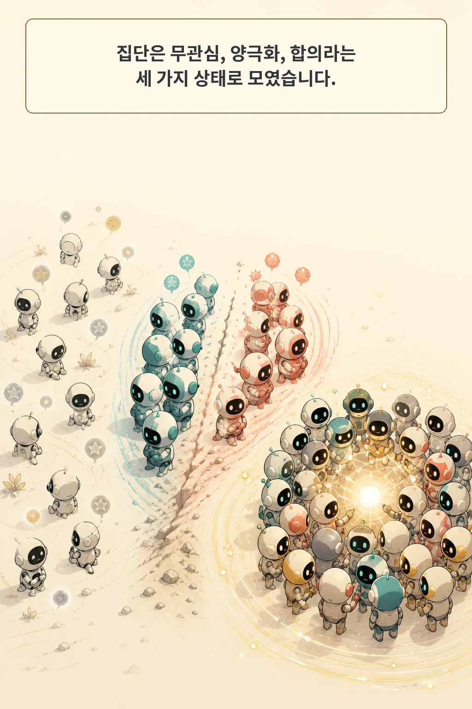
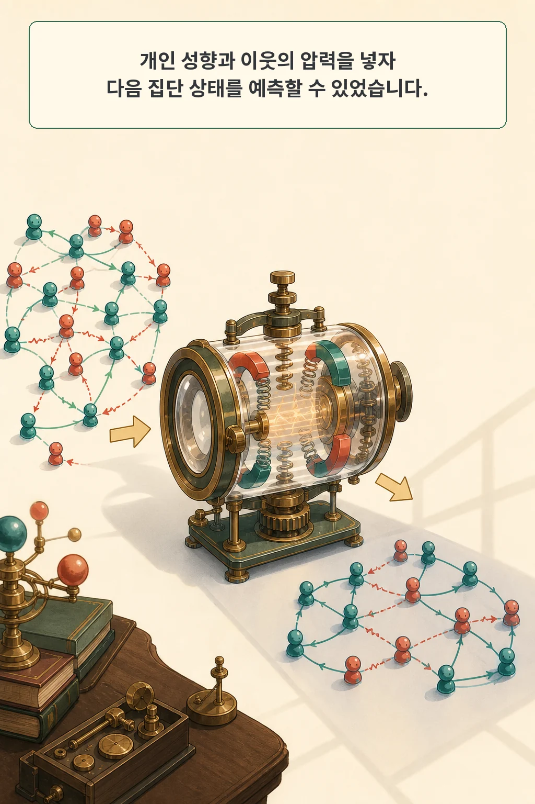

여러 AI 에이전트를 연결해 서로 토론하게 만들면 답이 더 정확해질 거라 기대하기 쉽습니다. 하지만 같은 연결망이 정답을 모으기도 하는 반면, 모델에 내재된 방향성 편향까지 함께 키우는 양날의 검으로 작동하기도 하거든요. **「Physics of Agents: Statistical Mechanics Predicts Collective Behavior of AI Agents」**는 1만 개가 넘는 LLM 에이전트 집단을 시뮬레이션해 집단 의견이 한쪽으로 쏠리는 원인을 밝히고, 통계역학의 작은 확률 모델로 다음 의견 변화를 예측했습니다.

글·해설: 다메카솔

## 핵심 내용

- 32개 에이전트가 단일 이진 문항을 두고 고정 대칭 네트워크에서 8라운드 동안 최신 메시지만 주고받으며 의견을 갱신했습니다.
- 집단 상태는 무관심·양극화·합의로 나뉘며, 대화가 쌓일수록 확신이 커져 질서 상태로 이동했습니다.
- 객관적 수학 문항(6,400개 궤적)에서는 네 모델 모두 집단 정답 비율이 올랐지만, 주관적 정치 문항에서는 네 모델 중 세 모델이 오른쪽으로 이동했습니다.
- 세 결합계수만 쓴 Ising 계열 갱신 규칙으로 미관측 시험 문항의 한 단계 의견 변화를 75~86%의 균형 정확도(balanced accuracy)로 예측했습니다.

## 32개 에이전트가 같은 질문을 반복해서 논의했다

연구진은 LLM 에이전트들의 자연어 대화도 소수의 동역학 법칙으로 설명할 수 있는지 확인하기 위해 통제된 시뮬레이션을 설계했습니다. 각 집단의 에이전트는 먼저 이진 문항에 독립적으로 답한 뒤, 연결된 이웃의 직전 라운드 메시지만 읽고 의견을 다시 내는 단순 Markov 갱신을 8라운드 반복했습니다. 단일 질문·고정 대칭 네트워크·이진 선택지라는 단순한 조건을 택해 다른 변수를 줄이고 의견 변화 자체만 떼어 본 셈입니다.

| 실험 항목 | 설정 내용 |
| --- | --- |
| 집단 및 라운드 | 집단당 에이전트 32개, 고정 대칭 네트워크에서 8라운드 진행 |
| 평가 모델 (4종) | GPT-4o-mini, Gemma-3n-E4B-it, Qwen3.5-9B, Llama-3.1-8B-Instruct |
| 객관 영역 (수학) | MATH 기반 이진 문항, 서로 다른 수학 전문성 부여 |
| 주관 영역 (정치) | 정치 성향 이진 문항, 서로 다른 페르소나 부여 |

## 복잡한 대화가 세 가지 집단 상태로 정리됐다

핵심 관찰 분석에는 9,600개 시뮬레이션 집단이 쓰였고, 미관측 그래프 일반화와 비동기 갱신 실험까지 합치면 전체 규모는 1만 개 집단을 넘습니다. 에이전트 의견에는 방향과 확신 강도가 함께 실리기 때문에 집단 상태는 약한 의견이 흩어진 **무관심**, 강한 의견이 두 진영으로 갈린 **양극화**, 강한 의견이 한쪽으로 모인 **합의**로 나뉩니다. 출발점에서는 약한 의견이 많았지만 상호작용을 거듭할수록 확신이 커지며 더 정렬된 질서 상태로 이동했습니다.

중요한 점은 집단 정렬이 곧 진실 도달을 뜻하지 않는다는 사실입니다. 예를 들어 여러 에이전트에게 수학 문제를 각자 풀게 한 뒤 풀이를 공유하게 하면, 처음에 오답을 고른 다수가 근거 있는 풀이를 보고 정답 쪽으로 돌아설 수 있습니다. 반대로 정답이 고정되지 않은 주관적 문항에서는 초기 모델 성향이나 페르소나가 한쪽으로 살짝만 기울어도 몇 라운드 만에 집단 전체가 그 방향으로 쏠리기 쉽죠.

| 문항 영역 | 집단 상호작용 결과 | 해석상 유의점 |
| --- | --- | --- |
| 객관적 수학 (6,400개 궤적) | 네 모델 모두 집단 정답 비율 상승 (오답 다수가 정답으로 바뀐 경우가 반대보다 많음) | 서로 다른 전문성을 지닌 에이전트 정보가 연결망에 모인 결과 |
| 주관적 정치 | 네 모델 중 세 모델의 집단 의견이 오른쪽 방향으로 이동 | 인간 사회 측정이 아닌 페르소나·문항·모델의 내재 편향 증폭 |

결국 토론을 붙이면 무조건 정확해진다는 통념은 절반만 맞습니다. 검증 가능한 정답이 있는 과제에서는 소통이 정보를 모으는 도구로 작동하지만, 가치 판단이 개입되는 과제에서는 공유된 편향을 확신으로 굳히는 통로가 되기도 합니다.

## 작은 통계역학 모델은 다음 의견을 어떻게 예측했나

저자들은 자연어 메시지 본문을 직접 분석하지 않고도 다음 라운드의 의견 변화를 높은 정확도로 예측했습니다. 현재 의견을 강화하거나 뒤집는 힘을 세 가지 결합계수로 압축해 통계역학의 Ising 계열 확률 갱신 규칙에 맞춰 넣었거든요.

1. **내재장**: 이웃 압력과 무관하게 에이전트 개인이 원래 지닌 기본 성향입니다.
2. **우호 이웃 결합($0.99 \sim 3.03$)**: 같은 방향의 이웃이 끌어당기는 힘입니다.
3. **비우호 이웃 결합($\le 0.73$)**: 반대 방향 이웃이 밀어내는 힘으로, 우호 결합보다 작아 양극화보다 합의가 자주 나타나는 이유를 설명합니다.

| 분석 항목 | 관측 결과 및 해석 |
| --- | --- |
| 미관측 문항 한 단계 예측 | 모델·문항 전반에서 균형 정확도 75~86% |
| 초기 상태 rollout 예측 | 다단계 연속 예측 시 균형 정확도 61~77% |
| GPT-4o-mini 그래프 일반화 | 미학습 연결망 포함 16개 열 중 15개에서 세 결합계수 규칙이 1위 |
| 사회적 온도(`social temperature`) | LLM 생성 온도가 아닌 갱신 잡음 지표이며, 동작점 $T=1$이 임계온도 아래에 위치 |

동작점이 임계온도 아래에 놓인다는 말은 작은 이웃 압력만으로도 집단이 쉽게 질서 상태로 쏠린다는 뜻입니다. 객관 문항용 확장 규칙에서는 네 모델 모두 현재 정답을 가진 우호 이웃에게 더 강하게 끌리고 오답을 가진 비우호 이웃에게 더 강하게 밀리는 비대칭이 보였습니다. 다만 이 계수는 관측된 전환을 설명하도록 맞춘 값일 뿐, 인과 개입 실험 결과나 설득에 쓰인 문장 근거까지 밝혀 주는 데에는 한계가 있습니다.

## 실험 범위와 다메카솔의 해석

실제 서비스에 이 결과를 곧바로 적용하기 전에 실험 경계를 먼저 확인해야 합니다. 이번 연구는 단일 이진 문항과 고정·대칭 통신망, 직전 메시지만 보는 단순 갱신을 전제로 했기 때문에 여러 질문이 이어지거나 역할·연결이 바뀌고 외부 도구가 개입하는 실무 환경과는 조건이 꽤 다르거든요.

그럼에도 멀티에이전트 설계에서는 단순히 토론 라운드를 늘리기보다 **집단 상태 계기판**을 두는 접근이 유효합니다. 최종 답과 완료율만 기록하면 타당한 근거로 수렴한 것인지 같은 편향을 공유하게 된 것인지 구분하기 어렵기 때문입니다. 의견 다양성 잔존율, 확신 강도 변화, 객관 과제의 오답→정답 전환율, 주관 과제의 방향 쏠림을 따로 기록하고, 정답이 열려 있는 과제라면 연결망 바깥에 반대 역할 에이전트나 독립 검증 경로를 함께 배치해 볼 만합니다.

## 논문 정보

| 항목 | 내용 |
| --- | --- |
| 제목 | Physics of Agents: Statistical Mechanics Predicts Collective Behavior of AI Agents |
| 저자 | Batu El, Jinhee Paeng, Fatih Dinc, Shiye Su, Mete Erdogan, Aneesh Pappu, Haotian Ye, Wanjia Zhao, Surya Ganguli, James Zou |
| arXiv v1 | 2026-08-17 13:41:24 UTC |
| 분야 | Artificial Intelligence (cs.AI), Multiagent Systems (cs.MA) |
| 분류 | empirical paper |

## 출처

- [Physics of Agents — arXiv:2608.16578](https://arxiv.org/abs/2608.16578)
- [공식 arXiv PDF](https://arxiv.org/pdf/2608.16578)
- [저자가 연결한 GitHub 저장소](https://github.com/batu-el/physics-of-agents)
- [저자가 연결한 Hugging Face 조직](https://huggingface.co/physics-of-agents)

2026년 8월 18일 확인 시점에 공식 GitHub 저장소에는 README와 Apache-2.0 라이선스만 있었고 Hugging Face 공개 데이터셋도 없어 실험은 독립 재현하지 않았으며, 원문 PDF·TeX를 바탕으로 해설하고 논문 그림은 자체 시각 언어로 새로 구성했습니다.

이 글의 본문과 이미지는 생성형 AI로 제작했습니다. 기획과 편집 기준은 다메카솔이 정했습니다.

Updated: 2026-08-18
