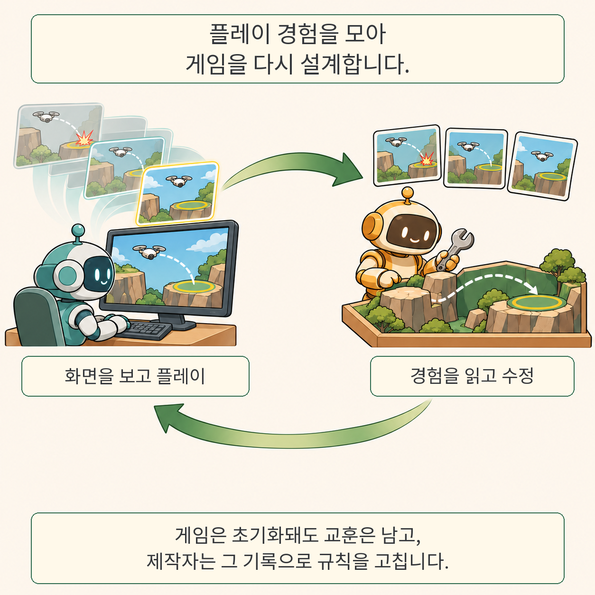
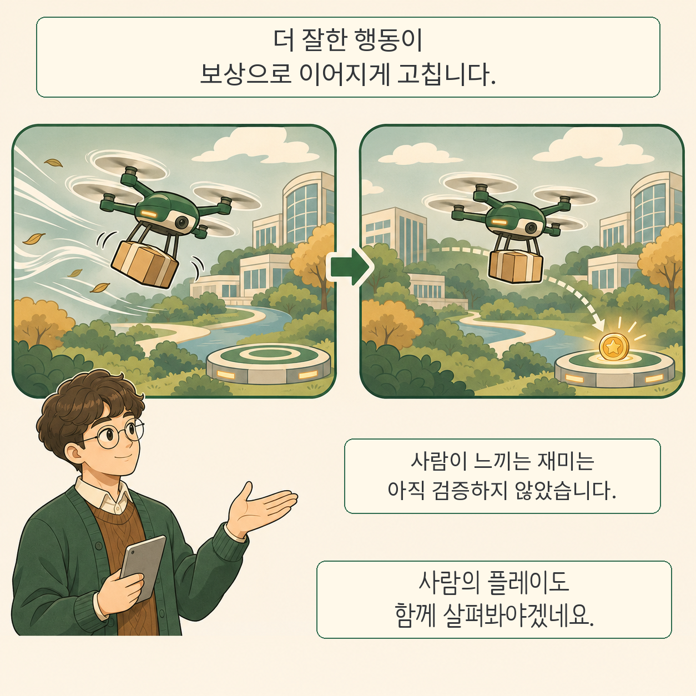

AI가 만든 게임이 실행은 되는데, 여러 번 해도 새로 익힐 것이 없다면 무엇을 고쳐야 할까요? PlayCraft는 AI에게 직접 게임을 시키고, 실패와 발견을 기록하게 한 뒤 그 경험으로 게임을 수정합니다. 핵심 질문은 “클리어할 수 있는가”를 넘어 “연습할수록 더 나은 선택을 할 여지가 있는가”입니다.

글·해설: 다메카솔

## 점수 뒤의 경험을 읽습니다

플레이어 역할의 에이전트는 화면을 보고 키보드·마우스로 조작합니다. 게임 코드를 들여다보거나 인터넷에서 공략을 찾지 못하도록 제한했죠. 한 판이 끝나면 게임 상태는 초기화되지만, 에이전트는 이전 시도의 기억과 자연어 교훈을 이어받습니다. 어떤 선택을 했고, 어디서 막혔으며, 예상과 실제가 어떻게 달랐는지가 기록에 들어갑니다.

제작자 역할의 에이전트는 이 기록을 읽고 게임을 고칩니다. 먼저 플레이어가 원래 가진 능력을 고려해 초보·중간·숙련 수준의 성과를 추정하고, 목표한 성장 과정과 비교합니다. 여기서 숙련자의 성과는 실제 사람이 도달한 점수가 아니라 제작자가 잡은 추정 기준입니다. 게임의 기본 목적과 정체성을 유지하면서, 더 잘 판단하고 조작하면 보상을 얻을 기회를 만드는 것이 수정 방향입니다.

예를 들어 논문의 드론 배달 게임을 보면 이 차이가 구체적입니다. 에이전트는 맞바람에 들어설 때 갑자기 느려지고, 더 적게 부딪혀 배달해도 점수가 같다는 경험을 남겼습니다. 수정된 게임은 맞바람 속에서 운동량을 유지하다 서서히 감속하게 하고, 배달 때 남은 배터리와 적은 손상에 보너스를 줍니다. 플레이어가 건물 뒤에서 속도를 얻어 노출 구간을 통과하거나 충돌을 줄이는 선택을 익힐 이유가 생기는 셈이죠.

경험을 다음 행동에 활용한다는 점은 [에이전트의 기억량을 다룬 연구](/posts/agent-memory-dose/)와 연결됩니다. 이 연구의 특징은 그 기억을 플레이어에게만 주는 데서 멈추지 않고, 게임 규칙을 수정하는 입력으로도 쓴다는 점입니다.

## 평가한 것은 연습에 따른 성과 변화입니다

저자는 화면 기반 플레이 경험을 쓰는 방식과 두 비교 방법을 시험했습니다. Code는 플레이어 경험 없이 코드 분석을 이용하고, Policy는 내부 게임 상태를 읽는 제어 프로그램으로 플레이 기록을 모읍니다. Policy의 제어기는 시도 사이의 경험을 기억하지 않습니다. 따라서 방법 간 차이에는 화면 접근 방식과 경험 유지 여부 등이 함께 들어갑니다.

| 평가 항목 | 논문에서 사용한 조건 |
| --- | --- |
| 게임과 수정 | Three.js 브라우저 게임 10개, 각 방법으로 3회 수정 |
| 반복 평가 | 게임·방법·설정마다 독립 실행 3회, 실행당 10판 |
| 플레이 시간 | 한 판 최대 60초의 활성 시간, 모델 추론 중 게임 정지 |
| Low | GPT-6.1 Terra, 행동 계획 medium·회고 xhigh |
| Medium / High | GPT-6.1 Sol, 각각 medium·xhigh / xhigh·max |

완성된 게임은 수정에 쓴 실행과 분리해 다시 평가했습니다. 학습 증가량은 초반 세 판과 후반 세 판의 정규화 점수 차이입니다. 점수는 **게임과 수정 방법마다 따로**, 세 설정의 전체 90개 결과 중 최고값으로 나눕니다. 서로 다른 게임의 원점수나 재미 점수를 직접 비교한 결과로 읽으면 안 됩니다.

| 평가 설정 | 초기 게임 | PlayCraft 수정 후 |
| --- | ---: | ---: |
| Low | 11.0%p | 13.7%p |
| Medium | 17.5%p | 31.5%p |
| High | 12.4%p | 34.3%p |

표는 각 설정에서 실행별 증가량을 평균한 뒤, 게임마다 같은 가중치로 합친 값입니다. 평균적으로 연습 전후의 차이가 커졌다는 결과죠. 다만 모든 게임에서 이긴 것은 아닙니다. 전체 열 판의 추세를 직선으로 요약한 학습 기울기도 Low에서는 초기 게임 1.96, 수정 후 1.95로 거의 같았습니다.

## 어려워진 게임이 더 좋은 게임일까요?

로봇 팔로 캔을 옮기는 게임에서는 다른 결과가 나왔습니다. PlayCraft가 흔들림과 회전하는 받침대 등을 추가하자, 이미 배운 동작도 안정적으로 반복하기 어려워졌습니다. 저자는 이 불안정성이 학습 지표가 낮아진 이유일 수 있다고 설명합니다. 복잡한 선택을 더하는 것과, 선택을 익혀 성과를 높일 수 있게 하는 것은 구분해야 합니다.

가장 큰 한계는 사람과의 연결입니다. 이 연구는 에이전트의 실력 향상을 숙련의 대리 지표로 삼았고, **그 학습 양상이 사람과 닮았다는 가정은 아직 검증하지 않았습니다.** 모델이 생각하는 동안 게임을 멈추는 조건도 실시간 사람 플레이와 다릅니다. 긴 게임으로 넓히면 플레이 시간과 추론 비용이 늘어난다는 제약도 있습니다.

## 다메카솔의 해석

이 접근을 제작 과정에 넣는다면, 자동 플레이 기록은 사람 테스트 전에 수정 가설을 좁히는 재료로 쓰겠습니다. “어려워했다”에서 끝내지 않고, 어떤 정보를 놓쳤고 어떤 행동이 보상으로 이어지지 않았는지 찾는 데 가치가 있으니까요. 수정 뒤에는 실제 플레이어가 선택의 차이를 이해하는지, 실패 후 다시 시도하고 싶은지도 따로 확인해야 합니다. AI의 학습 곡선과 사람의 플레이 경험을 함께 보는 편이 목표에 가깝습니다.

## 출처

- Weihao Cheng, [PlayCraft: Designing Engaging Games from Agent Play Experience](https://arxiv.org/abs/2611.26624v1), 2026-11-19 제출, v1. 방법 §3, 평가 §4·표 1–3, 한계 §5.
- [저자 프로젝트](https://xt4d.github.io/playcraft-web/) · [공식 코드](https://github.com/xt4d/PlayCraft), 2026-11-22 확인. README는 Bash 호환 셸, Python 3.11 이상, GPU를 사용할 수 있는 Chromium을 갖춘 macOS/Linux 환경을 권장합니다.

논문 실험을 독립 재현하지 않았으며, 만화는 논문 그림을 복제하지 않고 새로 구성했습니다.

이 글의 본문과 이미지는 생성형 AI로 제작했습니다. 기획과 편집 기준은 다메카솔이 정했습니다.
