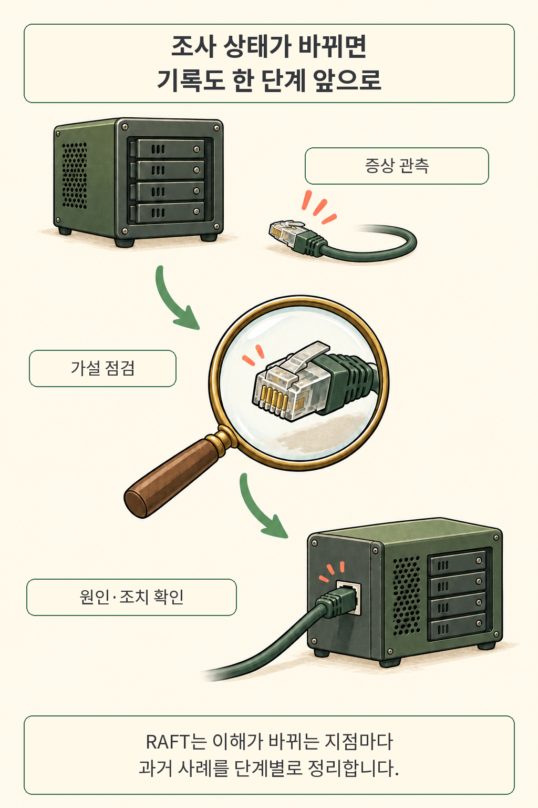
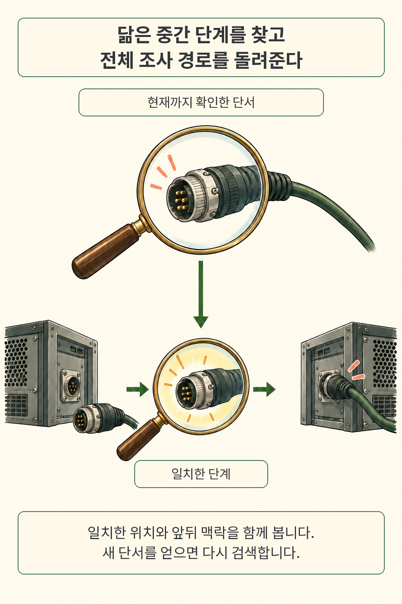
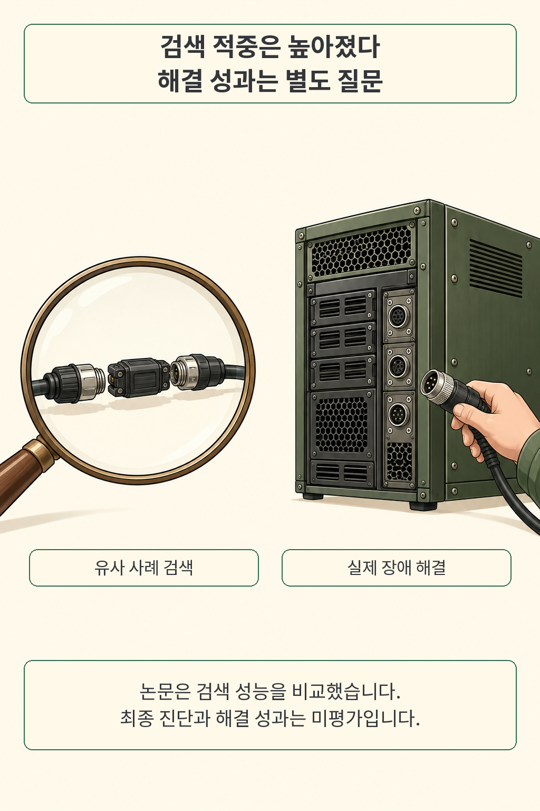
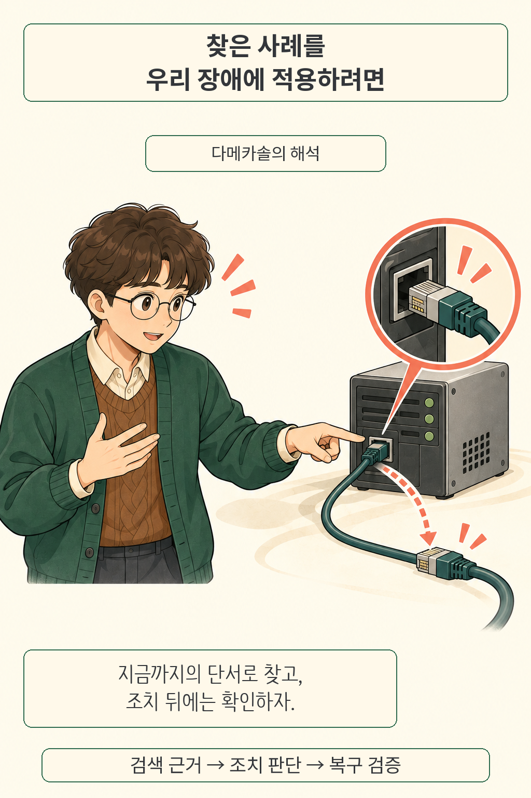

새벽 당직 중 "연결 실패" 알림을 받고 인증과 방화벽까지 정상임을 확인했는데도, 사내 검색기가 여전히 인증 오류 해결 문서만 띄워 준다면 다음 점검으로 넘어가기 어렵죠. 처음 증상이 똑같더라도 조사가 진행되며 좁혀진 단서에 따라 지금 필요한 과거 사례는 달라지기 때문입니다. RAFT(*Retrieval-Augmented Framework for Troubleshooting Agents*, 분산 합의 알고리즘 Raft나 미세조정 기법 RAFT와는 별개) 연구팀은 과거 장애 이력을 조사 단계별 타임라인으로 구조화해, 현재 상태와 맞닿은 중간 단계와 전체 조사 경로를 함께 찾아주는 프레임워크를 제안했습니다.

글·해설: 다메카솔

## 핵심 내용

- **조사 단계 단위의 타임라인 색인**: 과거 장애 기록을 단순 글자 수로 자르지 않고, 증상 보고·가설 추가와 기각·원인 확인·조치 검증처럼 문제 이해가 바뀐 시점마다 타임라인 항목을 만듭니다.
- **중간 단계 검색과 전체 경로 반환**: 의미 유사도와 BM25 검색 순위를 RRF로 결합해 현재 상태와 맞닿은 중간 단계를 찾고, 일치 지점과 요약된 앞뒤 조사 경로를 문맥 예산 안에서 돌려줍니다.
- **검색 적중률 향상과 검증 경계**: Windows Server 합성 사례(826건, 5회 평균)에서 0% 시점 Case Hit이 일반 RAG 67.3%에서 RAFT 84.2%로 올랐고, 소규모 Apache Jira 평가(30개 질문 그룹)에서도 66.7% → 83.3%로 개선됐습니다(최종 해결 성과와 운영 비용은 후속 검증 과제).

## 장애 이력의 어느 부분을 검색할까

가령 같은 '연결 실패' 티켓이라도 어떤 장애는 만료된 토큰이 원인이고, 다른 장애는 방화벽 정책 변경이 원인일 수 있습니다. 당직 엔지니어가 이미 인증 설정을 점검해 정상임을 확인했다면, 검색기도 '인증 정상 확인 이후'의 분기점에 집중해야 하는 셈이죠.

저자들은 종료된 과거 장애 기록을 읽으며 **문제 이해 상태가 바뀔 때마다 새로운 타임라인 항목**을 만듭니다. 초기 증상 보고, 가설 수립과 기각, 근본 원인 확인, 조치 검증이 단계의 경계가 되며 단순 인사말이나 확인 답장은 해당 단계에 흡수됩니다([논문 방법론](https://arxiv.org/html/2609.20754v1#S4.SS1)).

추출 과정에서는 작업자 에이전트가 순서대로 기록을 읽으며 사례 상태를 갱신하고, 마지막 검토자가 원문과 수정 이력을 대조해 정리합니다. 설계상 긴 기록은 여러 번 나누어 처리할 수 있지만 이번 실험의 짧은 사례들은 단일 호출로 처리했거든요. 실제 운영 환경처럼 긴 장애 로그에서도 같은 추출 품질이 나오는지는 별도 확인이 필요합니다([부록 B](https://arxiv.org/html/2609.20754v1#A2)).

## 중간 단서로 찾되 앞뒤 맥락도 가져온다

검색 시에는 타임라인의 각 단계 항목을 개별 검색 단위로 삼습니다. 임베딩 의미 유사도와 BM25 키워드 검색 순위를 상호 순위 융합(RRF)으로 결합한 뒤, 동일 사례 중복을 제거하고 정해진 문맥 예산 안에서 반환 사례를 고릅니다.

이때 에이전트는 **현재 상태와 일치한 중간 단계 위치뿐 아니라 요약된 전체 조사 경로**를 함께 받습니다. 원시 대화 전문을 그대로 주는 대신 과거 사례에서 왜 그 가설을 세우고 어떻게 검증·기각했는지 앞뒤 맥락을 읽게 해 주는 편이죠. 조사 에이전트는 이렇게 얻은 단서로 점검을 이어간 뒤 바뀐 상태로 다시 질의합니다. 사례 간 유사 원인·절차를 잇는 그래프 확장 기능도 선택적으로 지원하지만, 부록 실험에서는 이를 핵심 적중률 향상의 주원인보다 관련 근거를 다양화하는 보조 장치로 해석했습니다([검색 구조와 부록](https://arxiv.org/html/2609.20754v1#S4.SS2)).

## 높아진 것은 유사 사례를 찾은 비율

연구팀은 두 가지 데이터셋에서 검색 적중률인 **Case Hit**(같은 원인·해결 그룹 사례를 한 건 이상 찾은 질문 비율)을 비교했습니다. 최초 증상만 주어진 0% 시점부터 조사 단서가 반영된 30%·60% 시점까지 단계별로 정답 그룹을 얼마나 잘 찾는지 검증한 것입니다([실험 평가](https://arxiv.org/html/2609.20754v1#S5)).

- **합성 사례(Windows Server)**: Microsoft Learn 문서 기반 전체 826건에서 원인 그룹당 1건을 질의로 뽑고 나머지를 색인하는 구성을 5회 반복했습니다. 공통 임베딩 `text-embedding-3-large`, 색인 `gpt-5.2`, 평가 `gpt-5.4`를 썼고 반환 문맥은 최대 6,000토큰·최대 5건으로 제한했습니다(Fast-GraphRAG는 문맥 제한만 적용).
- **실제 이력(Apache Jira)**: 사람이 중복 이슈로 연결한 30개 질문 그룹과 과거 사례 600건(정답 30건 + 방해 사례 570건, 질문·색인 키 분리)으로 5개 색인 시드 평균을 냈습니다. 문맥 한도는 5,000토큰·최대 5건이며, 60% 시점은 정답 노출 전 이력이 충분한 19개 그룹만 평가했습니다.

| 조사 진행 시점 | 합성 사례 일반 RAG | 합성 사례 RAFT | Apache Jira 일반 RAG | Apache Jira RAFT (유효 질문 수) |
| --- | ---: | ---: | ---: | --- |
| **0% (최초 증상만 제공)** | 67.3% | **84.2%** | 66.7% | **83.3%** (30개) |
| **30% (초기 조사 반영)** | 71.9% | **87.1%** | 66.7% | **84.0%** (30개) |
| **60% (중반 조사 반영)** | 76.9% | **88.8%** | 78.9% | **89.5%** (19개 — 정답 노출 전 이력이 충분한 그룹만 평가) |

두 데이터셋 모두 조사 초기부터 중반까지 RAFT의 Case Hit이 일반 RAG를 앞섰습니다. 합성 사례의 원인 그룹 단위 부트스트랩에서도 세 시점의 적중률 차이는 모두 양의 95% 신뢰구간을 보였죠. 다만 후기 단계에서 반환 문맥 안에 원인 설명·조치 절차가 포함됐는지 따진 비율 차이는 신뢰구간에 0을 포함했고, Jira 평가도 소규모 표본에 신뢰구간이 없어 실제 이력에 대한 방향성 근거로 읽어야 합니다.

무엇보다 **Case Hit은 유사 사례 검색률이지 최종 진단 정확도나 복구 성공률이 아닙니다.** 논문은 해결 성공률과 엔지니어 생산성, 전체 운영 비용을 평가하지 않았고 합성 사례도 실제 운영 기록보다 짧고 규모가 작거든요. 공식 저장소에는 코드와 Jira 데이터가 공개돼 있지만 합성 데이터셋은 들어 있지 않으며, 오프라인 타임라인 추출에 LLM 비용이 추가로 드는 만큼 도입 전 사내 티켓으로 비용·지연·추출 오류를 측정해 봐야 합니다.

## 다메카솔의 해석: 당시의 단서로 다시 시험하기

사내 장애 대응 RAG를 평가할 때 흔히 저지르는 실수는 **장애가 끝난 뒤 쓴 사후 분석서(Postmortem) 요약문을 질의로 넣는 것**입니다. 사후 분석서에는 이미 밝혀진 원인이 적혀 있어 검색기가 쉽게 정답을 찾지만, 장애 한복판의 당직 엔지니어는 초기 증상과 기각된 가설 몇 개만 들고 있거든요. 예를 들어 과거 티켓을 시험 데이터로 쓸 때도 해결 답안을 가린 채 조사 시점별 단서만으로 질의를 만들어 봐야 실전 검색 품질을 알 수 있습니다.

유사 사례를 찾더라도 실제 조치를 실행하기 전에는 현재 서비스 버전·권한·의존성을 확인하는 승인 경계와 복구 검증을 분리해 두어야 합니다([RCA 에이전트의 과정 증거를 다룬 글](/posts/llm-agent-rca-trajectory-evidence/) 참고). 초기 타임라인 색인 비용과 반복 검색 빈도를 함께 따져 보면서, 검색 적중률 너머 **검색 결과가 다음 점검 명령을 어떻게 바꿨는지**까지 함께 기록해 보시기를 권합니다.

## 출처

- Mingxuan Zhang 외, [RAFT: A Stateful Retrieval-Augmented Framework for Troubleshooting Agents, arXiv:2609.20754v1](https://arxiv.org/abs/2609.20754v1). 2026년 9월 17일 제출(EMNLP 2026 Industry Track 채택 표기).
- [원문 PDF](https://arxiv.org/pdf/2609.20754v1) 및 [HTML 본문](https://arxiv.org/html/2609.20754v1): 방법 4절, 실험 5절, 부록 B·C·D.
- Microsoft, [RAFT 공식 코드와 Jira 데이터 (`29dcb429`)](https://github.com/microsoft/RAFT/tree/29dcb42967b70db2f9bffb99c82d30adfbc8a8ed): 2026년 9월 20일 파일 구성 및 데이터 분리 조건 확인.

이 글은 논문 원문과 공식 저장소의 공개 자료를 바탕으로 정리했으며, 모델 실행이나 벤치마크 수치 재현은 포함하지 않았습니다.

자료 확인 및 글 업데이트: 2026년 9월 20일.

이 글의 본문과 이미지는 생성형 AI로 제작했습니다. 기획과 편집 기준은 다메카솔이 정했습니다.
