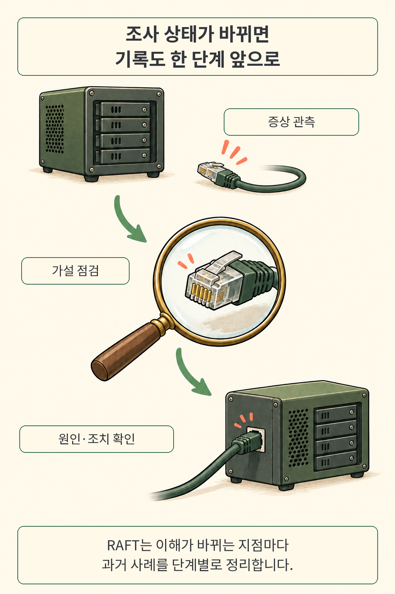
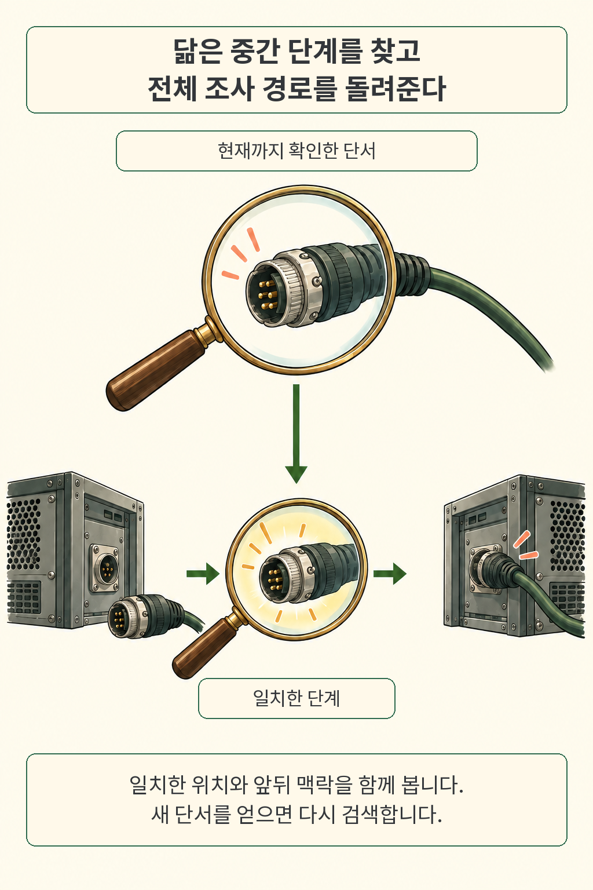
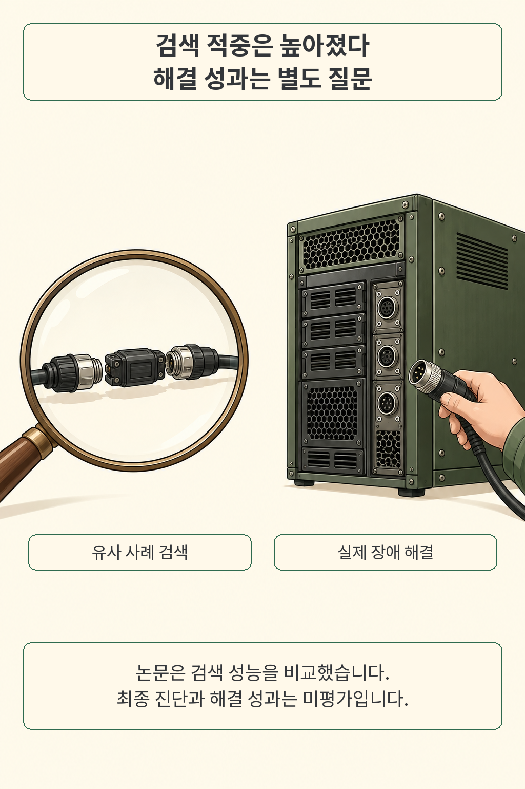
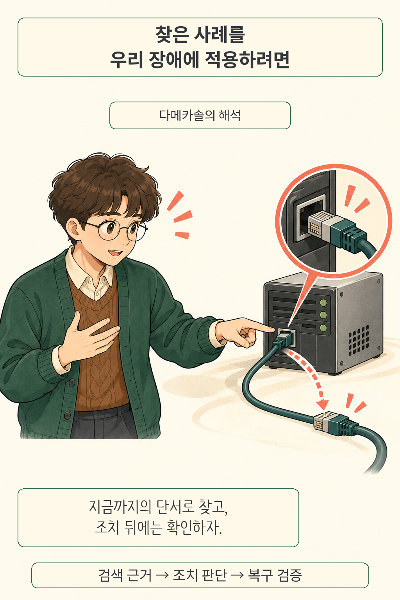

**장애 대응 RAG에서는 검색 질의에 지금까지 확인한 조사 상태를 함께 담는 것이 중요합니다.** 처음 “연결 실패” 알림이 뜬 순간과, 케이블·인증·방화벽을 차례로 점검해 정상임을 확인한 뒤에 찾아야 할 과거 장애 사례는 서로 다르기 때문입니다. RAFT(*Retrieval-Augmented Framework for Troubleshooting Agents*, 분산 합의 알고리즘 Raft나 미세조정 기법 RAFT와는 별개) 연구팀은 과거 장애 이력을 조사 단계별 타임라인으로 구조화해 검색하고, 일치한 중간 단계와 그 사례의 전체 조사 경로를 함께 돌려주는 프레임워크를 제안했습니다.

글·해설: 다메카솔

## 핵심 내용

- **조사 단계 단위의 타임라인 색인**: 과거 장애 기록을 단순 글자 수로 자르는 대신, 증상 보고·가설 추가와 기각·원인 확인·조치 검증처럼 문제 이해가 바뀐 시점마다 타임라인 항목을 만듭니다.
- **중간 단계 검색과 전체 경로 반환**: 의미 유사도와 BM25(단어 검색) 순위를 RRF로 결합해 현재 조사 상태와 맞닿은 중간 단계를 찾고, 에이전트에게는 일치 지점과 요약된 앞뒤 조사 경로를 문맥 예산 안에서 함께 돌려줍니다.
- **합성 사례 및 Apache Jira 검색 적중률 향상**: Windows Server 기반 합성 사례(전체 826건, 5회 반복 평균)에서 유사 원인·해결 사례를 찾은 비율(Case Hit)이 최초 증상 시점(0%) 기준 일반 RAG **67.3%**에서 RAFT **84.2%**로 올랐고, 소규모 Apache Jira 평가(30개 질문 그룹, 색인 600건)에서도 0% 시점 **66.7% → 83.3%**로 같은 방향의 개선을 보였습니다(최종 복구 성공률과 엔지니어 생산성은 후속 검증 과제).

## 장애 이력의 어느 부분을 검색할까

최초 증상이 똑같이 ‘연결 실패’였더라도 조사가 진행되며 얻는 단서는 시점마다 달라집니다. 인증에는 문제가 없다는 사실을 방금 확인했다면, 인증 오류 사례가 아니라 그다음 의심 지점을 다룬 과거 사례가 필요합니다.

저자들은 종료된 과거 장애 기록을 읽으며 **문제를 이해하는 상태가 바뀔 때마다 새로운 타임라인 항목**을 생성합니다. 증상 보고, 가설 수립과 기각, 근본 원인 확인, 조치 검증이 단계의 경계가 되며 단순 인사말이나 확인 답장은 해당 단계에 흡수합니다. ([논문 4.1절](https://arxiv.org/html/2609.20754v1#S4.SS1))

이 구조화 과정에서는 작업자 에이전트가 순서대로 입력을 읽으며 사례 상태를 갱신하고, 마지막 검토자가 원문과 수정 이력을 대조합니다(설계상 긴 기록은 여러 번 나누어 처리할 수 있도록 되어 있으나 이번 실험의 짧은 사례들은 단일 호출로 처리했으므로, 훨씬 긴 운영 로그에서의 추출 품질은 별도 확인이 필요합니다). ([부록 B](https://arxiv.org/html/2609.20754v1#A2))

## 중간 단서로 찾되 앞뒤 맥락도 가져온다

검색할 때는 타임라인의 각 단계 항목을 개별 검색 단위로 삼습니다. 임베딩 의미 유사도와 BM25 키워드 검색 순위를 상호 순위 융합(RRF)으로 합친 뒤 동일 사례의 중복을 제거하고, 정해진 문맥 예산 안에서 반환할 사례를 고릅니다.

이때 에이전트가 받는 결과에는 **현재 상태와 일치한 중간 단계의 위치뿐 아니라 요약된 전체 조사 경로**가 함께 담깁니다. 원시 대화 전문을 그대로 쏟아붓는 대신, 과거 사례에서 왜 그 가설을 세웠고 어떤 점검을 거쳐 기각·확정했는지 앞뒤 맥락을 함께 읽게 해 주는 구조입니다(사례 간 유사 원인·절차를 잇는 그래프 확장 기능도 선택적으로 지원하지만, 부록 C.5 비교에서 핵심 적중률 향상의 주원인이기보다 관련 근거를 넓히는 보조 기능으로 설명됩니다). ([논문 4.2절·부록 C.5](https://arxiv.org/html/2609.20754v1#S4.SS2))

## 높아진 것은 유사 사례를 찾은 비율

연구팀은 두 가지 데이터셋에서 검색 적중률(**Case Hit**, 같은 원인·해결 그룹에 속한 사례를 1건 이상 찾은 질문 비율)을 비교했습니다. 첫 번째는 Microsoft Learn의 Windows Server 문서를 바탕으로 만든 합성 사례 826건(원인 그룹마다 1건을 질의로 뽑고 나머지를 색인하는 구성을 5회 반복, 반환 문맥 최대 6,000토큰·최대 5건, `text-embedding-3-large` · 색인 `gpt-5.2` · 평가 `gpt-5.4` 공통 사용)이고, 두 번째는 사람이 중복 이슈로 연결한 실제 Apache Jira 이슈(질문 그룹 30개, 정답 30건+방해 사례 570건=색인 600건, 문맥 한도 5,000토큰·최대 5건, 5개 색인 시드 평균)입니다. ([논문 5절·표 1·2·4·부록 C.3·D](https://arxiv.org/html/2609.20754v1#S5))

| 조사 진행 시점 | 합성 사례 일반 RAG | 합성 사례 RAFT | Apache Jira 일반 RAG | Apache Jira RAFT (유효 질문 수) |
| --- | ---: | ---: | ---: | --- |
| **0% (최초 증상만 제공)** | 67.3% | **84.2%** | 66.7% | **83.3%** (30개) |
| **30% (초기 조사 반영)** | 71.9% | **87.1%** | 66.7% | **84.0%** (30개) |
| **60% (중반 조사 반영)** | 76.9% | **88.8%** | 78.9% | **89.5%** (19개 — 정답 노출 전 이력이 충분한 그룹만 평가) |

합성 사례의 원인 그룹 단위 부트스트랩 분석에서 Case Hit 차이는 세 시점 모두 양의 95% 신뢰구간을 보였습니다. 다만 후기 단계에서 반환된 문맥 안에 원인 설명·조치 절차가 포함됐는지 따진 비율 차이는 신뢰구간에 0을 포함했고, Jira 평가 역시 60% 시점에서는 정답이 미리 드러나지 않은 19개 그룹만 남아 소규모 방향성 근거로 읽어야 합니다.

이 글을 준비하며 2026년 9월 20일 Microsoft 공식 저장소의 고정 커밋(`29dcb429`)에서 공개된 Jira 데이터 파일을 직접 검수해 색인 600건, 질문 30건, 시점별 유효 표시(30·30·19건), 그리고 질문 이슈 키와 색인 키가 겹치지 않음을 확인했습니다(합성 데이터셋은 저장소에 포함돼 있지 않으며, 모델 임베딩·추출 재실행은 수행하지 않았습니다). ([고정된 공식 저장소](https://github.com/microsoft/RAFT/tree/29dcb42967b70db2f9bffb99c82d30adfbc8a8ed))

## 다메카솔의 해석: 당시의 단서로 다시 시험하기

사내 장애 대응 RAG를 평가할 때 흔히 저지르는 실수는 **장애가 다 끝난 뒤 작성한 사후 분석서(Postmortem) 요약문을 검색 질의로 넣는 것**입니다. 사후 분석서에는 이미 밝혀진 근본 원인이 적혀 있어 검색기가 쉽게 정답을 찾지만, 실제 장애 한복판에 있는 당직 엔지니어는 초기 증상과 기각된 가설 몇 개만 들고 있기 때문입니다. 과거 장애 티켓에서 해결 답안을 가린 채 조사 시점별(0%·30%·60%) 질의를 만들어 테스트해 봐야 실전 검색 품질을 알 수 있습니다.

또한 유사 사례를 잘 찾아왔더라도 실제 조치를 실행하기 전에는 현재 서비스 버전과 권한, 의존성이 그때와 같은지 확인하는 승인 경계가 필요합니다([RCA 에이전트의 과정 증거를 다룬 글](/posts/llm-agent-rca-trajectory-evidence/) 참고). 과거 티켓을 단계별로 색인하는 초기 LLM 비용과 반복 검색 빈도를 함께 따져 보고, 검색 적중률 너머 **그 검색 결과가 다음 점검 명령을 어떻게 바꿨는지**까지 함께 기록해 보기를 권합니다.

## 출처

- Mingxuan Zhang 외, [RAFT: A Stateful Retrieval-Augmented Framework for Troubleshooting Agents, arXiv:2609.20754v1](https://arxiv.org/abs/2609.20754v1). 2026년 9월 17일 제출(EMNLP 2026 Industry Track 채택 표기).
- [원문 PDF](https://arxiv.org/pdf/2609.20754v1) 및 [HTML 본문](https://arxiv.org/html/2609.20754v1): 방법 4절, 실험 5절, 부록 B·C·D.
- Microsoft, [RAFT 공식 코드와 Jira 데이터 (`29dcb429`)](https://github.com/microsoft/RAFT/tree/29dcb42967b70db2f9bffb99c82d30adfbc8a8ed): 2026년 9월 20일 파일 구성 및 데이터 분리 조건 확인.

자료 확인 및 글 업데이트: 2026년 9월 20일.

이 글의 본문과 이미지는 생성형 AI로 제작했습니다. 기획과 편집 기준은 다메카솔이 정했습니다.
