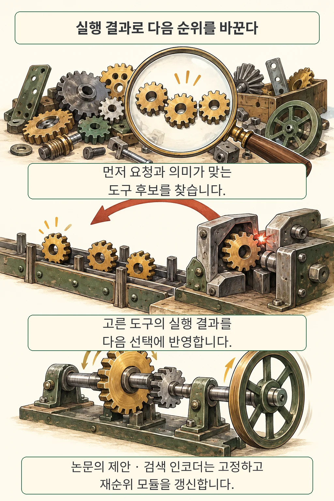
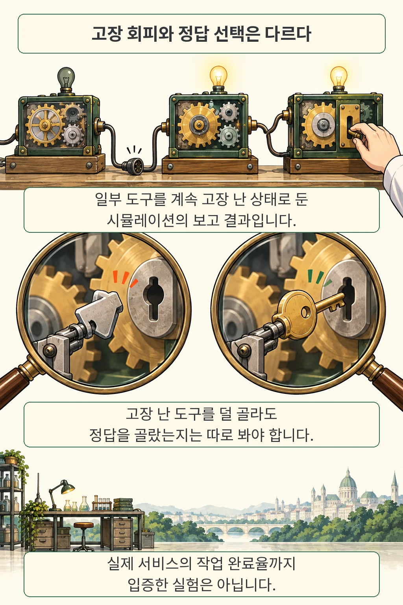
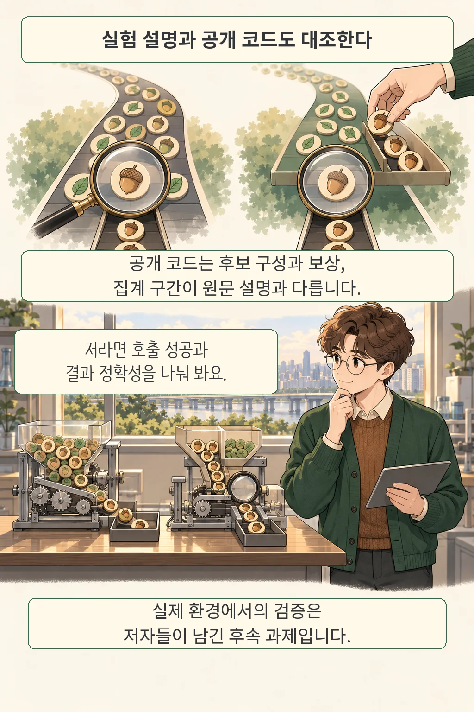

글·해설: 다메카솔

도구 설명이 요청과 잘 맞으면 에이전트도 일을 끝낼 것이라 기대하기 쉽습니다. 그런데 호출 대상이 멈춰 있으면 같은 추천이 같은 실패로 이어집니다. **RATED는 의미 검색 뒤에 실행 피드백을 반영하는 재순위 단계를 붙이는 연구**입니다. 설계 아이디어는 살펴볼 만하지만, 장애 실험의 수치와 실제 서비스에서의 효과 사이에는 확인할 거리가 남아 있습니다.

## 실행 결과가 다음 선택에 돌아오게 한다

검색기가 실패를 알아야 다음 선택도 달라집니다. 저자들은 DRAGON 인코더를 미세조정한 뒤 고정하고, 의미 검색 상위 10개에 질의 맥락·도구 메타데이터·실행 이력을 반영한다고 설명합니다. 선택한 도구의 결과만 관측하며, discounted LinUCB라는 순위 조정 방법으로 오래된 관측의 비중을 낮춥니다. [원문 §3](https://arxiv.org/html/2610.13889v1#S3)

저는 이 분업에 주목했습니다. 일시적인 호출 장애 때문에 언어 모델 전체를 다시 학습시키기보다, 호출 결과가 선택 단계로 돌아갈 경로를 마련하는 접근입니다. 서버 처리와 에이전트의 작업 계획을 구분했던 [HEAR의 역할 분담](/posts/hear-harness-engine-coordination/)과 함께 읽으면 시스템의 어느 부분을 바꿀지 생각하기 좋습니다.

## 논문이 보고한 성능의 범위

도구를 피했는지와 정답을 골랐는지는 서로 다른 질문입니다. EcoAgent는 도구 정의 5,172개를 모은 자료이며, EcoAgent-Real의 질의 6,379개는 ToolBench에서 가져와 도구와 연결했습니다. 이 연결은 자동 검색과 모델 판정을 거쳤고, 사람이 본 표본 200개에서는 판정 일치율 94%를 보고했습니다. 운영 호출을 그대로 모은 장애 로그와는 구분해야 합니다. [원문 §2](https://arxiv.org/html/2610.13889v1#S2)

정적 검색에서 정답의 순위를 반영하는 MRR은 RATED 0.618, ToolLLM 0.406, Ada-002 0.670입니다. 초록의 52.2% 향상은 ToolLLM 대비 상대 개선으로, 전체 비교 대상 중 최고라는 뜻은 아닙니다. [표 1](https://arxiv.org/html/2610.13889v1#S4.T1)

장애 실험에서는 일부 도구를 계속 사용할 수 없게 만들었습니다. 저자들은 등장 빈도 상위 10%를 건너뛴 뒤 다음 일정 비율의 정답 도구를 장애 대상으로 정하고, 총 10,000단계 중 장애 후 2,001~5,000단계의 선택 3,000회를 집계한다고 설명합니다. 아래는 **도구 30%에 장애를 주입한 조건의 저자 보고치**입니다. 요청마다 무작위로 30%가 실패하는 설정과는 다릅니다. [원문 §4.2·표 2](https://arxiv.org/html/2610.13889v1#S4)

| 방법 | 고장 도구 선택률 ↓ | 정답이면서 사용 가능한 도구 선택률 ↑ |
| --- | ---: | ---: |
| ToolLLM | 86.2% | 10.5% |
| 한 번 실패하면 차단 | 1.9% | 80.2% |
| 최대 3개 후보 재시도 | 19.1% | 82.9% |
| RATED | 2.9% | 82.1% |

고장 회피만 보면 단순 차단도 강합니다. 이 표는 여러 지표를 함께 읽을 이유를 보여줍니다. 고장 선택률의 나머지 97.1%를 실제 업무 완료율로 바꾸어 말할 근거는 없습니다.

## 공개 코드가 같은 실험을 실행할까

2026년 10월 12일 확인한 공개 평가 스크립트에는 원문 설명과 차이가 있습니다. 고정 커밋 `bc5db40`의 코드는 정답 라벨로 후보를 구성하며, 장애 대상 여부도 후보 선택에 사용합니다. 원문이 설명한 전체 도구의 의미 검색 상위 후보와 구성이 다릅니다. 보상에는 성공 시 1, 장애 시 -2를 포함한 혼합값을 쓰고, 장애 후 성공률은 첫 1,000단계, 고장 선택률은 이후 전체 구간을 집계합니다. [해당 코드 180~308행](https://github.com/Elliotes/EcoAgent/blob/bc5db40a20b254c5249401d2220ea71b06c86a5c/scripts/evaluation/evaluate_rated_full.py#L180-L308)

그래서 현재 코드를 그대로 실행하면 논문 표가 재현된다고 약속하기 어렵습니다. 이번 글에서는 모델을 재학습하거나 성능 실험을 다시 돌리지 않았으며, 차이가 논문 결과 전체를 무효로 만든다고 판단하지도 않습니다. 저자들은 새 도구에 대한 평가와 실제 에이전트 환경 검증을 후속 과제로 남겼습니다. [결론](https://arxiv.org/html/2610.13889v1#S5)

## 다메카솔의 해석: 실패 신호부터 나누고 싶습니다

저라면 도구를 바꾸는 규칙보다 **무엇을 실패로 기록할지**부터 정하겠습니다. 일시적인 서버 장애, 잘못된 인자, 권한 부족을 모두 같은 점수로 낮추면 정상 도구도 후보에서 밀려날 수 있기 때문입니다. 특히 권한 거부는 다른 경로로 돌아서 실행하라는 신호로 취급해서는 안 됩니다. 이 부분은 논문의 성능 결론과 별개인 제 설계 판단입니다.

호출이 성공했어도 결과가 틀릴 수 있습니다. 도구 선택의 적합성, 호출 가용성, 응답 내용의 정확성, 최종 요청 완료를 따로 관측해야 어디서 개선됐는지 알 수 있습니다. 결제나 문서 수정처럼 부작용이 있는 호출이라면, 대체 도구를 선택하기 전에 앞선 요청이 이미 반영됐는지도 확인해야 합니다.

이 연구에서 가져올 것은 실패 피드백을 선택 과정에 연결한다는 질문입니다. 실제 도입을 검토한다면 기존 재시도·차단 정책과 동일한 요청 묶음에서 비교하고, 회복한 도구를 다시 후보로 들이는 조건까지 시험하겠습니다. [에이전트 평가에서 실행 설정을 남기는 이유](/posts/agent-evaluation-system-configuration/)도 그 비교의 출발점이 됩니다.

## 출처

- Weiliang Chen, Song Liao, [RATED v1](https://arxiv.org/abs/2610.13889v1), 2026년 10월 9일 제출. arXiv 메타데이터는 CIKM 2026 채택으로 표시합니다.
- [원문 PDF](https://arxiv.org/pdf/2610.13889v1), [HTML](https://arxiv.org/html/2610.13889v1).
- [공식 EcoAgent 저장소의 확인한 리비전](https://github.com/Elliotes/EcoAgent/tree/bc5db40a20b254c5249401d2220ea71b06c86a5c). 코드와 자료 공개 여부를 확인했으며, 독립적인 성능 재현은 수행하지 않았습니다.

확인·작성: 2026-10-12. 그림은 설명을 위한 독자적 비유이며 논문 그림을 복제하지 않았습니다.

이 글의 본문과 이미지는 생성형 AI로 제작했습니다. 기획과 편집 기준은 다메카솔이 정했습니다.
