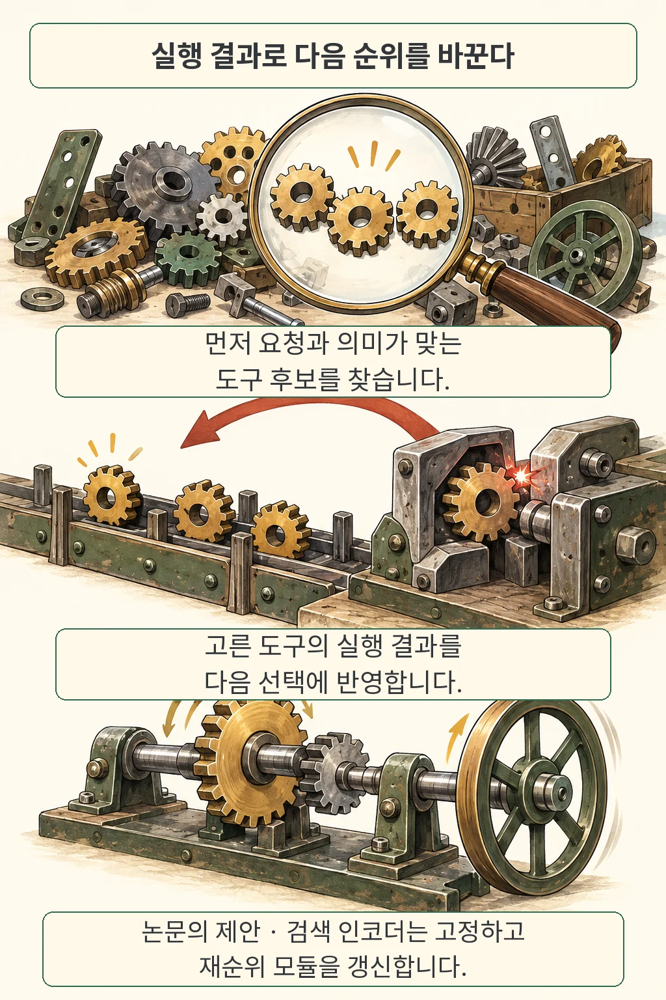

도구 설명이 사용자 요청과 정확히 맞아떨어져도, 호출할 API가 멈춰 있다면 에이전트는 같은 실패를 반복하게 됩니다. 가령 결제나 일정 조회 API 한 곳이 계속 타임아웃을 내고 있는데도 의미 검색기가 설명 문구만 보고 매번 1순위로 추천한다면, 옆에 멀쩡한 대체 도구가 있어도 차례가 돌아가지 않는 셈이죠.

RATED 연구는 이 문제를 풀기 위해 의미 검색 뒤에 실행 결과를 반영하는 가벼운 재순위(re-ranking) 단계를 덧붙입니다. 다만 논문의 장애 실험 수치와 공개된 평가 코드 사이에는 도입 전 짚어 볼 구현 차이도 남아 있습니다.

글·해설: 다메카솔

## 핵심 내용

- **검색과 신뢰성 판단의 분리**: 미세조정 뒤 고정한 DRAGON 인코더로 상위 10개 후보를 추리고, 실행 이력과 메타데이터를 더해 순위만 다시 매깁니다.
- **고장 회피와 정답 선택의 균형**: 도구 30%에 고정 장애를 주입한 실험에서 RATED는 고장 도구 선택률 2.9%, 장애 후 정답·가용 도구 선택률 82.1%를 기록했습니다.
- **논문 설명과 공개 코드의 차이**: 공식 평가 스크립트는 후보 풀 구성, 보상 함수, 집계 구간이 본문 설명과 달라 표 수치를 그대로 재현하기 어렵습니다.

## 실행 결과가 다음 선택에 돌아오게 한다

도구 검색기가 방금 난 호출 실패를 알아야 다음 요청에서 다른 후보를 앞으로 끌어올 수 있습니다. [원문 방법론](https://arxiv.org/html/2610.13889v1#S3)에 따르면 RATED는 합성 데이터(EcoAgent-Syn)로 DRAGON 인코더를 대조 학습해 고정하고, 추론 때는 의미 검색 상위 10개 후보만 다시 정렬합니다. 외부 API 장애가 날 때마다 모델이나 검색 인코더 전체를 재학습하는 대신, 가벼운 순위 계층으로 실행 피드백을 돌리는 접근입니다.

재순위 단계에서는 질의 임베딩 맥락, 메타데이터 초기 점수, 호출 성패 이력을 함께 계산합니다. 이때 실제로 호출한 도구의 결과만 관측해 **discounted LinUCB**를 갱신하고, 오래된 기록의 비중은 점차 낮춰 최근 장애에 빠르게 반응하도록 설계했죠. 이력이 없는 새 도구는 이름·설명 일치도와 출처 신뢰도로 초기 점수를 채우며, 순위 계산의 추가 지연은 1ms 미만이라고 보고합니다. 추론과 실행 제어를 분리했던 [HEAR의 하네스·엔진 협업 구조](/posts/hear-harness-engine-coordination/)와 나란히 보면 장애 대응 계층을 나누는 기준을 잡기 좋습니다.

## 논문이 보고한 성능의 범위

성적표를 볼 때는 **‘고장 난 도구를 피했는가’와 ‘요청에 맞는 정답 도구를 골랐는가’**를 나누어 읽어야 합니다. 저자들이 만든 [EcoAgent 벤치마크](https://arxiv.org/html/2610.13889v1#S2)는 상용 서비스의 실시간 장애 로그가 아니라 공개 도구 정의와 가공 질의를 결합한 모의 환경입니다.

- **데이터셋 구성**: LangChain·CrewAI·LlamaIndex·n8n의 도구 5,172개로 합성 학습 질의 69,501개(양성 70,122·음성 140,244쌍)를 만들었고, EcoAgent-Real은 ToolBench 질의 6,379개를 9,946쌍에 연결했습니다(200개 검수 표본 일치율 94%).
- **정적 검색 성능(MRR)**: EcoAgent-Real 기준 RATED `0.618`, ToolLLM `0.406`, OpenAI Ada-002 `0.670`이었습니다. 초록의 ‘52.2% 향상’은 ToolLLM 대비 상대 개선폭인 셈이죠.
- **장애 주입 규칙**: 전체 10,000단계 중 빈도 상위 10% 도구를 건너뛴 뒤 다음 일정 비율(20%·30%)의 정답 도구를 **계속 실패하는 고정 장애 집합**으로 두고, 장애 시작 후 2,001~5,000단계(3,000회)를 집계했습니다.

여기서 가정한 30% 장애는 매 호출마다 무작위로 실패가 나는 확률 설정과 다릅니다. 특정 도구가 아예 멈춰 버린 지속 장애 조건에서 [논문 4장 표 2](https://arxiv.org/html/2610.13889v1#S4)가 보고한 비교 수치를 표로 정리했습니다.

| 방법 | 고장 도구 선택률 ↓ | 장애 후 정답·가용 도구 선택률 ↑ |
| --- | ---: | ---: |
| ToolLLM API Retriever | 86.2% | 10.5% |
| 한 번 실패 시 영구 차단 (Blacklist) | 1.9% | 80.2% |
| 최대 3개 후보 재시도 (Retry k=3) | 19.1% | 82.9% |
| RATED (Full) | 2.9% | 82.1% |

한 번 실패한 도구를 영구 차단하는 방식도 고장 도구 선택률은 가장 낮았고, 최대 세 후보를 재시도하는 방식은 정답·가용 선택률에서 근소하게 앞섰습니다. 게다가 RATED가 고장 도구를 고른 비율을 100%에서 뺀 나머지 값을 곧바로 ‘실제 과제를 끝까지 완수한 비율’로 치환하기도 어렵거든요. 두 지표를 함께 보아야 고장 회피와 정답 선택의 균형을 정확히 읽을 수 있습니다.

## 공개 코드가 같은 실험을 실행할까

논문 수치만큼 꼼꼼히 봐야 할 자료가 공식 저장소에 공개된 [평가 스크립트](https://github.com/Elliotes/EcoAgent/blob/bc5db40a20b254c5249401d2220ea71b06c86a5c/scripts/evaluation/evaluate_rated_full.py#L180-L308)입니다. 본문 알고리즘 설명과 실제 스크립트 구현을 대조해 보면 세 가지 중요한 차이가 드러나는데요.

| 비교 항목 | 논문 본문 설명 | 공개 평가 스크립트 (180~308행) |
| --- | --- | --- |
| 후보 구성 | 전체 도구 의미 검색 상위 10개 재순위 | 정답 라벨·장애 여부를 참조해 후보 풀 구성 |
| 보상 함수 | 실행 성공·실패 이진 보상 (`0` / `1`) | 성공 `1`, 장애 `-2` 등을 섞은 혼합 보상 |
| 집계 구간 | 장애 후 2,001~5,000단계(3,000회) 평균 | 성공률은 첫 1,000단계, 고장률은 장애 후 전체 구간 |

이 차이 때문에 공개 스크립트를 그대로 실행해 논문 표와 같은 수치를 얻기는 어렵습니다. 보고된 성능은 논문 본문의 실험 조건에 묶어서 읽어야 하며, [논문 결론](https://arxiv.org/html/2610.13889v1#S5)에서도 새 도구가 들어오는 cold-start 평가와 실제 에이전트 런타임 검증은 향후 과제로 남겨 두었습니다.

## 다메카솔의 해석: 실패 신호부터 가려야 합니다

실무 시스템에 이런 재순위 계층을 얹으려면, 점수 수식보다 **‘무엇을 도구 장애로 기록할 것인가’**부터 가려내야 합니다. 운영 환경에서는 실패 원인이 제각각이라서, 이를 같은 실패 점수로 묶으면 멀쩡한 도구가 밀려나거나 위험한 우회가 생기기 쉽거든요.

- **일시적 서버·네트워크 장애 (`503`, 타임아웃)**: 도구 가용성 문제이므로 백오프 재시도나 대체 도구로 순위를 넘길 신호입니다.
- **모델의 인자 생성 오류 (`400 Bad Request`)**: 도구 고장이 아니라 LLM이 스키마를 잘못 채운 경우여서, 순위를 깎기보다 프롬프트·스키마 검증을 고쳐야 합니다.
- **권한 부족 (`403 Forbidden`)**: 접근 제어 결과이므로 다른 도구로 우회하지 말고 즉시 멈춘 뒤 권한을 확인해야 합니다.

호출이 `200 OK`로 성공했더라도 반환 데이터까지 항상 정확하다고 장담하기는 어렵습니다. 실무에서는 **도구 선택 적합성, API 가용성, 반환 데이터 정확성, 최종 요청 완수 여부**를 따로 관측해야 원인을 짚을 수 있고, 결제·문서 수정처럼 부작용이 남는 작업은 대체 도구를 부르기 전에 앞선 요청의 멱등성부터 확인해야 하죠. 도입을 검토할 때는 기존 서킷 브레이커·재시도 정책과 같은 요청 묶음에서 효과를 비교하고, 복구된 도구를 다시 후보로 받아들이는 기준까지 시험해 볼 필요가 있습니다. 이런 실행 맥락 기록은 [에이전트 평가에서 실행 설정을 함께 남겨야 하는 이유](/posts/agent-evaluation-system-configuration/)와도 맞닿아 있습니다.

## 출처

- Weiliang Chen, Song Liao, [RATED v1](https://arxiv.org/abs/2610.13889v1), 2026년 10월 9일 제출(arXiv 메타데이터 기준 CIKM 2026 채택).
- [원문 PDF](https://arxiv.org/pdf/2610.13889v1) · [원문 HTML](https://arxiv.org/html/2610.13889v1)
- [공식 EcoAgent 저장소(2026년 10월 12일 확인 시점)](https://github.com/Elliotes/EcoAgent/tree/bc5db40a20b254c5249401d2220ea71b06c86a5c) · [평가 스크립트 `evaluate_rated_full.py`](https://github.com/Elliotes/EcoAgent/blob/bc5db40a20b254c5249401d2220ea71b06c86a5c/scripts/evaluation/evaluate_rated_full.py#L180-L308)

자료 확인·작성: 2026-10-12. 이 글은 논문 원문과 공식 저장소 코드를 바탕으로 해설했으며 실험을 독립 재현하지 않았고, 본문 이미지는 설명을 위해 새로 구성했습니다.

이 글의 본문과 이미지는 생성형 AI로 제작했습니다. 기획과 편집 기준은 다메카솔이 정했습니다.
