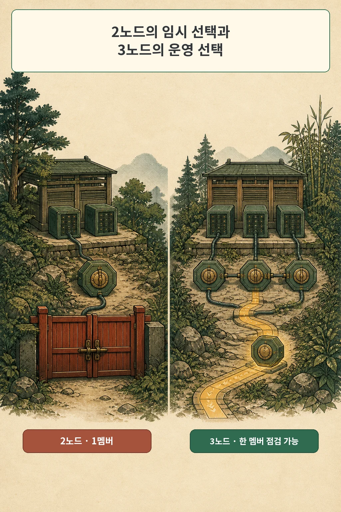
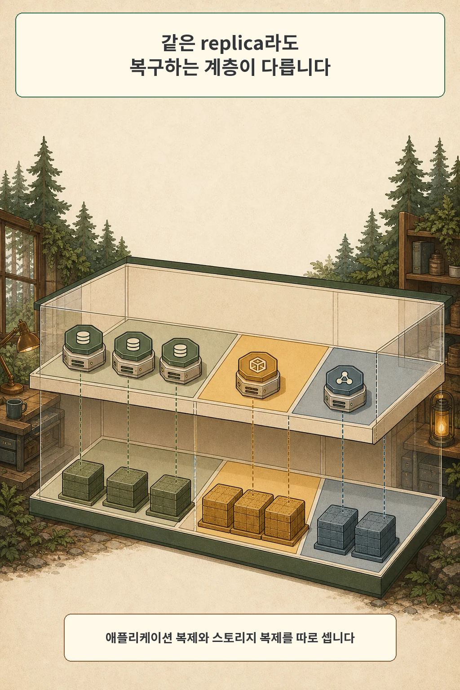

---
title: "replica 1은 같은 뜻이 아니었습니다: Vault PDB 앞에서 멈춘 drain"
description: "단일 Vault를 보호한 PDB의 중단 예산 0에서 kubectl drain이 멈춘 사건과 애플리케이션·스토리지 복제를 따로 설계한 기록입니다."
searchTitle: "Kubernetes drain이 PDB maxUnavailable 0에서 멈춘 이유"
slug: "replica-layer-pdb-drain"
publishedAt: 2026-09-06
updatedAt: "2026-10-18"
track: tech_column
subtype: case_study
category: development_episode
series:
  slug: homelab-k8s
  title: "홈랩 쿠버네티스 구축기"
  order: 6
tags:
  - "홈랩"
  - "Kubernetes"
  - "K3s"
  - "고가용성"
  - "스토리지"
audience: developer
readerOutcome: "애플리케이션 복제와 스토리지 복제를 따로 세고, drain 전에 PDB 중단 예산과 실제 복구 주체를 확인한다."
contentFormats:
  - article
  - comic
  - diagram
  - checklist
freshnessStatus: current
reviewedAt: 2026-08-09
reviewAfter: 2027-02-09
cover: "./cover.webp"
coverAlt: "남성 카솔이 멈춘 노드 점검 레버와 복제 계층을 살피는 표지"
sourceUrl: "urn:internal:homelab-k8s:pdb-drain-2026-07-14"
featured: false
draft: false
---

글·해설: 다메카솔

2026년 7월 14일, 2노드 홈랩을 3노드로 다시 세우던 중 노드 한 대를 비우려고 `kubectl drain`을 실행했습니다. 그런데 화면은 `evicting pod vault-0`에서 멈춰 서더니 오류로 끝나지도, 다음 파드로 넘어가지도 않았습니다.


> 이 글은 당시 실패 패턴 원장 H-05와 이후의 복제 정책 ADR을 2026년 8월 9일에 다시 대조해 쓴 회고입니다. 사설 주소와 호스트명은 뺐고, 정확한 차트 패치 버전은 기록이 없어 확정하지 않습니다.

## 핵심 내용

- **멈춘 이유**: 2노드 환경에서 Raft 합의 이점이 없어 Vault를 단일 멤버(`replica: 1`)로 띄웠더니, Helm 차트 템플릿이 PodDisruptionBudget(PDB)의 `maxUnavailable: 0`을 자동 계산해 자발적 축출(eviction)을 모두 막았습니다.
- **설정과 렌더 결과의 차이**: `values.yaml`에서 값을 고쳐도 차트 helper가 단일 replica 조건을 우선 계산했으므로, `helm template` 결과와 클러스터의 `disruptionsAllowed` 값을 직접 확인해야 했습니다.
- **복제 계층의 분리**: 애플리케이션 계층 복제(CloudNativePG 스트리밍 복제, Vault 3멤버 Raft)와 블록 스토리지 계층 복제(Longhorn replica)는 복구 주체가 다르므로, 두 수를 무조건 같게 두면 복제 경로가 곱해집니다.

## 두 노드에서 하나만 띄운 이유와 멈춰 선 drain

당시 Vault replica를 하나로 둔 것은 고가용성을 포기해서가 아니라, 2노드 환경에서 Raft 멤버를 둘로 만드는 편이 실익이 없다고 판단했기 때문입니다. 멤버가 둘이면 과반수도 둘이어서 한 노드만 빠져도 합의를 이어 갈 수 없고, 장애 허용 수는 그대로인 채 관리할 멤버만 늘어납니다.

그래서 3노드가 준비되기 전까지 Vault를 하나만 두었는데, Helm 차트가 그 replica 수를 보고 PodDisruptionBudget의 `maxUnavailable`을 0으로 계산했습니다.

```yaml
spec:
  maxUnavailable: 0
```

Kubernetes 공식 문서가 설명하듯 `maxUnavailable: 0` 또는 `minAvailable: 100%`이면 자발적 축출(voluntary eviction)을 단 하나도 허용하지 않아 해당 노드의 drain이 끝나지 않을 수 있습니다.


결국 제가 마주한 멈춤은 장애가 아니라 정책 집행이었습니다. `drain`이 노드를 스케줄 불가로 만들고 eviction API로 파드를 내보내려 하자, API는 PDB의 허용 중단 수 0을 존중해 그 자리에서 대기한 것입니다.

## values를 바꿨는데도 0이 남았습니다

처음에는 `values.yaml`에서 PDB 값을 바꾸면 다음 렌더에서 1이 나올 거라고 생각했습니다. 하지만 당시 차트 helper는 replica가 하나면 내가 바꾼 값보다 템플릿 계산을 우선해 `maxUnavailable: 0`을 그대로 출력했습니다. 이 지점에서 Git에 적힌 설정 파일과 클러스터에 실제로 들어간 렌더 결과를 나누어 확인해야 했습니다.

```bash
helm template <release> <chart> -f values.yaml \
  | yq 'select(.kind == "PodDisruptionBudget")'

kubectl get pdb -A
kubectl describe pdb <pdb-name> -n <namespace>
```

특히 `disruptionsAllowed`가 0인지 먼저 보면 `drain`이 대기하는 이유를 빠르게 좁힐 수 있습니다. 당시 선택지는 점검 시간을 잡고 PDB를 잠시 지우거나 `--disable-eviction`으로 eviction API를 우회하는 두 가지였는데, 둘 다 단일 Vault 파드가 내려가는 동안 서비스 중단을 감수하겠다는 운영 승인이었습니다. 이후 3노드 전환을 마치고 Vault를 3멤버로 늘리자 차트가 `maxUnavailable: 1`을 계산해 한 멤버를 자발적으로 내릴 여유가 생겼습니다.



## 같은 시기에 replica를 한 번 더 셌습니다

비슷한 시기에 `replica: 1`이라는 표기가 Longhorn 볼륨 정책에도 등장해 두 사건이 하나로 보일 수 있지만, Longhorn replica 1이 `drain`을 막은 것은 아니었습니다. 애플리케이션 replica는 서비스를 수행하는 프로세스의 사본이고, 스토리지 replica는 한 볼륨의 블록 사본이어서 복구 대상과 담당자가 서로 다릅니다.

만약 데이터베이스 인스턴스 셋이 3개이고 각 PVC가 다시 Longhorn 블록 사본 3개를 만들면 물리 데이터 경로는 최대 9개로 곱해져 CPU·네트워크·디스크 비용을 모두 치르게 됩니다. 그래서 당시 홈랩에서는 워크로드마다 복제 계층을 다음과 같이 나누었습니다.

| 워크로드 | 애플리케이션 복구 주체 | Longhorn replica | 판단 |
| --- | --- | ---: | --- |
| CloudNativePG | PostgreSQL 스트리밍 복제 | 1 | 애플리케이션 계층에서 이미 복제 |
| Vault | Raft 멤버 | 1 | 3멤버 전환 뒤 애플리케이션 계층이 복제 |
| SeaweedFS 단일 인스턴스 | 없음 | 3 | 볼륨 계층이 노드 실패를 받아야 함 |
| Prometheus·Loki·Tempo | 제한적 재생성·재수집 | 2 | 손실 비용과 저장 비용 사이 절충 |

이 표는 보편적인 권장값이 아니라 당시 홈랩의 결정 기록입니다. 특히 Longhorn 문서가 말하는 $N-1$은 볼륨 replica 실패에 관한 조건일 뿐, 애플리케이션의 정상 응답이나 데이터베이스 승격 일관성까지 자동으로 보장하는 숫자는 아닙니다.



## 숫자보다 먼저 적을 세 문장

이 일을 겪은 뒤로는 replica 설정 칸에 바로 숫자를 넣기 전에 세 가지 질문부터 적습니다.

1. 프로세스가 죽었을 때 누가 새 인스턴스를 만들고 데이터를 이어받는가? (애플리케이션 replica)
2. 노드나 디스크가 사라졌을 때 어느 계층이 복구를 맡는가? (스토리지 replica와 실패 도메인)
3. 계획 점검 중 동시에 몇 개까지 멈춰도 되는가? (PDB와 점검 절차)


`replica: 1`이라는 숫자를 발견했을 때 무조건 숫자부터 늘리기보다, 그 숫자가 어느 계층의 사본이며 무엇이 실패했을 때 누가 복구하는지부터 확인하는 편이 정확합니다.

## 함께 읽을 개념 글

- [애플리케이션 복제와 스토리지 복제는 무엇이 다른가](/posts/application-storage-replication-layers/): 두 replica 수가 곱해지는 구조와 결정 순서를 설명합니다.
- [PodDisruptionBudget는 무엇을 보장하나: maxUnavailable 0의 의미](/posts/poddisruptionbudget-zero-eviction/): PDB의 보호 범위와 `disruptionsAllowed`를 읽는 법을 정리합니다.
- [kubectl drain이 멈췄을 때 PDB를 우회하기 전에 확인할 것](/posts/kubectl-drain-pdb-checklist/): 정체 원인과 강제 옵션의 차이를 체크리스트로 묶었습니다.

## 출처

- 개인 인프라 실패 패턴 원장 H-05, 2026-07-14
- 개인 인프라 ADR-033·ADR-034, 2026-07-13~16
- [Kubernetes: Specifying a Disruption Budget for your Application](https://kubernetes.io/docs/tasks/run-application/configure-pdb/)
- [Kubernetes: kubectl drain](https://kubernetes.io/docs/reference/kubectl/generated/kubectl_drain/)
- [CloudNativePG: Replication](https://cloudnative-pg.io/docs/current/replication/)
- [Longhorn 1.12: Architecture and Concepts](https://longhorn.io/docs/1.12.0/concepts/)

공식 문서는 2026년 8월 9일 다시 확인했습니다. 본문 명령과 리소스 이름은 공개 가능한 예시로 바꿨습니다.

이 글의 본문과 이미지는 생성형 AI로 제작했습니다. 기획과 편집 기준은 다메카솔이 정했습니다. 만화 이미지는 텍스트 없는 원화에 결정적 레터링을 합성해 만들었습니다. 공식 로고·UI·문서 도표 등 외부 이미지 자산은 사용하지 않았습니다.
