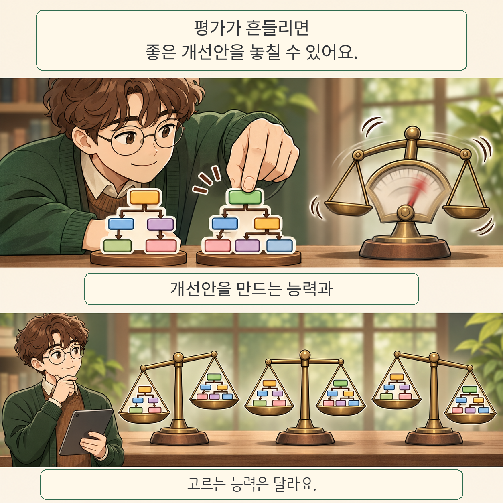

코딩 에이전트가 새 스킬을 만들어 붙인 뒤 평가 점수가 올랐다면, 정말로 실력이 좋아진 걸까요? 같은 스킬을 다시 실행했을 때 결과가 흔들린다면, 애써 만든 좋은 개선안도 선택 단계에서 그대로 놓칠 수 있습니다. 2026년 11월 17일 공개된 사전공개 논문 **The Resolution Hypothesis**는 이 문제를 개선안 생성과 선택으로 나누어 조사했습니다.

글·해설: 다메카솔

## 가중치는 고정하고 외부 틀만 바꾸는 실험

이 연구의 에이전트는 언어 모델 가중치를 그대로 고정해 둡니다. 대신 모델에 건네는 프롬프트, 스킬, 메모리, 실행 흐름을 감싸는 하네스 같은 외부 구성요소만 바꿉니다. 후보를 만들고 실행 결과를 평가해 높은 점수의 후보를 다음 단계에 남기는 순환이 실제로 작동하는지 따져 본 것이죠.

모델 파라미터를 학습시키는 강화학습 대신 외부 구조의 조합만 다루기 때문에, [ModHarness 논문에서 살펴본 실행 틀의 학습](/posts/modharness-learned-agent-scaffold/)과도 맞닿아 있습니다. 영리한 실행 틀을 새로 만들어 내더라도, 평가기가 그 개선을 알아볼 수 있는지는 별개로 확인해야 할 문제거든요.

## 평가 점수가 흔들리는 두 가지 원인

논문은 점수 변동을 두 갈래로 분리합니다. **평가 잡음**은 같은 개선안을 여러 번 반복 실행해도 관측 점수가 달라지는 현상이고, **실행 간 분산**은 개선 과정을 독립적으로 다시 돌릴 때 최종 산출물의 실제 품질이 서로 달라지는 현상입니다. 같은 물건을 올려도 눈금이 출렁이는 저울과, 만들 때마다 품질 자체가 다른 물건을 구분해 보는 셈이죠.

예를 들어 코딩 에이전트의 스킬 문구를 손본 뒤 시험 과제 열 개를 한 번씩 돌려 통과 수가 하나 늘었다고 가정해 봅시다. 이 한 칸의 상승이 진짜 스킬 개선 덕분인지, 모델 응답이 우연히 잘 풀린 덕분인지 단일 실행 점수만으로는 가려내기 어렵습니다. 논문이 말하는 **평가의 해상도**란 이런 흔들림 속에서도 신뢰할 만하게 구별할 수 있는 개선의 크기를 뜻합니다.

## 좋은 후보를 만드는 일과 고르는 일의 격차

저자들은 후보 생성 능력과 후보 선택 능력을 따로 살피기 위해 세 실험을 분리해 설계했습니다. 아래 표처럼 생성 풀의 시험 과제와 선택 풀의 과제는 서로 다른 조건으로 구성되어 있어, 병목이 어디에 걸리는지 단계별로 확인할 수 있습니다.

| 실험 단계 | 구성 및 조건 | 핵심 관찰 결과 |
| --- | --- | --- |
| **후보 생성 풀 (§5.1)** | Terminal-Bench v2.1 학습 10과제 기반 스킬 100개 · 분리된 시험 10과제 · 스킬-과제당 16회 실행 | 모든 후보 품질이 같다고 본 비교선보다 이상적 선택 곡선이 상승해 유용한 스킬의 존재를 확인 |
| **후보 선택 풀 (§5.2)** | Terminal-Bench·DeepSWE 기반 별도 스킬 100개 · Terminal-Bench 11과제 · 선택·추정 실행 분리 | 표 1 기준 실행 1회 쌍별 선택 정확도 **49.7 ± 1.9%** (무작위 50%, 사후평균 95% 신용구간 반폭) |
| **반복 루프 재평가 (§5.3)** | SkillOpt-Lite·GEPA 각각 8회 실행 · 중간 산출물을 산출물-과제당 8회 독립 재평가 | 루프 내부 검증 점수는 상승했으나 독립 재평가에서는 상승 폭이 유지되지 않음 |

먼저 생성 풀에서는 후보를 많이 뽑을수록 운 좋게 높은 점수가 나오는 착시를 걸러 내기 위해, 모든 후보의 실제 품질이 같다고 가정한 비교선을 따로 세웠습니다. 좋은 후보를 고를 수 있다고 가정한 품질 곡선이 이 비교선 위로 올라갔다는 점은, 분리된 시험 과제에서도 실제로 도움이 되는 스킬이 후보 풀에 존재한다는 근거가 됩니다. 다만 이는 유용한 후보가 들어 있다는 뜻일 뿐, 실제 선택기가 그 후보를 찾아냈다는 결과와는 별개죠.

정작 선택 풀로 넘어가면 결과가 확연히 달라집니다. 선택기에 보여 주는 실행과 후보 품질을 추정하는 나머지 실행을 분리해 점수 재사용을 막았을 때, 논문 표 1 기준 실행 한 번 기반의 쌍별 선택 정확도는 **49.7 ± 1.9%**에 머물렀습니다. 두 후보 중 더 나은 쪽을 고르는 확률이 무작위 기준인 50%와 통계적으로 구별하기 어려운 수준으로 떨어진 셈입니다.

여기서 ± 값은 사후평균에 대한 **95% 신용구간의 반폭**이며, 과제 성공률이나 일반 AI 판단 정확도가 아니라 쌍별 선택 지표로 읽어야 합니다. 한편 SkillOpt-Lite와 GEPA의 기본 선택 방식은 후보당 실행 두 번을 관찰하므로, 실행 한 번 방식과는 정보량 조건이 서로 다릅니다.

## 반복 루프에서는 작은 선택 오류가 누적된다

실제 개선 루프는 선택을 여러 라운드에 걸쳐 되풀이합니다. SkillOpt-Lite와 GEPA를 각각 여덟 번 실행해 얻은 중간 산출물을 산출물-과제 조합마다 여덟 번씩 독립 재평가하자, 루프 내부에서 올랐던 검증 점수가 재평가에서는 유지되지 않는 결과가 드러났죠. 우연히 높은 점수를 얻은 후보를 다음 기준선으로 채택하는 일이 반복되면, 기록 점수는 오르는데 실제 개선은 쌓이지 않을 수 있습니다.

물론 이 관찰은 논문에서 조사한 방법과 모델, 과제 설정 아래의 결과이므로 자기개선 전반의 실패로 확대해 보기는 어렵습니다. 후보 수준의 근거는 Terminal-Bench v2.1에 한정되어 있어 더 큰 후보 풀이나 다른 도메인·생성 방식으로의 일반화는 열려 있으며, 가중치 학습이나 결정적 프로그램 진화 방식까지 그대로 적용하기 어렵다는 점도 논문이 짚은 한계입니다.

## 다메카솔의 해석: 만드는 쪽과 고르는 쪽을 나눠 점검하자

실무에서 에이전트 개선이 멈췄을 때 후보를 더 많이 생성하는 쪽부터 늘리려 하기 전에, 선택기가 유용한 차이를 구별할 해상도를 갖추었는지 먼저 살피는 편이 실용적입니다. 개선 루프를 점검할 때는 아래 세 단계를 분리해 확인하면 병목을 훨씬 구체적으로 좁힐 수 있습니다.

- **생성 풀의 잠재력 확인**: 후보 풀 안에 기존 기준선을 넘는 개선안이 실제로 섞여 있는지 선택기와 떼어 점검합니다.
- **선택기의 변별력 검증**: 선택용 실행과 품질 추정용 실행을 분리해, 우연한 고득점이 아니라 진짜 개선안을 남기는지 확인합니다.
- **독립 재평가 유지 여부 추적**: 채택된 산출물이 별도 재실행에서도 점수 상승을 유지하는지 추적해 누적 편차를 걸러냅니다.

논문은 수정 뒤 테스트 실행 여부 같은 중간 행동 지표를 보조 진단 도구로 제안합니다. 이런 지표는 최종 통과·실패 점수보다 행동 변화를 안정적으로 포착하는 데 유용하지만, 체크를 많이 수행한다고 해서 최종 과제 성공까지 자동으로 이어지는 것은 아니거든요. 기존 [Verification Transport 글](/posts/verification-transport-evidence/)이 평가자에게 어떤 근거를 보여 주는지 물었다면, 이번 논문은 평가 점수의 흔들림 속에서 개선을 가려낼 해상도가 충분한지 묻고 있습니다.

## 출처

- [논문 v1: The Resolution Hypothesis](https://arxiv.org/abs/2611.23068v1) — Yuanhao Zeng 외, 2026-11-17. §3.1, §5.1–5.3, 표 1, §6, Limitations.
- [저자 프로젝트 페이지](https://lineshogan.github.io/resolution-hypothesis/) — 실험별 설명과 저자 제공 탐색 도구.

2026년 11월 18일 확인한 논문 원문과 저자 프로젝트 설명을 바탕으로 정리한 해설이며, 실험을 독립적으로 재현하지는 않았습니다(재현 자료와 실행 데이터는 논문 채택 후 공개 예정). 논문 그림을 복제하지 않고 설명용 비유를 새로 그렸으며, 한국어 문구는 별도로 합성했습니다.

이 글의 본문과 이미지는 생성형 AI로 제작했습니다. 기획과 편집 기준은 다메카솔이 정했습니다.
