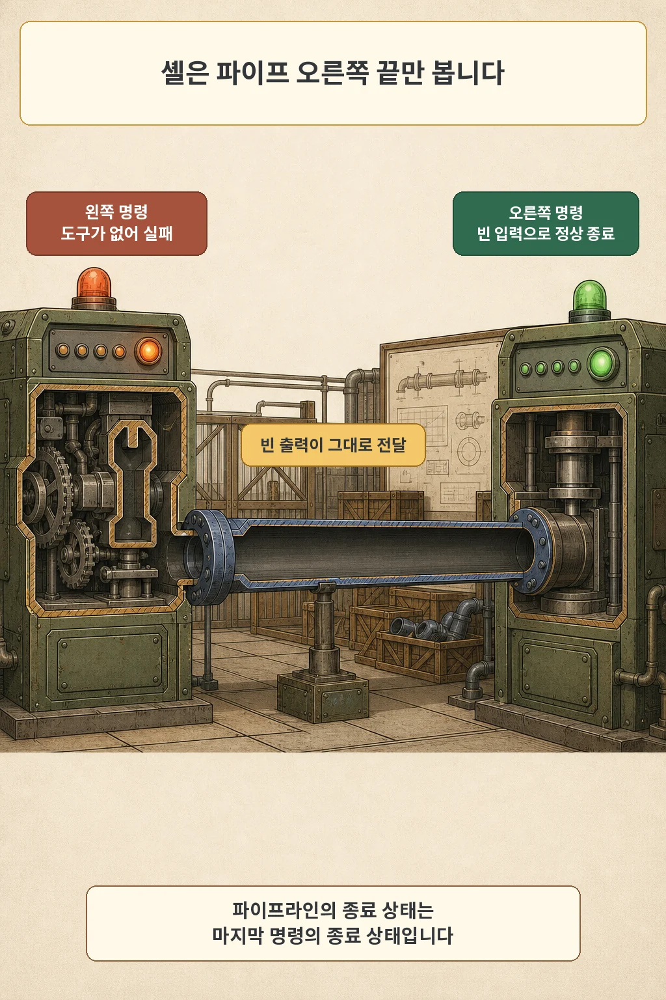

글·해설: 다메카솔

복원 잡(Job)은 종료코드 0으로 끝났고, 마지막 로그 줄은 정합성 검증을 통과했다고 알렸습니다. 그런데 정작 복구 목표 시각 **이전**에 심어 두었던 마커 데이터 하나가 복원본 데이터베이스에 없었습니다.

2026년 7월 10일, 차세대 선불결제 플랫폼의 내부 오픈을 앞두고 첫 시점 복구(Point-in-Time Recovery) 리허설을 진행했습니다. 단일 노드 개발 클러스터에 GitOps 배포 루프를 세우고, 일 1회 논리 백업(full dump)과 15분 주기 binlog 보관 체계 위에서 특정 시각으로 되돌리는 복원 전용 인스턴스를 띄웠습니다.

> 이 글은 2026년 7월 10일 개발 환경에서 수행한 복원 리허설 기록을 바탕으로 구성했습니다. 사내 시스템 이름, 저장소, 사내망 자원은 제외했습니다.

## 핵심 내용

- **거짓 성공(False Success) 현상**: 시점 복구 리허설에서 복원 잡이 종료코드 0과 정합성 검증 통과를 기록했지만, 논리 백업 시점 이후부터 복구 목표 시각 사이에 기록된 두 번째 마커 데이터가 통째로 누락되었습니다.
- **두 겹의 원인**: 복원 잡이 사용한 MySQL 8.0.34 최소 이미지(Oracle Linux 기반 변형)에 `mysqlbinlog` 바이너리가 빠져 있었고, `sh -e` 환경에서 `mysqlbinlog ... | mysql` 파이프라인을 실행해 왼쪽 명령의 실패(종료코드 127)가 오른쪽 `mysql` 클라이언트의 빈 입력 정상 종료(종료코드 0)에 가려졌습니다.
- **해결 및 검증**: 클라이언트 도구가 포함된 Debian 변형 이미지로 교체하고, 실행 전 `command -v mysqlbinlog` 검사 및 중간 파일(`/tmp/binlog-replay.sql`)을 거치는 2단계 적재로 파이프라인을 분리했습니다. 재검증 결과 목표 시각 이전 마커 2개 복원·이후 마커 1개 제외, 정합성 위반 0건, 복원 개시부터 검증 통과까지 38초를 확인했습니다.

## 리허설이 판정하려던 것

백업 파일이 존재하느냐는 질문에는 이미 답이 있었습니다. 이번 리허설이 답해야 할 질문은 **그 백업으로 원하는 시각까지 정확히 되돌아갈 수 있는가**였습니다. 선불결제는 잔액과 원장이 함께 맞아야 하는 도메인이므로, 복원 잡이 끝났다는 말과 실제 데이터를 쓸 수 있다는 말은 다릅니다.

그래서 성공 로그 대신 데이터 자체에 판정 기준을 두었습니다. 복구 목표 시각을 정하고, 그 시각 **이전**에 두 번(전체 백업 전 1회, 전체 백업 후~목표 시각 전 1회), **이후**에 한 번 식별 가능한 마커 기록을 남겼습니다. 시점 복구가 제대로 동작했다면 앞의 두 개는 살아 있고 뒤의 하나는 없어야 합니다.


## 마커 하나가 비어 있었습니다

첫 실행 결과를 대조하자 목표 시각 이전의 두 번째 마커가 보이지 않았습니다. 목표 시각 이후에 넣은 세 번째 마커가 빠진 것은 정상적이었지만, 두 번째 마커는 반드시 복원되어야 하는 기록이었습니다. 그럼에도 잡은 실패를 남기지 않았고 정합성 검증 쿼리도 통과했습니다.

복원본을 자세히 들여다보니 경계가 선명했습니다. 일 1회 논리 백업 파일이 만들어진 시점까지의 데이터만 들어 있고, 그 이후 구간은 통째로 비어 있었습니다. binlog 재생이 일부 깨진 것이 아니라 아예 한 줄도 실행되지 않은 상태였습니다.

## 처음 의심한 시각 계산 가설과 방향의 모순

당시 복원 잡은 UTC 문자열을 파싱해 파일 이름의 시각과 실제 파일 완료 시각을 목표 시각과 대조하는 검사를 여러 겹 두고 있었습니다. 그래서 처음에는 목표 시각과 백업 파일 시각을 비교하는 경계 계산이 한 칸 어긋났을 가능성을 먼저 의심했습니다.

하지만 그 가설이 맞다면 오류는 반대 방향으로 나타났어야 합니다. 목표 시각을 넘겨 재생해서 **이후** 기록(세 번째 마커)이 잘못 남는 쪽이어야지, **이전** 기록(두 번째 마커)이 사라지는 쪽이 될 수는 없었기 때문입니다. 오차의 방향이 맞지 않는다는 점을 확인하고 나서야 binlog 재생 명령 자체를 들여다봤습니다.

## 셸은 파이프 오른쪽 끝만 봅니다

원인은 컨테이너 이미지 구성과 POSIX 셸 파이프라인 동작이 겹친 두 겹의 문제였습니다.

첫째, 복원 잡이 쓰던 MySQL 8.0.34 기본 이미지(Oracle Linux 기반의 축소 변형)에 `mysqlbinlog` 실행 파일이 들어 있지 않았습니다. 공식 이미지 문서에는 어느 태그 변형에 어떤 클라이언트 도구가 빠져 있는지 상세히 적혀 있지 않아 실행 시점에야 부재를 확인했습니다.

둘째, 도구가 없으면 그 자리에서 멈춰야 정상인데 멈추지 않았습니다. 당시 재생 스크립트는 MySQL 공식 매뉴얼의 표준 예시대로 `mysqlbinlog` 출력을 `mysql` 클라이언트로 파이프(`|`)하는 한 줄이었고, 잡의 셸은 `sh -e`로 실행되고 있었습니다. POSIX 셸 규격에서 파이프라인의 종료 상태는 **가장 오른쪽(마지막) 명령의 종료 상태**입니다. 왼쪽에서 `mysqlbinlog: not found`가 발생해도 오른쪽 `mysql` 클라이언트는 빈 표준 입력을 받아 아무 작업 없이 정상 종료(종료코드 0)했고, `sh -e`는 이를 성공으로 간주해 다음 줄의 정합성 검증과 완료 로그 출력까지 그대로 진행했습니다.



이 동작은 데이터베이스 없이도 로컬 `dash`(2026년 8월 4일 재현)에서 그대로 확인됩니다.

```console
$ sh -ec 'mysqlbinlog --stop-datetime="2026-07-10 03:00:00" bin.000001 | cat > /tmp/replay.txt
> printf "다음 줄 도달, 파이프라인 상태=%s\n" "$?"
> printf "복원 입력 크기=%s바이트\n" "$(wc -c < /tmp/replay.txt)"
> printf "정합성 검증 통과\n"'
sh: 1: mysqlbinlog: not found
다음 줄 도달, 파이프라인 상태=0
복원 입력 크기=0바이트
정합성 검증 통과
$ echo $?
0
```

표준 오류에 `not found`가 찍혀도 스크립트 종료코드는 0입니다. 파이프만 제거하면 같은 스크립트가 종료코드 127로 즉시 멈춥니다. `set -o pipefail`로 이 문제를 막을 수도 있지만, 컨테이너 안의 `/bin/sh`가 `dash`로 연결된 환경에서는 해당 옵션을 지원하지 않아(`bash`에서만 수용) 셸 종류에 구애받지 않는 구조적 분리가 필요했습니다.

## 파이프를 끊고 관문을 세웠습니다

같은 날 두 겹의 원인을 함께 걷어냈습니다. 복원 잡 이미지를 클라이언트 도구가 모두 포함된 Debian 변형으로 교체하고, 재생 전에 `command -v`로 도구 존재 여부를 먼저 검사하게 했으며, 파이프라인을 중간 파일을 거치는 두 단계로 나눴습니다.

```sh
command -v mysqlbinlog
mysqlbinlog --start-position="${start_pos}" \
  --stop-datetime="${target_utc}" "$@" > /tmp/binlog-replay.sql
mysql -h "${restore_host}" -uroot < /tmp/binlog-replay.sql
```

이 방식은 MySQL 공식 매뉴얼에서도 파이프 형태와 나란히 안내하는 표준 절차입니다. 두 줄로 나누면 각 명령의 종료 상태가 독립적으로 평가되어, 첫 줄에서 오류가 나는 즉시 `sh -e`가 스크립트를 멈춥니다.


아울러 판정 관문도 강화했습니다. 정합성 검증 쿼리 결과가 하나라도 0이 아니면 종료코드 1로 실패하도록 만들고, 리허설 최종 판정은 반드시 사전 마커와 복원본 데이터를 대조해 내리도록 고정했습니다.

| 리허설 측정 항목 | 실측 결과 | 비고 |
| --- | --- | --- |
| **시점 복구 (수정 후 재검증)** | **38초** (정합성 위반 0건) | 목표 시각 이전 마커 2개 복원, 이후 마커 1개 미포함 확인 |
| **배포 롤백 (서비스 복구)** | **16초** | 장애 선언부터 서비스 응답 복구까지 소요 시간 |
| **배포 롤백 (Git 되돌림 재수렴)** | **5분 40초** | Git revert 후 Argo CD 완전 재수렴까지 소요 시간 |
| **스키마 마이그레이션 포함 배포 sync** | **1분 26초** | 스키마 변경을 포함한 배포 동기화 시간 |


다른 리허설 항목들의 수치가 모두 무난하게 나왔기 때문에, 만약 마커 대조를 생략했다면 복구 항목의 초록색 성공 로그도 그대로 믿고 넘어갈 뻔했습니다.

## 검증 범위와 남은 과제

이번 실측값은 데이터가 거의 없는 단일 노드 개발용 Kubernetes 클러스터(Argo CD v3.4.5, MySQL 8.0.34, ROW 형식 binlog)에서 측정한 결과입니다. 38초라는 복원 시간은 빈 스키마에 가까운 상태의 수치이므로, 실제 운영 데이터 규모와 스토리지 환경에서 목표 시간 안에 들어오는지는 추후 리허설에서 다시 측정해야 합니다. 또한 이번처럼 도구가 통째로 빠진 경우가 아니라 binlog 재생이 **중간에** 끊겼을 때에도 현재의 검증 관문이 빠짐없이 걸러내는지 다음 분기 리허설에서 재현해 볼 계획입니다.

이번 리허설에서 얻은 가장 분명한 기준은 한 문장입니다. **백업과 복원 작업이 종료코드 0으로 끝났다는 사실은 복구 가능성의 증거가 아닙니다.** 복구는 복원된 데이터와 미리 심어 둔 표식을 직접 맞춰 봐야 비로소 확인됩니다.

## 출처

- 내부 복원 리허설 기록과 복원 잡 수정 이력, 2026-07-10 (비공개)
- [POSIX Shell Command Language — 2.9.2 Pipelines](https://pubs.opengroup.org/onlinepubs/9699919799/utilities/V3_chap02.html)
- [MySQL 8.0 Reference Manual — Point-in-Time Recovery Using mysqlbinlog and mysql Client](https://dev.mysql.com/doc/refman/8.0/en/point-in-time-recovery-binlog.html)
- [Docker Official Image: mysql](https://hub.docker.com/_/mysql)

이 글의 본문과 이미지는 생성형 AI로 제작했습니다. 기획과 편집 기준은 다메카솔이 정했습니다. 만화 이미지는 텍스트 없는 원화에 결정적 레터링을 합성해 만들었습니다. 공식 로고·UI·문서 도표 등 외부 이미지 자산은 사용하지 않았습니다.
