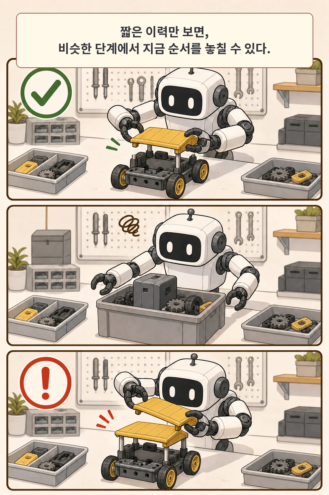
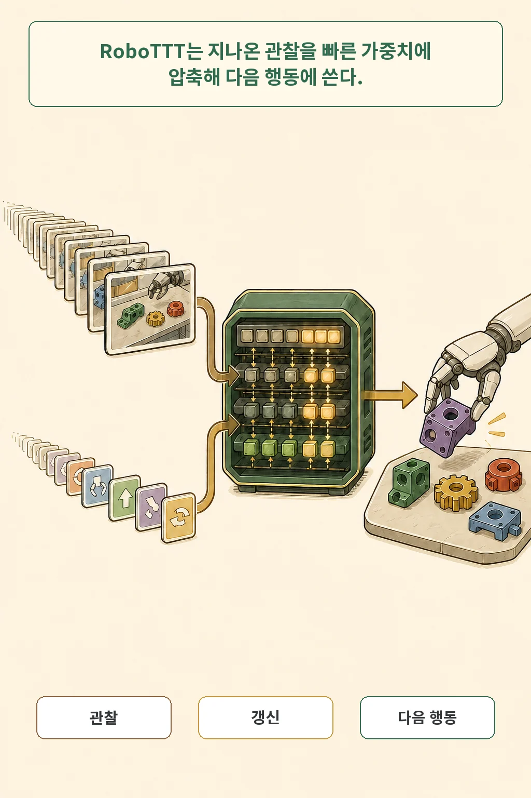
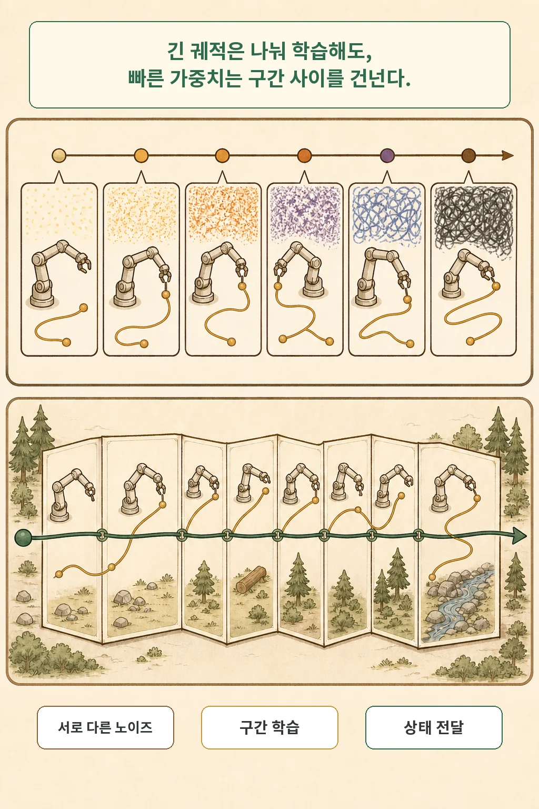
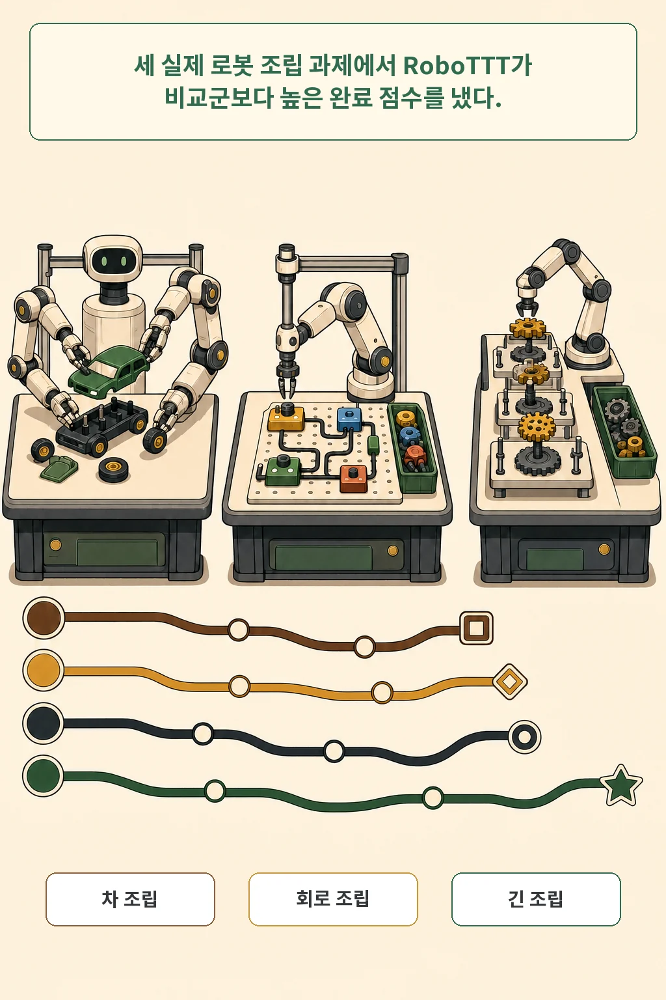

로봇 팔에게 장난감 자동차나 회로 기판을 조립하라고 맡기면, 초반 몇 단계까지는 곧잘 따라오다가 어느 순간 허공에서 멈칫거리는 경우가 많습니다. 카메라가 지금 보는 화면만으로는 방금 지붕을 끼운 직후인지, 아직 지붕을 집기 전인지 구분하기 어렵기 때문이죠. 2026년 7월 공개된 **RoboTTT** 논문은 지난 몇 분간의 영상을 KV 캐시에 통째로 쌓는 대신, 추론 중에 즉석으로 갱신되는 작은 **고속 가중치(Fast Weights)**에 작업 맥락을 압축해 넣는 해법을 제시했습니다.

글·해설: 다메카솔

## 핵심 내용

- **상태 앨리어싱 해소**: 한 프레임만 보는 기존 VLA 정책이 겉보기가 비슷한 조립 단계를 헷갈리는 문제를 추론 시점 가중치 갱신으로 풀었습니다.
- **고정 크기 기억**: `GR00T N1.7`의 DiT 액션 헤드에 작은 Test-Time Training(TTT) 층을 더해 8K 스텝에서도 스텝당 추론 비용을 일정하게 유지합니다.
- **장기 시퀀스 훈련**: 청크별 노이즈를 달리 주는 `Sequence Action Forcing`과 구간별 역전파(`TBPTT`)로 GPU 메모리 한계를 넘겼습니다.
- **검증과 경계**: NVIDIA YAM 양팔 로봇의 세 과제에서 평균 완료 점수 79%를 기록했으나, 특정 하드웨어 결과이며 공개 코드는 아직 없습니다.

## 상태 앨리어싱: 로봇은 왜 방금 한 일을 잊을까

예를 들어 로봇이 모형 자동차에 지붕 부품을 얹는 장면을 떠올려 봅시다. 지붕을 막 올려놓은 뒤 로봇 팔이 카메라 시야를 살짝 가리면, 현재 프레임 한 장만으로는 아직 조립 전인 상태와 모습이 거의 겹쳐 보입니다. 이때 과거 맥락을 놓치면 로봇은 이미 끝낸 부품을 다시 집으려 하거나 같은 동작을 되풀이하는 루프에 갇히고 맙니다.

그렇다고 과거 카메라 화면을 무작정 앞단에 이어 붙이면 문제가 풀릴까요? 논문 실험을 보면 오히려 역효과가 나기도 하거든요. 현재 시점만 보는 기준 모델이 Pup Go Car 과제에서 57%를 기록한 반면, 과거 프레임 한 장을 단순히 추가한 모델은 39.5%로 떨어졌습니다. 저자들은 불필요한 프레임이 늘어나면 우연한 상관관계가 끼어들고, 추론 시점의 시간 분포가 학습 때와 어긋나기 때문이라고 설명합니다.

## 고속 가중치로 작업 맥락을 압축하는 원리

RoboTTT는 지나간 사진들을 길게 늘어놓는 대신, 신경망 안의 작은 가중치 자체를 계속 고쳐 쓰는 작업 노트로 활용합니다. 새 관찰 토큰이 들어올 때마다 TTT 층은 자기지도 손실로 내부의 고속 가중치를 한 번씩 업데이트하고, 다음 시점에는 그 고정 크기 행렬만 넘기거든요. 덕분에 30Hz 제어 기준으로 4분이 넘는 8K 스텝 작업이 이어져도 한 스텝당 추론 비용이 컨텍스트 길이에 비례해 늘어나지 않고 일정하게 유지됩니다.

물론 지나간 모든 장면을 사진처럼 무손실로 보관하는 구조는 아닙니다. 바깥쪽 과제 손실이 초기 가중치와 갱신 규칙을 함께 학습하므로, 다음 행동을 고르는 데 꼭 필요한 단서만 가중치 공간에 남기는 셈이죠. 기존 사전학습 정책이 새 모듈 때문에 흔들리는 일을 막기 위해, 연구진은 각 TTT 층 출력 앞에 0에 가깝게 초기화한 학습 가능한 `tanh` 게이트를 달아 새 경로가 점진적으로 합류하도록 설계했습니다.

## 8K 장기 궤적을 메모리에 맞춰 훈련하는 법

긴 작업 이력을 학습할 때 가장 먼저 부딪히는 벽은 GPU 메모리 한계입니다. 8K 스텝 전체의 역전파 그래프를 한 번에 들고 있으면 메모리가 작업 길이에 맞춰 계속 늘어나기 때문입니다. 연구진은 이 병목을 풀기 위해 두 가지 학습 장치를 조합했습니다.

- **Sequence Action Forcing**: 궤적 안의 모든 액션 청크에 같은 난이도를 주지 않고 청크마다 다른 노이즈 레벨을 샘플링해 훈련을 안정화했으며, 제거 실험에서 빼자 폐루프 성능이 크게 떨어졌습니다.
- **구간별 역전파(TBPTT)**: 긴 궤적을 구간으로 나눠 기울기 계산은 구간 안에서만 수행하고, 고속 가중치 상태는 구간 경계를 넘어 끝까지 전달해 메모리를 아꼈습니다.

| 구성 요소 | 논문 적용 사양 |
| --- | --- |
| 액션 헤드 확장 | `GR00T N1.7` 16개 DiT 층마다 약 10M TTT 층 추가 (538M → 약 690M) |
| 사전·사후 학습 | 사전학습 8K 컨텍스트(GB200 16개·30K 스텝), 사후학습(GPU 8개·20K 스텝) |
| 평가 하드웨어 | RGB 카메라 4대를 장착한 NVIDIA YAM 양팔 로봇 |

## 실제 양팔 로봇 조립 벤치마크와 남은 한계

실제 로봇 실험은 Pup Go Car와 Circuit, 그리고 평균 5분 동안 10단계를 밟아야 하는 Gear Bot까지 세 가지 조립 과제로 진행됐습니다. 앞의 두 과제는 20회씩, 긴 Gear Bot은 10회씩 평가했고, 아래 표에서 보듯 추론 중 경사하강법으로 상태를 갱신하는 방식이 기존 기준선들을 앞섰습니다.

| 비교 항목 | RoboTTT | 비교 기준선 (최고 또는 주요 대조군) |
| --- | --- | --- |
| 세 과제 평균 완료 점수 | **79%** | GDN 56% · `GR00T N1.7 Hist.` 49% · `GR00T N1.7` 42% |
| 컨텍스트 확장 (DAgger 전) | 1K **43.9%** → 8K **71.5%** | 짧은 컨텍스트 최고 기준선 45.6% |
| 원샷 회로 시연 모방 (10회) | 완료 **65%** (완전 성공 6회) | GDN 33% (완전 성공 0회) |
| 외부 교란 복구 (지붕/타이어) | 지붕 **15/20** · 타이어 **18/20** | GDN 지붕 13/20 · 타이어 18/20 (동률) |
| Gear Bot 완전 성공 (10회) | **2회** | 세 비교군 모두 0회 |
| DAgger Distillation (100개 궤적) | **+36%** 개선 | GDN +29% (두 시퀀스 모델 평균 +33%) |

세 과제 평균으로 보면 RoboTTT는 현재 시점만 보는 모델보다 상대적으로 약 87%, 순환 상태 모델인 GDN보다 약 41% 높은 점수를 얻었습니다. 사람이 조립 도중 부품을 떼어내거나 한 번만 시연한 낯선 회로 구성을 따라 하는 조건에서도 긴 작업 맥락을 유지하며 복구력과 적응력을 보여 줬습니다.

하지만 이 수치만으로 상용 현장의 범용 성능을 기대하기에는 아직 이릅니다. 가장 긴 Gear Bot 과제의 완전 성공률이 열 번 중 두 번에 머물렀고, 연구진도 훈련 비용 증가와 로보틱스 전용 손실 함수의 필요성을 과제로 남겼거든요. 2026년 7월 기준으로 공식 프로젝트 페이지에 논문과 영상은 공개됐지만 코드와 데이터 저장소는 추후 제공 여부를 지켜봐야 하는 상태입니다.

## 다메카솔의 해석: 기억량보다 갱신 규칙의 설계

로보틱스에서도 무거운 KV 캐시를 계속 키우기보다 **무엇을 남기고 무엇을 덮어쓸지 학습한 고정 크기 상태**가 실무적인 대안이 될 수 있다는 점이 이번 논문의 핵심입니다. 특히 연산 자원이 제한된 엣지 로봇에서는 컨텍스트가 길어져도 스텝당 추론 비용이 일정하다는 특성이 큰 장점으로 작용하죠.

현장 적용을 검토할 때는 추론 중 실시간으로 바뀌는 가중치가 예상 밖의 동작을 낼 때 어떻게 감시하고 제동할지, 훈련 비용과 공개 코드 부재를 어떻게 감당할지 함께 따져봐야 합니다. 세 조립 과제가 열어 둔 가능성을 다른 로봇과 센서 환경에서도 재현할 수 있을지가 다음 관전 포인트입니다.

## 함께 읽을 AI 시스템 글

- [컴퓨터 사용 AI 에이전트의 GUI 제어 아키텍처(Tactile)](/posts/tactile-computer-use-agents/)
- [VLM 기하학적 토큰과 공간 추론(IE3D)](/posts/vlm-ie3d-geometry-tokens/)

## 출처

- [RoboTTT: Context Scaling for Robot Policies, arXiv:2607.15275](https://arxiv.org/abs/2607.15275)
- [NVIDIA GEAR Lab — RoboTTT Official Project Page & Demo Videos](https://research.nvidia.com/labs/gear/robottt/)
- [RoboTTT arXiv v1 원문 PDF](https://arxiv.org/pdf/2607.15275)
- [Creative Commons Attribution 4.0 International](https://creativecommons.org/licenses/by/4.0/)

이 글은 논문 원문과 공식 프로젝트 페이지를 바탕으로 해설했으며, 별도의 실험 재현이나 독립 측정은 포함하지 않았습니다.

이 글의 본문과 이미지는 생성형 AI로 제작했습니다. 기획과 편집 기준은 다메카솔이 정했습니다.
