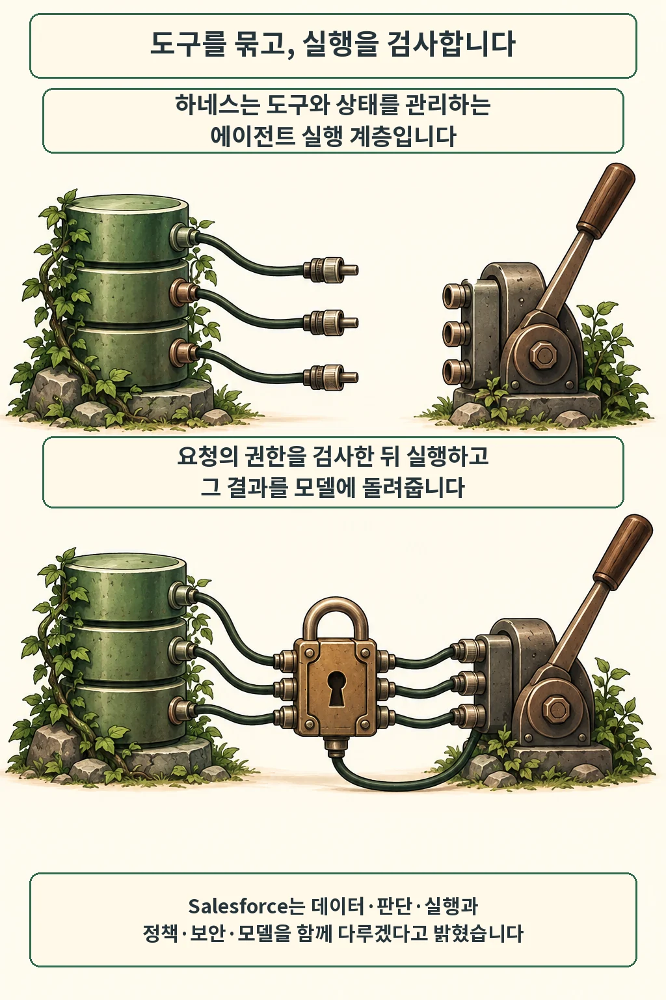
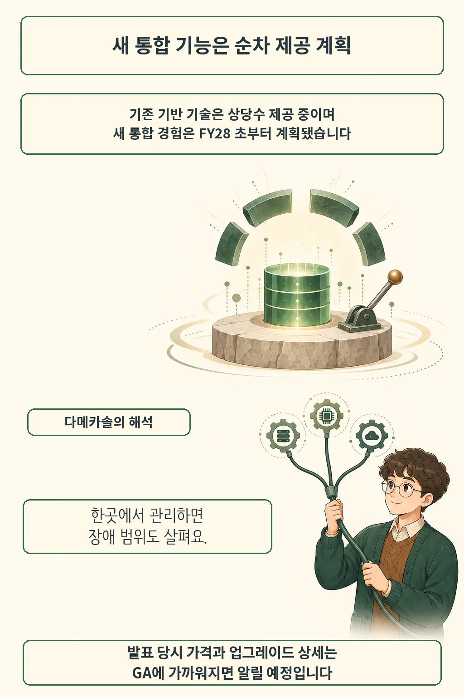

AI 에이전트를 사내 업무 시스템에 붙일 때 개발팀이 가장 먼저 부딪히는 문제는 모델 성능보다 도구 호출과 권한을 어디서 통제하느냐입니다. 에이전트마다 인증과 API 재시도 로직을 따로 짜 두면 정책이 바뀔 때마다 유지보수 비용이 눈덩이처럼 불어나거든요. Salesforce가 2026년 9월 10일 공개한 **Enterprise AI Harness**와 **AI Control Plane** 구상은 바로 이 실행·관리 계층을 공통 구조로 묶겠다는 계획입니다.

글·해설: 다메카솔

## 핵심 내용

- **공통 실행·관리 구조**: 데이터(context)·판단(agency)·실행(action)·정책(governance)·보안(security)·모델(models)을 하나로 묶는 설계 방향을 제시했습니다.
- **현재 제공과 향후 일정**: 기반 기술 상당수는 이미 제공 중이며, 새 기능과 통합 경험은 Salesforce 회계연도 기준 **FY28 초**부터 순차 공개될 예정입니다(가격·업그레이드 조건은 추후 안내).
- **도입 전 검증 포인트**: 공통 계층을 쓰면 정책 수정은 쉬워지지만 장애 반경도 넓어지므로, 재시도 상태 확인과 개별 시스템의 권한 거부를 분리해 시험해야 합니다.

## 하네스는 실행 흐름 어디에 끼어들까요

모델이 외부 도구를 부르겠다고 판단하더라도 실제 API를 호출하고 결과를 챙기는 역할은 별도 실행 계층이 맡습니다. Salesforce의 [하네스 설명](https://www.salesforce.com/agentforce/ai-agents/agent-harness/)은 바로 이 계층에서 작업 상태를 보관하고 권한을 검사한 뒤, 도구 실행 결과를 다시 모델에 돌려주는 구조를 다룹니다.

예를 들어 데이터 조회와 후속 변경 작업을 함께 수행하는 에이전트를 운영한다고 가정해 보겠습니다. 하네스가 중간에서 요청마다 권한을 확인하고 처리 상태를 기록해 주면, 에이전트 코드마다 인증 검사나 복구 로직을 중복 구현할 필요가 줄어듭니다. 이번 [공식 발표](https://www.salesforce.com/news/stories/enterprise-ai-harness/)는 여기에 여섯 영역을 한데 엮고 **AI Control Plane**으로 에이전트 활동을 한곳에서 관리하려는 구상을 담았죠.

다만 두 문서는 모두 Salesforce가 직접 작성한 1차 자료입니다. 회사가 제시한 설계 방향을 파악하는 데는 유용하지만, 실제 운영 환경에서 독립적으로 검증된 성능이나 안정성 수치는 빠져 있다는 점도 함께 구분해 읽어야 합니다.

## 지금 쓸 수 있는 기반과 FY28 계획의 경계

발표문을 볼 때 가장 먼저 가려내야 할 대목은 지금 쓸 수 있는 기능과 앞으로 나올 통합 경험의 시차입니다. 기반 기술 상당수는 현재도 제공되고 있지만, 새 기능과 통합 경험은 회사 회계연도 기준 **FY28 초**부터 순차 제공될 예정이거든요. 여기서 FY28은 Salesforce의 회계연도 표기이므로 달력상의 2028년 출시일과는 구분해 읽어야 합니다.

| 구분 | 공개 자료 기준 상태 | 실무 확인 포인트 |
| --- | --- | --- |
| **기존 기반 기술** | 상당수 현재 제공 중 | 현행 라이선스 범위와 연동 가능 여부 확인 |
| **새 통합 기능·경험** | 회계연도 FY28 초부터 순차 제공 예정 | 달력 연도가 아닌 회계연도 기준 일정 점검 |
| **가격·업그레이드** | 정식 출시(GA)에 가까워지면 추후 안내 | 계약 단위·추가 비용 확정 전까지 예산 보류 |

가격과 패키지, 업그레이드 상세 조건 역시 정식 출시(GA)에 가까워져야 안내되며, 2026년 9월 11일 확인 기준 공개 자료는 여기까지입니다. 실제 도입을 검토한다면 같은 제품 묶음 안에서도 당장 계약해 쓸 수 있는 기능과 향후 추가될 기능을 나누어 확인하는 편이 좋습니다.

## 다메카솔의 해석: 관리가 모이면 장애 반경도 함께 봅니다

실행 계층을 한곳에 모으는 설계를 볼 때는 관리 편의성만큼 장애 영향 범위도 따져 보게 됩니다. 공통 검사 지점을 두면 정책 변경 시 수정 범위가 줄어드는 대신, 그 지점의 장애가 여러 업무 흐름을 동시에 멈출 위험도 따라오기 때문입니다.

가령 데이터 조회는 성공했는데 후속 변경 API 호출이 시간 초과된 가상 시나리오를 떠올려 볼까요? 설명을 위해 가정한 이 상황에서 실행 계층이 앞선 요청의 처리 여부를 모른 채 모델에게 단순히 "다시 해보라"고 넘기면, 이미 반영된 변경 작업이 중복 실행될 수 있습니다. 요청 식별자와 처리 결과를 실행 계층에 보관하고, 재시도 전에 이전 작업 상태를 먼저 확인하도록 설계해야 하는 이유가 여기에 있습니다.

또한 공통 관리 화면이 있다고 해서 각 업무 시스템의 권한 검사가 자동으로 끝났다고 보기는 어렵습니다. 앞서 [Claude 평가 사고 재분석](/posts/claude-cyber-incidents-alignment-assessment/)에서 살핀 것처럼 설명과 실제 실행 경계에는 차이가 생기기 쉽거든요. 도입 전 개발팀은 아래 세 가지 경로를 각각 분리해 시험할 필요가 있습니다.

1. **정상 완료**: 권한 검사를 통과한 도구 호출이 상태를 정확히 기록하고 모델로 결과를 반환하는지 확인합니다.
2. **권한 거부**: 중앙 정책과 개별 하위 시스템의 권한 차단 신호가 우회 없이 전달되는지 점검합니다.
3. **실행 계층 장애**: 타임아웃이나 일시 중단 시 요청 식별자 기반으로 중복 실행 없이 복구되는지 시험합니다.

앞으로 공개될 통합 기능이 이 경계를 어디까지 책임질지가 남은 확인 과제입니다.

## 출처

- [Salesforce — Enterprise AI Harness 발표 (2026-09-10)](https://www.salesforce.com/news/stories/enterprise-ai-harness/): 발표 범위와 제공 계획.
- [Salesforce — Agent Harness 설명](https://www.salesforce.com/agentforce/ai-agents/agent-harness/): 실행 계층 개념. 날짜 표기 없음, 2026-09-11 확인.

Salesforce 공식 발표와 설명 문서를 바탕으로 정리했으며, 별도 실행 측정은 포함하지 않았습니다.
이 글의 본문과 이미지는 생성형 AI로 제작했습니다. 기획과 편집 기준은 다메카솔이 정했습니다.
